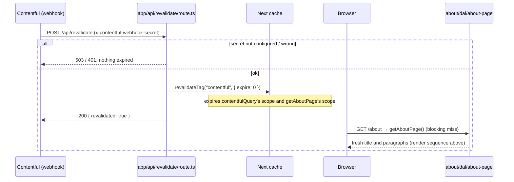

# Design

## Context

- The footer links «О проекте» to `/about` (`FOOTER_LINK_PATHS.about`), and no page answers
  there yet (`site-footer` FR-4).
- The home greeting already reads a `greeting` entry from Contentful through
  `features/home/dal/home-greeting.ts`: a GraphQL query on `greetingCollection(where: { key })`,
  a Zod schema in `model/`, and a `{ ok: true } | { ok: false, reason }` result. On failure,
  home falls back to static copy.
- `shared/lib/contentful` provides `contentfulQuery` (its own `"use cache"` scope, 60 s,
  always tagged `CONTENTFUL_CACHE_TAG`) and `ContentfulError` with `kind`
  `config | network | auth | graphql | http`.
- `POST /api/revalidate` verifies the webhook secret and calls
  `revalidateTag(CONTENTFUL_CACHE_TAG, { expire: 0 })`: every cache scope carrying that tag
  expires at once. It is not configured on a deployed site yet (deferred deploy item).
- CI builds with no `CONTENTFUL_*` variables. A page that prerenders a Contentful read at build
  time must therefore survive a `config` failure.
- `features/authors/dal/public-authors.ts` already solves "a failure must not be frozen into the
  build": the DAL owns its `"use cache"` scope and sets the lifetime after the read
  (`"hours"` / `"minutes"` / `"seconds"`).
- `features/breadcrumbs` uses a mirror `@breadcrumbs` slot (one slot page per real page,
  checked by `app/tests/breadcrumbs-slot.test.ts`) and a route table on named path constants.

## Goals / Non-Goals

**Goals**

- `/about` renders the `about_page` entry's title and paragraphs, fully on the server.
- Any failure shows the existing error screen, never stale or invented text.
- A Contentful publish refreshes `/about` through the existing webhook.
- The CI build (no Contentful env) still passes.

**Non-Goals**

- A new content type, rich text, or images.
- Changing home's fallback, the webhook endpoint, or the Contentful client.
- `metadata` titles.

## Decisions

### D1 — A new feature, `features/about`, with its own DAL and schema

```
src/features/about/
├── dal/about-page.ts                 # getAboutPage(): Promise<AboutPageResult>, server-only, owns the cache scope (D2)
├── model/about-page.schema.ts        # Zod for the greetingCollection response; AboutPageEntry
├── model/about-page.types.ts         # AboutPageFailureReason, AboutPageResult
├── components/AboutPage/             # Suspense boundary + fallback (D3)
├── components/AboutContent/          # async loader: awaits the DAL, throws on failure (D4)
├── components/AboutArticle/          # sync view: <h1> + paragraphs (D5)
├── components/AboutPlaceholder/      # Suspense fallback (D3)
├── tests/
└── index.ts                          # exports AboutPage only
```

The route file `app/(public)/about/page.tsx` renders `<main>` (same wrapper classes as `/authors`)
with `<AboutPage />` inside. No logic, no cache directive (D2 puts the scope in the DAL).

*Alternatives considered:*

- Reuse `getHomeGreeting` by making it `getGreeting(key)` and importing it from `@/features/home`.
  Rejected: `about` would depend on `home` for an unrelated page, and the two need different
  cache scopes and failure handling (home: page-level scope + fallback; about: DAL-level
  result-dependent scope + throw).
- Move the `greeting` query and schema into `shared/lib/contentful`. Rejected: the client is
  infrastructure and stays free of content types (ADR 0001: data access stays with the feature
  that owns it). The cost is two ~10-line Zod schemas describing the same content type; if the
  type changes in Contentful, both fail validation loudly (home falls back, about shows the
  error screen), so a drift can't pass silently.

`getAboutPage()` mirrors `getHomeGreeting()`'s body: one query with
`ABOUT_PAGE_KEY = "about_page"`, `limit: 1`; a `ContentfulError` becomes
`{ ok: false, reason: error.kind }` (logged once, with the status only for `auth`/`http`); a
schema failure is `validation`; an empty `items` is `not-found`; any other error is rethrown.
Log prefix: `[contentful] about page failed`.

### D2 — Cache scope in the DAL, lifetime chosen by the result

```ts
export async function getAboutPage(): Promise<AboutPageResult> {
  "use cache";
  cacheTag(CONTENTFUL_CACHE_TAG);
  const result = await readAboutPage();
  cacheLife(result.ok ? "minutes" : "seconds");
  return result;
}
```

- **Tag.** The scope tags itself with `CONTENTFUL_CACHE_TAG` directly (as home's page does), so
  the webhook's `revalidateTag` expires it without relying on tag propagation from
  `contentfulQuery`'s inner scope. This is FR-3; no change to `/api/revalidate`.
- **Success → `"minutes"`.** Same lifetime as home. Without a webhook, a publish shows within
  3 minutes (FR-3): each of the two nested scopes (this one and `contentfulQuery`'s 60 s one)
  serves its stale copy once while it refreshes, so the worst case is about two refresh
  cycles plus the request gaps. Longer would only matter once the webhook is
  configured in production, and `"minutes"` is the established Contentful lifetime here.
- **Failure → `"seconds"`.** A short-lived scope is not baked into the prerendered shell, so the
  CI build (no env → `config` failure) leaves `/about`'s content as a hole streamed at request
  time inside D3's Suspense boundary, and a Contentful outage is never frozen into the shell:
  once Contentful is back, `/about` recovers within about a minute (the failure still sits in
  `contentfulQuery`'s own 60 s scope, R4). This is the `authors` public-read pattern (`cacheForResult`).
- `readAboutPage` returns failures as plain values (never throws a `ContentfulError` across the
  scope), as `docs/state-management.md` requires for cached functions.
- The route file gets no `"use cache"`: the page has no other data, and a page-level scope
  would include the throw path (D4) in the prerender.

This departs from `docs/state-management.md`'s "a Contentful DAL function adds no cache scope of
its own"; NFR-6 documents the exception.

*Alternative considered:* home's pattern (page-level `"use cache"` + `cacheLife("minutes")`).
Rejected: home never throws (it falls back), while about must throw on failure (FR-2). A throw
inside a prerendered page scope at build time with no env would fail `npm run build` in CI.

### D3 — `AboutPage`: Suspense boundary inside the feature

`AboutPage` renders `<Suspense fallback={<AboutPlaceholder />}><AboutContent /></Suspense>`, per
`docs/code-style.md` (boundaries live in the feature's component, not the route file).
`AboutPlaceholder` is what the shell shows while the content streams (only when the content is a
dynamic hole: a failed or expired read). Its look follows the approved mockup and the
`app/loading.tsx` pattern: a `role="status"` with a visually hidden «Загрузка…», then
`aria-hidden` skeleton blocks (`rounded bg-surface animate-pulse motion-reduce:animate-none`):
a title bar one title line high (`h-9`, `sm:h-10`, matching D5's heading sizes) at 60% width (max 420 px), then a `max-w-prose` column of three paragraph
groups (`gap-6`) of `h-4` lines (`gap-3`) with ragged last lines. With a cached
success the shell already holds the article and the placeholder is never seen.

### D4 — `AboutContent`: throw on failure, let `app/error.tsx` render

```ts
export async function AboutContent() {
  const result = await getAboutPage();
  if (!result.ok) throw new Error(ABOUT_CONTENT_UNAVAILABLE);
  return <AboutArticle entry={result.entry} />;
}
```

- The error boundary in `app/error.tsx` covers every segment; it shows fixed copy and a retry
  that re-requests from the server. That is FR-2's screen, with the header and the footer from
  the root layout.
- The breadcrumb trail stays too (FR-2, FR-4): the throw happens inside the `children` slot,
  and each parallel slot gets its own boundary from `app/error.tsx`, so the `@breadcrumbs`
  slot's `about/page.tsx` keeps rendering «Главная › О проекте». This is the same behaviour
  `/authors/<id>` already shows on a failed read. Gate 3 (task 4.3) checks it in a browser.
- The thrown message is a fixed internal constant (`ABOUT_CONTENT_UNAVAILABLE`, declared in the
  component file, not shown to readers): it never includes the reason, payload, or status. The
  reason is already in the DAL's log line.
- Because the throw happens inside a streamed Suspense boundary, the HTTP status of a failed
  `/about` may be 200 (the shell was already sent). FR-2 asserts the screen, not a status.
- Precedent: `features/authors/components/AuthorPageContent` already throws to `error.tsx` after a
  cached DAL failure, the same way.
- `AboutContent` is an async Server Component and is not rendered in Vitest. Its branching is
  tested by calling it as a function with a mocked DAL (`await AboutContent()` resolves to an
  element on success and rejects on failure), the way `SiteFooter` is tested.

### D5 — `AboutArticle`: plain-text paragraphs via a shared splitter

- Props: `{ entry: Pick<AboutPageEntry, "title" | "message"> }`.
- Renders the `<h1>{title}</h1>` (`text-3xl font-bold tracking-tight` below 640 px and
  `sm:text-4xl` above; home and the error screen keep `text-4xl`) and an `<article>` with one
  `<p className="whitespace-pre-line">` per paragraph.
  From the approved mockup: the article is `max-w-prose` (65ch), `flex flex-col gap-6`,
  `text-prose-compact leading-relaxed` (15 px) below 640 px and `sm:text-lg` above (the mobile
  sizes are smaller than the mockup: user decision, 2026-10-21), in `foreground` (not `muted`:
  long prose needs full contrast). The heading and the article sit in the route's
  `<main>` (`gap-8`, items start-aligned). Token utilities only (NFR-4).
- Paragraphs come from `splitParagraphs(text)` in a new `src/shared/lib/split-paragraphs.ts`:
  `text.split(/\n\s*\n/)`. It is the exact regex `HomeGreeting` uses today; `HomeGreeting`
  switches to the shared function (no behaviour change). Two features now need it, which meets
  the architecture rule for creating a `shared/` helper.
- No Markdown or HTML parsing (NFR-3): text goes in as React children.

### D6 — `ABOUT_PATH` in `shared/config/constants.ts`

- `ABOUT_PATH = "/about"` next to `HOME_PATH`. `FOOTER_LINK_PATHS.about` becomes `ABOUT_PATH`
  (the object keeps its shape, so the footer's code and tests are unchanged).
- `breadcrumbs`' `STATIC_ROUTES` gains `{ path: ABOUT_PATH, label: BREADCRUMB_LABELS.about }`,
  with `about: "О проекте"` in `breadcrumbs-messages.ts` (UI copy table). `buildTrail` adds
  «Главная» as for every static row.
- `app/@breadcrumbs/about/page.tsx` renders `<Breadcrumbs segments={Promise.resolve(["about"])} />`,
  which `breadcrumbs-slot.test.ts` then finds automatically.
- The footer and breadcrumbs keep their own copy of the «О проекте» label: copy belongs to the
  feature that shows it (`docs/code-style.md`).

### D7 — Testing

- `tests/model/about-page.schema.test.ts`: valid payload trimmed; missing/empty/whitespace
  `title` or `message` fails; missing collection fails.
- `tests/dal/about-page.test.ts` (mocked `contentfulQuery`): success; each `ContentfulError` kind
  → its reason, logged once with status only for `auth`/`http`; `validation`; `not-found`; a
  non-Contentful error rethrows; `cacheTag(CONTENTFUL_CACHE_TAG)` always, `cacheLife("minutes")`
  on success, `"seconds"` on failure (NFR-2; spies on the global `next/cache` mock).
- `tests/components/AboutContent.test.tsx`: resolves to the article on success; rejects on
  failure without the reason in the message.
- `tests/components/AboutArticle.test.tsx`: FR-1's example; NFR-3's markup-as-text example.
- `shared/lib/tests/split-paragraphs.test.ts`: blank lines, whitespace-only lines, single
  breaks kept, no separator → one paragraph. Home's existing tests stay green unchanged.
- `breadcrumbs` tests: `matchRoute(["about"])` and `buildTrail` give Главная › О проекте.
- Browser (Gate 3): FR-2 with a broken token, FR-4, FR-5, NFR-1 network list. FR-3 by `curl` to
  `/api/revalidate` with the local secret after publishing an edit (as the home greeting's
  change did). `tests/dal/about-page.integration.test.ts` (required; user decision, 2026-10-21) calls
  `getAboutPage()` against the real Contentful space (no `fetch` or module mocks) and expects
  `{ ok: true }` with a non-blank title and message. It is skipped (`describe.skipIf`) when
  `CONTENTFUL_SPACE_ID` or `CONTENTFUL_ACCESS_TOKEN` is unset, so CI stays green without
  secrets. Unlike `home-greeting.integration.test.ts`, which stubs `fetch`, it does reach the
  network: its job is to catch a renamed or unpublished `about_page` entry.

### D8 — Documentation (NFR-6)

`docs/architecture.md`: the `(public)/about/page.tsx` and `@breadcrumbs` lines, `features/about/`
in the tree, `ABOUT_PATH` on the `shared/config` line, `split-paragraphs.ts` under `shared/lib`.
`docs/state-management.md`: under Server caching → Data, the exception for a Contentful DAL that
owns a result-dependent scope, with `features/about/dal/about-page.ts` as the example.

### Sequence diagrams

Render, success and failure:

```mermaid
sequenceDiagram
    participant B as Browser
    participant Pg as app/(public)/about/page.tsx (RSC)
    participant AP as about/AboutPage (Suspense)
    participant AC as about/AboutContent
    participant D as about/dal/about-page
    participant C as shared/lib/contentful (contentfulQuery)
    participant CF as Contentful GraphQL API
    participant E as app/error.tsx

    B->>Pg: GET /about
    Pg->>AP: render
    AP->>AC: render inside Suspense (fallback AboutPlaceholder)
    AC->>D: getAboutPage()
    alt cache hit (tag CONTENTFUL_CACHE_TAG not expired)
        D-->>AC: cached AboutPageResult
    else miss
        D->>C: contentfulQuery(AboutPage, { key: "about_page" })
        C->>CF: POST GraphQL (token read inside the client)
        alt Contentful answers with data
            CF-->>C: { greetingCollection: { items } }
            C-->>D: data
            D->>D: Zod parse, pick first item
        else config / network / auth / graphql / http
            C-->>D: throws ContentfulError(kind)
        end
        D->>D: result → cacheLife("minutes") if ok, "seconds" otherwise; log one line on failure
        D-->>AC: AboutPageResult
    end
    alt build-time prerender and result is a failure
        Note over D,AC: "seconds" lifetime: the scope is a request-time hole, AboutContent never resolves at build, so the throw never runs during prerender (R1). The shell holds AboutPlaceholder.
    else ok
        AC-->>B: <article><h1/>paragraphs</article> (HTML, no client JS of its own)
    else failure (any reason), at request time
        AC->>E: throw Error(ABOUT_CONTENT_UNAVAILABLE)
        E-->>B: «Что-то пошло не так» + «Повторить» (header, breadcrumb trail, and footer stay)
    else non-Contentful error inside the read
        D-->>AC: rethrown (not cached as a result)
        AC->>E: propagates to the error boundary
        E-->>B: same error screen
    end
```

Publish → fresh page (unchanged endpoint, new scope expired by the same tag):



## Risks / Trade-offs

- **R1 — The build-time behaviour of a throw after a `"seconds"` scope is unverified.** D2
  relies on Next 16 treating a short-lived `"use cache"` result as a request-time hole, so the
  throw in D4 never runs during `next build`. The `/authors` list relies on the same hole at
  build; `/authors/[id]` throws like D4 but isn't prerendered, so neither settles R1 alone. Runtime check: task 4.2's `npm run build` with every `CONTENTFUL_*`
  variable empty (CI has them unset) must succeed (NFR-2), and its output must contain the
  `[contentful] about page failed` line with reason `config`, which proves the failure path
  actually ran during prerender rather than the build silently reading real settings. If it fails, the fallback is to keep D2 and have
  `AboutContent` call `connection()` before throwing on failure; that is a design revision via
  `opsx-update-review`, not a silent workaround.
- **R2 — Two schemas for one content type** (D1). Accepted; a drift fails loudly on both pages.
- **R3 — A failed `/about` may answer HTTP 200** (D4). Accepted: the reader sees the error
  screen; search engines aren't a concern for this project yet.
- **R4 — The `contentfulQuery` scope caches a failure for 60 s.** After Contentful recovers,
  `/about` may keep showing the error screen for up to a minute; the retry button can't skip
  it. Same as home's fallback window; accepted.
- **R6 — The webhook expiring the prerendered shell relies on tag propagation.** With Contentful
  reachable at build, the article lands in `/about`'s static shell. The webhook expiring that
  shell depends on the DAL scope's `CONTENTFUL_CACHE_TAG` propagating to the route, as the
  authors pages already rely on for their tags (ADR 0005). The dev server builds no shell, so
  task 4.3 checks FR-3 against `npm run build && npm start` with real settings, not only
  `npm run dev`.
- **R7 — Duplicated failure mapping and log redaction** (Gate 1 finding 1). `readAboutPage`
  repeats home's `ContentfulError → reason` mapping and its "status only for `auth`/`http`"
  log rule. Accepted for this change: both DALs' tests pin the rule, and extracting a shared
  helper would also rewrite the home DAL, which this change otherwise leaves alone. A
  candidate follow-up if a third Contentful page lands.
- **R5 — The entry may not exist yet in a given Contentful environment.** The user reports it
  exists (2026-10-21); task 2.1 checks it before the DAL is written.

## Migration Plan

No data or config migration. The deployed webhook remains the existing deferred deploy item.

## Scaffold map

| File | Role | Exports |
| --- | --- | --- |
| `src/shared/config/constants.ts` | add the path constant | `ABOUT_PATH` |
| `src/shared/lib/split-paragraphs.ts` | blank-line paragraph split | `splitParagraphs` |
| `src/features/about/model/about-page.schema.ts` | Zod for the collection response | `aboutPageCollectionResponseSchema`, `AboutPageEntry` |
| `src/features/about/model/about-page.types.ts` | result types | `AboutPageFailureReason`, `AboutPageResult` |
| `src/features/about/dal/about-page.ts` | server-only read + cache scope | `getAboutPage` |
| `src/features/about/components/AboutPage/AboutPage.tsx` | Suspense wrapper | `AboutPage` |
| `src/features/about/components/AboutContent/AboutContent.tsx` | async loader, throws on failure | `AboutContent` |
| `src/features/about/components/AboutArticle/AboutArticle.tsx` (+ `.types.ts`) | view | `AboutArticle`, `AboutArticleProps` |
| `src/features/about/components/AboutPlaceholder/AboutPlaceholder.tsx` | Suspense fallback | `AboutPlaceholder` |
| `src/features/about/index.ts` | public API | `AboutPage` |
| `src/app/(public)/about/page.tsx` | route | default `AboutRoutePage` |
| `src/app/@breadcrumbs/about/page.tsx` | breadcrumbs slot page (final code, D6) | default `AboutBreadcrumbs` |
| `knip.jsonc` | temporary ignores for the stubs; removed in tasks 1.1, 1.2, and 3.2 | — |

Written after the files existed (scaffold, 2026-10-21): every row matches the files on disk.
The route file renders `<AboutPage />` only; task 3.3 adds its `<main>` wrapper. The schema
holds the loose field shape; task 2.2 tightens it.
