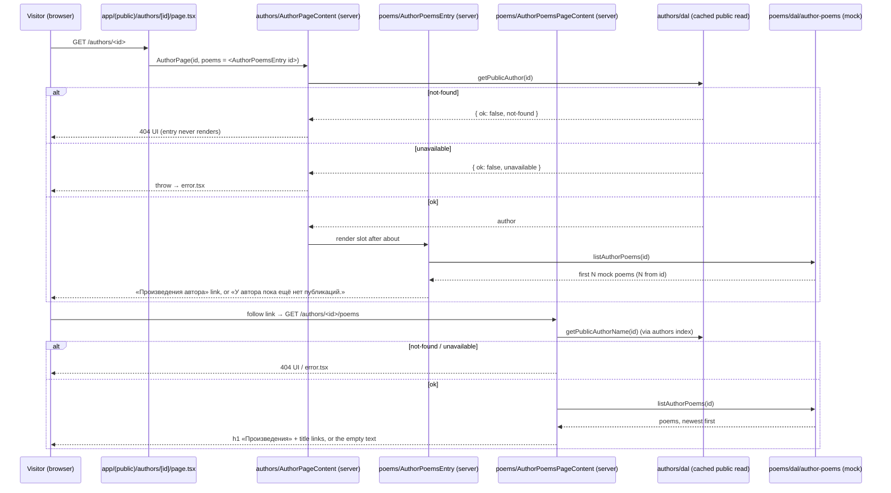
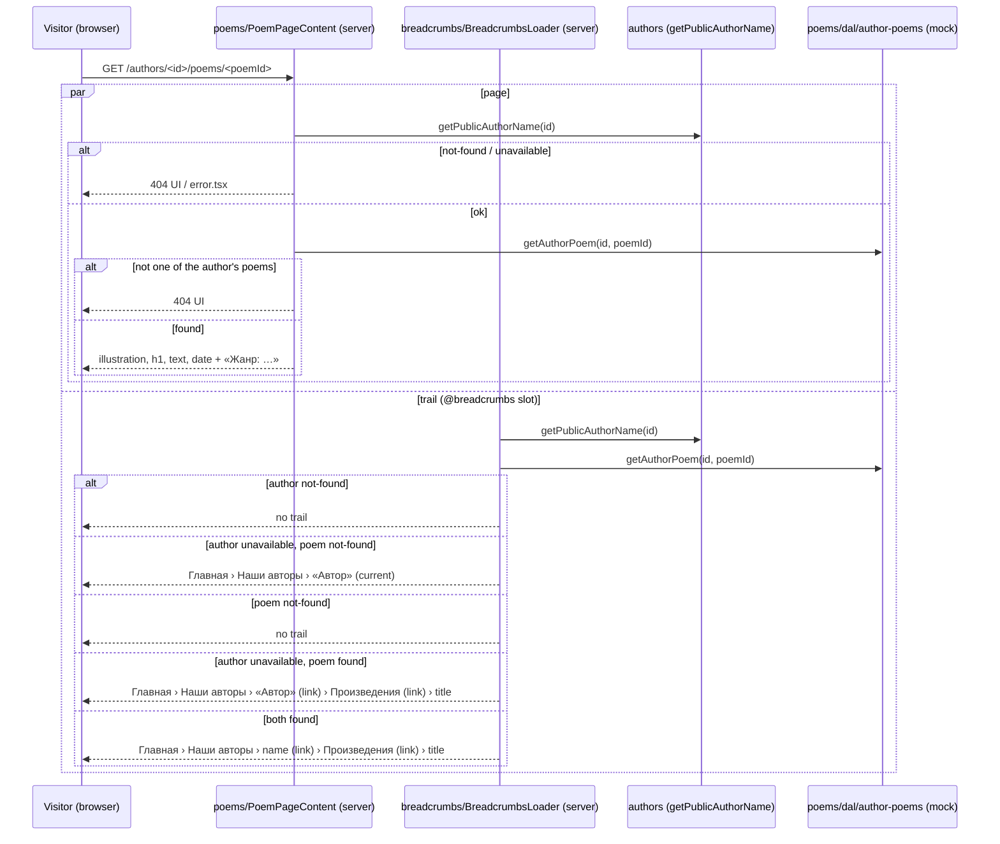

# Design

## Context

- `/authors/[id]` (`app/(public)/authors/[id]/page.tsx`) renders authors' `AuthorPage` with the
  `params` promise mapped to the id. `AuthorPage` owns the Suspense boundary and skeleton;
  `AuthorPageContent` awaits `getPublicAuthor` (cached, result-dependent lifetime), calls
  `notFound()` on not-found and throws on unavailable, then renders `AuthorProfileView` with an
  `ownerLink` slot (`ReactNode`) for the per-request owner check. The view is: owner link, h1
  full name, photo, about.
- `getPublicAuthorName(id)` (authors' public API, server-only) returns
  `{ ok: true, name } | { ok: false, reason: "not-found" | "unavailable" }` through the same
  cache scope; a non-UUID id is `not-found` before any scope opens.
- The `poems` feature today is the starter template's client code, used only by the home page:
  a mock `fetchPoems` behind TanStack `queryOptions`, a Zustand search store, `PoemSearch`,
  `PoemList`, `PoemCard`. No spec owns it except `feedback-tones` FR-4 (PoemList's error alert)
  and `route-groups` FR-7 (home holds "the poems list").
- The home page (`app/(public)/page.tsx`) is a `"use cache"` body (`cacheLife("minutes")`,
  `cacheTag(CONTENTFUL_CACHE_TAG)`) that awaits the greeting and prefetches the poems query into
  a `HydrationBoundary`. `getQueryClient` is otherwise used only by `app/providers.tsx`.
- Breadcrumbs: `matchRoute(segments)` maps a URL to `none`, `static`, or `author` (exactly one
  segment after `/authors`); `BreadcrumbsLoader` reads the author name for an `author` match;
  `buildTrail` hides the trail on not-found and shows «Автор» on unavailable. Every page needs a
  mirror page under `app/@breadcrumbs/` (`app/tests/breadcrumbs-slot.test.ts` checks).
- Cross-feature rule (`docs/architecture.md`): a feature may import another feature's public API
  server-side, never in both directions. `breadcrumbs` already imports `authors`.
- `next/image` serves a `src` ending in `.svg` unoptimized automatically (Next.js Image docs,
  `dangerouslyAllowSVG` section), so local SVG illustrations need no config change.

## Goals / Non-Goals

**Goals**

- An author's poem list and poem pages, public and server-rendered, on mock data behind a DAL
  that a database read can replace without touching pages or components.
- The author page links to the list or says there are no publications.
- Home shows only the greeting, as a banner.

**Non-Goals**

- Creating, editing, deleting poems; a poems table; poem ownership rules (separate change).
- Pagination, sorting controls, search, a global poem catalogue.
- Per-page `<title>` metadata (no page sets one today).
- Removing TanStack Query from the app: `Providers` keeps it for future client-side server
  state; only the poems usage goes.

## Decisions

### D1 — Module layout

```
src/features/poems/
├── dal/
│   ├── mock-poems.ts          # import "server-only"; MOCK_POEMS: readonly Poem[] (4, definition order = FR-7's "first N")
│   ├── mock-poem-count.ts     # mockPoemCount(authorId) + MOCK_POEM_COUNT_VARIANTS (D2); mock-only, so it lives with the mock
│   └── author-poems.ts        # import "server-only"; listAuthorPoems, getAuthorPoem (D3)
├── model/
│   ├── poem.types.ts          # Poem, AuthorPoemResult
│   ├── poem.constants.ts      # POEMS_SEGMENT, ILLUSTRATION_WIDTH/HEIGHT/SIZES, PUBLISHED_DATE_FORMAT options
│   ├── poems-messages.ts      # every UI copy string (NFR-7) + getIllustrationAlt, formatGenreLine
│   ├── poem-paths.ts          # authorPoemsPath(authorId), authorPoemPath(authorId, poemId)
│   ├── compare-poems.ts       # newest publication date first
│   └── format-published-date.ts # "12 марта 2026 г." (D5)
├── components/
│   ├── AuthorPoemsEntry/      # async: the author page's link or empty text (FR-1)
│   ├── AuthorPoemsPage/       # Suspense boundary + skeleton for /authors/[id]/poems
│   ├── AuthorPoemsPageContent/# async: author check, list read → AuthorPoemList (FR-2, FR-3, FR-5)
│   ├── AuthorPoemList/        # sync view: h1, ul of title links or the empty text
│   ├── PoemPage/              # Suspense boundary + skeleton for the poem route
│   ├── PoemPageContent/       # async: author check, poem read → PoemView (FR-4, FR-5)
│   └── PoemView/              # sync view: illustration, h1, paragraphs, footer
├── tests/                     # mirrors the above
└── index.ts                   # AuthorPoemsEntry, AuthorPoemsPage, PoemPage, getAuthorPoem,
                               # authorPoemsPath, POEMS_SEGMENT, POEMS_PAGE_TITLE
```

Removed: `api/`, `components/{PoemSearch,PoemList,PoemCard}`, `model/{filter-poems,poems-ui.store}`,
and their tests. Each component folder carries its `*.types.ts` per `docs/code-style.md`.

The whole feature is server-only: its index exports the DAL, and `poem-paths.ts` builds on
`authorPagePath` from `@/features/authors` (newly exported), whose index is server-only too.
No module has `"use client"` (NFR-1).

`MOCK_POEMS` and `mockPoemCount` live in `dal/`, not `model/`: they stand in for the database,
only `author-poems.ts` imports them (NFR-3), and the database swap deletes them together without
leaving dead code in `model/` (Gate 1). `model/` keeps what outlives the mock: types, paths, copy,
date format, sorting, and `POEMS_SEGMENT`.

### D2 — Which poems an author gets (FR-7)

`mockPoemCount(authorId)`: the sum of the UTF-16 code units of `authorId.toLowerCase()`, modulo
`MOCK_POEM_COUNT_VARIANTS` (5) — a number from 0 to 4. `listAuthorPoems` takes
`MOCK_POEMS.slice(0, count)`. Pure, no randomness, no clock, so it is identical on every request,
build, and machine. Lowercasing keeps an uppercase spelling of the same UUID on the same count.
Every value is reachable: raising one decimal digit of the UUID by one (`0`→`1`, …, `8`→`9`)
raises the sum by one, so the tests can build a UUID for each count. (Across `9`→`a` the jump is
40, so the tests use digit edits only.)

Rejected: a hash library (a dependency for mock data), `crypto` digests (async in the browser
API, overkill), a hand-kept id list (breaks on any other database, user decision 2026-10-24).

### D3 — DAL contract (NFR-3)

```ts
// model/poem.types.ts
export interface Poem {
  readonly id: string;            // lowercase slug, unique in the set
  readonly title: string;
  readonly text: string;          // plain text, blank line between stanzas
  readonly illustrationSrc: string; // "/mock-poems/<id>.svg"
  readonly publishedAt: string;   // ISO date "YYYY-MM-DD"
  readonly genre: string;
}
export type AuthorPoemResult =
  | { readonly ok: true; readonly poem: Poem }
  | { readonly ok: false; readonly reason: "not-found" };

// dal/author-poems.ts
export async function listAuthorPoems(authorId: string): Promise<readonly Poem[]>;   // newest first
export async function getAuthorPoem(authorId: string, poemId: string): Promise<AuthorPoemResult>;
```

Both are `async` so the database version keeps the signature. `getAuthorPoem` looks the id up in
`listAuthorPoems(authorId)` by exact, case-sensitive id equality, so another author's poem, a
poem past the author's count, or a differently cased id is `not-found` (FR-5; user decision,
2026-10-24: unlike the author id, the poem id is not lowercased). Neither validates the author id: callers check the author first (D4), and the
mock does no I/O, so junk ids cost nothing.

No `"use cache"` scope: the mock reads no data and no clock. When a database replaces it, the
DAL adds its own result-dependent scope and an `unavailable` reason, per
`docs/state-management.md`'s Supabase public reads — a widening of `AuthorPoemResult` the
callers then handle. That belongs to the CRUD change.

### D4 — Pages and the author check (FR-2..FR-6)

Route files compose, features render:

```tsx
// app/(public)/authors/[id]/poems/page.tsx
<main className="mx-auto flex w-full max-w-4xl flex-1 flex-col gap-8 px-6 py-16">
  <AuthorPoemsPage authorId={params.then(({ id }) => id)} />
</main>

// app/(public)/authors/[id]/poems/[poemId]/page.tsx
<main …same…>
  <PoemPage authorId={params.then(({ id }) => id)} poemId={params.then(({ poemId }) => poemId)} />
</main>
```

`AuthorPoemsPageContent` and `PoemPageContent` each start with
`getPublicAuthorName(await authorId)`: `not-found` → `notFound()`; `unavailable` →
`throw new Error(...)` (the route's `error.tsx`, as `AuthorPageContent` does). The name itself is
not shown on the page (the trail shows it). Then they read the DAL; `PoemPageContent` calls
`notFound()` on `getAuthorPoem`'s `not-found`.

The Suspense wrappers (`AuthorPoemsPage`, `PoemPage`) mirror `AuthorPage`: an `aria-hidden`
skeleton of `bg-surface animate-pulse motion-reduce:animate-none` blocks (list: a heading block
and three line blocks; poem: an illustration block at the illustration's aspect ratio, a heading
block, three line blocks). Params are awaited only inside the boundary, so both routes are
partially prerendered (NFR-4).

### D5 — Views (FR-2, FR-3, FR-4, NFR-6)

- `AuthorPoemList({ authorId, poems })`: h1 «Произведения» (`text-4xl font-bold tracking-tight`,
  as the author page heading); `poems.length === 0` → `<p className="text-muted">` with the empty
  text; else `<ul className="flex flex-col gap-3">` of `next/link` items to
  `authorPoemPath(authorId, poem.id)`, text `text-lg`, `text-foreground hover:text-accent`
  with an accent focus outline.
- `PoemView({ poem })`: `<article lang={CONTENT_LANG}>` holding `next/image`
  (`src={poem.illustrationSrc}`, `alt={getIllustrationAlt(poem.title)}`,
  `width={ILLUSTRATION_WIDTH}` 800, `height={ILLUSTRATION_HEIGHT}` 450, `sizes`, `preload`,
  `className="h-auto w-full rounded-2xl bg-surface"`), the h1 title, the text through
  `splitParagraphs` (shared) into `<p className="whitespace-pre-line">` blocks inside a
  `flex flex-col gap-6 italic text-lg leading-[1.7]` wrapper (16 px below 640 px, per the
  mockup; React escapes them: FR-4's literal markup), and `<footer className="flex flex-wrap gap-x-4 gap-y-1 text-sm text-muted">`
  with `<time dateTime={poem.publishedAt}>{formatPublishedDate(poem.publishedAt)}</time>` and
  `formatGenreLine(poem.genre)`.
- `formatPublishedDate(iso)`: `new Intl.DateTimeFormat("ru-RU", { day: "numeric", month: "long",
  year: "numeric", timeZone: "UTC" }).format(new Date(`${iso}T00:00:00Z`))` → «12 марта 2026 г.».
  UTC on both sides, so the server's time zone never shifts the day. Parsing a fixed string is
  not a current-time read, so Cache Components allows it outside a cache scope.
- `AuthorPoemsEntry({ authorId })`: awaits the id, reads `listAuthorPoems`; at least one poem →
  `next/link` «Произведения автора» to `authorPoemsPath(authorId)` (`text-accent` underline-on-hover
  link, the project's link look on the author page); none → `<p className="text-muted">` empty
  text. It reads no session, so every visitor sees the same entry (FR-1, FR-6).

Exact spacing and the link look follow the approved Claude Design mockup (see the project's UI
flow); the classes above are the starting point, tokens only (NFR-5).

### D6 — Author page slot (FR-1, NFR-2)

`AuthorPage` gains `poems: ReactNode`, passed through `AuthorPageContent` to `AuthorProfileView`,
which renders it last inside its `<article>`, after the about section (or the photo). The route
composes it:

```tsx
// app/(public)/authors/[id]/page.tsx
const id = params.then(({ id }) => id);
<AuthorPage id={id} poems={<AuthorPoemsEntry authorId={id} />} />
```

The slot element is created in the route but renders inside `AuthorPage`'s Suspense boundary
and only after the profile resolved, so a not-found author never reads poems. `authors` imports
nothing from `poems`; `poems` imports `authors` (D1, D4). Same pattern as `ownerLink`.

Rejected: `AuthorPageContent` reading poems itself (authors → poems while poems → authors: a
cycle); moving the poem pages into `authors` (a god feature that the CRUD change would grow
further).

### D7 — Breadcrumbs (FR-8)

- `RouteMatch` gains `{ kind: "author-poems"; authorId }` and
  `{ kind: "author-poem"; authorId; poemId }`. `matchRoute` replaces `matchAuthorId` with one
  function over the segments after `/authors`: `[id]` → `author`; `[id, POEMS_SEGMENT]` →
  `author-poems`; `[id, POEMS_SEGMENT, poemId]` → `author-poem`; anything else → `none`.
  `/authors/a/b` stays `none` (FR-6 of breadcrumbs).
- `BreadcrumbsLoader` reads `getPublicAuthorName` for all three author kinds, and for
  `author-poem` also `getAuthorPoem(authorId, poemId)` (in parallel).
- `buildTrail(match, authorName, poem)`, in this order: author `not-found` → none; author
  `unavailable` and poem `not-found` → Главная › Наши авторы › «Автор» (current); poem
  `not-found` → none; otherwise Главная › Наши авторы › name-or-«Автор» (a link to `authorPagePath(id)` on the
  deeper pages, current on the author page) › «Произведения» (link on the poem page, current on
  the list) › poem title (current).
- Imports: `POEMS_SEGMENT`, `POEMS_PAGE_TITLE`, `authorPoemsPath`, `getAuthorPoem` from
  `@/features/poems`, and `authorPagePath` (newly exported, D1) from `@/features/authors` — no
  `"poems"` literal in breadcrumbs. Slot pages:
  `app/@breadcrumbs/authors/[id]/poems/page.tsx` (segments `["authors", id, "poems"]`) and
  `…/poems/[poemId]/page.tsx` (`["authors", id, "poems", poemId]`).

`breadcrumbs` → `poems` → `authors` and `breadcrumbs` → `authors`: no cycle.

### D8 — Home banner (FR-9, FR-10)

`app/(public)/page.tsx` keeps its `"use cache"`, `cacheLife("minutes")`, and Contentful tag, and
renders only `<HomeGreeting greeting={resolveGreeting(await getHomeGreeting())} />` inside
`<main>`; the TanStack imports and `HydrationBoundary` go. `HomeGreeting`'s root becomes
`<section className="flex flex-col gap-3 rounded-2xl border border-border bg-surface px-6 py-10
sm:px-10 sm:py-14">` around the same h1 and paragraphs (final values from the mockup). Content
behaviour (`home-greeting` FR-4..FR-7) is unchanged.

`getQueryClient` and `Providers` stay (Non-Goals); `docs/state-management.md`'s TanStack
section keeps the conventions but drops the claim that the home page uses them.

### D9 — Mock content and illustrations (FR-7)

Four poems in `MOCK_POEMS`, original Russian placeholder verse written for this change, each
two or three stanzas; genres «Лирика», «Сонет», «Элегия», «Верлибр»; distinct dates in 2026,
none in the future relative to 2026-10-24. Illustrations: `public/mock-poems/<id>.svg`, 800 × 450,
abstract shapes, no text, no external references, no scripts.

### D10 — Testing

- Model and mock: `mockPoemCount` (determinism, lowercase equivalence, a constructed UUID for each of
  0..4), `compare-poems`, `format-published-date` (`2026-03-12` → «12 марта 2026 г.», a
  1 January date in a negative-offset `TZ` stays 1 January), `poem-paths`, `poems-messages`
  helpers.
- DAL: `listAuthorPoems` returns the first N in newest-first order; `getAuthorPoem` found /
  past the author's count / unknown; the mock set: four poems, unique slug ids, ISO dates,
  every `illustrationSrc` file exists under `public/`.
- Components (Vitest renders the sync views; async ones are called as functions and their
  output rendered, as the authors tests do): `AuthorPoemList` (links and order, empty state),
  `PoemView` (element order, alt, `<time datetime>`, paragraphs and line breaks, literal
  markup), `AuthorPoemsEntry` (link vs empty text, mocked DAL), the two `*Content` components
  (`notFound` on not-found author and poem, throw on unavailable), `AuthorProfileView` renders
  the slot after the about section, `HomeGreeting` banner container.
- Breadcrumbs: `matchRoute` and `buildTrail` rows for both routes, every author/poem outcome.
- Static checks (file-reading tests, as `breadcrumbs/tests/server-only-trail.test.ts`): no
  `"use client"` and no auth/Supabase import in `features/poems` (NFR-1); no `features/poems`
  import in `features/authors` (NFR-2); `mock-poems` imported only by `dal/author-poems.ts`
  (NFR-3); no old home poem code in `src/` (FR-10).
- Browser (Gate 3): the author page entry both ways, list → poem navigation, 404s, the trail,
  the banner; `home-search-filter.spec.ts` deleted, `home-renders.spec.ts` asserts the banner
  heading and no `main` list.

### D11 — Retry lock that refreshes page and trail (FR-11, FR-12)

`RootError` holds `const router = useRouter()` and `const [isPending, startTransition] =
useTransition()`; «Повторить» runs `startTransition(() => { router.refresh(); reset(); })` and
gets `disabled={isPending}`; while pending, the screen's `<main>` carries `aria-busy="true"`
(mockup artboard 15).

- **Why not `retry()`.** Next's `retry()` "re-fetch[es] and re-render[s] the error boundary's
  children" (Next.js docs, `error.js`). The `@breadcrumbs` slot is a sibling of the root
  boundary's children, not inside it, so after a successful `retry()` the trail could keep the
  failed request's «Автор» above a recovered page (user decision, 2026-10-24: page and trail
  must always agree on screen). `router.refresh()` re-requests the whole current route, page and
  slots in one RSC payload, so both come from one request (and D12's shared read); `reset()`
  then clears the boundary so the refreshed children render.
- **Why the lock holds.** `retry` returns nothing, but `router.refresh()` inside a transition
  keeps `isPending` true until the refreshed payload has rendered — the pattern
  `features/authors` `RetryButton` already relies on. React flushes a discrete event's updates
  before the next event, so a second click meets a disabled button.
- `RootErrorProps` gains `reset: () => void` (Next passes `error`, `reset`, `retry`); `retry`
  stays in the type but is no longer called.

Rejected: `retry()` alone (leaves the trail stale); `retry()` plus `router.refresh()` (two
fetches of the same route); a `useRef` in-flight flag cleared on a timer (guesses the duration);
hiding the button while pending (focus would drop to `<body>`).

### D12 — One read per request for page and trail (FR-12)

`getPublicAuthor` (authors DAL) becomes `export const getPublicAuthor = cache(async (id) => …)`
with React's `cache`, wrapping the existing UUID check and the `"use cache"` call.
`getPublicAuthorName` keeps calling it, so the page (`AuthorPageContent`,
`AuthorPoemsPageContent`, `PoemPageContent`) and the trail (`BreadcrumbsLoader`, in the
`@breadcrumbs` slot of the same request) get one shared promise per id. `getAuthorPoem` (poems
DAL) gets the same `cache` wrapper.

Why it is needed although `"use cache"` exists: after D14 a failed read is never stored, so two
separate calls in one request are two separate chances to fail — one can fail while the other
succeeds (or reads a stale entry that a just-finished refresh replaced). One shared promise per
request rules that out, independent of how the framework schedules concurrent cache fills. `React.cache` is
scoped to one request (Next.js docs, "Reusing data with React.cache"), so nothing leaks between
visitors, and it adds no cache lifetime of its own.

### D13 — Last navigation wins (FR-13)

The App Router already discards a navigation superseded by a newer one, and the `@breadcrumbs`
slot renders in the same RSC payload as the page, so page and trail switch together. No code is
added for this; FR-13 is a guarantee checked in the browser (Gate 3) and recorded as an
end-to-end scenario, so a later change (for example, client-side fetching on these pages) can't
break it unnoticed.

### D14 — Failures are thrown inside the cache, returned outside it (FR-14, FR-15)

Today `listPublicAuthors` and `cachedPublicAuthor` return `unavailable` from inside their
`"use cache"` scope with `cacheLife("seconds")`. A returned value is a cache entry, so when a
stale `"hours"` entry is refreshed in the background and the read fails, the failure replaces
it. Next.js does not store a `"use cache"` function's thrown error: the wrapper rejects, drops
its in-flight entry, and a stale entry stays (`use-cache-wrapper.ts`; the same rule the ISR docs
state: "the last successfully generated data will continue to be served").

New shape, per read (`features/authors/dal/public-authors.ts`):

```ts
async function cachedPublicAuthor(id) {                  // "use cache" scope
  "use cache";
  cacheTag(authorTag(id));
  const result = await readPublicAuthor(id);             // logs the failure once, as today
  if (!result.ok && result.reason === "unavailable") throw new Error(UNAVAILABLE_MARKER); // not cached
  cacheLife(result.ok ? "hours" : "minutes");            // success / not-found only
  return result;
}

export const getPublicAuthor = cache(async (id) => {     // D12: one call per request
  if (!authorIdSchema.safeParse(id).success) return NOT_FOUND;
  try {
    return await cachedPublicAuthor(id);
  } catch (error) {
    unstable_rethrow(error);                             // Next's own control flow passes through
    await connection();                                  // request-time only: never prerendered
    return UNAVAILABLE;
  }
});
```

`listPublicAuthors` gets the same split (`cachedPublicAuthors` + an uncached exported wrapper).
`cacheForResult` loses its `"seconds"` branch.

- **No cache yet (FR-14).** Concurrent callers in one process join the leader's in-flight
  invocation (`use-cache-wrapper.ts` dedup), and `React.cache` joins the page and the trail
  (D12): one read. A failure rejects all of them, is not stored, and the wrapper's
  `connection()` makes the result request-time, so an env-less build or a database outage during
  the build leaves a dynamic hole instead of a baked-in failure (the reason the `"seconds"`
  lifetime existed). The next request reads again.
- **Expired, refresh fails (FR-15).** The stale entry keeps being served; the failed refresh
  logs once and is retried on a later request. The window ends at the profile's `expire`
  (`"hours"`: 1 day): past that, or after the owner's `updateTag`, there is no good entry and the
  visitor gets FR-14's failure path.
- `not-found` stays a cached value (`"minutes"`), so random UUIDs still cost one read per
  minute, not one per request.
- **No reliance on error identity.** A value crossing a `"use cache"` boundary is serialized,
  so whether a thrown class instance keeps its identity is a framework detail this project does
  not depend on (migrate-to-cache-components design D1, `shared/lib/contentful/client.ts`). The
  wrapper never inspects what it caught: `unstable_rethrow` (`next/navigation`) passes Next's
  control-flow errors (`notFound`, postpone, hanging-promise and prerender-interrupted
  rejections) back up, and every other rejection means "the read did not produce a cacheable
  result", which is `unavailable`. That is exact today: `readPublicAuthor` / `readPublicAuthors`
  already catch and log every error of their own and return a value, so the only rejections
  the cached function can produce are the marker and the framework's. The marker's message
  (`UNAVAILABLE_MARKER`, a named constant) is for logs and readability only.
- **Accepted decisions.** This replaces ADR 0005 Decision 3's "`seconds` for unavailable" and
  `docs/state-management.md`'s "Failures are returned as plain values, never thrown" for public
  reads. Task 1.3 records ADR 0008 (superseding that point of 0005, whose status line then names
  0008) and rewrites the doc's "Supabase public reads" section in the same group, so the next
  public read (the poems database read in the CRUD change) follows the new rule.

Rejected: keeping a last-good copy in module memory (per-instance, unbounded, duplicates the
framework's cache); `revalidateTag(…, "max")` tricks (they govern invalidation, not failed
refreshes).

### Sequence diagrams

Author page entry and list page:



Poem page and its trail:



Retry on the error screen (FR-11):

```mermaid
sequenceDiagram
    participant V as Visitor (browser)
    participant E as app/error.tsx RootError (client)
    participant N as Next.js router / error boundary
    participant S as Server (page RSC, cached author read)

    V->>E: click «Повторить»
    E->>E: startTransition(() => { router.refresh(); reset() }) → isPending = true, button disabled
    V->>E: click again (ignored: button disabled)
    E->>N: router.refresh() + reset()
    N->>S: re-request the route: page and @breadcrumbs slot in one payload
    alt read succeeds
        S-->>N: RSC payload (page + trail from one request)
        N-->>V: page replaces the error screen, trail shows the name (transition ends)
    else read fails again
        S-->>N: error
        N-->>E: error screen again, isPending = false, button enabled
    end
```

Public author read and the cache (D12, D14):

```mermaid
sequenceDiagram
    participant P as Page or trail (server component)
    participant W as authors getPublicAuthor (React.cache, uncached wrapper)
    participant C as cachedPublicAuthor ("use cache" scope)
    participant DB as Supabase (anon, public rows)

    P->>W: getPublicAuthor(id)
    alt id is not a UUID
        W-->>P: { ok: false, not-found } (no scope opened)
    else same id already read in this request
        W-->>P: the same promise (page and trail share it)
    else first call in this request
        W->>C: cachedPublicAuthor(id)
        alt fresh entry
            C-->>W: cached result
        else stale entry
            C-->>W: stale result now; background refresh starts
            C->>DB: select (refresh)
            alt refresh ok / not-found
                DB-->>C: rows → entry replaced (hours / minutes)
            else refresh fails
                DB--xC: error → logged once, marker thrown, entry NOT replaced (stale kept)
            end
        else no entry (cold, expired past expire, or after updateTag)
            C->>DB: select
            alt ok
                DB-->>C: row → cacheLife("hours"), stored
                C-->>W: { ok: true, author }
            else not-found
                DB-->>C: no row → cacheLife("minutes"), stored
                C-->>W: { ok: false, not-found }
            else unavailable
                DB--xC: error → logged once, marker thrown, nothing stored
                C--xW: rejection
                W->>W: unstable_rethrow(error); await connection()
                W-->>P: { ok: false, unavailable } (request-time only)
            end
        end
        W-->>P: result
    end
```

## Risks / Trade-offs

- **Retry recovery (D11).** That `router.refresh()` + `reset()` in a transition recovers the root
  boundary and refreshes the trail is the documented pre-`retry` pattern, but Gate 3 confirms it
  in the browser: make the author read fail, restore it, click «Повторить» twice, and check the
  button stays disabled until the page and the trail («Анна Ахматова», not «Автор») both show.
- **Unverified framework behaviour (D14).** That a failed background refresh keeps the stale
  `"use cache"` entry is read from Next's source and the ISR docs, not from the `use cache` page
  itself, and an hour-long revalidate window can't be waited out in a browser pass. Task 1.3
  checks it once with a throwaway probe: a temporary short `cacheLife({ revalidate: 5 })` on the
  author read in a local `next build && next start`, the local Supabase stack stopped after the
  first load, the page reloaded past the window. The probe also checks that each failed read
  writes exactly one server log line (Next might log a rejected `"use cache"` call itself). It is
  backed up and restored by copy, never committed. If the stale entry isn't kept, or a failure
  logs twice, the change pauses for a decision.
- **Memoized failure (D12).** With `React.cache`, a failed author read stays failed for the
  whole request: page and trail fail together, which is the point; the next request reads again.

- **The mock split is arbitrary.** Code-unit sums cluster, so counts aren't evenly spread across
  real authors; acceptable for placeholder data, and each count is reachable (D2).
- **Owners see «нет публикаций» with no way to add one** until the CRUD change. Accepted (user
  scope decision, 2026-10-24).
- **Poem URLs change later.** Mock ids are slugs; database ids will likely be UUIDs, so
  `/authors/<id>/poems/<slug>` links won't survive the switch. Nothing links to them from
  outside the site yet.
- **Soft 404.** Inside a streamed boundary `notFound()` renders the 404 UI with status 200, as on
  `/authors/<id>` (design D5 of add-author-profiles).
- **Page and trail reads** share one `getPublicAuthor` promise per request (D12), so a poem page
  costs one author read at most; the mock read is free.
- **Every author shares the same titles.** "First N of four" means two authors with poems show
  the same poems. Fine for mocks; noted so nobody reads it as a bug.

## Migration Plan

No data or configuration to migrate. Deploy as usual; rollback is a revert. Delete
`tests/web-qa-scenarios/home-search-filter.spec.ts` in the same change so the replay set never
expects the removed search.
