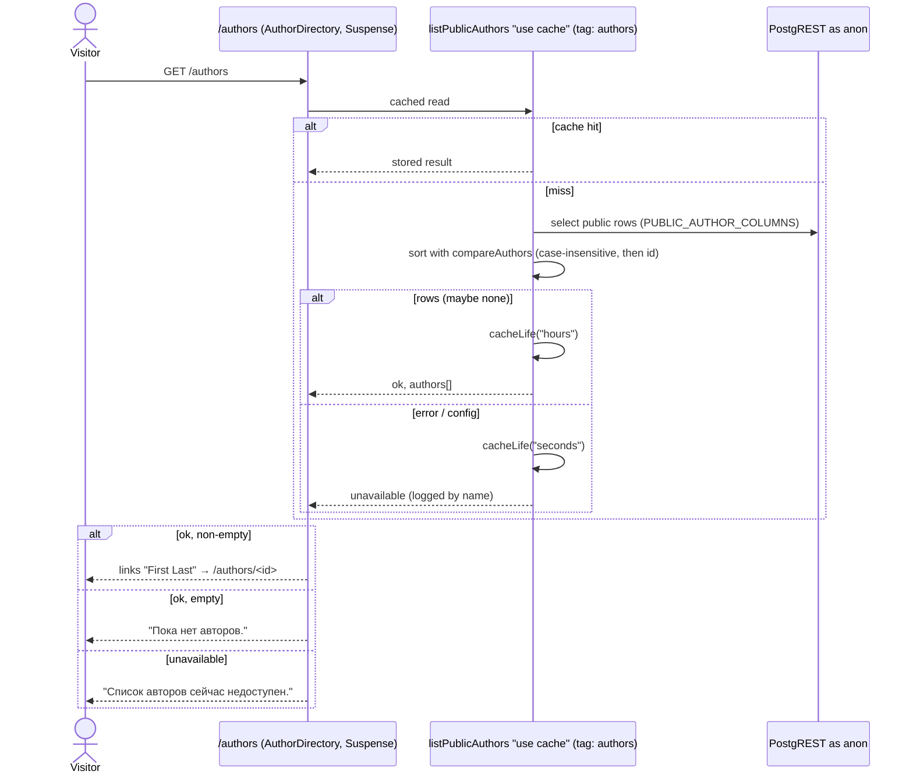

# Design

## Context

See `proposal.md` (Why, Requirements). Current state that shapes the approach:

- **Auth** (ADR 0003, ADR 0004). Sessions live in `@supabase/ssr` cookies. The proxy refreshes them on every request. `features/auth/dal/is-signed-in.ts` answers "signed in?" on the server with `getClaims()` and never throws. No browser Supabase client exists, and this change adds none.
- **Server Actions.** They are built with `next-safe-action`. Each feature has its own action client whose `handleServerError` logs only the error's `name` and returns a generic message (`features/auth/actions/action-client.ts`). Forms use `useActionState`, never `useAction`.
- **Cache Components is on.**
  - Caching is `"use cache"` + `cacheLife` + `cacheTag`.
  - Nothing inside a cache scope may read cookies.
  - A cached function returns a plain, serializable result.
  - Reading cookies outside `<Suspense>` fails the build. So every per-request read sits in a feature component inside its own Suspense boundary (`docs/code-style.md` "Route files compose").
- **`(authorized)/` has no pages and enforces nothing.** `route-groups` FR-8 forbids pages there today.
- **No `supabase/migrations/` yet.** `supabase/config.toml` exists for the local CLI stack, and `supabase` is a devDependency.
- **`next.config.ts`** has no `images` or `serverActions` settings. The Server Action body limit defaults to 1 MB. `next/image` in Next 16 refuses to optimize images from local IPs unless `images.dangerouslyAllowLocalIP` is set.

## Goals / Non-Goals

**Goals:**
- One owner-scoped table and one bucket. RLS is the last line of defense, not the only one (NFR-2).
- Per-field writes. Each write uses the action-client error policy shared with auth (`shared/lib/safe-action`), so poems can copy the pattern later.
- Public pages served from cache. Expiry is driven by the owner's writes; no time-based polling is needed for correctness.
- Business rules in pure `model/` functions: validation, visibility, image sniffing, Markdown toolbar edits, and failure mapping. Components stay thin.

**Non-Goals:**
- A browser Supabase client or direct-to-Storage uploads from the browser.
- Generated database types (`supabase gen types`). Rows are parsed with Zod at the DAL boundary, as Contentful responses already are.
- A shared toast system. The "Сохранено" notification is feature-local until a second feature needs one.
- An `updated_at` column or trigger. Nothing reads it.

## Decisions

### D1. Module layout: a new `features/authors`; `auth` gains one server-only accessor

```
src/shared/ui/TextField/            # promoted from features/auth AuthField: labelled input + error wiring (user decision 2026-10-15)
src/shared/lib/safe-action/
└── create-action-client.ts         # createActionClient({ logPrefix, genericMessage }) — one log/mask policy (Gate 1 P3)
src/features/authors/
├── actions/
│   ├── action-client.ts            # authorsActionClient = createActionClient({ logPrefix: "authors", … })
│   └── author-profile.actions.ts   # "use server": saveName, saveAbout, savePhoto, deleteField
├── dal/
│   ├── my-author-profile.ts        # getMyAuthorProfile() — per request, cookie client, owner's row
│   ├── public-authors.ts           # getPublicAuthor(id), listPublicAuthors() — "use cache"
│   └── author-profile-writes.ts    # writeOwnProfile, clearProfileField, replacePhoto, removePhoto
├── model/
│   ├── author.types.ts             # AuthorProfile, PublicAuthor, ProfileField, ProfileFailure, form states
│   ├── author.constants.ts         # NAME_MAX_LENGTH 60, ABOUT_MAX_LENGTH 1000, PHOTO_MAX_BYTES, bucket, tags
│   ├── author-profile.schema.ts    # Zod input schemas (shared by the actions and the DAL's row parsing)
│   ├── author-messages.ts          # UI copy, failure → message
│   ├── is-public-profile.ts        # FR-4 rule, mirrored by the RLS policy
│   ├── has-profile-content.ts      # a row with no content field reads as "no profile" (D3)
│   ├── compare-authors.ts          # directory order: case-insensitive last, first, then id (D5)
│   ├── profile-form-state.ts       # action result + draft → field form state
│   ├── detect-image-type.ts        # magic-byte sniffing (FR-8)
│   ├── validate-photo-file.ts      # size + type check, run in the browser before submit and again in the action
│   ├── markdown-format.ts          # toolbar edits as pure (text, selection) → (text, selection)
│   ├── classify-profile-error.ts   # PostgREST / Storage / config errors → ProfileFailure
│   └── author-cache-tags.ts        # authorsTag, authorTag(id)
├── components/                      # see D6
├── tests/
└── index.ts
```

- **`features/auth` gains `dal/current-user.ts` with `getCurrentUserId(): Promise<string | null>`.** It is server-only and never throws, and it calls `connection()` first, like `isSignedIn`. It also gains `requireUserId(): Promise<string>`, which calls `redirect("/login")` when there is no user. `isSignedIn()` becomes `(await getCurrentUserId()) !== null`, so one function owns the claims read. Both are exported from `@/features/auth`. (FR-20 reworks this: `getSessionState()` becomes the base function and `requireSession()` replaces `requireUserId()`; see D9.)
- **`features/authors` imports `getCurrentUserId` / `requireUserId` from `@/features/auth`,** the public API, never internals. The dependency is one-way (`authors → auth`), and `auth` never imports `authors`. *Alternative rejected:* each authors module calling `supabase.auth.getClaims()` itself. That duplicates the one place where "who is signed in" is decided, which ADR 0004 put in `auth/dal`. *Alternative rejected:* composing only in `app/`. Actions are endpoints and must resolve the user themselves (NFR-2), and an action cannot receive the user id from a route file.
- **`shared/lib/safe-action/create-action-client.ts`** (server-only) holds the error policy both features need: log `[<prefix>] action failed: <error.name>`, return the generic message, and use the `"flattened"` validation shape. `features/auth/actions/action-client.ts` is rewritten on top of it, with behavior unchanged and its existing tests still green. A second consumer now exists, which is the rule's trigger for moving code to `shared/` (`docs/architecture.md`). It also keeps the security-relevant "never log the input" policy from drifting between copies (Gate 1 P3).
- **`shared/lib/supabase/public.ts`** (server-only) adds `createSupabasePublicClient()`. It is a cookie-less `createClient(url, publishableKey, { auth: { persistSession: false, autoRefreshToken: false } })`, usable inside `"use cache"` because it reads no request data. It returns an anon-role client, so RLS returns only public rows. This follows the precedent of an infrastructure client in `shared/lib` (`docs/architecture.md`).

### D2. Data model and RLS (first migration)

`supabase/migrations/<timestamp>_author_profiles.sql`:

```sql
create table public.author_profiles (
  id          uuid primary key default gen_random_uuid(),
  user_id     uuid not null unique references auth.users (id) on delete cascade,
  -- A whitespace-only name written straight through PostgREST must not count as a name (FR-4). Blank means
  -- what JS trim() removes; one-argument btrim strips only U+0020 (code-review fix, 2026-10-15).
  first_name  text check (first_name is null or char_length(first_name) <= 60 and first_name !~ E'^[\t\n\u000B\f\r \u00A0\u1680\u2000-\u200A\u2028\u2029\u202F\u205F\u3000\uFEFF]*$'),
  last_name   text check (last_name  is null or char_length(last_name)  <= 60 and last_name  !~ E'^[\t\n\u000B\f\r \u00A0\u1680\u2000-\u200A\u2028\u2029\u202F\u205F\u3000\uFEFF]*$'),
  about       text check (about      is null or char_length(about) <= 1000 and about !~ E'^[\t\n\u000B\f\r \u00A0\u1680\u2000-\u200A\u2028\u2029\u202F\u205F\u3000\uFEFF]*$'),
  about_align text not null default 'left' check (about_align in ('left', 'center', 'right')),
  -- A photo path must live in this profile's own folder, so no one can point at another author's file.
  -- The exact format, not just the first segment: `<id>/../<other>/…` would pass a prefix check and
  -- resolve to another author's file in the public URL (Gate 1 N2).
  photo_path  text check (photo_path is null or photo_path ~ ('^' || id::text || '/[0-9a-f]{8}-[0-9a-f]{4}-[0-9a-f]{4}-[0-9a-f]{4}-[0-9a-f]{12}\.(png|jpg)$')),
  created_at  timestamptz not null default now()
);

alter table public.author_profiles enable row level security;

create policy "public profiles are readable by anyone" on public.author_profiles
  for select to anon, authenticated
  using (first_name is not null and last_name is not null);
create policy "owners read their own profile" on public.author_profiles
  for select to authenticated using ((select auth.uid()) = user_id);
create policy "owners update their own profile" on public.author_profiles
  for update to authenticated
  using ((select auth.uid()) = user_id) with check ((select auth.uid()) = user_id);
-- No insert policy: rows are created only by ensure_my_author_profile().
-- No delete policy: the app clears fields, never deletes the row (proposal Out of Scope).

-- Column privileges (Gate 1 C3, P5; code-review CR-01). The policies decide which rows; these decide
-- which columns. No client role can select or write user_id; a policy compares it without a privilege.
revoke all on public.author_profiles from anon, authenticated;
grant select (id, first_name, last_name, about, about_align, photo_path) on public.author_profiles to anon, authenticated;
grant update (first_name, last_name, about, about_align, photo_path) on public.author_profiles to authenticated;

-- "My profile" without exposing user_id: security definer, empty search_path, no user-id argument, the
-- caller from auth.uid() only; execute granted to authenticated alone.
create function public.ensure_my_author_profile() returns uuid ...;   -- insert … on conflict (user_id) do nothing; return id
create function public.my_author_profile_id() returns uuid ...;       -- the caller's id, or null
create function public.owns_author_profile(folder text) returns boolean ...;  -- for the storage policies
```

- **Column privileges close two gaps that RLS alone leaves open (Gate 1 C3).**
  - **Mass assignment.** A signed-in user calling PostgREST directly with the publishable key can update only the five content columns of their own row. They cannot touch `id`, `user_id`, or `created_at`, and cannot insert at all.
  - **The photo-path rule is a table check, not app logic.** A direct `PATCH` that sets `photo_path` to another profile's file fails the check. The check pins the whole format (`<own id>/<uuid>.png|jpg`), so dot segments can't escape the folder.
- **Explicit column lists everywhere (Gate 1 N1).** Under column grants, `select=*` and a bare `.select()` (`RETURNING *`) fail with `42501`.
  - `author.constants.ts` holds two lists:
    - `OWNER_PROFILE_COLUMNS = "id, first_name, last_name, about, about_align, photo_path"`;
    - `PUBLIC_AUTHOR_COLUMNS`, the same list.
  - Every read and every `.select(…)` after a write names one of them. `user_id` is never selected and never sent: the app addresses its own row by `id` (D3).
  - A pgTAP case runs a real save through the grants (ensure, then update by id).
- **The row is created only by `ensure_my_author_profile()`,** with an empty content row; a photo is attached by an update after the row exists, because its folder is the row's `id` (D4).
- **`user_id` never leaves the database (Gate 1 P5; code-review CR-01, user decision 2026-10-15).** Neither client role can select it, and photo paths use the profile id, so public URLs and API reads carry no auth id. The owner reaches their own row through the three security definer functions: `ensure_my_author_profile()` (create if missing, return the id), `my_author_profile_id()` (the id or null), and `owns_author_profile(folder)` for the storage policies. Each resolves the caller from `auth.uid()` and takes no user id, so no client input can name another user. The update policy still compares `user_id`: a policy expression needs no column privilege. *Alternative rejected:* keeping `select (user_id)` for authenticated so the DAL could filter on it; that let any signed-in user read every public author's auth id.

- **A deleted field is stored as `NULL`, never `''`.** The blank-pattern checks make an empty or whitespace-only string impossible, and `char_length(…) ≤ 60/1000` bounds the raw value too. So "public" is exactly `first_name is not null and last_name is not null`, in RLS (FR-4) and in `model/is-public-profile.ts`. The database repeats the 60/1000 limits so a bypassed action still can't store an oversized value.
- **`about` length is counted by `char_length`.** That is Unicode code points, the same as the `[...value].length` the schema uses. `String.prototype.length` would count UTF-16 units and disagree on emoji.
- **Storage bucket `author-photos`:** `public = true`, `file_size_limit = 5242880`, `allowed_mime_types = {image/png, image/jpeg}`. It is created in the same migration (`insert into storage.buckets …`) and mirrored in `supabase/config.toml` `[storage.buckets.author-photos]` for local `db reset`.
- **Storage policies:** `insert`, `select` (which `remove` needs), and `delete` on `storage.objects`, all `to authenticated`. All three are scoped to `bucket_id = 'author-photos'` and to a folder that names a profile the caller owns:

  ```sql
  public.owns_author_profile((storage.foldername(name))[1])
  ```

  The insert policy also requires the whole name to be `<uuid>/<uuid>.png|jpg`, the `photo_path` format, so the public bucket can't host arbitrary objects (code-review fix, 2026-10-15). The ownership check is a security definer function because a policy subquery runs with the caller's privileges, and the caller can no longer read `user_id`. Public reading goes through the public-bucket URL, which needs no `select` policy for `anon`.
- **Object path:** `<profile_id>/<random uuid>.<png|jpg>`. Using the profile id rather than the user id keeps the auth id out of public URLs (P5). A fresh name per upload means a cached public URL never shows a stale image after replacement, so no cache-busting query string is needed.
- *Alternative rejected:* a `profile_id` FK to a separate `profiles` table keyed by user. YAGNI: one author profile per user is the only reader-owned row so far.

### D3. Writes: one helper per field write, the user always from the session

Every action:
1. Runs the Zod schema (next-safe-action `inputSchema`). A violation becomes `validationErrors` → a field error (FR-8).
2. Checks the session with `getSessionState()`: `signed-out` returns `{ status: "failed", failure: "unauthenticated" }`, `unknown` returns the `unavailable` failure (FR-20). The input never carries a user or profile id (NFR-2).
3. Consumes one allowance from the write limit (FR-21, D13): over the limit returns `too-many-saves` (or `too-many-uploads` for a photo), and a failed check returns the failure `classifyProfileError` gives it (D10), both before any other I/O.
4. Calls a DAL write. The DAL uses the cookie client (`createSupabaseServerClient`), so the request runs as `authenticated` with the same session, RLS applies, and the database functions resolve the caller themselves. The owner DAL therefore takes no `userId` argument (CR-01); the action's session check only decides `unauthenticated` before any I/O.
5. On `ok`, calls `updateTag(AUTHORS_TAG)` (the directory) and `updateTag(authorTag(profileId))` (that author's page) (FR-17), and returns `{ status: "saved", profile }`. Otherwise it returns the failure.

- **Every field write is two steps, through one helper `writeOwnProfile(patch)` (Gate 1 N1; CR-01):**
  1. ensure the row exists and get its id: `rpc("ensure_my_author_profile")`;
  2. `update(patch).eq("id", id).select(OWNER_PROFILE_COLUMNS).single()`.

  The photo flow (D4) uses the same step 1.
- **The owner read** (`getMyAuthorProfile()`) is `rpc("my_author_profile_id")`; `null` → no profile; otherwise `select(OWNER_PROFILE_COLUMNS).eq("id", id).single()`.
- **An empty row means "no profile" (Gate 1 N4).** Step 1 can leave a row with every content field `NULL`: after a failed photo upload, or after the owner deletes every field. `model/has-profile-content.ts` treats such a row as absent. `getMyAuthorProfile` returns `null` for it, so `/account` shows "Создать кабинет автора" again (FR-1) and the editor shows four add prompts. The row is harmless: it isn't public and holds nothing. "Создать кабинет автора" stays a plain link.
- **Delete:** `rpc("my_author_profile_id")`, then `update({ <column>: null }).eq("id", id)`. Deleting about also sets `about_align: "left"` (FR-10). With no row (a stale editor in a second tab), the id is `null` and nothing is updated: the delete maps that to the absent profile → `saved` (Gate 1 N5), and ends with `.select(OWNER_PROFILE_COLUMNS).maybeSingle()`, never `.single()`. `writeOwnProfile` keeps `.single()`, because its step 1 guarantees the row exists.
- **Delete photo order (Gate 1 C4):**
  1. read the current `photo_path`;
  2. set `photo_path = null`;
  3. remove the object, best effort, logged by name on failure.

  The row is cleared before the file goes, so a failed step leaves either an unchanged profile or an orphaned file, never a profile pointing at a missing file. After success the editor and the public page show the placeholder, the same as before any photo was added (FR-10).
- **Four actions,** not one generic one: `saveNameAction({ field: "first_name" | "last_name", value })`, `saveAboutAction({ about, align })`, `savePhotoAction({ photo: File })`, and `deleteProfileFieldAction({ field })`. Each has a tight schema. A single `{ field, value: unknown }` action would need a union schema whose errors are harder to attach to one field.
- **`updateTag`, not `revalidateTag`:** it is Server-Action-only and read-your-own-writes, so the action's own RSC payload already carries the fresh data. `revalidateTag(…, "max")` would serve stale data on the very re-render that follows the save.
- **The server re-render is the source of truth after a save.** The editor's props come from `getMyAuthorProfile()`. `updateTag` re-renders the route in the same round trip, so the saved value arrives as new props, and the client never copies server data into state (D6).

### D4. Photo upload through a Server Action

- **The browser checks first (user decision 2026-10-15; Gate 1 C2).** On file selection and again on Save, `PhotoFieldEditor` runs `validatePhotoFile(file)` from `model/validate-photo-file.ts`, which:
  - checks `size ≤ PHOTO_MAX_BYTES`;
  - reads the first 12 bytes (`file.slice(0, 12).arrayBuffer()`) and runs `detectImageType`.

  A failure shows the same field error the server would return, and the action is never called. An oversized file therefore never reaches Next's body limit, which would otherwise reject the request before any of our code runs. The check is a UX layer; the server repeats it.
- **The server repeats the check.** The client passes the `File` inside the action's argument object, which Server Actions serialize. The schema is `z.instanceof(File)` plus `.refine(size ≤ PHOTO_MAX_BYTES)`. The action then calls the same `validatePhotoFile` (magic bytes `89 50 4E 47 0D 0A 1A 0A` → png, `FF D8 FF` → jpeg). A mismatch is a field error, whatever `photo.type` claims (FR-8). The bucket's `size` and `allowed_mime_types` limits are a third check.
- **`next.config.ts`: `experimental.serverActions.bodySizeLimit: "6mb"`.** That is 5 MiB plus multipart overhead, per the Next docs. `proxyClientMaxBodySize` defaults to 10 MB, above the payload, so it stays unset. A body over the limit, reachable only by bypassing the browser check, makes the action call reject at the framework level. The field wrapper's `catch` maps that rejection to the generic failure under the field (D6), never to `error.tsx`.
- **Replace order.** The folder is the profile id, so the row must exist first:
  1. ensure the row exists and get its id (`writeOwnProfile`'s step 1), then select its `photo_path` by id;
  2. upload `<id>/<uuid>.<ext>`;
  3. update `photo_path`;
  4. remove the old object.

  Step 1 can create a row that holds only a photo. It is not public until both names exist (FR-4), and a photo-first profile is a legitimate state. If the upload fails, the row stays empty and reads as "no profile" (D3).
- **Failure handling.** If step 3 fails, the DAL removes the just-uploaded object, then returns the failure. If step 4 fails, the failure is logged by name and the save still reports success. The reader's photo did change; the orphan is a known risk (Risks).
- *Alternative rejected:* a signed upload URL (`createSignedUploadUrl`) with a direct browser upload. It avoids the body limit, but it needs a browser Supabase client and a second round trip. ADR 0004 removed the browser client.

### D5. Public reads: cached DAL, Suspense-wrapped pages

- `listPublicAuthors()` and `getPublicAuthor(id)` each open a `"use cache"` scope. Tags (Gate 1 P4): `AUTHORS_TAG` on the directory only, and `authorTag(id)` on the single read only. A save expires both through the two `updateTag` calls in D3, so each page keeps its own granularity.
- **The cache lifetime depends on the result (Gate 1 P1, P7).** `cacheLife` is called after the read, inside the scope:
  - `ok` → `cacheLife("hours")`;
  - `not-found` → `cacheLife("minutes")`, so random valid UUIDs don't pin entries for hours;
  - `unavailable` → `cacheLife("seconds")`, so a Supabase blip or an env-less build heals itself instead of freezing "unavailable" into the prerendered shell.

  Failures are returned as values, not thrown, matching the `shared/lib/contentful/client.ts` precedent, which caches failures with a lifetime and tag. The scope always carries its tag, so `updateTag` expires it too.
- **Order (FR-13, spec-clarify 2026-10-15).** The directory is sorted in the DAL by the pure `model/compare-authors.ts`: lower-cased last name, then lower-cased first name, compared by code point, then `id`. PostgREST's `order` can't sort on `lower(...)` without a view or generated column, and with no pagination (proposal Out of Scope) sorting the fetched list is the simplest correct option. The query fetches with no `order`.
- They use `createSupabasePublicClient()`, so anon RLS returns only public rows; a non-public or missing id comes back as `{ ok: false, reason: "not-found" }`. They return plain discriminated results (`docs/state-management.md`): `PublicAuthor` contains `id`, `firstName`, `lastName`, `about`, `aboutAlign`, and `photoUrl | null`. `user_id` never enters a cached result.
- **`getPublicAuthor` validates `id` as a UUID before opening the cache scope.** A non-UUID never becomes a cache key and returns `not-found` → `notFound()` (FR-14).
- **Photo URL:** `getPublicUrl(path)` is computed inside the DAL, a pure string build with no request.
- **Pages:**
  - `app/(public)/authors/page.tsx` renders `<AuthorDirectory />`.
  - `app/(public)/authors/[id]/page.tsx` renders `<AuthorPage id={params.then((p) => p.id)} />`.
  
  Each feature component holds its own `<Suspense>` (`docs/code-style.md`). The route files contain no `"use cache"`, because the cache lives on the data.
- **Owner link (FR-15).** `<AuthorOwnerLink profileId={…} />` sits in its own `<Suspense fallback={null}>` outside the cached data. It awaits `getCurrentUserId()` then `getMyAuthorProfile()` and renders "Редактировать профиль" only when the ids match. The cached page body stays identical for every visitor.
- **Unavailable reads.** If Supabase errors during a public read, the DAL logs by name and returns `{ ok: false, reason: "unavailable" }`, cached for seconds as above. The directory then shows "Список авторов сейчас недоступен." The author page throws to the route `error.tsx`, the existing generic error screen.
- **`notFound()` is a soft 404 (Gate 1 P2).** It is called inside the Suspense boundary after the shell has streamed, so Next renders the `not-found.tsx` UI but the HTTP status is 200. This is the same streaming mechanism D9 accepts for `redirect`. The specs require the 404 page to render, not a 404 status, and Gate 3 checks the UI.

### D6. Editor components and client state

```
AuthorEditorPanel        (server, exported) Suspense → AuthorEditorLoader
AuthorEditorLoader       (server) requireSession(); getMyAuthorProfile(); renders AuthorProfileEditor, a danger Alert on a failed read, or SessionUnavailableAlert (FR-20)
AuthorProfileEditor      ("use client") activeField: useOptimistic<ProfileField | null>(null); "Сохранено" notice; layout
├── NameFieldEditor ×2   ("use client") useActionState + useOptimistic, text input
├── AboutFieldEditor     ("use client") useActionState + useOptimistic, MarkdownToolbar, Write/Preview, counter
├── PhotoFieldEditor     ("use client") validatePhotoFile before submit; useActionState + useOptimistic (object URL preview); placeholder when empty
└── SaveNotice           role="status" live region, text "Сохранено"
AuthorAbout              (shared by Preview and the public page) react-markdown, allowlist (NFR-1)
AuthorPhoto              next/image or placeholder icon; sizing per FR-16
TextField (shared/ui)    the name inputs: labelled input with error wiring, moved from auth's AuthField;
                         layout="columns" puts its label in the field row's 10rem column, as the mockup draws it
                         (user decision 2026-10-16; "stacked", the default, stays for the auth forms)
FieldErrorText           error text wired by id for aria-describedby, for the about textarea and photo input (NFR-5)
```

- **The input draft is local `useState` in each field editor.** Two pieces of state cross fields, both held in `AuthorProfileEditor`:
  - `editingField: ProfileField | null` (plain `useState`, set by Edit and cleared by Cancel or on success), because at most one field is in edit mode (FR-6, spec-clarify 2026-10-15);
  - which field has an action pending (FR-7).

  Each field gets `disabled = (editingField ?? activeField) !== null && (editingField ?? activeField) !== field`. Clicking Edit happens outside any transition, so plain state is visible at once there. The pending field lives in `AuthorProfileEditor` as `const [activeField, setActiveField] = useOptimistic<ProfileField | null>(null)`. The `disabled` formula above, `(editingField ?? activeField)`, is the only one. A pending delete has no `editingField`, so `activeField` covers it. *Alternative rejected:* a Zustand store. This state belongs to one component subtree with a single owner, so a module-singleton store adds global state for no gain (`docs/state-management.md`).
- **Why `useOptimistic`, not `useState` (Gate 1 C1).** In React 19, a plain state update made inside an action transition is held back until the whole async action finishes. A `useState` `activeField` would therefore switch on and off in the same commit, after the save, and the other fields would never look disabled. An optimistic update is shown at once while the transition runs. It drops back to `null` on its own when the transition settles, so nothing has to clear it.
- **Keyboard focus across mode switches (NFR-5, added by the Gate 3 defect fix, 2026-10-17).** A mode switch replaces a field's subtree, so focus is placed on mount. Each edit form's control has `autoFocus`. The view's first button gets `autoFocus` from `useProfileField`'s `restoreFocus`, plain `useState`. `cancelEditing` sets it, and so does `start()`, synchronously and outside the transition, so it is already committed when the buttons remount. `startEditing` clears it. `FieldActions` keys every button, so React mounts that button fresh rather than reusing the pending button's node, and `autoFocus` acts only on a mount (debug record `_debug/editor-focus-lost-on-mode-switch.md`).
- **Each field's `useActionState` action is a component-local wrapper:**
  1. call `onStart(field)`, which runs `setActiveField(field)` and `setOptimisticNotice("")`, then `setOptimistic(submitted)`;
  2. `await` the action inside `try`;
  3. in `catch`, map a rejected call (a framework rejection such as an oversized body, or a network failure) to the `unknown` failure, so it shows under the field and never reaches `error.tsx` (Gate 1 C2);
  4. map the result to a form state with a pure `model/` function;
  5. on success, call `onSaved()`, which runs `setNotice("Сохранено")` on the committed state.

  No `useEffect` syncs pending state upward.
- **The field's mode follows the optimistic state (spec-clarify 2026-10-15).** Pressing Save switches the field to view mode at once, with the optimistic value as text and one disabled "Сохранение…" button; edit mode shows only the input. `mode` is derived during render: `isPending` → view; otherwise the field's local `isEditing` flag. On failure the wrapper sets `isEditing` back to `true` with the draft in the form state.
- **The optimistic value reverts on its own when the transition ends.** `useOptimistic(savedValueFromProps)` falls back to props. On success, the props already hold the new value (D3), so the field shows it with no flicker. On failure, the props are unchanged, so it reverts to the last saved value (FR-7).
- **On failure the input keeps its draft.** The form state carries the submitted text back, the way `SignInForm` keeps `email`. The photo input cannot be re-filled programmatically, so it shows the error and the previous photo, or the placeholder when there was none.
- **Leaving the page keeps the editor's drafts (user decision 2026-10-16).** With Cache Components, Next hides a left route with React `<Activity>` instead of unmounting it, so state survives a client-side round trip: an open field, its draft, and a chosen photo file are still there on return (a reload or a new tab starts fresh). Two things are reset on hide, because effects are cleaned up then: the photo preview's object URL is held by a `useSyncExternalStore` subscription (`hooks/object-url-store.ts`), released on hide and created again on show, so a kept file never points at a revoked URL; and the save notice is cleared, so a stale "saved" text doesn't greet the reader on return.
- **The photo field reuses `AuthorPhoto`.** With no photo, including right after a delete, the editor shows the same user-icon placeholder as the public page, plus "Добавить фото" (FR-6, FR-10).
- **A failed loader read (Gate 1 C5).** When `getMyAuthorProfile()` returns a failure, the loader renders no editor. It shows a danger `Alert` reading "Не удалось загрузить профиль. Попробуйте позже." `AccountAuthorSection` does the same, and `AuthorOwnerLink` renders nothing.
- **`SaveNotice` stays mounted** with `role="status"`. A live region that exists before its text changes is announced reliably (NFR-5). It does not auto-hide on a timer.
- **The notice text is optimistic too (Gate 1 N3).** `const [notice, setNotice] = useState("")` holds the committed text. `const [shownNotice, setOptimisticNotice] = useOptimistic(notice)` is what renders.
  - **On start:** `setOptimisticNotice("")` empties the region at once.
  - **On success:** `setNotice("Сохранено")` commits when the transition settles, so the region goes from empty to "Сохранено" on every save, including repeats. That change in the DOM is what assistive technology announces.
  - **On failure:** the committed text is cleared too (`setNotice("")`), so a stale "Сохранено" doesn't reappear.
  - A plain `setNotice("")` on start would be held back by the transition, the same deferral C1 describes.
- **The 460 px breakpoint** lives in `AuthorPhoto.module.css` as a media query, with a comment naming FR-16. CSS has no named-constant mechanism for media-query values without a build plugin. The 300 × 400 size is applied by CSS, and `next/image` gets `width={300} height={400}` plus `sizes="(min-width: 460px) 300px, 100vw"` from named constants.

- **Russian copy (NFR-8).** Every string lives in `model/author-messages.ts`, verbatim from the proposal's UI copy table. Each feature component's root element sets `lang="ru"` (the app root stays `lang="en"`), and so does each of the two header links.

### D7. Markdown: toolbar edits as pure functions, rendering by allowlist

- `markdown-format.ts` exports `applyFormat(text, { start, end }, format): { text, selection }` for `bold`, `italic`, `heading`, `subheading`, `bulleted`, `numbered`, and `quote`.
  - **Inline formats** wrap the selection, or insert a placeholder word when the selection is empty. Whitespace at the selection's edges stays outside the markers, since CommonMark does not render `** word**` as bold; an all-whitespace selection counts as empty (user decision 2026-10-16, group 3 code-review PLAUSIBLE).
  - **Block formats** prefix each selected line. With an empty selection they prefix the cursor's line, or fill an empty line with the prefixed placeholder (user decision 2026-10-16; was: a placeholder on a new line).
  
  The textarea applies the result and restores the selection. Pure, so it is unit-tested without the DOM.
- `AuthorAbout` renders with `react-markdown`, `skipHtml`, `allowedElements: ["p", "strong", "em", "h2", "h3", "ul", "ol", "li", "blockquote", "br"]`, and `unwrapDisallowed`. Disallowed nodes such as links, `h1`, and code keep their text content but lose their element (NFR-1). An image has no children to keep, so unwrapping would drop it whole: `img` is therefore on the allowlist only for `components.img` to render its alt text instead of an element (group 5). Alignment is applied as a `text-left | text-center | text-right` utility on the wrapper.
- *Alternative rejected (user decision):* a WYSIWYG editor (Tiptap), or Markdown with an inline-HTML allowlist via `rehype-sanitize`. Both are heavier, and the second opens an XSS surface.
- `react-markdown` renders in Server Components too, so the public page does not ship the editor.

### D8. Images: `next/image` with a host derived from the env

- `next.config.ts` builds `images.remotePatterns` from `NEXT_PUBLIC_SUPABASE_URL`, when it is set, as `new URL("/storage/v1/object/public/author-photos/**", supabaseUrl)`. With the env unset (CI build), the list is empty and the build still succeeds (NFR-6).
- `AuthorPhoto` passes `unoptimized` when the photo URL's host is `localhost` or `127.0.0.1`, decided by a pure helper. Next 16 refuses to optimize local-IP sources, and `dangerouslyAllowLocalIP` is rejected because it is an SSRF opening in production config.
- **Weight on slow mobile connections (PR #79 review, 2026-10-16).** `images.formats` puts AVIF before WebP, `images.qualities` allows only `IMAGE_QUALITY` (60, `shared/config/constants.ts`), and `AuthorPhoto` passes `preload`, since the photo is the author page's largest above-the-fold element. A blur placeholder is left out: a remote photo needs a stored `blurDataURL`, generated at upload, and the frame's surface color already holds the space.
- *Alternative rejected:* a plain ``. It loses responsive optimization in production and trips `@next/next/no-img-element` under the zero-warning lint.

### D9. Session gate for `(authorized)` pages

- `app/(authorized)/account/page.tsx` renders `<AccountPage />`, and `app/(authorized)/account/author/page.tsx` renders `<AuthorEditorPanel />`. Each feature component has a `<Suspense>` whose child calls `requireSession()` first (FR-1, FR-2; `requireUserId()` until FR-20).
- Reading the session needs Suspense under Cache Components, so the redirect happens inside a streamed boundary. Next then performs it client-side (an injected redirect) instead of an HTTP 307. Both reach `/login` before any account data renders: the loader returns before fetching the profile. Gate 3 verifies the browser lands on `/login`.
- **Proxy redirect on top (FR-19; user decision 2026-10-16, PR #81 discussion; was the rejected alternative here).** A signed-out guest used to see the page heading and skeleton flash before the streamed client redirect. The proxy now answers a signed-out page request under `/account` with a real 307 to `/login`, before anything renders:
  - **One reading of a `getClaims()` result (Gate 1 revision, PLAUSIBLE 1 and 2; user decision 2026-10-16).** A pure helper `readClaimsState(result)` in `shared/lib/supabase/claims.ts` maps it to `{ state: "signed-in", userId } | { state: "signed-out" } | { state: "unknown" }`:
    Checked in this order, first match wins (spec-clarify 2026-10-16):
    1. a returned retryable error (`isAuthRetryableFetchError`, status ≥ 500, or a 429 rate limit: supabase-js returns network and outage failures rather than throwing) → `unknown`, even if claims came with it;
    2. any other returned error (expired or invalid JWT) → `signed-out`, even if claims came with it, as `getCurrentUserId` always read it (implementation, group 8);
    3. a non-empty string `sub` → `signed-in`;
    4. anything else → `signed-out`: no claims, or claims without a non-empty string `sub`. The page gate reads such a result the same way.

    Both `refreshSession` and auth's `getCurrentUserId` use it, so the proxy and the page gate can't disagree on what counts as signed in. `getCurrentUserId` still turns anything but `signed-in` into `null` and keeps its own logging. Auth still decides "who is signed in" for rendering; only the parsing of Supabase's result is shared.
  - **`refreshSession` reports the session state** from the `getClaims()` call it already makes: `{ response, session }`, with `session` from `readClaimsState`, or `unknown` for a missing config or a thrown `getClaims`. No second Supabase call (auth FR-6). This is routing only. Rendering still asks auth's `dal/` (`getSessionState`, `requireSession`). ADR 0006 records that this narrows ADR 0004's rejected alternative ("put the check in `session.ts`") for routing only.
  - **Which requests redirect** is a pure helper in `shared/config/account-paths.ts` (`isAccountPath(pathname)`: `/account` or `/account/…`, never `/accounts`) plus the proxy's check: method `GET` or `HEAD`, no `Next-Action` header, `session === "signed-out"`. The same module owns the `ACCOUNT_PATH` and `SIGN_IN_PATH` constants; auth imports them instead of keeping its own copies (Gate 1 revision, PLAUSIBLE 4), since `shared/` can't import from a feature. A Server Action call is never redirected: it is a POST to the page's path, and a 307 there would replace FR-9's "session expired" field error with a failed call.
  - **The redirect response** is `NextResponse.redirect(new URL("/login", request.url), 307)` with every `Set-Cookie` from the refresh copied onto it (a revoked session's clearing cookies included), then the security headers and `Cache-Control: private, no-store`. No `?next=` (open-redirect risk; Out of Scope).
  - **Fail open.** `unknown` passes through; the page's `requireSession()` decides, and on `unknown` shows the unavailable alert (FR-20). The page gate stays in every case (NFR-2): the Next docs call the proxy an optimistic check only, since a matcher change can silently drop it.
  - The account-path prefix is the one list to update when an `(authorized)` page is added outside `/account`; the page gate still protects a page the list misses.
- **"Can't tell" is shown honestly (FR-20; user decision 2026-10-16).** Before this, any failure of the session check read as signed out: during a Supabase outage a signed-in reader saw "Sign in" in the header and was sent from `/account` to `/login`, where sign-in failed too. Now the same three states reach the render tree:
  - **auth `dal/`** gains `getSessionState(): Promise<ClaimsState>`, now the one base function. It calls `await connection()` first, outside any `try`, as D1 and ADR 0004 require: otherwise an env-less build's config error would resolve during prerender and bake `unknown` into the shell (Gate 1 rerun, PLAUSIBLE 1). Then it applies `readClaimsState` to the cookie client's `getClaims()`, with `unknown` for a missing config or a throw. `getCurrentUserId()` delegates to it as `signed-in ? userId : null`, for callers that only need an id (`AuthorOwnerLink`: no owner link on `unknown`, as with any failed read).
  - **`requireUserId()` becomes `requireSession()`**, typed `Promise<Exclude<ClaimsState, { state: "signed-out" }>>`, so one name runs along the chain (`state: "unknown"`); "unavailable" is only UI and action-failure wording (Gate 1 rerun, PLAUSIBLE 3). It still redirects on `signed-out`, outside any `try`. `AccountAuthorSection` renders `SessionUnavailableAlert` under its «Профиль автора» heading, where the links go, as with FR-18; `AuthorEditorLoader` renders it in place of the editor. Both do so on `unknown`, with no profile read (spec-clarify 2026-10-16). That component is a server-rendered danger `Alert` with «Сервис временно недоступен. Попробуйте позже.»; only its «Повторить» button is a client component. The button calls `router.refresh()` inside `useTransition`, disabled while pending so a click shows it is working (Gate 1 rerun, PLAUSIBLE 4). `router.refresh()` re-requests the route's server tree under Cache Components, so the header recovers in the same round trip. ADR 0004 rejected a client `refresh()` after sign-out because the server knew when cookies changed; no server event marks the end of an outage, so a reader-triggered refresh fits here.
  - **The header** gets only the state's name, not the claims. `HeaderAuthLinksContent` awaits `getSessionState()` and passes `state` (`"signed-in" | "signed-out" | "unknown"`) to `AuthStatus`, so no user id enters the render tree (ADR 0004; Gate 1 rerun, PLAUSIBLE 2). `AuthStatus` renders "Sign in", the signed-in links, or, for `unknown`, the same empty placeholder as the Suspense fallback (`HeaderAuthPlaceholder`, extracted so both use one element). `isSignedIn()` is removed.
  - **Actions** call `getSessionState()`. `signed-out` → `unauthenticated`, as today. `unknown` → the `unavailable` failure (FR-9's "Сохранение сейчас недоступно…"), with no DAL call.
  - A missing config counts as `unknown` everywhere, the same as in the proxy. In a deployed app it means the service is broken, not that the reader is a guest.
  - `SessionUnavailableAlert` lives in `features/authors`, its only consumer. A second account-area feature (the poems change) couldn't import it: a cross-feature import is allowed only for server-only accessors. Then it moves to auth's public API (Gate 1 rerun, PLAUSIBLE 5).
- A layout-only check is ruled out by `route-groups` (soft navigation skips shared layouts).
- `(authorized)/layout.tsx` stays pass-through. Its comment changes from "enforces nothing yet" to "pages here enforce the session themselves (requireSession)".

### D10. Error layers (FR-9)

| Layer | Catches | Becomes |
| --- | --- | --- |
| Browser pre-check (photo only) | Size over 5 MiB, or not PNG/JPEG by magic bytes | The same field error, and no request is sent |
| Zod schema (next-safe-action) | Invalid input | `validationErrors` → field error, no I/O |
| Action | `getSessionState()` is `signed-out` / `unknown` | `failed: unauthenticated` / `failed: unavailable` (FR-20) |
| Action, write limit (D13) | `consume_write_allowance` returns `false`, or the call fails | `failed: too-many-saves` / `too-many-uploads` (FR-21); a failed call → `classifyProfileError` (usually `unavailable`; a missing function, PostgREST `PGRST202`, is `unknown`); a result other than `true`/`false` → `unknown`. No write, no `updateTag` either way |
| DAL | Supabase `{ error }` results, `SupabaseConfigError` | `classifyProfileError` → `unauthenticated` (JWT expired/invalid, HTTP 401 only), `unavailable` (config, network, 5xx, Storage 5xx), `unknown` (everything else, including `42501` permission denied: with a valid session that means a grant or policy bug, not an expired session) |
| Action client `handleServerError` | Any unexpected throw | `serverError` (generic). The form maps it to `unknown`. Only `error.name` is logged |
| Field wrapper `catch` (client) | The action call itself rejects (body over `bodySizeLimit`, network) | `unknown` failure under the field. Never `error.tsx` |

- **The DAL never throws for an expected failure.** It returns `{ ok: false, failure }`. Logs carry `[authors] <operation> failed: <error.name>`, never input values or file bytes (NFR-3).
- **`redirect()` stays outside every `try`,** following the `signInAction` precedent, so `NEXT_REDIRECT` isn't swallowed.

### D11. Header (FR-3)

- **`app/layout.tsx`'s header gains a static `<nav>` with "Наши авторы".** It is plain composition, so it stays in the prerendered shell.
- **`AuthStatus` (signed in) renders a "Мастерская поэта" link (`AccountLink`) and `SignOutButton`.** The link is part of the same session-dependent Suspense child, so no extra session read is added.

### D12. Documentation and decision record (Gate 1 C6)

This change departs from two rules in `docs/state-management.md`:

| Today's rule | What this change does instead | Why |
| --- | --- | --- |
| The shared client owns the cache scope; a DAL adds none | A feature DAL opens its own `"use cache"` scope | The scope must sit around the row mapping and the result-dependent `cacheLife` (D5) |
| Invalidation happens through `revalidateTag` in a route handler | Invalidation happens through `updateTag` in a Server Action | A reader's own write must show on the next render (D3) |

The poems change is expected to copy this pattern, so the docs move with the code:

- **`docs/state-management.md`** gains a "Supabase public reads" subsection:
  - the cookie-less client;
  - the feature-DAL cache scope;
  - result-dependent `cacheLife`;
  - `updateTag` from actions vs `revalidateTag` from webhooks.
- **`docs/architecture.md`:**
  - the project tree gains `features/authors`, `shared/lib/safe-action`, `shared/lib/supabase/public.ts`, and the `(authorized)/account` routes;
  - the `(authorized)` bullet changes from "enforces nothing yet" to "each page calls `requireSession()` inside its feature's Suspense" (was `requireUserId()` until FR-20);
  - a new note: a feature may import another feature's public API for server-only accessors (`authors → auth`).
- **ADR 0005** records the durable decisions: RLS plus column grants as the last line of defense for reader-owned rows, per-field actions with `updateTag`, cookie-less cached public reads, and photo upload through a Server Action with a browser pre-check.

Each doc lands in the task group whose code it describes (`tasks.md`).

### D13. Per-user write limit (FR-21)

Added 2026-10-17 (user decision). A second migration, `supabase/migrations/<timestamp>_write_rate_limits.sql`:

```sql
create table public.write_rate_limits (
  user_id      uuid not null references auth.users (id) on delete cascade,
  scope        text not null check (scope in ('profile_write', 'photo_upload')),
  window_start timestamptz not null,
  hits         integer not null check (hits > 0),
  primary key (user_id, scope)
);

alter table public.write_rate_limits enable row level security;
-- No policies and no grants: only consume_write_allowance() touches the table.
revoke all on public.write_rate_limits from anon, authenticated;

-- Security definer, empty search_path, the caller from auth.uid() only (as D2's functions); execute
-- granted to authenticated alone. The limits live here, so no client input can raise them:
--   profile_write: 10 per 1 minute; photo_upload: 5 per 1 hour.
-- One atomic upsert: a row whose window has passed restarts at hits = 1 and window_start = now();
-- otherwise hits + 1. Returns hits <= the scope's limit. An unknown scope raises.
-- `language sql`, and the argument always written `consume_write_allowance.scope`: in plpgsql a bare
-- `scope` next to the `scope` column raises "column reference is ambiguous" (Gate 1, 2026-10-17).
create function public.consume_write_allowance(scope text) returns boolean language sql ...;
```

- **Postgres, not Redis (user decision 2026-10-17).** The counter lives next to the data it protects: no new service, account, secret, or dependency, and pgTAP tests it like the rest of the schema. The cost is one short RPC per write, made only by signed-in readers who already passed the session check. *Alternative rejected:* Upstash Redis with `@upstash/ratelimit`. It is faster and keeps the counter off the database, but adds a vendor, two secrets, a runtime dependency (NFR-4 allows one), and a stand-in for local runs and CI.
- **Fixed window.** One row per user and scope, so the table stays bounded (two rows per user). A burst across a window boundary can reach twice the limit; that still bounds the cache churn FR-21 targets. *Alternative rejected:* a sliding log, one row per attempt, which needs cleanup.
- **The atomic upsert decides.** `insert … on conflict (user_id, scope) do update … returning hits` serializes concurrent attempts on the row lock, so two parallel saves can't both read "9" and pass as the 10th.
- **A blocked attempt still counts.** It raises `hits` past the limit, which changes nothing: the window still ends at `window_start` + its length.
- **The DAL: `dal/write-allowance.ts` `consumeWriteAllowance(scope)`** → `{ ok: true } | { ok: false, failure }`, never a bare boolean or `null` (`docs/code-style.md`). It uses the cookie client, so the function sees the session's `auth.uid()`. Exactly `true` with no error → allowed; `false` → `too-many-saves` for `profile_write`, `too-many-uploads` for `photo_upload`; any other `data` with no error → `unknown`, logged, so the check stays closed if the function's return shape changes; a Supabase error or `SupabaseConfigError` → `classifyProfileError` (D10), so an outage is `unavailable`. The scope names are an `as const` object in `author.constants.ts` (`WRITE_SCOPES`), mirrored by the SQL check.
- **The actions.** `runOwnerWrite(scope, write)`: session, then allowance, then `writeAndExpire`. `deleteProfileFieldAction` uses `profile_write` for every field, photo included: a delete expires the cache like a save. `savePhotoAction`: session, then the `photo_upload` allowance, then `validatePhotoFile`, then the write, so an over-limit caller never makes the server read the file's bytes (the body was already received; that cost is bounded by the 6 MB limit, D4). The cost of that order: a file that fails the content check has already used an upload (FR-21); only a bypassed browser check sends one.
- **A wider failure type for writes only: `WriteFailure = ProfileFailure | "too-many-saves" | "too-many-uploads"`** (Gate 1, 2026-10-17). `WriteAllowance`, `ProfileActionResult`, and `FieldFormState` use it; reads (`MyProfileResult`, FR-18) and `classifyProfileError` keep the narrow `ProfileFailure`, so the types can't say a read was rate-limited. Each new failure has its FR-21 message in `author-messages.ts`. The client needs no new code: any `failed` result already returns the field to edit mode with the draft (FR-7) or restores the value (FR-10).
- **Logs.** A blocked attempt is expected, not an error, so it is a `console.warn` naming the scope only (`[authors] write limit reached: <scope>`), which makes one account that keeps hitting the limit visible (code-review CR-05, user decision 2026-10-17); NFR-3 still holds for it and for a failed check.
- **Not this layer.** Per-IP flood protection is the hosting's job (proposal Out of Scope), and a direct PostgREST or Storage call with the reader's own token bypasses the actions, so it can't expire the cache.

### Sequence: save one field (browser ↔ Server Action ↔ Supabase)

```mermaid
sequenceDiagram
  actor R as Reader (browser)
  participant F as NameFieldEditor
  participant E as AuthorProfileEditor
  participant A as saveNameAction (server)
  participant AU as auth getSessionState
  participant L as DAL consumeWriteAllowance
  participant D as DAL writeOwnProfile
  participant S as Supabase PostgREST (RLS + column grants)
  participant C as Next cache

  R->>F: Save (first name = "Anna")
  F->>E: setActiveField(first_name), setOptimisticNotice("") (optimistic → other fields disabled now)
  F->>F: setOptimistic("Anna"); "Сохранение…"
  F->>A: { field: "first_name", value: "Anna" }
  alt call rejects (network / framework)
    A--xF: rejection
    F->>F: catch → unknown failure under field
  else action runs
    A->>A: Zod parse (trim, 1–60)
    alt invalid
      A-->>F: validationErrors → field error
    else valid
      A->>AU: getSessionState()
      AU->>S: getClaims (cookie session)
      alt signed-out
        A-->>F: failed: unauthenticated
      else unknown (Supabase unreachable or failing, FR-20)
        A-->>F: failed: unavailable; no DAL call
      else signed-in
        A->>L: consumeWriteAllowance("profile_write") (FR-21, D13)
        L->>S: rpc consume_write_allowance → hits <= limit
        alt over the limit
          L-->>A: { ok: false, failure: too-many-saves }
          A-->>F: failed → «Слишком много сохранений…»; no write, no updateTag
        else check fails (call error, or a result other than true/false)
          L-->>A: { ok: false, failure } (classifyProfileError: usually unavailable; else unknown)
          A-->>F: failed → that failure's message; no write
        else allowed
          L-->>A: { ok: true }
          A->>D: writeOwnProfile({ first_name })
          D->>S: rpc ensure_my_author_profile → id; update … eq(id) select OWNER_PROFILE_COLUMNS
          alt error
            S-->>D: { error }
            D-->>A: { ok: false, failure }
            A-->>F: failed → message under field
          else ok
            S-->>D: row
            D-->>A: { ok: true, profile }
            A->>C: updateTag("authors"), updateTag("author:<id>")
            A-->>F: saved + re-rendered RSC payload (fresh props)
            F->>E: onSaved → setNotice("Сохранено") (shown when the transition settles)
          end
        end
      end
    end
  end
  Note over F,E: transition settles → optimistic value and activeField fall back (props / null)
```

### Sequence: replace photo (browser ↔ Server Action ↔ Storage ↔ PostgREST)

```mermaid
sequenceDiagram
  participant P as PhotoFieldEditor (browser)
  participant A as savePhotoAction
  participant AU as auth getSessionState
  participant L as DAL consumeWriteAllowance
  participant D as DAL replacePhoto
  participant S as PostgREST (RLS)
  participant ST as Supabase Storage (author-photos)

  P->>P: validatePhotoFile(file): size ≤ 5 MiB, PNG/JPEG magic bytes
  alt invalid in browser
    P->>P: field error; no request sent
  else valid
    P->>A: { photo: File }
    alt body over 6 MB (browser check bypassed) / network
      A--xP: rejection → catch → unknown failure under field
    else action runs
      A->>A: Zod: File, size
      A->>AU: getSessionState() (before reading any bytes, code-review CR-01)
      alt signed-out
        A-->>P: failed: unauthenticated; nothing read or uploaded
      else unknown (FR-20)
        A-->>P: failed: unavailable; nothing read or uploaded
      else signed-in
        A->>L: consumeWriteAllowance("photo_upload") (FR-21, D13)
        L->>S: rpc consume_write_allowance → hits <= limit
        alt over the limit
          L-->>A: { ok: false, failure: too-many-uploads }
          A-->>P: failed: too-many-uploads; nothing read or uploaded, no updateTag
        else check fails (call error, or a result other than true/false)
          L-->>A: { ok: false, failure } (usually unavailable; else unknown)
          A-->>P: failed → that failure's message; nothing read or uploaded
        else allowed
        A->>A: validatePhotoFile (magic bytes)
        alt invalid
          A-->>P: validationErrors → field error; nothing uploaded
        else valid
          A->>D: replacePhoto(file, type)
          D->>S: rpc ensure_my_author_profile → id; select photo_path by id
          alt row read/write fails
            D-->>A: failed
          else row (id, oldPath)
            D->>ST: upload <id>/<uuid>.<ext>
            alt upload fails
              D-->>A: failed (unavailable / unknown)
            else uploaded
              D->>S: update photo_path = <id>/<uuid>.<ext>
              alt update fails
                D->>ST: remove new object (compensate)
                D-->>A: failed
              else ok
                D->>ST: remove oldPath (best effort; logged by name on failure)
                D-->>A: ok, profile
              end
            end
          end
          A-->>P: saved (+ updateTag both tags) / failed
        end
        end
      end
    end
  end
```

### Sequence: delete photo (browser ↔ Server Action ↔ PostgREST ↔ Storage)

```mermaid
sequenceDiagram
  participant P as PhotoFieldEditor
  participant A as deleteProfileFieldAction { field: "photo" }
  participant AU as auth getSessionState
  participant L as DAL consumeWriteAllowance
  participant D as DAL removePhoto
  participant S as PostgREST (RLS)
  participant ST as Supabase Storage

  P->>P: setActiveField(photo); setOptimistic(null) → placeholder
  P->>A: { field: "photo" }
  alt call rejects
    A--xP: catch → unknown failure; previous photo shown again
  else
    A->>AU: getSessionState()
    alt signed-out
      A-->>P: failed: unauthenticated
    else unknown (FR-20)
      A-->>P: failed: unavailable; previous photo shown again
    else signed-in
      A->>L: consumeWriteAllowance("profile_write") (FR-21, D13: a delete counts as a profile write)
      L->>S: rpc consume_write_allowance → hits <= limit
      alt over the limit
        L-->>A: { ok: false, failure: too-many-saves }
        A-->>P: failed → previous photo, «Слишком много сохранений…»; file untouched, no updateTag
      else check fails (call error, or a result other than true/false)
        L-->>A: { ok: false, failure } (usually unavailable; else unknown)
        A-->>P: failed → previous photo, that failure's message; file untouched
      else allowed
        L-->>A: { ok: true }
        A->>D: removePhoto()
        D->>S: select photo_path; update photo_path = null
        alt row write fails
          D-->>A: failed (file untouched)
          A-->>P: failed → previous photo, error under field
        else cleared
          D->>ST: remove old object (best effort; logged by name on failure)
          D-->>A: ok, profile
          A-->>P: saved (+ updateTag both tags) → placeholder + "Добавить фото", "Сохранено"
        end
      end
    end
  end
```

### Sequence: public author page (visitor ↔ Next ↔ cache ↔ Supabase)

```mermaid
sequenceDiagram
  actor V as Visitor
  participant P as /authors/[id] (AuthorPage, Suspense)
  participant G as getPublicAuthor
  participant K as "use cache" scope (tag: author:id)
  participant S as PostgREST as anon (RLS: public rows; no user_id column)
  participant O as AuthorOwnerLink (own Suspense)

  V->>P: GET /authors/<id>
  P->>G: id
  alt not a UUID
    G-->>P: not-found (no cache entry)
  else UUID
    G->>K: cached read(id)
    alt cache hit
      K-->>G: stored result
    else miss
      K->>S: select … where id = $1
      alt row
        K->>K: cacheLife("hours")
      else none
        K->>K: cacheLife("minutes") → not-found
      else error / config
        K->>K: cacheLife("seconds") → unavailable (logged by name)
      end
      K-->>G: result
    end
  end
  G-->>P: ok → render / not-found → notFound() (soft 404) / unavailable → error.tsx
  P->>O: profileId
  O->>O: getCurrentUserId(); getMyAuthorProfile()
  alt owner
    O-->>V: "Редактировать профиль"
  else not owner / signed out / read failed
    O-->>V: nothing
  end
```

### Sequence: author directory (visitor ↔ Next ↔ cache ↔ Supabase)



### Sequence: session gate on `/account/author`

```mermaid
sequenceDiagram
  actor R as Browser
  participant P as proxy (refreshSession)
  participant A as Supabase Auth
  participant L as AuthorEditorLoader (inside Suspense)
  participant AU as requireSession (auth dal)
  participant D as getMyAuthorProfile
  participant S as PostgREST (owner policy)

  R->>P: GET /account/author (no Next-Action header)
  alt Supabase config missing
    P->>P: session = unknown
  else config present
    P->>A: getClaims() (once; may refresh cookies via setAll)
    alt claims with sub
      A-->>P: claims → signed-in
    else no claims, or a non-retryable error (expired / invalid JWT)
      A-->>P: → signed-out (a revoked session's cookies are cleared)
    else retryable error (network, 5xx) or a throw
      A--xP: → unknown
    end
  end
  alt signed-out
    P-->>R: 307 Location /login (+ refresh cookies, security headers, no-store); nothing renders
  else signed-in or unknown (fail open)
    P->>L: pass through
    L->>AU: requireSession() (the page gate stays, NFR-2)
    alt signed-out (the proxy let it through only if it couldn't tell)
      AU-->>R: redirect("/login") (streamed → client redirect); no profile read
    else unknown (Supabase unreachable or failing, FR-20)
      AU-->>L: { state: "unknown" }
      L-->>R: SessionUnavailableAlert «Сервис временно недоступен. Попробуйте позже.» + «Повторить»; no profile read
    else signed-in
      AU-->>L: { state: "signed-in", userId }
      L->>D: getMyAuthorProfile()
      D->>S: select own row (cookie client)
      alt row or none
        D-->>L: AuthorProfile | null
        L-->>R: editor (add prompts for empty fields)
      else error
        D-->>L: failure (logged by name)
        L-->>R: danger Alert "Не удалось загрузить профиль. Попробуйте позже."
      end
    end
  end
  Note over P: A Server Action POST (Next-Action header) is never redirected, so FR-9's field error still shows
```

## Risks / Trade-offs

- **[A raised body limit applies to every Server Action]** Next buffers up to 6 MB for any Server Action before Zod or the auth check runs, including the unauthenticated sign-in and sign-up actions. → It is a bounded per-request cost. The default was 1 MB, and the proxy already buffers up to 10 MB. The browser pre-check means legitimate users never send more than 5 MiB. Accepted.
- **[Orphaned Storage objects]** These come from a failed old-file removal on replace or delete, or from an auth user deleted with files left behind (cascade covers rows, not objects). → Unique object names make orphans harmless to display, and they are never referenced. The cleanup job is out of scope; record it in `docs/deferred.md` if it surfaces in QA.
- **[RLS or grant misconfiguration exposes or blocks data]** → pgTAP tests under `supabase/tests/` (run with `npx supabase test db` against the local stack) cover:
  - anon sees only public rows, and neither anon nor a signed-in user can select `user_id`;
  - a user cannot insert, update, or read another user's row;
  - a user cannot update `id`, `user_id`, or `created_at`;
  - `photo_path` outside the profile's folder, including a `<own id>/../<other id>/…` path, is rejected;
  - a real save runs through the grants (ensure row, then update with the column list);
  - a whitespace-only name is rejected;
  - a user cannot write outside their profile's Storage folder.

  Manual validation against the local stack is a task.
- **[Security definer functions]** `ensure_my_author_profile`, `my_author_profile_id` and `owns_author_profile` run as the table owner, bypassing RLS. → Each takes no user id, resolves the caller from `auth.uid()` only, sets an empty `search_path`, and is executable by `authenticated` alone; pgTAP covers their results and anon's denied call. (This replaced the earlier residual risk that signed-in users could read public authors' auth ids, closed by code-review CR-01.)
- **[Photo-only rows]** A photo saved before any name creates a non-public row. → That state is intended (FR-4). It is invisible publicly and editable by its owner.
- **[Soft 404]** An unknown author gets the 404 UI with status 200. → Acceptable for UX, with no data rendered first (D5). Signed-out `/account*` now gets a proxy 307 (D9, FR-19); the streamed client redirect remains only as the fallback when the proxy can't read the session.
- **[FR-20 depends on how tokens are signed]** "Can't tell" during an Auth outage only happens while `getClaims()` needs the network. Group 8's browser check showed the local stack already signs access tokens with **ES256** (asymmetric keys, the Supabase CLI default), although `supabase/config.toml` has no `signing_keys_path` and ADR 0004 assumed a shared secret. So once the server has loaded Auth's signing keys, `getClaims()` verifies a still-valid token locally, and an Auth outage doesn't change that reader's state: they stay signed in, and a failing database shows FR-18's message. FR-20 appears when the session really can't be checked: the server can't load the keys (verified: Auth stopped, then a dev-server restart), or an expired token can't be refreshed. → Accepted: a valid token is a valid session. Task 10.3 reproduces FR-20 with "stop Auth, restart the server". Check the hosted project's signing mode at deploy.
- **[Proxy gate drift]** The proxy redirects by path prefix, so an `(authorized)` page added outside `/account` gets no 307 until the prefix list is updated. → It still can't render data for a guest: the page gate stays (D9). Accepted.
- **[`getClaims` per request on account pages and the owner link]** → Same cost profile as the header (ADR 0004). The public page body stays cached; only the small owner link is per request.
- **[Server Action `File` serialization holds the whole file in memory]** → Bounded by the 6 MB limit.
- **[CI builds without Supabase env produce empty `remotePatterns`]** → Builds don't render photos. A deploy with the env set gets the pattern. A missing env at deploy shows broken images rather than failing: `next/image` throws on an unconfigured host only at render, so Gate 3 checks a photo renders.
- **[Write-limit numbers are a guess]** 10 writes a minute and 5 photos an hour are generous for a person editing four fields and tight for a script (FR-21). → They live in one SQL function; changing them is a new migration, with no app change.
- **[The write limit adds one RPC per write]** → Only signed-in readers who passed the session check pay it, and a failed check fails closed (no write, whatever the failure kind), so an outage can't turn into unlimited writes.
- **[Direct Storage uploads are not counted]** A reader's own token can still insert any number of objects into their folder through the Storage API: the insert policy checks the name, the bucket checks size and type, and nothing counts them (FR-21 Out of Scope). → They don't touch `photo_path` or the cache; the cost is Storage and bandwidth. Accepted for now; a server-only upload path is a separate change (`PROGRESS.md`).
- **[The write limit needs a second migration at deploy]** → `npx supabase db push` applies both; the deploy checklist (task 10.4) names it.
- **[`updateTag` only from Server Actions]** → All writes are Server Actions. A future admin or route-handler write must use `revalidateTag(tag, { expire: 0 })`.

## Migration Plan

1. Local:
   - add the migration and the `config.toml` bucket;
   - run `npx supabase db reset` (applies the migrations);
   - run `npx supabase test db` (pgTAP).
2. Code ships behind no flag. The routes are new, and the header links point at them.
3. Deploy, as a manual step owned by the user and added to the PROGRESS deploy checklist:
   - run `npx supabase db push` to the remote project before deploying the app;
   - confirm the bucket exists with its limits;
   - confirm `NEXT_PUBLIC_SUPABASE_URL` is set at build time, for `remotePatterns`.
4. Rollback:
   - revert the app deploy (the new routes disappear);
   - the table and bucket can stay, since nothing else reads them;
   - a down migration (`drop table public.author_profiles; delete from storage.buckets where id = 'author-photos'`) is documented in the migration's header comment, not auto-run;
   - the write-limit migration documents its own (`drop function public.consume_write_allowance(text); drop table public.write_rate_limits`). Without it, the actions fail closed with `unknown` (the function is missing, PostgREST `PGRST202`), so it goes after the app is reverted.

## Open Questions

None.

## Scaffold map

Files on disk after `opsx-scaffold` (signatures and stub bodies only). Each component row covers its `.tsx` and, where it has props, its `.types.ts`. Paths are relative to `src/`.

| File | Responsibility | Exports |
| --- | --- | --- |
| `shared/ui/TextField/TextField.tsx`, `.types.ts` | Labelled input with error wiring, promoted from auth's `AuthField` (7.1) | `TextField`, `TextFieldProps` |
| `shared/ui/index.ts` | Shared UI barrel, now with `TextField` | `TextField` |
| `shared/lib/safe-action/create-action-client.ts` | The one action-client error policy (D1) | `createActionClient`, `ActionClientOptions`, `ActionClient` |
| `shared/lib/supabase/public.ts` | Cookie-less anon client for cached reads (D1) | `createSupabasePublicClient` |
| `shared/config/supabase-image-patterns.ts` | `images.remotePatterns` from `NEXT_PUBLIC_SUPABASE_URL` (D8) | `buildSupabaseImagePatterns` |
| `features/auth/dal/current-user.ts` | Who is signed in; the session gate (D1, D9; reworked by FR-20, see the row below) | `getCurrentUserId`, `requireUserId` (until FR-20) |
| `features/auth/index.ts` | Public API, now with the session accessors | + `getCurrentUserId`, `requireUserId`; FR-20 (task 8.4): + `getSessionState`, `requireSession`, − `requireUserId` |
| `features/authors/model/author.types.ts` | Domain types, DAL and action results, field form state, Markdown edit types | `NameField`, `ProfileField`, `AboutAlign`, `ProfileFailure`, `ImageType`, `PhotoFileCheck`, `AuthorProfile`, `PublicAuthor`, `ProfileRowPatch`, `MyProfileResult`, `ProfileWriteResult`, `PublicAuthorResult`, `PublicAuthorsResult`, `ProfileActionResult`, `ProfileActionResponse`, `FieldFormState`, `MarkdownFormat`, `TextSelection`, `FormattedText`; FR-21 (task 9.2): + `WriteFailure`, `WriteAllowance` |
| `features/authors/model/author.constants.ts` | Limits, bucket, column lists, photo size | `NAME_MAX_LENGTH`, `ABOUT_MAX_LENGTH`, `PHOTO_MAX_BYTES`, `AUTHOR_PHOTOS_BUCKET`, `OWNER_PROFILE_COLUMNS`, `PUBLIC_AUTHOR_COLUMNS`, `PHOTO_WIDTH`, `PHOTO_HEIGHT`; FR-21 (task 9.2): + `WRITE_SCOPES` |
| `features/authors/model/author-profile.schema.ts` | Action input schemas and the row schema (rules in 3.1) | `saveNameSchema`, `saveAboutSchema`, `savePhotoSchema`, `deleteProfileFieldSchema`, `profileRowSchema`, `ProfileRow` |
| `features/authors/model/author-messages.ts` | Russian UI copy; failure → message | `getProfileFailureMessage` |
| `features/authors/model/is-public-profile.ts` | FR-4 rule | `isPublicProfile` |
| `features/authors/model/has-profile-content.ts` | Empty row reads as no profile (D3) | `hasProfileContent` |
| `features/authors/model/compare-authors.ts` | Directory order (D5) | `compareAuthors` |
| `features/authors/model/detect-image-type.ts` | PNG/JPEG magic bytes | `detectImageType` |
| `features/authors/model/validate-photo-file.ts` | Size + type check, browser and action (D4) | `validatePhotoFile` |
| `features/authors/model/markdown-format.ts` | Toolbar edits (D7) | `applyFormat` |
| `features/authors/model/classify-profile-error.ts` | Error → `ProfileFailure` (D10) | `classifyProfileError` |
| `features/authors/model/author-cache-tags.ts` | Cache tags (D3, D5) | `AUTHORS_TAG`, `authorTag` |
| `features/authors/model/profile-form-state.ts` | Action result + draft → field state | `toFieldFormState` |
| `features/authors/dal/my-author-profile.ts` | Owner read, per request | `getMyAuthorProfile` |
| `features/authors/dal/public-authors.ts` | Cached public reads | `listPublicAuthors`, `getPublicAuthor` |
| `features/authors/dal/author-profile-writes.ts` | Field writes and photo replace/remove | `writeOwnProfile`, `clearProfileField`, `replacePhoto`, `removePhoto` |
| `features/authors/actions/action-client.ts` | Authors action client on the shared factory | `authorsActionClient` |
| `features/authors/actions/author-profile.actions.ts` | The four Server Actions (D3) | `saveNameAction`, `saveAboutAction`, `savePhotoAction`, `deleteProfileFieldAction` |
| `features/authors/components/AuthorAbout/` | Allowlisted Markdown render (D7) | `AuthorAbout`, `AuthorAboutProps` |
| `features/authors/components/AuthorPhoto/` (+ `is-unoptimizable-image.ts`) | Photo or placeholder (FR-16); serve-as-is check for a local host or a `blob:` preview (D8) | `AuthorPhoto`, `AuthorPhotoProps`, `isUnoptimizableImage` |
| `features/authors/components/AuthorDirectory/` | Directory Suspense boundary | `AuthorDirectory` |
| `features/authors/components/AuthorList/` | Directory list, empty, unavailable | `AuthorList`, `AuthorListProps` |
| `features/authors/components/AuthorPage/` | Author page Suspense boundary | `AuthorPage`, `AuthorPageProps` |
| `features/authors/components/AuthorProfileView/` | Public profile layout; `ownerLink` slot before the h1 | `AuthorProfileView`, `AuthorProfileViewProps` |
| `features/authors/components/AuthorOwnerLink/` | Per-request owner check | `AuthorOwnerLink`, `AuthorOwnerLinkProps` |
| `features/authors/components/AuthorOwnerLinkView/` | "Редактировать профиль" when owner | `AuthorOwnerLinkView`, `AuthorOwnerLinkViewProps` |
| `features/authors/components/AccountPage/` | Account page: «Мастерская поэта» h1 in the shell, Suspense around the author section (renamed from `AccountAuthorSection` in the PR #80 review) | `AccountPage` |
| `features/authors/components/AccountAuthorSectionSkeleton/` | The section's Suspense fallback: heading and link-pill skeletons | `AccountAuthorSectionSkeleton` |
| `features/authors/components/AccountAuthorSection/` | Session gate, owner read, «Профиль автора» h2 over the links (added in group 6 as `AccountAuthorLoader`: a Suspense boundary needs an async child) | `AccountAuthorSection` |
| `features/authors/components/AccountAuthorLinks/` | FR-1 links or FR-18 alert, from the whole read result | `AccountAuthorLinks`, `AccountAuthorLinksProps` |
| `features/authors/components/AuthorsNavLink/` | The header's «Наши авторы» link (FR-3), composed by the root layout (added in group 6) | `AuthorsNavLink` |
| `shared/ui/ButtonLink/` | A link drawn as `Button` (added in group 6, user decision 2026-10-16: the account links are navigation, so an `<a>`, not a `Button` with an `href` prop) | `ButtonLink` |
| `shared/lib/supabase/session.ts` | `refreshSession` also reports the session state from its one `getClaims()` (FR-19, task 8.1) | `refreshSession`, `SessionState` |
| `shared/config/account-paths.ts` | Which paths the proxy gates, and the account and sign-in paths auth also uses (FR-19, task 8.2) | `isAccountPath`, `ACCOUNT_PATH`, `SIGN_IN_PATH` |
| `features/auth/dal/current-user.ts` | `getSessionState` (three states), `getCurrentUserId`, `requireSession` replacing `requireUserId` (FR-20, task 8.4) | `getSessionState`, `getCurrentUserId`, `requireSession` |
| `features/auth/components/HeaderAuthPlaceholder/` | The header's empty session slot, for the Suspense fallback and the "can't tell" state (FR-20, task 8.4) | `HeaderAuthPlaceholder` |
| `features/authors/components/SessionUnavailableAlert/` | «Сервис временно недоступен…» with «Повторить» on the account pages (FR-20, task 8.5) | `SessionUnavailableAlert` |
| `shared/lib/supabase/claims.ts` | One reading of a `getClaims()` result for the proxy and auth's DAL (FR-19, task 8.1) | `readClaimsState`, `ClaimsState` |
| `proxy.ts` | The account-route redirect on top of the refresh and security headers (FR-19, task 8.3) | `proxy`, `config`, `applySecurityHeaders` |
| `shared/config/constants.ts` | `IMAGE_QUALITY`; `CONTENT_LANG`, the `lang` of the Russian product copy in authors, auth's header link, and the layout (user decision 2026-10-16; named `RUSSIAN_LANG` until the PR #80 review) | `IMAGE_QUALITY`, `CONTENT_LANG` |
| `features/auth/components/AccountLink/` | The header's «Мастерская поэта» link to `/account`, signed-in only (PR #80 review) | `AccountLink` |
| `features/auth/components/HeaderAuthLinks/` | The header's session part: Suspense around `HeaderAuthLinksContent` (renamed from `HeaderSession` / `HeaderSessionStatus` in the PR #80 review) | `HeaderAuthLinks` |
| `features/authors/components/AuthorEditorPanel/` | Editor Suspense boundary | `AuthorEditorPanel` |
| `features/authors/components/AuthorEditorLoader/` | Session gate, owner read, editor or alert | `AuthorEditorLoader` |
| `features/authors/components/AuthorProfileEditor/` | Field editors, one-active-field rule, notice | `AuthorProfileEditor`, `AuthorProfileEditorProps` |
| `features/authors/components/NameFieldEditor/` | First / last name field | `NameFieldEditor`, `NameFieldEditorProps` |
| `features/authors/components/AboutFieldEditor/` | About field: toolbar, alignment, tabs, counter | `AboutFieldEditor`, `AboutFieldEditorProps` |
| `features/authors/components/MarkdownToolbar/` | Seven format buttons | `MarkdownToolbar`, `MarkdownToolbarProps` |
| `features/authors/components/PhotoFieldEditor/` | Photo field with browser pre-check | `PhotoFieldEditor`, `PhotoFieldEditorProps` |
| `features/authors/components/SaveNotice/` | `role="status"` notice | `SaveNotice`, `SaveNoticeProps` |
| `features/authors/components/FieldErrorText/` | Error text wired by id | `FieldErrorText`, `FieldErrorTextProps` |
| `features/authors/hooks/use-profile-field.ts`, `use-dismissible-error.ts`, `settle-profile-action.ts`, `profile-field.types.ts` | One field's edit mode, optimistic value, and action, shared by the three field editors; its error until dismissed; the rejected-call → `unknown` mapping; the `FieldEditorControls` and `PhotoDraft` contracts (added in group 7, split and moved to `hooks/` per the PR #81 review) | `useProfileField`, `useDismissibleError`, `settleProfileAction`, `FieldEditorControls`, `PhotoDraft` |
| `features/authors/hooks/use-field-lock.ts`, `use-save-notice.ts` | The one-active-field rule; the optimistic save notice (PR #81 review: `FieldEditorControls` is now `disabled`, `onEditingChange`, `onActionStart`, `onActionEnd`) | `useFieldLock`, `useSaveNotice` |
| `features/authors/model/field-mode.ts` | Pending → view, else the field's edit flag (PR #81 review) | `getFieldMode` |
| `features/authors/components/NameFieldEditForm/`, `AboutEditForm/`, `PhotoEditForm/` | Each field's edit-mode form, split from its field editor (PR #81 review) | `NameFieldEditForm`, `AboutEditForm`, `PhotoEditForm` |
| `features/authors/components/AboutToolbarRow/`, `AboutPreview/`, `AboutTextarea/`, `AboutFieldMeta/` | The about form's parts: toolbar + alignment, preview tab, textarea, error + counter (PR #81 review) | `AboutToolbarRow`, `AboutPreview`, `AboutTextarea`, `AboutFieldMeta` |
| `features/authors/components/PhotoPicker/` | The photo's file input, visually hidden but focusable, opened by a Russian pill label, with the chosen file's name (NFR-8: a native file input's text follows the browser's language; PR #81 discussion) | `PhotoPicker` |
| `features/authors/components/FieldEditActions/` | Save/Cancel, shared by the three edit forms (PR #81 review) | `FieldEditActions` |
| `features/authors/hooks/use-photo-draft.ts`, `object-url-store.ts` | The chosen file, its browser check, and its preview URL, live only while subscribed (PR #81 review; Activity fix) | `usePhotoDraft`, `subscribeObjectUrl`, `getObjectUrl` |
| `features/authors/components/ProfileFieldRow/` | The field row: 10rem caption column + value column, stacking below 600 px (group 7) | `ProfileFieldRow` |
| `features/authors/components/FieldActions/` | View-mode buttons: Изменить/Удалить, the add prompt, or the pending «Сохранение…»/«Удаление…» (group 7) | `FieldActions` |
| `features/authors/components/AlignControl/`, `AboutViewTabs/` | About's alignment toggles and «Редактор»/«Просмотр» tabs (group 7) | `AlignControl`, `AboutViewTabs` |
| `features/authors/components/AuthorEditorSkeleton/` | The editor's Suspense fallback: four field-row skeletons (group 7) | `AuthorEditorSkeleton` |
| `shared/ui/TextField/text-field-classes.ts` | Class sets for `TextField`'s `stacked` and `columns` layouts (group 7) | `TEXT_FIELD_CLASSES` |
| `supabase/migrations/<timestamp>_write_rate_limits.sql`, `supabase/tests/write_rate_limits.test.sql` | The FR-21 counter table and `consume_write_allowance(scope)`, and its pgTAP tests (D13, group 9) | — |
| `features/authors/dal/write-allowance.ts` | One write-limit check per action call (D13, group 9) | `consumeWriteAllowance` |
| `features/authors/index.ts` | Public API for route files | `AccountPage`, `AuthorDirectory`, `AuthorEditorPanel`, `AuthorPage`, `AuthorsNavLink` |
| `app/(public)/authors/page.tsx` | `/authors` route | default |
| `app/(public)/authors/[id]/page.tsx` | `/authors/[id]` route | default |
| `app/(authorized)/account/page.tsx` | `/account` route | default |
| `app/(authorized)/account/author/page.tsx` | `/account/author` route | default |
