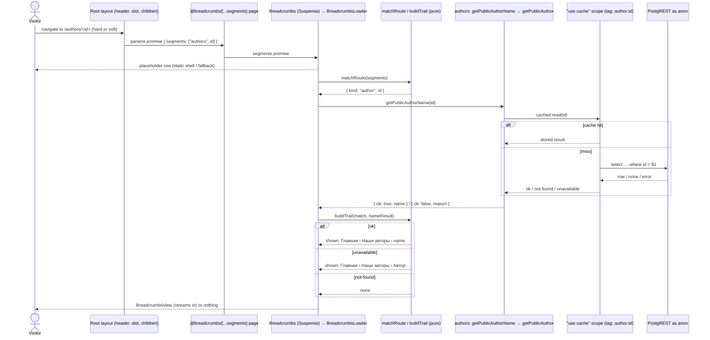

# Design

## Context

See `proposal.md` — Why. Constraints that shape the approach:

- The root layout (`src/app/layout.tsx`) renders the header and is shared by every page. A shared layout does not re-render on client-side navigation, and a Server Component has no `usePathname`. So a Server Component placed directly in the layout can't know the current URL, and a client hook is ruled out by NFR-1.
- `cacheComponents: true` is on. Route params are request data: a component that awaits them must sit inside a `<Suspense>` boundary (or the route must list its params with `generateStaticParams`), or the build fails.
- Next.js 16 requires an explicit `default.tsx` in every parallel route slot.
- The author name lives in Supabase behind the authors feature's cached public read (`getPublicAuthor`, `"use cache"`, tag `author:<id>`). The author page already reads it, so a second read for the same id hits the same cache entry.
- Page titles «Наши авторы», «Мастерская поэта», «Профиль автора» already exist as authors' `PAGE_TITLES`. «Вход» and «Регистрация» are written inline as the login and signup page headings.

## Goals / Non-Goals

**Goals:**

- One place that maps a URL to its trail, as a pure function testable without React.
- The trail stays a Server Component end to end and still updates on client-side navigation.
- No change to any existing page file.

**Non-Goals:**

- A generic, path-to-label engine. The route table lists exactly the pages that exist (proposal FR-2); a new page adds its row.
- Reading page titles from the pages themselves (`generateMetadata` or a shared title registry).

## Decisions

### D1. A parallel route slot `@breadcrumbs` with a catch-all page

The root layout gains a `breadcrumbs` slot and renders it between `</header>` and `{children}`. The slot has three files:

| File | Matches | Renders |
| --- | --- | --- |
| `app/@breadcrumbs/page.tsx` | `/` | `null` (FR-1: no trail on home) |
| `app/@breadcrumbs/[...segments]/page.tsx` | every other URL | `<Breadcrumbs segments={params.then(({ segments }) => segments)} />` |
| `app/@breadcrumbs/default.tsx` | a hard navigation the slot can't match | `null` (required by Next 16) |

Because the catch-all matches every non-root URL and `page.tsx` matches `/`, the slot always has a match. That matters: on a soft navigation, Next keeps an unmatched slot's previous content, which would leave a stale trail on screen (FR-7). Route groups `(public)` and `(authorized)` add no URL segment, so the slot sees the same segments the browser shows.

The slot page passes a promise, not awaited segments, so the route file stays a synchronous composer and the Suspense boundary lives in the feature component (`docs/code-style.md`, "Route files compose, features render").

Alternatives considered:

- **Each page renders its own `<Breadcrumbs items={…} />`.** Simplest mechanics, but the trail definitions spread across six route files plus the author page, every new page must remember to add one, and `app/` would carry trail data. Rejected by the user in favor of one place.
- **A mirror slot tree** (`@breadcrumbs/authors/page.tsx`, `@breadcrumbs/authors/[id]/page.tsx`, …). Static routes would prerender with no Suspense, but the slot would duplicate the route tree file by file and drift from it. The catch-all with one table is less code.
- **A Client Component with `usePathname`.** Ruled out by NFR-1.

### D2. Module layout: a new `features/breadcrumbs`; `authors` exports four things

```
src/features/breadcrumbs/
├── model/
│   ├── breadcrumb.types.ts        # BreadcrumbItem, RouteMatch, Trail
│   ├── breadcrumbs-messages.ts    # Russian copy: landmark name, «Главная», «Вход», «Регистрация», «Автор», separator
│   ├── match-route.ts             # segments → RouteMatch (the route table, FR-2, FR-6)
│   └── build-trail.ts             # RouteMatch (+ author name result) → Trail (FR-3, FR-4)
├── components/
│   ├── Breadcrumbs/               # Suspense boundary; fallback BreadcrumbsPlaceholder (NFR-4)
│   ├── BreadcrumbsLoader/         # async: awaits segments, reads the author name when needed, renders the view or nothing
│   ├── BreadcrumbsView/           # synchronous presentational nav/ol (FR-3, NFR-2, NFR-3)
│   └── BreadcrumbsPlaceholder/    # empty row of the view's height, aria-hidden
├── tests/                         # model/, components/
└── index.ts                       # export { Breadcrumbs }
```

Types (discriminated, no `null` as success — `docs/code-style.md`):

```ts
type BreadcrumbItem =
  | { readonly kind: "link"; readonly label: string; readonly href: string }
  | { readonly kind: "current"; readonly label: string };

type RouteMatch =
  | { readonly kind: "none" }                                              // home, unknown URL
  | { readonly kind: "static"; readonly items: readonly BreadcrumbItem[] } // fully known trail
  | { readonly kind: "author"; readonly id: string };                      // /authors/<id>

type Trail = { readonly kind: "none" } | { readonly kind: "shown"; readonly items: readonly BreadcrumbItem[] };
```

**Paths come from the existing named constants, never literals** (Gate 1 finding 1). The route table is written against:

| Path | Constant | Where |
| --- | --- | --- |
| `/` | `HOME_PATH` (new) | `shared/config/constants.ts` |
| `/authors` | `AUTHORS_PATH` (exists; newly exported) | `features/authors/model/author.constants.ts` |
| `/account` | `ACCOUNT_PATH` (exists) | `shared/config/account-paths.ts` |
| `/account/author` | `AUTHOR_EDITOR_PATH` (exists; newly exported) | `features/authors/model/author.constants.ts` |
| `/login` | `SIGN_IN_PATH` (exists) | `shared/config/account-paths.ts` |
| `/signup` | `SIGN_UP_PATH` (new; replaces the `/signup` literal in auth's `SignInForm.tsx` too) | `shared/config/account-paths.ts` |

The table is a list of rows `{ path, label }` for the five static pages only (`/authors`, `/account`, `/account/author`, `/login`, `/signup`); it has no `HOME_PATH` row, so `matchRoute` never returns «Главная» — `buildTrail` alone adds it (below). `matchRoute(segments)` joins the segments into a path (`/` + segments joined by `/`) and compares it exactly against each row's path; the parent items of a match are the rows whose path is a proper prefix of it, at a `/` boundary, in table order. `/authors/<id>` is the one dynamic row: exactly one segment after `AUTHORS_PATH`. Anything else, including extra segments, is `none` (FR-6). `matchRoute` does not validate the author id: `getPublicAuthor` already turns a non-UUID into `not-found` before any cache scope opens. Renaming a constant moves the trail with it; a test asserts every row's path equals its constant, so a new literal can't slip in.

`buildTrail(match, authorName?)` returns `none` for a `none` match, the items for `static`, and for `author`: `none` on `not-found`, the name on `ok`, «Автор» on `unavailable` (FR-4). It always prepends «Главная» → `HOME_PATH`.

`authors` index gains:

- `AUTHORS_PAGE_TITLES` — its existing `PAGE_TITLES`, re-exported under a feature-prefixed name, so the trail and the pages share one string (NFR-6).
- `AUTHORS_PATH` and `AUTHOR_EDITOR_PATH` — its existing path constants.
- `getPublicAuthorName(id): Promise<PublicAuthorNameResult>` in a new `dal/public-author-name.ts` (`import "server-only"`): calls `getPublicAuthor(id)` and maps `ok` through the existing `model/full-name.ts`. `PublicAuthorNameResult` = `{ ok: true; name } | { ok: false; reason: "not-found" | "unavailable" }`, declared in `model/author.types.ts` with the other domain results. No cache scope of its own: it reuses `getPublicAuthor`'s.
- The index's header comment ("imported only by route files") is updated: route files and, server-side, the `breadcrumbs` feature (Gate 1 finding 3).

Dependency direction: `breadcrumbs` → `authors` public API, server-only, one way (`docs/architecture.md`). `authors` never imports `breadcrumbs`. `shared/` gains only the two path constants; no trail code goes there, since one feature uses it.

### D3. Rendering, placement, and highlight

`BreadcrumbsView` renders (values from the approved mockup, artboard «7 · Навигационная цепочка», see proposal `## Mockups`):

```
<nav aria-label="Навигационная цепочка" class="mx-auto w-full max-w-4xl px-6 pt-4 text-sm">
  <ol class="flex flex-wrap items-baseline gap-x-2 gap-y-1">
    <li class="inline-flex items-baseline gap-2"><Link href={HOME_PATH} class="text-foreground transition-colors hover:text-accent">Главная</Link></li>
    <li class="inline-flex min-w-0 items-baseline gap-2">
      <span aria-hidden="true" class="text-muted">›</span>
      <span aria-current="page" class="min-w-0 font-medium text-accent wrap-anywhere">Наши авторы</span>
    </li>
  </ol>
</nav>
```

- Horizontal alignment matches the header's `max-w-4xl px-6`, so the trail lines up with the wordmark. The row has 16 px top padding (`pt-4`) and none below; pages keep their own `py-16` top padding, so the trail sits above it.
- Text 14/20 px (`text-sm`). Items wrap with 8 px between items and 4 px between lines; a long current item (an author's name) breaks anywhere (`overflow-wrap: anywhere`) rather than overflowing at 360 px.
- Each item after the first starts with its separator «›», an `aria-hidden` span inside the same list item, so the list has exactly one item per label and screen readers announce only the labels (NFR-3).
- Parent links: `text-foreground`, no underline, `text-accent` on hover with a 150 ms color transition, matching the header's `AuthorsNavLink`. Current item: `text-accent`, `font-medium`. Separator: `text-muted`. The mockup shows the same look in light and dark themes through the tokens.
- `BreadcrumbsPlaceholder` renders the same `pt-4 px-6` container, `aria-hidden`, holding one empty `h-5` row (36 px in all), so the page doesn't jump when the trail streams in (NFR-4). Home reserves no row. On a URL that ends with no trail (404, unknown author) the placeholder is replaced by nothing; the row collapses, which is acceptable on a 404.
- No `"use client"` anywhere in the feature or the slot (NFR-1); `next/link` works from a Server Component.

### D4. Data and caching

The only data read is the author name, through `getPublicAuthor`'s existing cache scope (hours for a hit, minutes for not-found, seconds for unavailable). An owner's name edit already calls `updateTag(authorTag(id))`, which expires the same entry, so the trail's name stays in step with the page heading. The breadcrumb components add no cache scope: the slot page is dynamic (it reads params), inside Suspense, and the static shell holds only the placeholder.

No session read anywhere in the feature (FR-5).

### D5. Documentation

- `docs/architecture.md`: the project tree gains `app/@breadcrumbs/` and `features/breadcrumbs/`; the root-layout line mentions the slot; the `shared/config` line lists `HOME_PATH` and `SIGN_UP_PATH`; the cross-feature example in Boundary rules adds `breadcrumbs` → `authors` (`getPublicAuthorName`, titles, paths).
- `docs/design-system.md`: `BreadcrumbsView` as a feature-local primitive (row, separator, current-item accent).

### Sequence: trail on `/authors/<id>` (visitor ↔ Next ↔ slot ↔ cache ↔ Supabase)



### Sequence: client-side navigation back to home

```mermaid
sequenceDiagram
  actor V as Visitor
  participant R as Next client router
  participant N as Next server (RSC)
  participant H as @breadcrumbs/page.tsx

  V->>R: click «Главная» in the trail
  R->>N: RSC request for /
  alt RSC request succeeds
    N->>H: render slot for /
    H-->>N: null
    N-->>R: payload: children = home, breadcrumbs = null
    R-->>V: home without a trail (no full reload)
  else network error or server error
    R->>R: Next falls back to a full-page navigation to /
    R-->>V: home loads with a hard navigation; the slot's page.tsx renders null, so still no trail
  end
```

The slot itself does no I/O on this path, so its only failure mode is the framework's own navigation fallback.

## Risks / Trade-offs

- [The catch-all slot may change how an unknown URL resolves: the slot matches `/no-such-page` while `children` doesn't, so Next could render `children`'s default instead of `not-found.tsx`, or appear as a new `/[...segments]` entry in the build's route list] → Group 4 checks both before anything else: `/no-such-page` must still return HTTP 404 with «Страница не найдена», and the build's route list must match `main` (NFR-5). If `children` needs a default, add `app/default.tsx` calling `notFound()`. If the route list changes, fall back to the mirror slot tree from D1's alternatives.
- [Every non-home page streams the trail after the shell, so a fallback row flashes on a cold load] → The placeholder holds the row's height (NFR-4); static routes resolve without I/O, so the gap is one stream chunk.
- [The route table can drift from the real routes when a page is added] → The table is one file next to its tests; proposal Out of Scope assigns each future page's row to its own change. A test lists the table's paths, so a reviewer sees it when a route is added.
- [`breadcrumbs` depends on `authors`] → One-way, server-only, through the public index, like `authors` → `auth`.
- [«Вход» and «Регистрация» now exist twice: in the login/signup page headings and in breadcrumbs' messages] → Accepted: moving the route files' headings is outside this change. Noted for a later copy tidy-up.
- [Merge overlap with the unmerged `feature/add-site-footer`, which also edits `src/app/layout.tsx`] → Small textual conflict at merge; the slot goes after `</header>`, the footer after `{children}`.

## Migration Plan

No data or config migration. Rollback: revert the change; the layout loses the slot and pages render as before.
