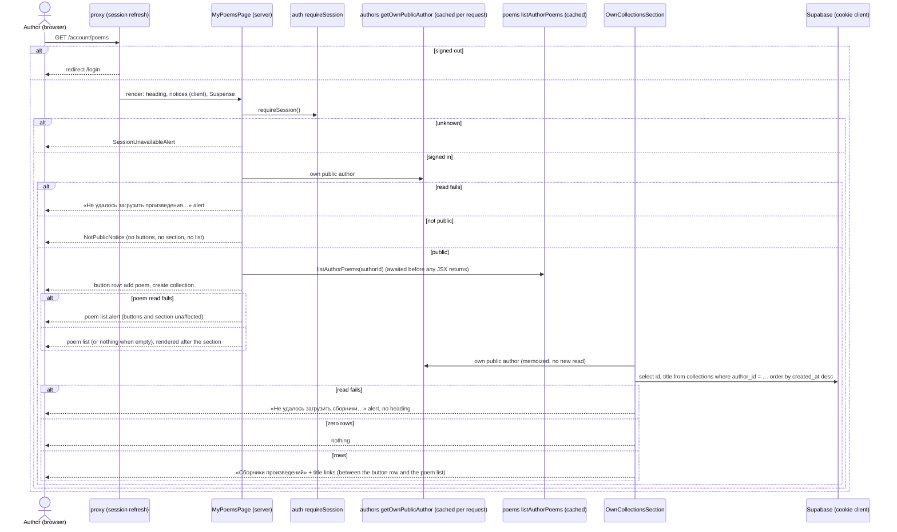

# Design

## Context

See proposal.md (Why). Current state the design builds on:

- Reader-owned tables follow ADR 0005: RLS plus select-only column grants, no write grant; writes
  go through `security definer` functions resolving the owner with `auth.uid()` and
  `my_author_profile_id()` (`create_my_poem`, `update_my_poem`, `delete_my_poem`).
- Row-creating writes count creations inside the inserting function (ADR 0009, amended by ADR 0010:
  a creation log filled by an insert trigger, so a deleted row still counts). Writes that change an
  existing row go through `consume_write_allowance(scope)` in the action (ADR 0007; scopes
  `profile_write`, `photo_upload`, `poem_edit`).
- Poems are public and served from one `"use cache"` entry per author (`poemsTag`); writes expire
  it with `updateTag`. Collections are private, so that cache does not apply (D4).
- `poem-management` owns the flows this change mirrors: `MyPoemsPage` / `MyPoemsContent`
  (`/account/poems`), `NotPublicNotice`, the one-time notices on `useOneTimeValue`, the delete
  button on the shared `Dialog` (`closable={false}` while sending), the edit form's hook with
  change detection and outcome table (edit-poem D4–D7), the leave guard (edit-poem D10:
  `use-leave-guard.ts`, `use-leave-prompt.ts`, `LeaveBlockedDialog`), and `dal/write-log.ts`.
- `shared/` already holds what is domain-free: `useConnectionStatus` + `ConnectionNotice`
  (edit-poem D8), the leave-block store and `LEAVE_ANSWER` (the «Выйти» handshake), the
  session-expired store, `useOneTimeValue`, `Dialog`, `Button`'s `danger` variant, `TextField` (an
  `<input>` only), `ButtonLink`, `Alert`, `splitParagraphs`, `trimmedLength`, and
  `classifySupabaseError` with its `SupabaseFailure` union.
- `authors`' `AuthorPage` takes `poems`' `AuthorPoemsEntry` as a slot from the route file, so
  `authors` never imports `poems` (architecture.md).
- `refresh()` from `next/cache` is already used in `auth/actions/auth.actions.ts`.

## Goals / Non-Goals

Goals: owner-only collections a direct API call can't read or widen; the poem edit and delete UX
repeated, not shared; `poem-management` unchanged in behaviour and code apart from two slot
props; no import between `poem-management` and `collection-management` in either direction.

Non-goals: poems inside collections, public collection pages, caching collection reads, moving
any `poem-management` code into `shared/`, a generic "entity form", optimistic concurrency,
retries.

## Decisions

### D1 — A new, self-contained feature `collection-management` (NFR-3)

**Repeat, don't extract (user decision, 2026-11-04).** The feature repeats the poem flows' logic
in its own files. Only what already sits in `shared/` is reused. Nothing moves out of
`poem-management`; its files stay as they are, except `MyPoemsPage` / `MyPoemsContent`, which gain
slot props (D3). The leave guard is repeated too, although it is domain-free (user decision,
2026-11-04: copy, so the poem module needs no rework).

```
src/app/(authorized)/account/poems/page.tsx                                    # passes the three slots (D3)
src/app/(authorized)/account/poems/collections/new/page.tsx                    # thin: NewCollectionPage
src/app/(authorized)/account/poems/collections/[collectionId]/page.tsx         # thin: CollectionPage
src/app/(authorized)/account/poems/collections/[collectionId]/edit/page.tsx    # thin: EditCollectionPage
src/app/@breadcrumbs/account/poems/collections/…                               # the three slot pages (D11)

src/features/collection-management/
├── actions/
│   ├── action-client.ts                       # the feature's next-safe-action client
│   ├── create-collection.actions.ts           # createCollectionAction (D5)
│   ├── update-collection.actions.ts           # updateCollectionAction (D6)
│   └── delete-collection.actions.ts           # deleteCollectionAction (D7)
├── dal/
│   ├── own-collections.ts                     # listOwnCollections, getOwnCollection, getOwnCollectionTitle (React cache) (D4)
│   ├── collection-writes.ts                   # createOwnCollection, updateOwnCollection, deleteOwnCollection (RPCs)
│   ├── collection-edit-allowance.ts           # consumeCollectionEditAllowance (`collection_edit`)
│   └── write-log.ts                           # the feature's own copy: `[collection-management]` prefix (D12)
├── hooks/
│   └── use-collection-form.ts (+ .types.ts)   # drafts, browser check, focus, isChanged, reset — both forms (D5, D6)
├── model/
│   ├── collection-form.schema.ts              # field rules + the three action inputs (UUID guard)
│   ├── collection-form-values.ts              # CollectionFormValues, normalize, isCollectionFormChanged
│   ├── collection-management.constants.ts     # lengths, statuses, COLLECTIONS_SEGMENT, COLLECTION_EDIT_SEGMENT, LEAVE_DIALOG_REASON
│   ├── collection-management.types.ts         # results, failures (ServiceFailure = SupabaseFailure), notices
│   ├── collection-management-messages.ts      # every string of the proposal's copy table, leave dialog included
│   ├── collection-paths.ts                    # NEW_COLLECTION_PATH, collectionPath(id), editCollectionPath(id)
│   ├── collection-list-notice-ui.store.ts     # created | deleted | already-deleted (+ title) (D8)
│   └── saved-collection-notice-ui.store.ts    # { collectionId } just saved (D8)
└── components/
    ├── OwnCollectionsSection/                 # server: the section on /account/poems (D3)
    ├── CollectionListNotice/                  # client: the one-time notice on /account/poems (D8)
    ├── CreateCollectionLink/                  # server: «Создать сборник произведений» ButtonLink (D3)
    ├── CollectionFormFields/                  # client: title TextField + description TextAreaField
    ├── NewCollectionPage/ NewCollectionContent/ NewCollectionForm/     # create (D5)
    ├── CollectionPage/ CollectionContent/                              # view (D4)
    ├── SavedCollectionNotice/                 # client: «Изменения сохранены.» (D8)
    ├── CollectionActions/                     # client: the connection notice above the button row (children)
    ├── EditCollectionButton/                  # server: ButtonLink to the edit page
    ├── DeleteCollectionButton/                # client: danger button + Dialog + action (D7)
    ├── EditCollectionPage/ EditCollectionContent/                      # edit (D6)
    ├── EditCollectionForm/                    # client (D6, D12)
    │   ├── use-edit-collection-form.ts        #   fields, the call and its outcomes, discard
    │   ├── use-leave-guard.ts                 #   the feature's copy of the link, beforeunload, and «Выйти» guard
    │   └── use-leave-prompt.ts                #   the feature's copy of the dialog's opening and focus
    ├── CollectionLeaveDialog/                 # client: the feature's copy of the unsaved-changes Dialog
    ├── CollectionFormSkeleton/                # both forms' loading state
    └── CollectionNotPublicNotice/             # the create page's not-public text and link
src/shared/ui/TextAreaField/                   # new primitive (D5); domain-free
```

Import direction: `app → breadcrumbs → collection-management → authors → auth → shared`, and
`poem-management` and `collection-management` never import each other. `collection-management`
imports `requireSession` / `getSessionState` from `auth`, `getOwnPublicAuthor` and
`AUTHOR_EDITOR_PATH` from `authors`, nothing from `poems` or `poem-management`, and only these
from `shared/`: `config/account-paths`, `lib/network`, `lib/leave-guard` (the store and
`LEAVE_ANSWER`), `lib/one-time-notice`, `lib/supabase` (server client, classifier),
`lib/safe-action`, `lib/text`, `lib/split-paragraphs`, `ui`. The index exports the three page
components, the three `/account/poems` slot components, the paths and `COLLECTIONS_SEGMENT`,
`COLLECTION_EDIT_SEGMENT`, the trail labels, and `getOwnCollectionTitle`.

`COLLECTION_EDIT_SEGMENT` is the feature's own constant (`"edit"`), not `poem-management`'s
`EDIT_SEGMENT` (Gate 1 C1: the reuse would have closed an import cycle); the distinct name lets
`breadcrumbs` import both without an alias (Gate 1 re-check note).

Why a new feature and not more `poem-management`: a collection is its own noun with its own
table, rules, and pages; `poem-management` is already the largest feature; a later "add poems to
a collection" change will depend on `poems` from here.

### D2 — Database (NFR-1, FR-4, FR-5, FR-9, FR-10, FR-13)

New migration `supabase/migrations/<ts>_collections.sql`:

```sql
create table public.collections (
  id          uuid primary key default gen_random_uuid(),
  author_id   uuid not null references public.author_profiles (id) on delete cascade,
  title       text not null check (char_length(title) <= 80 and title !~ <blank class>),
  description text check (description is null or (char_length(description) <= 1000
                                                  and description !~ <blank class>)),
  created_at  timestamptz not null default now()
);
create index collections_author_created_idx on public.collections (author_id, created_at desc, id);
alter table public.collections enable row level security;
create policy "owners read their collections" on public.collections
  for select to authenticated using (author_id = (select public.my_author_profile_id()));
revoke all on public.collections from anon, authenticated;
grant select (id, author_id, title, description, created_at) on public.collections to authenticated;
```

- `<blank class>` is the poems table's explicit whitespace literal, copied with a comment naming
  `20261028160000_poems.sql` as the copy to keep in step (Gate 1 P4). A blank description is
  stored as `null` (the action normalizes; the check rejects `''`).
- The policy wraps the function in `(select …)`, so Postgres evaluates it once per query, as the
  project's other policies do with `(select auth.uid())` (Gate 1 P3).
- **Private**: `anon` gets no grant; the policy shows a reader only their own rows, public profile
  or not. Pages still require a public profile (D4), like the poem pages.
- `collection_creations (author_id, created_at)` + `after insert` trigger `log_collection_creation`
  + `collection_create_limits()` (`(interval '30 days', 50)`) + `collection_create_status(profile)`,
  ADR 0010's poem shape (RLS on, no policies, no grants; pruning older rows; no backfill — the
  table is new).
- `create_my_collection(title text, description text) returns jsonb`: `auth.uid()` null → 42501;
  profile from `my_author_profile_id()`; per-author `pg_advisory_xact_lock`; status `not-public` /
  `over-limit` → returned; else insert and return `{ status: 'created', id }`. No read-only twin:
  there is no upload to spare (ADR 0009 Decision 5's reason doesn't apply).
- `update_my_collection(collection_id uuid, title text, description text) returns jsonb`: updates
  title and description `where id = … and author_id = profile and is_public_author_profile(profile)`;
  no match → `{ status: 'not-found' }`, else `{ status: 'updated' }`. `id`, `author_id`,
  `created_at` never change.
- `delete_my_collection(collection_id uuid) returns jsonb`: deletes `where id = … and author_id =
  my_author_profile_id()` (not gated by public status, as `delete_my_poem`), returning
  `{ status: 'deleted', title }` or `{ status: 'not-found' }`. The title feeds the deleted notice
  from the stored value, not from the browser.
- All three: `security definer`, `set search_path = ''`, execute revoked from `public, anon`,
  granted to `authenticated`.
- `write_rate_limits.scope` check and `consume_write_allowance`'s limits gain
  `('collection_edit', 10, interval '1 minute')` (ADR 0007: an edit updates a row).
- Down migration in the header comment (never auto-run): drop the three functions, the trigger and
  its function, the limits and status functions, both tables; restore the previous scope check
  and `consume_write_allowance`; delete `collection_edit` rows.

### D3 — `/account/poems`, composed in `app/` (FR-1, FR-2, FR-15)

`poem-management` stays unaware of collections (Gate 1 P5; the `AuthorPage` slot precedent).
`MyPoemsPage` gains three optional `ReactNode` props, typed in `MyPoemsPage.types.ts`:
`notices` (rendered next to `DeletedPoemNotice`, outside the Suspense), `actions` (rendered after
«Добавить новое произведение» in the button row), and `beforeList` (rendered between the button
row and the poem list). It passes `actions` and `beforeList` to `MyPoemsContent`, which renders
them only on the public-profile branch, so a non-public profile shows neither. The route file:

```tsx
<MyPoemsPage
  notices={<CollectionListNotice />}
  actions={<CreateCollectionLink />}
  beforeList={<OwnCollectionsSection />}
/>
```

`MyPoemsContent` renders a wrapping button row (`flex flex-wrap gap-2`): «Добавить новое
произведение», then `actions`; then `beforeList`; then the poem list or its failure alert
(unchanged). Its existing tests stay green unchanged; new cases cover the slots.

`CreateCollectionLink`: `ButtonLink` «Создать сборник произведений» (the `ghost` variant, so the
poem link stays the primary action). `OwnCollectionsSection` (server, async): `getOwnPublicAuthor()`
(memoized, so no second read), then `listOwnCollections(authorId)`: zero rows → `null`; rows →
`<section aria-labelledby>` with the `<h2>` «Сборники произведений» and a `<ul>` of title links to
`collectionPath(id)`, newest first; failure → `Alert tone="danger"` «Не удалось загрузить
сборники. Попробуйте позже.» (no heading). It renders inside `MyPoemsContent`'s Suspense, so the
list skeleton covers it.

### D4 — Reads and the collection page (FR-6, FR-7, FR-15, NFR-2, NFR-8)

`dal/own-collections.ts` (server-only, cookie client — RLS limits rows to the caller):

- `listOwnCollections(authorId): Promise<{ ok: true; collections: CollectionSummary[] } | { ok:
  false }>` — `id, title`, `.eq("author_id", authorId)` (the index's leading column; RLS still
  applies), ordered `created_at desc, id`.
- `getOwnCollection = cache(async (id) => …)`: malformed id → `not-found` without a query;
  `getOwnPublicAuthor()` failure → `unavailable`, not public → `not-found`; then the row by id and
  author (`maybeSingle`): none → `not-found`, error → `unavailable`. Zod-parsed.
- `getOwnCollectionTitle(id)` derives from it, so page and trail share one read (ADR 0008).

No `"use cache"`: these reads need the session cookie, which a cache scope can't read, and the
data is shown to one reader only. Every collection page is dynamic inside its Suspense boundary;
the shell (heading where static, skeleton) still prerenders (NFR-8). This pattern — private,
uncached, kept fresh with `refresh()` (D10) — is new and outlives this change, so it is recorded
as ADR 0011 and in state-management.md (Gate 1 P6).

`CollectionContent` (server): `requireSession()` (unknown → `SessionUnavailableAlert`);
`getOwnCollection(id)`: `not-found` → `notFound()`, `unavailable` → throw (route `error.tsx`).
Renders `SavedCollectionNotice`, `<h1>` title, the description through `splitParagraphs` (one `<p>`
each, with `whitespace-pre-line` so a single line break shows, as `HomeGreeting` does; spec-clarify,
2026-11-04), then `CollectionActions` (client: `ConnectionNotice` (D9) above a wrapping row of its
`children`), with `EditCollectionButton` (server) and `DeleteCollectionButton` passed in as
children, so the edit link stays a server module (Gate 1 re-check N2). `CollectionPage` wraps it in Suspense with a
skeleton (heading bar, two text bars, two button bars).

### D5 — Create (FR-3, FR-4, FR-5, FR-11, FR-14)

`NewCollectionPage` (server): `<h1>` «Создание сборника» in the shell, Suspense with
`CollectionFormSkeleton`. `NewCollectionContent`: `requireSession()`, `getOwnPublicAuthor()`:
failure → throw (the generic error), not public → `CollectionNotPublicNotice`, else
`NewCollectionForm`.

`collectionFormSchema` (Gate 1 P4): line breaks `\r\n` / `\r` → `\n` first (as browsers send a
textarea's value; the poem schema's rule, repeated), then trim; lengths measured with
`trimmedLength` from `shared/lib/text` (code points, the database's `char_length`); title required
and ≤ 80; description ≤ 1000, blank → `null`. The same transforms are exported as
`normalizeCollectionTitle` / `normalizeCollectionDescription`.

`useCollectionForm(initial, { isPending, formRef })` (`hooks/`): title and description drafts, `validate()`,
field errors, focus on the first invalid field, `isChanged` (D6), `reset()`. It holds no action. The form
component owns `formRef` and hands it in, as the poem forms do: the React Compiler's lint rejects passing
on, during render, an object that holds a ref (group 4).
`CollectionFormFields` renders `TextField` «Название сборника» and `TextAreaField` «Описание
(необязательно)» (new `shared/ui` primitive: `TextField`'s label, error, and `aria-*` wiring over a
`<textarea>`, reusing `text-field-classes`; no counter).

`createCollectionAction` (`{ title, description }`), in order:

1. Field rules → `invalid` with field errors.
2. Session: `signed-out` → `failed: unauthenticated`; `unknown` → `failed: unavailable`.
3. `createOwnCollection(title, description | null)` → RPC: `not-public` → `failed: not-public`;
   `over-limit` → `failed: too-many-collections`; error → classified failure.
4. `created` → `refresh()` (D10), return `{ status: "created", title }` (the normalized title).

`NewCollectionForm` outcomes (the poem forms' guards: in-flight ref, clear the alert, browser
check, `useTransition`):

| Result | Client |
| --- | --- |
| `created` | `setListNotice({ kind: "created", title })`, `router.replace(POEM_MANAGEMENT_PATH)` |
| `invalid` | field errors, focus on the first |
| `failed: unauthenticated` | `markSessionExpired()`, `router.replace(SIGN_IN_PATH)`, `router.refresh()` |
| `failed: not-public \| too-many-collections \| unavailable \| unknown` | alert above the submit button, focus on it, values kept |
| call rejected while the latest connection status is `offline` | the offline notice, values kept, no alert |
| call rejected while online | the `unknown` alert, values kept |

Why `replace`: Back from `/account/poems` must not land on a filled create form that would create
a second collection. Why the session-expired redirect here, though the poem create form shows an
alert: the request asks for the edit and delete flows' edge-case handling, and they redirect;
recorded in Risks.

### D6 — Edit (FR-7 – FR-12)

`EditCollectionPage` / `EditCollectionContent`: the poem edit page's shape — heading
«Редактирование сборника» in the shell, Suspense with `CollectionFormSkeleton`; `requireSession()`;
`getOwnCollection(id)` → `notFound()` / throw; the form keyed by a digest of the stored title and
description, so a save's re-render remounts it fresh (edit-poem D6).

`model/collection-form-values.ts`: `CollectionFormValues { title; description }` and
`isCollectionFormChanged(stored, draft)` — changed when either normalized value differs. Derived
each render, never stored.

`EditCollectionForm` renders from `useEditCollectionForm({ collectionId, stored })`, which
composes `useCollectionForm(stored)`, the update call and its outcomes, discard, and the
feature's `useLeaveGuard` (D12). Unchanged → `ButtonLink` «Вернуться к сборнику»; changed →
«Сохранить изменения» + `ghost` «Отменить изменения»; sending → «Сохранение…», fieldset disabled
and dimmed. `reset()` → both drafts back, errors and alert cleared, focus on the back link.

`updateCollectionAction` (`{ collectionId, title, description }`), in order: malformed id →
`not-found`; field rules → `invalid` (nothing counted); session (as D5);
`consumeCollectionEditAllowance()` → `failed: too-many-saves` or classified; `getOwnPublicAuthor()`:
failure → classified, not public → `failed: not-public`; `updateOwnCollection(...)`: `not-found` →
`not-found`, error → classified; `updated` → `refresh()`, return `{ status: "saved" }`.

| Result | Client |
| --- | --- |
| `saved` | `setSavedNotice({ collectionId })`, guard off, `router.push(collectionPath(id))` |
| `invalid` | field errors, focus on the first |
| `not-found` | `setListNotice({ kind: "already-deleted" })`, `router.replace(POEM_MANAGEMENT_PATH)` |
| `failed: unauthenticated` | `markSessionExpired()`, `router.replace(SIGN_IN_PATH)`, `router.refresh()` |
| `failed: too-many-saves \| not-public \| unavailable \| unknown` | alert above the form, focus, values kept |
| call rejected while offline | the offline notice, values kept |
| call rejected while online | the `unknown` alert, values kept |

No automatic retry (edit-poem D9: every attempt counts against the limit).

### D7 — Delete (FR-13)

`DeleteCollectionButton` (client) repeats `DeletePoemButton`'s shape: danger `Button` «Удалить
сборник» opens the shared `Dialog` «Удалить сборник?», body with the title, «Отмена» focused,
«Удалить» (danger); while sending «Удаление…», both disabled, `closable={false}`; focus returns to
the opener on cancel (`openerRef`). The opener and «Удалить» are also disabled while the connection
status isn't `online` (D9): «Удалить» with native `disabled`, the opener with `aria-disabled="true"`
and a click handler that ignores presses, so `openerRef.focus()` still works after the dialog
closes offline (spec-clarify, 2026-11-04). If the shared `Button` can't express that, the button
sets the attribute itself; `Button` is not changed.

`deleteCollectionAction` (`{ collectionId }`): malformed id → `not-found`; session (as D5);
`deleteOwnCollection(id)`: `deleted` → `refresh()`, `{ status: "deleted", title }`; `not-found` →
`{ status: "not-found" }`; error → classified failure.

| Result | Client |
| --- | --- |
| `deleted` | `setListNotice({ kind: "deleted", title })`, `router.replace(POEM_MANAGEMENT_PATH)` |
| `not-found` | `setListNotice({ kind: "already-deleted" })`, `router.replace(POEM_MANAGEMENT_PATH)` |
| `failed: unauthenticated` | dialog closed, `markSessionExpired()`, `router.replace(SIGN_IN_PATH)`, `router.refresh()` |
| `failed: unavailable \| unknown` | «Не удалось удалить сборник. Попробуйте позже.» in the open dialog |
| call rejected while offline | the offline notice in the dialog (and on the page), dialog stays open, no failure text |
| call rejected while online | the failure text in the dialog |

**The 404 flash (Gate 1 P2; delete-poem's Gate 1 P2).** `refresh()` re-renders the current route,
the deleted collection's page, whose read now answers `not-found`. The client navigates in the
same transition the action's answer arrives in, so the 404 should never paint. If web-qa sees it,
the fallback is delete-poem's: the action skips `refresh()` and the client calls
`router.replace` followed by `router.refresh()` on `/account/poems`. D13 has the check.

No limit (ADR 0010 Decision 7): deletes are bounded by creates.

### D8 — One-time notices (FR-4, FR-9, FR-13, NFR-2)

Two Zustand stores in `model/`, both read through `useOneTimeValue` (shared) and written with
`getState()` after the answer:

- `collection-list-notice-ui.store.ts`: `{ kind: "created" | "deleted"; title } | { kind:
  "already-deleted" } | null`, read by `CollectionListNotice` on `/account/poems` (`Alert
  tone="success"` for created and deleted, `neutral` for already deleted, `role="status"`). Holds a
  title briefly, the deleted-poem store's documented exception (state-management.md), for the
  same reasons.
- `saved-collection-notice-ui.store.ts`: `{ collectionId } | null`, read by `SavedCollectionNotice`
  on the collection page, shown only when the id matches.

### D9 — Offline and slow (FR-14)

`useConnectionStatus()` and `ConnectionNotice` from `shared/` as they are (edit-poem D8). The
notice sits above the form (create, edit) and above the button row (collection page); the submit
buttons and the dialog's «Удалить» get native `disabled`, and «Удалить сборник» gets
`aria-disabled="true"` (D7), while the status isn't `online`. Inside the open delete dialog the
same `ConnectionNotice` shows above its buttons, since the page's notice sits behind the modal
(Gate 2 finding 6). Fields, links, «Отменить изменения», and «Отмена» stay enabled. A request already sending
is not cancelled. A rejected call while the latest status is `offline` (kept in a ref) shows no
alert.

### D10 — Freshness (FR-15)

Collection reads are uncached (D4), so the server always renders current data; what can be stale
is the client router's copy of `/account/poems`, the collection page, or the edit page kept from
an earlier visit (including Next's hidden `Activity` routes). Every successful write calls
`refresh()` from `next/cache` inside the action (Next 16: refreshes the client router from a
Server Action; it doesn't touch tagged data, which collections have none of). The client then
navigates. A hidden edit page of a collection deleted meanwhile re-renders as the 404 page, so its
unsaved draft is dropped rather than kept for a collection that no longer exists (spec-clarify,
2026-11-04; web-qa checks it). No poem tag is expired: collections appear on no cached page. web-qa checks the section
after create, edit, and delete, and after Back/Forward.

### D11 — Breadcrumbs (FR-17)

- `STATIC_ROUTES` gains `{ path: NEW_COLLECTION_PATH, label: «Создание сборника» }`; its parents
  come from the existing rows (`/account`, `/account/poems`).
- `matchOwnCollectionRoute` (before `matchOwnPoemRoute`): the segments after
  `${POEM_MANAGEMENT_PATH}/${COLLECTIONS_SEGMENT}/` — `[id]` → `{ kind: "own-collection", id }`,
  `[id, COLLECTION_EDIT_SEGMENT]` → `{ kind: "own-collection-edit", id }`, anything
  else → no match. Trails: «Мастерская поэта» › «Управление произведениями» › `<title>` (current,
  or a link to `collectionPath(id)` on the edit page) › «Редактирование». Title from
  `getOwnCollectionTitle`; not found or unavailable → no trail.
- Slot pages mirror the three routes (`app/tests/breadcrumbs-slot.test.ts` checks).

### D12 — The feature's own copies (FR-12, NFR-3, NFR-5)

Repeated from `poem-management`, with that feature's files left untouched (D1):

- `EditCollectionForm/use-leave-guard.ts` and `use-leave-prompt.ts`: copies of the poem edit
  form's, with `isAllowed = (p) => p === collectionPath(id) || p === editCollectionPath(id)` and
  `active = (isChanged || isPending) && !saved`. They register with the existing shared
  leave-block store (`useLeaveBlock`, `LEAVE_ANSWER`), so «Выйти» asks first with no change in
  `auth`.
- `CollectionLeaveDialog`: a copy of `LeaveBlockedDialog` over the shared `Dialog`, link and
  sign-out forms; its texts (the poem dialog's, verbatim) in the feature's messages module, and
  `LEAVE_DIALOG_REASON` in the feature's constants.
- `dal/write-log.ts`: a copy with the prefix `[collection-management]`, typed with
  `SupabaseFailure` from `shared/lib/supabase/classify-error.ts` (`ServiceFailure` is an alias).
- `poem-management/tests/boundaries.test.ts`'s "beforeunload only in the edit form's leave guard"
  check scans all of `src/`; its expected list gains the collection guard's file (a test-data
  change, no code change in `poem-management`).

The copies' tests are repeated from the poem tests, adapted to the collection paths.

### D13 — Testing

- pgTAP (`collections.test.sql`): anon can't select or execute any function; an author reads only
  their own rows (another author's rows invisible, also when public); no role can insert, update,
  or delete directly; create stores the values and refuses `not-public` and the 51st in 30 days (a
  deleted collection still counts); update changes only title and description, refuses another
  author's id, an unknown id, and a non-public own profile with `not-found`; delete returns the
  title, refuses another author's id with `not-found`; the checks reject blank and over-long values
  and `''` descriptions. `write_rate_limits.test.sql`: `collection_edit` 10 per minute.
- Vitest: schema and normalization (CRLF, code points); `isCollectionFormChanged`; DAL (statuses,
  Zod parses, error classes, NFR-5 log content); each action's order (nothing counted before the
  limit step; no RPC on invalid input or a malformed id; `refresh()` only on success);
  `useCollectionForm`; `NewCollectionForm`, `EditCollectionForm`, `DeleteCollectionButton` (each
  outcome's store and navigation, alert position and focus, offline and slow disabling, discard,
  guard activation); the feature's leave guard and dialog; `OwnCollectionsSection` (list order,
  hidden when empty, failure alert); `MyPoemsPage` / `MyPoemsContent` slots (rendered in place,
  absent on the not-public branch; existing cases unchanged); both notices; `TextAreaField`;
  `matchRoute` for the three paths; a `boundaries` test for the new feature.
- web-qa: create (valid, blank title, over-long fields, not public), the section appearing; open,
  edit, discard, save with the notice; limit (11 saves in a minute); session expired; deleted in
  a second tab while editing; leave guard and «Выйти»; delete with both notices, no 404 flash, and
  the section disappearing after the last one; offline and slow on all three pages; Back/Forward
  after each write; recorded scenarios for the create → edit → delete path.

### Sequence diagrams

`/account/poems` load (the notices outside the boundary; the section's failure isolated). The two
reads run one after the other — `MyPoemsContent` awaits the poems before it returns the slot — an
accepted waterfall of one indexed query (Gate 1 re-check N1):



Collection page and its trail (the edit page is the same, plus the form keyed by the digest):

```mermaid
sequenceDiagram
  actor A as Author (browser)
  participant PX as proxy (session refresh)
  participant C as CollectionContent (server)
  participant T as breadcrumbs trail (server)
  participant AU as auth requireSession
  participant G as getOwnCollection (React cache)
  participant AP as authors getOwnPublicAuthor (cached per request)
  participant DB as Supabase (cookie client)
  A->>PX: GET /account/poems/collections/<id>
  alt signed out
    PX-->>A: redirect /login
  else
    par page
      C->>AU: requireSession()
      alt unknown
        C-->>A: SessionUnavailableAlert
      else signed in
        C->>G: getOwnCollection(id)
      end
    and trail
      T->>G: getOwnCollectionTitle(id) (same memoized read)
    end
    alt malformed id
      G-->>C: not-found (no query)
    else
      G->>AP: own public author
      alt read fails
        G-->>C: unavailable
      else not public
        G-->>C: not-found
      else public
        G->>DB: select … where id = … and author_id = … (RLS: owner only)
        alt error
          G-->>C: unavailable
        else no row (unknown or another author's)
          G-->>C: not-found
        else row
          G-->>C: collection
        end
      end
    end
    alt not-found
      C-->>A: 404 page; trail: none
    else unavailable
      C-->>A: error.tsx; trail: none
    else collection
      C-->>A: saved notice?, title, description, notice + buttons
      T-->>A: … › «Управление произведениями» › <title>
    end
  end
```

Create:

```mermaid
sequenceDiagram
  actor A as Author (browser)
  participant F as NewCollectionForm (client)
  participant ACT as createCollectionAction
  participant AU as auth getSessionState
  participant DB as Supabase (cookie client)
  A->>F: «Создать сборник»
  F->>F: browser check; invalid → field errors, stop
  F->>ACT: POST { title, description }
  alt request rejected (network)
    F-->>A: offline notice if offline, else unknown alert
  else reaches the server
    alt field rules fail
      ACT-->>F: invalid { fieldErrors }
    else
      ACT->>AU: getSessionState()
      alt signed-out / unknown
        ACT-->>F: failed: unauthenticated / unavailable
      else signed-in
        ACT->>DB: rpc create_my_collection(title, description)
        alt not-public / over-limit / error
          ACT-->>F: failed: not-public / too-many-collections / classified
        else created
          ACT->>ACT: refresh() (client router)
          ACT-->>F: created { title }
        end
      end
    end
  end
  alt created
    F->>A: router.replace(/account/poems) → «Сборник «…» создан.», section lists it
  else invalid
    F-->>A: field errors, focus on the first
  else unauthenticated
    F->>A: router.replace(/login) → «Сессия истекла. Войдите снова.»
  else other failure
    F-->>A: alert above the button, values kept
  end
```

Save an edit:

```mermaid
sequenceDiagram
  actor A as Author (browser)
  participant F as EditCollectionForm (client)
  participant ACT as updateCollectionAction
  participant AU as auth getSessionState
  participant DB as Supabase (cookie client)
  A->>F: «Сохранить изменения»
  F->>F: browser check; pending, guard stays on
  F->>ACT: POST { collectionId, title, description }
  alt request rejected (network)
    F-->>A: offline notice if offline, else unknown alert
  else reaches the server
    alt malformed id
      ACT-->>F: not-found
    else field rules fail
      ACT-->>F: invalid { fieldErrors } (nothing counted)
    else
      ACT->>AU: getSessionState()
      alt signed-out / unknown
        ACT-->>F: failed: unauthenticated / unavailable
      else signed-in
        ACT->>DB: rpc consume_write_allowance('collection_edit')
        alt over the limit or error
          ACT-->>F: failed: too-many-saves / classified
        else allowed
          ACT->>DB: own public author
          alt read fails / not public
            ACT-->>F: failed: classified / not-public
          else public
            ACT->>DB: rpc update_my_collection(id, title, description)
            alt not-found / error
              ACT-->>F: not-found / failed
            else updated
              ACT->>ACT: refresh()
              ACT-->>F: saved
            end
          end
        end
      end
    end
  end
  alt saved
    F->>A: guard off, router.push(collection page) → «Изменения сохранены.»
  else invalid
    F-->>A: field errors, focus on the first
  else not-found
    F->>A: router.replace(/account/poems) → «Сборник уже удалён.»
  else unauthenticated
    F->>A: router.replace(/login) → session-expired notice
  else other failure
    F-->>A: alert above the form, values kept
  end
```

Delete:

```mermaid
sequenceDiagram
  actor A as Author (browser)
  participant B as DeleteCollectionButton (client)
  participant ACT as deleteCollectionAction
  participant AU as auth getSessionState
  participant DB as Supabase (cookie client)
  A->>B: «Удалить сборник» → dialog, «Отмена» focused
  A->>B: «Удалить»
  B->>B: «Удаление…», buttons disabled, dialog held open
  B->>ACT: POST { collectionId }
  alt request rejected (network)
    B-->>A: offline notice if offline, else the failure text in the dialog
  else reaches the server
    alt malformed id
      ACT-->>B: not-found
    else
      ACT->>AU: getSessionState()
      alt signed-out / unknown
        ACT-->>B: failed: unauthenticated / unavailable
      else signed-in
        ACT->>DB: rpc delete_my_collection(id)
        alt error
          ACT-->>B: failed: classified
        else not-found
          ACT-->>B: not-found
        else deleted
          ACT->>ACT: refresh()
          ACT-->>B: deleted { title }
        end
      end
    end
  end
  alt deleted / not-found
    B->>A: router.replace(/account/poems) → «Сборник «…» удалён.» / «Сборник уже удалён.»; section hidden if none left
  else unauthenticated
    B->>A: router.replace(/login) → session-expired notice
  else unavailable / unknown
    B-->>A: «Не удалось удалить сборник. Попробуйте позже.» in the dialog
  end
```

## Scaffold map

Written by `opsx-scaffold` after the files existed (map approved 2026-11-04). Stub bodies only;
the paths, the two stores, the copy, and the action client are complete (the edit-poem scaffold's
precedent). Not scaffolded: the migration (group 1), the route and breadcrumb slot files (groups
4–7), the breadcrumb matcher (group 7), docs. Client stubs carry no `"use client"` yet: each gets
it with its implementation and the `boundaries` test's list (NFR-2). `knip.jsonc` ignores the new
feature and `TextAreaField` until tasks 4.1 and 8.4 remove the entries (Gate 2b P1).

| File | Responsibility | Exports |
| --- | --- | --- |
| `src/features/collection-management/index.ts` | public API (D1) | `CollectionListNotice`, `CollectionPage`, `CreateCollectionLink`, `EditCollectionPage`, `NewCollectionPage`, `OwnCollectionsSection`, `getOwnCollectionTitle`, `COLLECTION_TRAIL_LABELS`, `COLLECTION_EDIT_SEGMENT`, `COLLECTIONS_SEGMENT`, `OwnCollectionTitleResult`, `collectionPath`, `editCollectionPath`, `NEW_COLLECTION_PATH` |
| `src/features/collection-management/actions/action-client.ts` | the feature's next-safe-action client | `collectionManagementActionClient` |
| `src/features/collection-management/actions/create-collection.actions.ts` | `"use server"` create (D5) | `createCollectionAction` |
| `src/features/collection-management/actions/update-collection.actions.ts` | `"use server"` save (D6) | `updateCollectionAction` |
| `src/features/collection-management/actions/delete-collection.actions.ts` | `"use server"` delete (D7) | `deleteCollectionAction` |
| `src/features/collection-management/dal/own-collections.ts` | owner reads under RLS (D4) | `listOwnCollections`, `getOwnCollection`, `getOwnCollectionTitle` |
| `src/features/collection-management/dal/collection-writes.ts` | the three RPCs (D2) | `createOwnCollection`, `updateOwnCollection`, `deleteOwnCollection` |
| `src/features/collection-management/dal/collection-edit-allowance.ts` | the `collection_edit` scope (D2, D6) | `consumeCollectionEditAllowance` |
| `src/features/collection-management/dal/write-log.ts` | the feature's copy of the write-log helpers (D12) | `logFailure`, `toServiceFailure`, `withStatus` |
| `src/features/collection-management/hooks/use-collection-form.ts` | drafts, check, focus, change, reset (D5, D6) | `useCollectionForm` |
| `src/features/collection-management/hooks/use-collection-form.types.ts` | the hook's contract | `CollectionFormState`, `CollectionFormCheck`, `CollectionFormHost` (group 4) |
| `src/features/collection-management/model/collection-form.schema.ts` | normalization and the action inputs (types only until 3.1) | `normalizeCollectionTitle`, `normalizeCollectionDescription`, `createCollectionInputSchema`, `updateCollectionInputSchema`, `deleteCollectionInputSchema`, their input types |
| `src/features/collection-management/model/collection-form-values.ts` | form values and change detection (D6) | `CollectionFormValues`, `isCollectionFormChanged` |
| `src/features/collection-management/model/collection-management.constants.ts` | limits, statuses, segments, the leave dialog's forms | `COLLECTION_TITLE_MAX_LENGTH`, `COLLECTION_DESCRIPTION_MAX_LENGTH`, `COLLECTIONS_SEGMENT`, `COLLECTION_EDIT_SEGMENT`, `CREATE_COLLECTION_STATUS`, `UPDATE_COLLECTION_STATUS`, `DELETE_COLLECTION_STATUS`, `LEAVE_DIALOG_REASON` |
| `src/features/collection-management/model/collection-management.types.ts` | read, write, and action results; notices | `ServiceFailure`, `CollectionSummary`, `OwnCollection`, the `Own*Result` types, `CollectionFieldErrors`, the action results and failures, `CollectionEditAllowance`, `CollectionListNotice`, `SavedCollectionNotice`, `LeaveDialogReason` |
| `src/features/collection-management/model/collection-management-messages.ts` | the proposal's copy table | `COLLECTION_LIST_COPY`, `COLLECTION_FORM_COPY`, `COLLECTION_FIELD_ERRORS`, `NEW_COLLECTION_COPY`, `CREATE_COLLECTION_FAILURE_MESSAGES`, `COLLECTION_PAGE_COPY`, `EDIT_COLLECTION_COPY`, `UPDATE_COLLECTION_FAILURE_MESSAGES`, `LEAVE_DIALOG_COPY`, `COLLECTION_TRAIL_LABELS` |
| `src/features/collection-management/model/collection-paths.ts` | the three paths | `NEW_COLLECTION_PATH`, `collectionPath`, `editCollectionPath` |
| `src/features/collection-management/model/collection-list-notice-ui.store.ts` | the `/account/poems` notice (D8) | `useCollectionListNotice`, `CollectionListNoticeState` |
| `src/features/collection-management/model/saved-collection-notice-ui.store.ts` | the saved notice (D8) | `useSavedCollectionNotice`, `SavedCollectionNoticeState` |
| `src/features/collection-management/components/OwnCollectionsSection/` | the section (D3) | `OwnCollectionsSection` |
| `src/features/collection-management/components/CollectionListNotice/` | the one-time list notice (D8) | `CollectionListNotice` |
| `src/features/collection-management/components/CreateCollectionLink/` | the `ghost` create link (D3) | `CreateCollectionLink` |
| `src/features/collection-management/components/CollectionFormFields/` | title and description fields (D5) | `CollectionFormFields`, `CollectionFormFieldsProps` |
| `src/features/collection-management/components/NewCollectionPage/, NewCollectionContent/, NewCollectionForm/` | create page, its reads, its form (D5) | `NewCollectionPage`, `NewCollectionContent`, `NewCollectionForm` |
| `src/features/collection-management/components/CollectionFormSkeleton/, CollectionNotPublicNotice/` | the forms' loading state; the create page's not-public notice | `CollectionFormSkeleton`, `CollectionNotPublicNotice` |
| `src/features/collection-management/components/CollectionPage/, CollectionContent/` | the collection page and its reads (D4) | `CollectionPage`, `CollectionContent` + props types |
| `src/features/collection-management/components/CollectionActions/` | the connection notice over the button row (D4, D9) | `CollectionActions`, `CollectionActionsProps` |
| `src/features/collection-management/components/SavedCollectionNotice/, EditCollectionButton/` | saved notice; the edit link | `SavedCollectionNotice`, `EditCollectionButton` + props types |
| `src/features/collection-management/components/DeleteCollectionButton/` | opener, dialog, delete call (D7) | `DeleteCollectionButton`, `DeleteCollectionButtonProps` |
| `src/features/collection-management/components/EditCollectionPage/, EditCollectionContent/` | the edit page and its reads (D6) | `EditCollectionPage`, `EditCollectionContent` + props types |
| `src/features/collection-management/components/EditCollectionForm/EditCollectionForm.tsx + .types.ts` | the edit form's composition (D6) | `EditCollectionForm`, `EditCollectionFormProps` |
| `src/features/collection-management/components/EditCollectionForm/use-edit-collection-form.ts` | the form's logic and outcomes (D6) | `useEditCollectionForm`, `EditCollectionFormModel`, `CollectionSaveAlertFailure` |
| `src/features/collection-management/components/EditCollectionForm/use-leave-guard.ts, use-leave-prompt.ts` | the feature's copies of the guard and prompt (D12) | `useLeaveGuard`, `LeaveGuardOptions`, `useLeavePrompt` |
| `src/features/collection-management/components/CollectionLeaveDialog/` | the feature's copy of the unsaved-changes dialog (D12) | `CollectionLeaveDialog`, `CollectionLeaveDialogProps` |
| `src/shared/ui/TextAreaField/TextAreaField.tsx` + `.types.ts` | labelled multi-line field (D5) | `TextAreaField`, `TextAreaFieldProps` |
| `src/features/poem-management/components/MyPoemsPage/MyPoemsPage.types.ts` | the three slots, optional (D3) | `MyPoemsPageProps` |
| `src/features/poem-management/components/MyPoemsContent/MyPoemsContent.types.ts` | the two slots it renders (D3) | `MyPoemsContentProps` |

`MyPoemsPage` and `MyPoemsContent` take their props with a `{}` default, so every existing caller and
test compiles unchanged; task 2.1 renders the slots.

## Risks / Trade-offs

- [Two copies of the leave guard, the leave dialog, and the write-log] → chosen by the user
  (2026-11-04) to keep the features independent; a fix in one copy must be repeated in the other.
  The copies are named in architecture.md so the twin is easy to find.
- [Session expired on create redirects, while the poem create form shows an alert] → the newer
  flows' rule, per the request; the two create forms differ.
- [`refresh()` after a write re-renders the whole current route] → the pages are small; web-qa
  checks it, Back/Forward and the 404 flash included (D7).
- [Uncached reads add one database round trip per page view] → private data, one reader; the
  same as the session check every management page already makes.
- [Last save wins between two tabs] → accepted, as for poems.
- [The blank-character class copied into a second table] → a comment names the other copy.
- [A collection title in the list notice store] → held until the notice first renders, then
  cleared; the deleted-poem store's existing exception.
- [The 50-per-30-days create limit is a guess] → a migration changes it; nothing in the app holds
  the number.
- [A profile turning non-public between the action's profile check and the RPC] → the RPC answers
  `not-found` and the author sees «Сборник уже удалён.»; one request long, accepted as for poems.

## Migration Plan

1. Add the migration; `npx supabase db reset` locally; run pgTAP.
2. Deploy: `npx supabase db push` before the app ships; add it to `docs/environment.md`'s deploy
   checklist.
3. Rollback: revert the app first, then the documented down migration.
