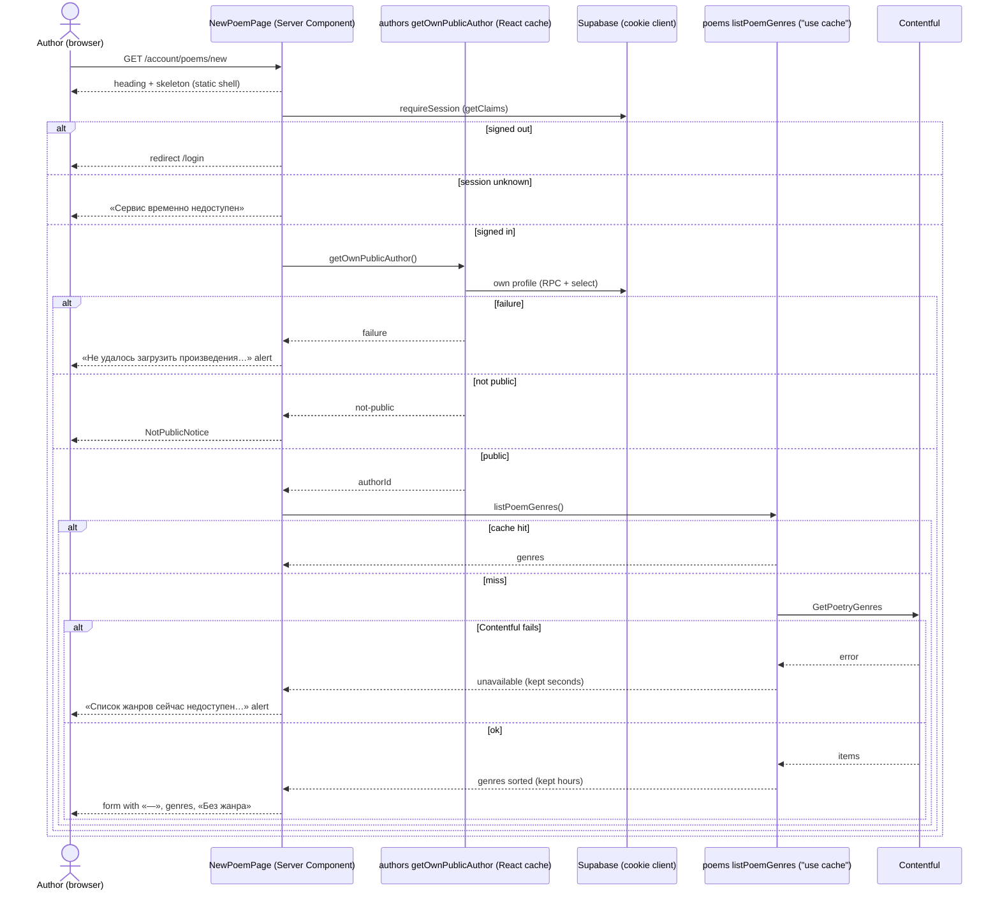
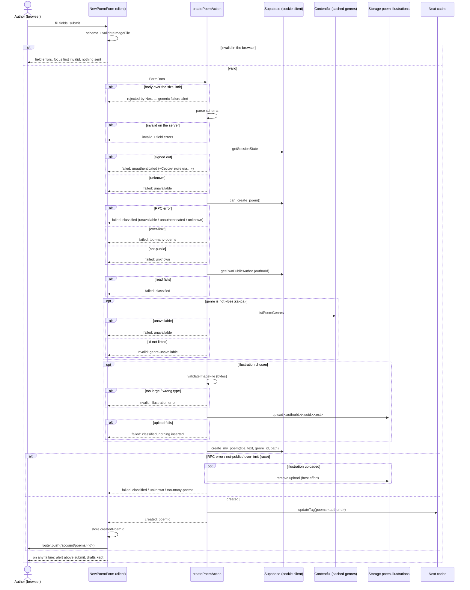
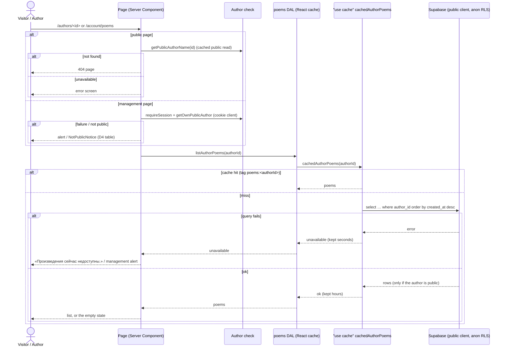
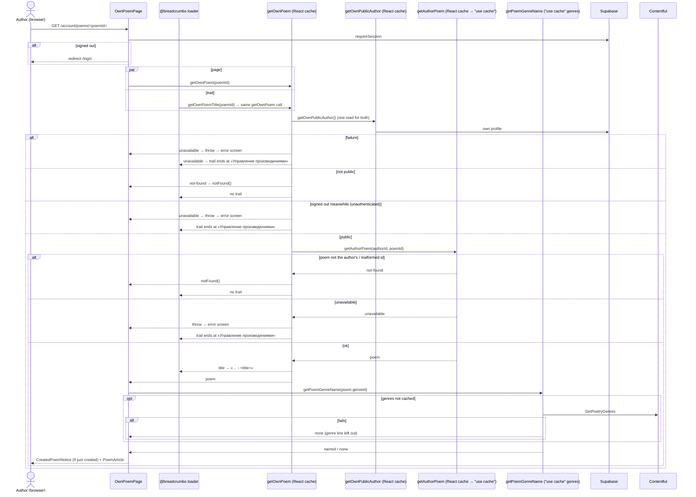

# Design

## Context

- Poems today are in-code mock data (`features/poems/dal/mock-poems.ts`): four poems, each author
  getting the first N by a hash of the id (`mock-poem-count.ts`). `author-poems.ts` is the only
  reader, so the DAL's bodies can be replaced without touching pages (author-poems NFR-3).
- `features/poems` is public and session-free (author-poems NFR-1): the author page's
  «Произведения» section (`AuthorPoemsEntry` → `AuthorPoemList`) and the poem page (`PoemPage` →
  `PoemPageContent` → `PoemView`). The breadcrumb trail reads `getAuthorPoem` through the same
  React `cache` memo as the page (ADR 0008).
- `features/authors` owns the profile: the owner reads and writes through the cookie client, public
  reads through the cookie-less client inside `"use cache"` with result-dependent lifetimes
  (hours / minutes / seconds) and one tag per author (`author:<id>`). Its writes go through
  `consume_write_allowance(scope)` first (ADR 0007). Reader-owned data follows ADR 0005: RLS plus
  column grants, no insert grant, writes only through `security definer` functions that resolve
  the caller from `auth.uid()`.
- The public-profile rule ("first and last name are set") lives in the `author_profiles` select
  policy (`20261015160958_author_profiles.sql`) and in `authors/model/is-public-profile.ts`.
- The profile editor already has what the add form needs: a Markdown editor for «О себе»
  (`AboutTextarea`, `MarkdownToolbar`, `AboutViewTabs`, `AboutPreview`, `AboutFieldMeta`, pure
  `model/markdown-format.ts`, `model/trimmed-length.ts`), a safe renderer (`AuthorAbout` with
  `about-markdown.ts`'s allowlist), an image check and picker (`validate-photo-file.ts`,
  `detect-image-type.ts`, `PhotoPicker`, `use-photo-draft.ts`, `object-url-store.ts`), and a
  Supabase error classifier (`model/classify-profile-error.ts`).
- `/account` and everything under it is gated twice: the proxy redirects a signed-out page request
  to `/login` (reader-account FR-19), and each page's feature component calls `requireSession()`
  inside its Suspense boundary.
- Genres come from a Contentful content type with id `tag` (fields `name`, `slug`) that the
  project defines — not Contentful's built-in tags (user confirmation, 2026-10-28). Creating that
  content type and its entries is an editorial prerequisite, not code in this change.
- There is no toast primitive in `shared/ui`; `Alert` has tones.

## Goals / Non-Goals

Goals: authors create poems from their account; all poem reads come from the database; one cache
entry per author serves both the public pages and the management pages; the profile editor's
Markdown editor, image check, and error classifier are shared, not copied; the write limit can't
be bypassed through the database API.

Non-goals: editing or deleting poems, drafts, search, filters, pagination, TanStack Query on the
client (user decision, 2026-10-28: server rendering with the Next.js cache until search arrives),
moderation, poem counts in the directory, a general toast system.

## Decisions

### D1 — Module layout (NFR-3)

```
src/features/poem-management/            # new: the owner's poem area under /account/poems
├── actions/
│   ├── action-client.ts                 # next-safe-action client on shared/lib/safe-action
│   └── create-poem.actions.ts           # createPoemAction ("use server")
├── dal/
│   ├── own-poem.ts                      # getOwnPoem(poemId), getOwnPoemTitle(poemId) (React cache)
│   └── poem-writes.ts                   # createOwnPoem(): pre-check, upload, create_my_poem RPC, cleanup
├── model/
│   ├── poem-form.schema.ts              # Zod: title, text, genreId; shared by form and action
│   ├── poem-management.constants.ts     # limits, NO_GENRE, bucket name
│   ├── poem-management.types.ts         # action result, form state, failures
│   ├── poem-management-messages.ts      # every string of the UI copy table this feature shows
│   ├── poem-paths.ts                    # ownPoemPath(id), NEW_POEM_PATH
│   └── created-poem-notice-ui.store.ts  # Zustand: the id of the poem just created (D8)
├── components/
│   ├── MyPoemsPage/ MyPoemsContent/ MyPoemsSkeleton/
│   ├── NewPoemPage/ NewPoemContent/ NewPoemSkeleton/
│   ├── NewPoemForm/                     # "use client": the form, on shared/ui MarkdownEditor + ImagePicker
│   ├── OwnPoemPage/ OwnPoemContent/
│   ├── CreatedPoemNotice/               # "use client": the success notification (D8)
│   └── NotPublicNotice/                 # «Чтобы добавлять произведения…» + link to the editor
├── tests/
└── index.ts
```

`poem-management/index.ts` exports: `MyPoemsPage`, `NewPoemPage`, `OwnPoemPage` (routes);
`getOwnPoemTitle`, `NEW_POEM_PATH`, `POEM_MANAGEMENT_TRAIL_LABELS` (breadcrumbs). `ownPoemPath` stays
internal: the trail builds the last item from the current URL, which it already has.

`features/poems` stays public and session-free (author-poems NFR-1):

```
src/features/poems/
├── dal/
│   ├── author-poems.ts      # listAuthorPoems, getAuthorPoem: database reads, own cache scope (D3)
│   ├── poem-row.ts          # row → Poem mapping (illustration public URL)
│   └── poem-genres.ts       # listPoemGenres(), getPoemGenreName(id): Contentful `tag` entries (D5)
├── model/
│   ├── poem-row.schema.ts   # Zod row schema (ADR 0001: dal/ validates with model/'s schema)
│   ├── poem-cache-tags.ts   # poemsTag(authorId)
│   └── …                    # Poem type changes (D3), copy, paths, constants
└── components/
    ├── PoemTitleList/       # was AuthorPoemList: the titles list, href per poem passed in
    ├── PoemArticle/         # async: reads the genre name, renders PoemView (both poem pages)
    ├── PoemPageSkeleton/    # was PoemPage's inline fallback (both poem pages)
    └── …                    # AuthorPoemsEntry, PoemPage, PoemPageContent, PoemView
```

`poems/index.ts` adds: `listAuthorPoems`, `getAuthorPoem` (already), `listPoemGenres`, `poemsTag`,
`PoemTitleList`, `PoemArticle`, `PoemPageSkeleton`, and the `Poem`, `PoemGenre`, result types.

`features/authors` adds one export: `getOwnPublicAuthor()` (D4), so the public-profile rule stays
inside `authors`.

Moved to `shared/` (second consumer, architecture.md's rule):

| From `features/authors/` | To |
| --- | --- |
| `model/markdown-format.ts`, `model/trimmed-length.ts` | `shared/lib/markdown/markdown-format.ts`, `shared/lib/text/trimmed-length.ts` |
| `AboutTextarea`, `MarkdownToolbar`, `AboutViewTabs`, `AboutPreview`, the counter part of `AboutFieldMeta` | `shared/ui/MarkdownEditor/` (one component; `maxLength`, `label`, `id`, `errorId`, `formats`, `variant` props; toolbar and tab labels stay the existing strings, now owned by shared, plus the three poem formats, D6) |
| `AuthorAbout` + `about-markdown.ts` | `shared/ui/MarkdownText/` (`variant: "about" \| "poem"` prop, D6) |
| `validate-photo-file.ts`, `detect-image-type.ts`, `PHOTO_FORMATS`, `PHOTO_MAX_BYTES` | `shared/lib/image-file/` (`validateImageFile`, `IMAGE_FORMATS`, `IMAGE_MAX_BYTES`) |
| `PhotoPicker`, `use-photo-draft.ts`, `object-url-store.ts` | `shared/ui/ImagePicker/` (button label prop) and `shared/lib/image-file/use-image-draft.ts` |
| `model/classify-profile-error.ts` | `shared/lib/supabase/classify-error.ts`: `classifySupabaseError(error)` → `"unauthenticated" \| "unavailable" \| "unknown"` (JWT codes, HTTP status, Storage errors) |

The authors feature keeps thin wrappers where it adds its own copy (`AboutFieldEditor` passes the
about label and limit). Every existing authors test keeps passing; tests of moved pure modules move
with them. `authors/dal/write-allowance.ts` stays where it is: poem creation doesn't use
`consume_write_allowance` (D2), so it still has one consumer, and architecture.md's "second
consumer" rule keeps it in `authors` (Gate 1 re-review N4).

Import direction (no cycles):

```
app ──► poem-management ──► poems ──► authors ──► auth
              │                └────► shared
              ├──► authors (getOwnPublicAuthor), auth (requireSession)
              └──► shared
breadcrumbs ──► poem-management, poems, authors
authors ──✗ poems, poem-management   (links use shared/config's POEM_MANAGEMENT_PATH, D9)
poems   ──✗ poem-management, auth, shared/lib/supabase/server
```

### D2 — Schema and the create function (NFR-1, FR-5, FR-6)

New migration `supabase/migrations/<ts>_poems.sql`, following ADR 0005: RLS, column grants, **no
insert grant**, one `security definer` write function.

```sql
create table public.poems (
  id                uuid primary key default gen_random_uuid(),
  author_id         uuid not null references public.author_profiles (id) on delete cascade,
  title             text not null check (char_length(title) <= 80 and title !~ <blank pattern>),
  text              text not null check (char_length(text) <= 10000 and text !~ <blank pattern>),
  genre_id          text check (genre_id is null or genre_id ~ '^[A-Za-z0-9._-]{1,64}$'),
  illustration_path text,
  created_at        timestamptz not null default now(),
  constraint poems_illustration_in_own_folder check (
    illustration_path is null
    or illustration_path ~ ('^' || author_id::text || '/<uuid>\.(png|jpg)$'))
);
create index poems_author_created_idx on public.poems (author_id, created_at desc, id);
```

- `<blank pattern>` is the same explicit whitespace class as `author_profiles` (trim()-equivalent).
  Title and text arrive trimmed; the length check counts code points, the same measure as the
  form (`trimmedLength`).
- `genre_id` is the Contentful `tag` entry's `sys.id`, or `null` for «Без жанра». The name is not
  stored: the poem page resolves it from the cached genre list (D5), so a renamed tag shows its new
  name everywhere.
- **One public-profile rule in SQL.** `public.is_public_author_profile(profile uuid) returns
  boolean` (`security definer`, `stable`, `set search_path = ''`, executable by `anon` and
  `authenticated`) holds the rule. The same migration rewrites the `author_profiles` policy
  "public profiles are readable by anyone" to `using (public.is_public_author_profile(id))`, so the
  author page and its poems can never disagree. (The function runs as the table owner, so calling
  it from a policy on the same table doesn't recurse.) The pgTAP test of `author_profiles` keeps
  passing unchanged.
- RLS on `poems`. Policies: `select` to `anon, authenticated` using
  `public.is_public_author_profile(author_id)`. No insert, update, or delete policy.
- Column grants: `revoke all … from anon, authenticated`; `grant select (id, author_id, title,
  text, genre_id, illustration_path, created_at)` to both. No insert, update, or delete grant.
- **`public.create_my_poem(title text, text text, genre_id text, illustration_path text) returns
  jsonb`** — `security definer`, `volatile`, `set search_path = ''`, executable by `authenticated`
  only. In one transaction:
  1. caller from `auth.uid()`; `null` → raise `42501`;
  2. own profile id from the existing `public.my_author_profile_id()`;
  3. `pg_advisory_xact_lock(hashtextextended(profile id::text, 0))`, so two concurrent calls of one
     author serialize;
  4. `public.poem_create_status(profile)` → `not-public` or `over-limit` returns that status;
  5. `insert` (the table checks reject bad lengths, genre id, and paths with `23514`) →
     `{"status": "created", "id": "<uuid>"}`.
- **`public.poem_create_status(profile uuid) returns text`** — internal (`security definer`,
  `stable`, execute revoked from `public`, `anon`, `authenticated`), the one home of the rules:
  `null` profile or `not is_public_author_profile(profile)` → `not-public`; the author's poems with
  `created_at > now() - interval '1 minute'` ≥ 2, or `> now() - interval '1 day'` ≥ 20 →
  `over-limit`; otherwise `allowed`. The numbers live only here (Gate 1 re-review N3).
- **`public.can_create_poem() returns jsonb`** — `security definer`, `stable`, executable by
  `authenticated` only: steps 1 and 2, then
  `poem_create_status`, without the lock and the insert: `{"status": "allowed" | "not-public" |
  "over-limit"}`. The
  action calls it before any upload (D7) so a blocked attempt uploads nothing. It writes nothing,
  so calling it directly gains a caller nothing.
- **Why count poems instead of the `write_rate_limits` counter** (ADR 0007's table): the counter
  would have to be consumed by the app before the upload and checked again by `create_my_poem`,
  and a direct caller could then skip the app's consume step. Counting the author's own rows inside
  the function that inserts is a check no client can skip, needs no new counter scopes, and holds
  the same numbers (2 per minute, 20 per day). The windows become sliding (the last minute, the
  last 24 hours) and count created poems, not attempts. This partially supersedes ADR 0007
  (its Decisions 1 and 3, and Decision 6's poem example) for writes that create rows: a new ADR
  0009 records it, and ADR 0007's status line gains "Partially superseded by 0009" (task 8.1).
  Profile writes keep ADR 0007's counter unchanged.
- Bucket `poem-illustrations`: public, 5 242 880 bytes, `image/png` and `image/jpeg` (mirrored in
  `supabase/config.toml`). Policies copy `author-photos`': insert with the `<uuid>/<uuid>.(png|jpg)`
  name pattern and `public.owns_public_author_folder(folder text)`; select and delete with
  `public.owns_author_profile(folder text)` (existing), needed for the best-effort cleanup. The new
  helper takes `text` and compares `p.id::text = folder`, like the existing one, so a malformed
  folder returns `false` instead of failing a `uuid` cast.
- Down migration documented in the header, never auto-run (restores the old `author_profiles`
  policy expression first).

### D3 — Read DAL and cache (FR-9, FR-11, FR-12, NFR-4)

```ts
type Poem = {
  id: string;                    // uuid
  title: string;
  text: string;                  // Markdown
  illustrationUrl: string | null;
  publishedAt: string;           // YYYY-MM-DD, created_at's UTC date
  genreId: string | null;
};
type AuthorPoemsResult = { ok: true; poems: readonly Poem[] } | { ok: false; reason: "unavailable" };
type AuthorPoemResult =
  | { ok: true; poem: Poem }
  | { ok: false; reason: "not-found" }
  | { ok: false; reason: "unavailable" };
```

- `listAuthorPoems(authorId)` and `getAuthorPoem(authorId, poemId)` are both wrapped in React
  `cache` (one read per request for page and trail, ADR 0008).
- One cached function, `cachedAuthorPoems(authorId)`: `"use cache"`, `cacheTag(poemsTag(authorId))`,
  the public client, `select id, title, text, genre_id, illustration_path, created_at … where
  author_id = $1 order by created_at desc, id`, Zod parse, map. Lifetimes: `"hours"` on success
  (an empty list included), `"seconds"` on failure (author-profiles NFR-7). `getAuthorPoem` finds the
  poem in that list, so the list and the poem can't disagree and a new poem needs one tag expiry.
  This is the "one place" cache: the public author page, the public poem page, `/account/poems`,
  and `/account/poems/<id>` all read this one entry.
- `poemId` that isn't a lowercase-hex UUID → `not-found` before any read (junk never becomes a
  cache key and never reaches the database); comparison stays exact, so an uppercase spelling is
  unknown (author-poems FR-5 keeps its case rule). `authorId` is validated as a UUID too, but
  lowercased rather than rejected when uppercase: the author page opens for an uppercase spelling,
  and the create expires the lowercase tag (group 3).
- An unavailable poem read on the public poem page shows the error screen; its trail ends at the
  author's item as the current item (breadcrumbs FR-4, user decision 2026-10-28, group 3).
- `next.config`'s `images.remotePatterns` allows the `poem-illustrations` public path next to
  `author-photos` (`shared/config/supabase-image-patterns.ts`; user decision 2026-10-28, group 3).
- Each read is bounded by an author check the caller already did (`getPublicAuthorName` on the
  public pages, `getOwnPublicAuthor` on the management pages).
- The illustration URL is the public-bucket URL of `illustration_path`, built in the mapping, like
  the author photo.

Why list-then-find instead of a per-poem query: authors have a handful of poems, the list is
needed anyway on the author page, and one tag per author is the only invalidation point. When
pagination arrives, the poem read splits into its own scope under the same tag.

### D4 — Owner reads (FR-1, FR-2, FR-7)

`authors/dal/own-public-author.ts`, exported from `authors`' index:

```ts
type OwnPublicAuthorResult =
  | { ok: true; status: "public"; authorId: string }
  | { ok: true; status: "not-public" }        // no row, or not public by isPublicProfile
  | { ok: false; failure: "unauthenticated" | "unavailable" | "unknown" };
export const getOwnPublicAuthor = cache(async (): Promise<OwnPublicAuthorResult> => …);
```

`getMyAuthorProfile()` itself is wrapped in React `cache` too, and `getOwnPublicAuthor` is built on
it and applies `isPublicProfile`, so the rule stays in `authors` and every caller in a request
shares one session-and-profile read: the management pages, their trails (D10), the account page,
and the owner link. The account page's `AccountAuthorSection` keeps calling `getMyAuthorProfile`,
because its links need three states (no profile, not public, public) that `not-public` would merge;
only `AuthorOwnerLink` switches to `getOwnPublicAuthor` (Gate 1 re-review N2).

`poem-management/dal/own-poem.ts`: `getOwnPoem(poemId)` = `getOwnPublicAuthor()` then
`getAuthorPoem(authorId, poemId)`, wrapped in `cache`; `getOwnPoemTitle(poemId)` derives from it.
Page and trail therefore share every read of the request and can't disagree.

Each management page component: `requireSession()` (redirects a signed-out reader; `unknown` →
the existing «Сервис временно недоступен» alert) → `getOwnPublicAuthor()` → by result:

| Result | `/account/poems` | `/account/poems/new` | `/account/poems/<id>` |
| --- | --- | --- | --- |
| public | list (D3) + add link | genres (D5) → form | `getOwnPoem` → `PoemArticle` or `notFound()` |
| not-public | `NotPublicNotice` | `NotPublicNotice` | `notFound()` |
| failure | «Не удалось загрузить произведения…» alert | same alert | throws → error screen |
| list `unavailable` | same alert, add link still shown | — | throws → error screen |
| genres `unavailable` | — | «Список жанров сейчас недоступен…» alert, no form | — |

`unauthenticated` after `requireSession` passed means the session ended between the two reads; it
is shown like a failure on all three pages (`getOwnPoem` maps it to `unavailable`, so the poem page
shows the error screen and the trail ends at «Управление произведениями»; Gate 1 re-review N5).

### D5 — Genres from Contentful (FR-3, FR-10)

`poems/dal/poem-genres.ts` owns the Contentful read, because both the poem page (name lookup) and
the add form (options, server-side check) need it, and `poems` must not import
`poem-management`.

- Query `GetPoetryGenres` (`tagCollection(limit: 100) { total items { sys { id } name slug } }`)
  against the project's `tag` content type — one page, a ceiling of 100 genres (clarify, 2026-10-28);
  when `total` exceeds 100, a warning with the two counts is logged, and the extra tags are
  neither offered nor named on poem pages; validated with Zod (`PoetryGenre`: `sys.id`, `name`, `slug`,
  all non-empty strings; an item that fails is dropped and logged by id only, not the whole list).
  `slug` is read and validated but not used yet.
- Result-dependent scope like `content-page`: `"use cache"`, `cacheTag(CONTENTFUL_CACHE_TAG)`,
  `cacheLife("hours")` on success, `"seconds"` on failure; returns `{ ok: true, genres }` sorted by
  `name` with `localeCompare("ru")`, or `{ ok: false, reason: "unavailable" }`. Unlike
  `content-page`, the callers fall back instead of throwing (D4 table, `getPoemGenreName`); the
  own scope is still needed so a failure is kept for seconds, not the client's default 60 s.
  `docs/state-management.md`'s exception wording is widened accordingly (task 8.1). A Contentful
  publish already expires `CONTENTFUL_CACHE_TAG` through `/api/revalidate`.
- `getPoemGenreName(genreId)`: `null` id → `{ kind: "none" }`; found → `{ kind: "named", name }`;
  id not in the list, or the list unavailable → `{ kind: "none" }` (the genre line is left out
  rather than failing the poem page).
- The form gets the sorted list plus a «Без жанра» option whose value is `NO_GENRE = ":none"` —
  the colon is outside the tag-id alphabet `^[A-Za-z0-9._-]{1,64}$`, so no real tag can collide.
  The schema maps it to `genre_id = null`. The placeholder option `—` has value `""` and fails
  `required`.

### D6 — Markdown on the poem page and the poem toolbar (FR-3, FR-10, NFR-5)

`shared/ui/MarkdownText` is `AuthorAbout` moved: `react-markdown` with `skipHtml`, images as alt
text, links unwrapped to text, and a `variant` prop:

- `"about"` (default): the profile's allowlist and look, unchanged.
- `"poem"`: allowlist `p`, `strong`, `em`, `blockquote`, `hr`, `br` (plus `img` → alt text);
  `unwrapDisallowed` turns hand-typed headings and lists into their text. A CSS-module class sets
  `white-space: pre-line` on paragraphs — react-markdown keeps a soft line break as `\n`, so each
  line of a stanza stays on its own line — and em spaces survive it, which is what the indent
  relies on. `blockquote` is styled as an epigraph (Claude Design artboard 14: each line right-aligned with
  `text-align: right`, the block pushed right with `margin-left: auto`, `max-width: 28em`, 14 px, line height 1.6, `text-muted`,
  italic inherited, no border); `hr` is drawn as a centred «* * *» (no rule line, `::before`
  content, upright, `letter-spacing: .3em`, keeps its `separator` role); `em` inside the italic
  poem text renders upright, as the mockup shows. No new dependency (laziness ladder rung 3).

`shared/ui/MarkdownEditor` takes a `formats` list and renders only those toolbar buttons, and a
`variant` that its «Просмотр» tab passes to `MarkdownText`, so the preview matches the page:

| Editor | `formats` | `variant` |
| --- | --- | --- |
| Profile «О себе» | bold, italic, heading, subheading, bulleted, numbered, quote (unchanged) | `about` |
| Poem text | bold, italic, epigraph, separator, indent (user decision, 2026-10-28) | `poem` |

As built in group 1: the caller renders the field's label (`htmlFor` the editor's `id`), because the
profile puts it in its own column and the poem form above the editor, so the editor takes no
`label` prop; it generates its own error and counter ids. It takes the counter's `length` from the
caller, because about and the poem trim differently (D6's poem trimming). `MarkdownEditor` and
`ImagePicker` take an `autoFocus` flag, on for the profile's on-demand editors and off inside a
form. `useImageDraft` returns the error kind, not a message: each feature keeps its own copy.

`shared/lib/markdown/markdown-format.ts` gains three pure formats next to the existing ones:

- `epigraph` — the existing `quote` transform (prefix `> ` to each selected line) under the poem
  label «Эпиграф»;
- `separator` — inserts `\n\n* * *\n\n` at the cursor (replacing a selection), collapsing extra
  blank lines around it so a stanza break stays one empty line; the cursor lands after it;
- `indent` — prefixes each selected line (or the cursor's line) with one indent step,
  `INDENT_STEP = "\u2003\u2003"` (two em spaces, the mockup's 2em step; CommonMark treats only
  spaces and tabs as indentation, so these never turn the line into a code block, and CSS
  `pre-line` collapses only spaces and tabs, so they survive); the selection grows with it.
  There is no outdent button: deleting the spaces is enough, and YAGNI until someone asks.

Text trimming for the poem (`poemFormSchema`, the counter, and the database check): line breaks
normalized to `\n`, then leading empty lines and trailing whitespace removed (`replace(/^(?:[ \t]*\n)+/, "")`
then `trimEnd()`), so an indented first line keeps its indent; a text that is whitespace only
counts as empty. The title keeps the plain `trim()`. The database's blank-text check is unchanged
(whitespace only is rejected); its length check counts the stored, already-normalized value.

### D7 — Create action (FR-4, FR-5, FR-6, NFR-1, NFR-10)

`createPoemAction` (next-safe-action, `FormData` input: `title`, `text`, `genreId`,
`illustration?`). Order:

1. Parse with `poemFormSchema` (line breaks normalized to `\n`; title trimmed, text trimmed per D6;
   title 1..80, text 1..10000 code points; `genreId` non-empty; the counter uses the same normalization);
   `illustration` an optional `File` (an empty file counts as none). Invalid → `invalid` with field
   errors, nothing else runs. A body over the Server Action size limit is rejected by Next before
   the action runs and shows the generic failure (ADR 0005 §4).
2. Session: `getSessionState()` — `signed-out` → `unauthenticated`; `unknown` → `unavailable`.
3. `can_create_poem()` RPC — the limit check, before any other I/O (ADR 0007's ordering rule):
   `over-limit` → `too-many-poems`; `not-public` → `unknown` (the UI never offers the form then);
   RPC error → `classifySupabaseError`.
4. `getOwnPublicAuthor()` for the `authorId` (the upload folder and the tag); failure → its
   failure; `not-public` → `unknown`.
5. Genre: `NO_GENRE` → `null`; otherwise `listPoemGenres()` must be `ok` and contain the id, else
   field error `genre-unavailable`; list unavailable → `unavailable`.
6. Illustration (only when chosen): `validateImageFile` (size, then sniffed type) → field error,
   nothing uploaded; then upload to `poem-illustrations/<authorId>/<uuid>.<ext>`, `upsert: false`,
   content type from the sniffed type. **Upload failure → the classified failure, nothing is
   inserted**: a poem is never stored without the illustration the author chose.
7. `create_my_poem(title, text, genre_id, illustration_path)` RPC — `created` → continue;
   `over-limit` (a concurrent create won the race) → `too-many-poems`; `not-public` → `unknown`;
   RPC error → classified failure. On anything but `created`, the upload is removed best-effort.
8. `updateTag(poemsTag(authorId))` — only after `created`.
9. Return `{ status: "created", poemId }`.

Failures are values (`{ status: "failed", failure }` / `{ status: "invalid", fieldErrors }`), never
`null`-as-success. Logs carry the operation and failure kind only — no title, text, file name, or
bytes, no user id, author profile id, or poem id (NFR-10; clarify, 2026-10-28).

Why not `redirect()` inside the action: the client needs to know the action succeeded to show the
notification (D8); a returned id plus `router.push` keeps that explicit and testable.

### D8 — Form and notification (FR-3, FR-4, FR-5, NFR-7)

- `NewPoemForm` (client): local `useState` for the four drafts (form state stays local,
  state-management.md); browser validation with the same schema and `validateImageFile` before the
  action runs; errors under each field, linked by `aria-describedby`, `aria-invalid` on the
  control, focus moves to the first invalid field — for browser and server field errors alike; an
  invalid text with «Просмотр» open first switches the editor back to «Редактор» —
  or, for a failure with no field, to the alert (`tabIndex={-1}`) above the submit button. Submit runs the action in a transition; while
  pending the button reads «Добавление…» and the whole form sits in a disabled `fieldset` dimmed
  to 50% (the contact form's pattern, including giving focus back after the fieldset drops it), so
  a double click sends once and no draft changes mid-request. A failure
  shows an `Alert` above the submit button and keeps every draft. Errors and the alert are not
  re-checked while typing: they stay until the next submit starts, which hides and replaces them.
- On `created`: `setCreatedPoemId(poemId)` in `created-poem-notice-ui.store.ts`, then
  `router.push(ownPoemPath(poemId))`.
- `CreatedPoemNotice` (client, on `/account/poems/<id>` above the poem): takes a snapshot on its
  first render — `const [shownId] = useState(() => useCreatedPoemNotice.getState().createdPoemId)`
  — then clears the store in an effect. It renders from the snapshot, never from a live selector,
  so clearing the store (twice under Strict Mode included) doesn't hide it. It shows a success
  `Alert` with `role="status"` when `shownId` equals the page's poem id. It is dismissed for good as
  soon as the page is left in any way (clarify, 2026-10-28): a new navigation remounts it with an
  empty store; a page Next keeps hidden for Back/Forward (React `Activity`) runs the notice's effect
  cleanup when hidden, which marks it dismissed, with a guard so Strict Mode's dev re-run doesn't
  dismiss it on first show; a reload starts with an empty store. The guard is verified by
  `CreatedPoemNotice.test.tsx` and the Back/Forward case by web-qa.
- On a `genre-unavailable` field error, the form drops that option from its list and resets the
  dropdown to «—» (clarify, 2026-10-28); the other drafts stay.
- On `created`, `NewPoemForm` clears all four drafts before `router.push`, so Back to the form
  shows it empty.
- Why Zustand: client UI state that must survive one client-side navigation, and nothing on the
  server needs it. A query flag (`?created=1`) would repeat the notification on reload and leak
  into shared links.

### D9 — Routes, links, proxy (FR-1, FR-2, FR-3, FR-7)

- `shared/config/account-paths.ts` adds `POEM_MANAGEMENT_PATH = "/account/poems"`; already covered
  by `isAccountPath`, so the proxy redirect needs no change.
- Routes (thin): `app/(authorized)/account/poems/page.tsx` → `MyPoemsPage`; `…/poems/new/page.tsx`
  → `NewPoemPage`; `…/poems/[poemId]/page.tsx` → `OwnPoemPage` with `params.then(…)`. The static
  `new` segment wins over `[poemId]`; poem ids are UUIDs, so they never collide.
- `authors`: `AccountAuthorLinks` adds a `ButtonLink variant="ghost"` «Управление произведениями»
  when `isPublicProfile(profile)`; `AuthorOwnerLinkView` renders it next to «Редактировать
  профиль». Both read the path from `shared/config`, so `authors` imports neither poem feature.

### D10 — Breadcrumbs (FR-8)

- `STATIC_ROUTES` adds `POEM_MANAGEMENT_PATH` → «Управление произведениями» and `NEW_POEM_PATH` →
  «Добавление нового произведения» (labels from `poem-management`'s index).
- New match kind `own-poem` for `/account/poems/<uuid>`; the loader calls `getOwnPoemTitle(poemId)`,
  which shares `getOwnPoem`'s reads with the page (D4). It never calls `requireSession`, so the
  `@breadcrumbs` slot never redirects; a signed-out request is redirected by the proxy before the
  slot renders. Results: `ok` → «… › <title>»; `not-found` → no trail
  (the page is a 404); `unavailable` → the trail ends at «Управление произведениями» as the
  current item (the page shows the error screen).
- Slot pages `app/@breadcrumbs/account/poems/page.tsx`, `new/page.tsx`, `[poemId]/page.tsx`
  (`breadcrumbs-slot.test.ts` requires them).
- The trail of `/account/poems/<id>` reads the session: it renders only for the signed-in owner,
  which breadcrumbs FR-5's new exception allows, since no other visitor can reach the page.

### D11 — Skeletons (FR-13)

Each page puts its heading in the static shell and its data part in a Suspense boundary with a
skeleton in the existing style (`bg-surface animate-pulse motion-reduce:animate-none`,
`aria-hidden`, plus a `role="status"` «Загрузка…»):

- list: three title-line blocks and the add-link block;
- add page: four field blocks (input, tall textarea, select, picker) and a button block;
- owner's poem page: `PoemPageSkeleton` from `poems`, the same one the public poem page uses.

After a create, `router.push` to a page whose tag was just expired shows the poem page skeleton
until the fresh read streams in — the "data refreshing on the server" case.

### D12 — Seed and mock removal (FR-9, FR-14)

`mock-poems.ts`, `mock-poem-count.ts`, their tests, and `public/mock-poems/` are deleted.
`supabase/seed.sql` inserts poems with the four former mock titles and texts: author1 0,
author2 1, author3 2, author4 3, author5 4 — the same counts the e2e scenarios rely on — with
`genre_id null`, no illustration, and `created_at` set to each mock poem's former `publishedAt` at
12:00 UTC, so pages and recorded scenarios keep the same dates and order (clarify, 2026-10-28).
Author N+1 gets the first N poems of the former set, in its definition order, as `slice(0, n)` did. The
seed runs as the database owner, so it inserts directly, bypassing `create_my_poem`. Each seeded poem
gets a fixed id, `30000000-0000-4000-8000-0000000000NM` (N the author's number, M the poem's 1-based
position in the former set), so recorded scenarios can open a poem by URL after every
`db reset` (user decision, 2026-10-28, group 2). Recorded
scenarios that asserted an illustration or a genre line are updated.

### D13 — Testing

- pgTAP `supabase/tests/poems.test.sql`: no role can insert, update, or delete `poems` directly;
  `create_my_poem` as anon fails; as a user with a non-public profile → `not-public`; as the
  owner → `created` with the row owned by their profile; length, blank, genre id, and
  illustration-path checks; the 3rd call in a minute and the 21st in a day → `over-limit` and no
  row; `can_create_poem` agrees with `create_my_poem`; select hides poems of a non-public profile;
  `author_profiles`' public select still behaves as before through `is_public_author_profile`;
  bucket policies, including a malformed folder name rejected with the RLS error `42501`,
  never a uuid-cast error.
- Vitest: schema, `getOwnPublicAuthor` (memo shared across callers), `getOwnPoem` /
  `getOwnPoemTitle`, read DAL (mocked public client, lifetimes, tag, UUID guard), genres DAL,
  `createOwnPoem` (upload failure → nothing inserted; RPC failure → upload removed), the action
  (order of checks, no tag expiry on failure, NFR-10 log content), every component, breadcrumbs
  trail building, the moved shared modules.
- web-qa (Gate 3): create with and without illustration, validation, notification once, both
  paths to the poem, guest redirect.

### Sequence diagrams

Add page load (`GET /account/poems/new`):



Create a poem:



Read an author's poems (public page and management page share one entry):



Owner's poem page and its trail (`GET /account/poems/<poemId>`), with the genre lookup shared by
both poem pages:



## Risks / Trade-offs

- **Author loses public status** (clears the name): their poems disappear from every page,
  `/account/poems` shows the not-public notice. Matches the "only with a public profile" decision;
  nothing is deleted.
- **Stale genre**: a tag deleted in Contentful after a poem used it — the genre line disappears
  (D5). A form opened before the deletion gets «Этот жанр больше недоступен».
- **Sliding limit instead of ADR 0007's fixed window** (D2): it counts created poems only, so
  failed attempts don't count. That's acceptable: a failed attempt writes nothing and expires no
  tag, which is what ADR 0007's limit protects. Recorded as ADR 0009, partially superseding 0007.
- **Direct Storage inserts**: as with author photos, a signed-in user's own token can upload any
  number of objects into their folder through the Storage API (the bucket caps size and type, not
  count). Known limit carried over from add-author-profiles (PROGRESS item 10). The `poems` table
  itself can't grow past the limit: its only write path is `create_my_poem`.
- **Orphan illustration** if the process dies between upload and `create_my_poem`. Accepted: rare,
  in the author's own folder, cleanable later.
- **List-then-find** reads the whole list for one poem; fine at the current scale, revisit with
  pagination (D3).
- **Shared extraction** touches the profile editor: covered by its existing tests, done in its own
  group before any new code.
- **Rewriting the `author_profiles` public policy** (D2): same rule, new home; the existing pgTAP
  file proves the behaviour is unchanged. The policy now calls a `security definer` function per
  row of the directory query, which Postgres can't inline; fine at the current scale (the
  directory is already capped at 1000 rows), revisit with directory pagination.
- **Contentful prerequisite**: the `tag` content type must exist in each environment; without it
  the query fails, and the add page shows the genres-unavailable alert (no crash).
- **`max_rows = 1000`** PostgREST cap applies to one author's list; above any real author given
  the 20-per-day limit for a long time, revisit with pagination.

## Migration Plan

1. Apply the migration locally (`npx supabase db reset`), run pgTAP.
2. Deploy: `npx supabase db push` before the app ships; confirm the `poem-illustrations` bucket
   and its limits on the hosted project; confirm the Contentful `tag` content type exists; add all
   three to the deploy checklist in `PROGRESS.md`.
3. Rollback: revert the app first (its reads would fail against a missing table), then the
   documented down migration.

## Scaffold map

Written by `opsx-scaffold` after the files existed (map approved 2026-10-28). Stub bodies only; moves
out of `authors` (group 1), the migration and seed (group 2), the `AuthorPoemList` → `PoemTitleList`
rename (5.2), routes and slot pages (groups 6-7) are not scaffolded. Temporary `knip.jsonc`
`ignoreFiles` entries and `@public` tags carry the task that removes each.

| File | Responsibility | Exports |
| --- | --- | --- |
| `src/shared/config/account-paths.ts` (added) | the management area's path | `POEM_MANAGEMENT_PATH` |
| `src/features/authors/dal/own-public-author.ts` | own profile as public / not public, request-memoized (D4) | `getOwnPublicAuthor` |
| `src/features/authors/model/author.types.ts` (added) | its result type | `OwnPublicAuthorResult` |
| `src/features/poems/model/poem-row.schema.ts` | Zod row schema (D3, ADR 0001) | `poemRowSchema`, `PoemRow` |
| `src/features/poems/dal/poem-row.ts` | row → `Poem` (D3) | `toPoem` |
| `src/features/poems/dal/poem-genres.ts` | Contentful `tag` genres, name lookup (D5) | `listPoemGenres`, `getPoemGenreName` |
| `src/features/poems/model/poem-cache-tags.ts` | one tag per author (D3) | `poemsTag` |
| `src/features/poems/model/poem.types.ts` (added) | list and genre result types | `AuthorPoemsResult`, `PoemGenre`, `PoemGenresResult`, `PoemGenreName` |
| `src/features/poems/index.ts` (added) | types for poem-management | `Poem`, `PoemGenre` (types) |
| `src/features/poems/components/PoemArticle/` | genre lookup + `PoemView`, both poem pages | `PoemArticle`, `PoemArticleProps` |
| `src/features/poems/components/PoemPageSkeleton/` | poem page loading state (D11) | `PoemPageSkeleton` |
| `src/features/poem-management/model/poem-management.constants.ts` | limits, `NO_GENRE`, bucket, action statuses | `TITLE_MAX_LENGTH`, `TEXT_MAX_LENGTH`, `NO_GENRE`, `POEM_ILLUSTRATIONS_BUCKET`, `CREATE_POEM_STATUS` |
| `src/features/poem-management/model/poem-management.types.ts` | form fields, failures, action and DAL results | `PoemFormField`, `PoemFieldErrors`, `ServiceFailure`, `CreatePoemFailure`, `CreatePoemResult`, `CanCreatePoemResult`, `PoemIllustration`, `CreateOwnPoemInput`, `CreateOwnPoemResult`, `OwnPoemResult`, `OwnPoemTitleResult` |
| `src/features/poem-management/model/poem-form.schema.ts` | field shape; rules in 4.1 | `poemFormSchema`, `PoemFormInput` |
| `src/features/poem-management/model/poem-management-messages.ts` | the UI copy table, verbatim | `POEM_MANAGEMENT_COPY`, `POEM_FIELD_ERRORS`, `CREATE_POEM_FAILURE_MESSAGES`, `POEM_MANAGEMENT_TRAIL_LABELS` |
| `src/features/poem-management/model/poem-paths.ts` | management paths | `NEW_POEM_PATH`, `ownPoemPath` |
| `src/features/poem-management/model/created-poem-notice-ui.store.ts` | Zustand: the poem just created (D8) | `useCreatedPoemNotice`, `CreatedPoemNoticeState` |
| `src/features/poem-management/dal/own-poem.ts` | owner's poem and its title, request-memoized (D4, D10) | `getOwnPoem`, `getOwnPoemTitle` |
| `src/features/poem-management/dal/poem-writes.ts` | limit check, upload, `create_my_poem`, cleanup (D7) | `checkCanCreatePoem`, `createOwnPoem` |
| `src/features/poem-management/actions/action-client.ts` | next-safe-action client | `poemManagementActionClient` |
| `src/features/poem-management/actions/create-poem.actions.ts` | `"use server"` create (D7) | `createPoemAction` |
| `src/features/poem-management/components/MyPoemsPage/`, `MyPoemsContent/`, `MyPoemsSkeleton/` | `/account/poems` (FR-2) | one component each |
| `src/features/poem-management/components/NewPoemPage/`, `NewPoemContent/`, `NewPoemSkeleton/` | `/account/poems/new` (FR-3) | one component each |
| `src/features/poem-management/components/NewPoemForm/` | client add form (D8) | `NewPoemForm`, `NewPoemFormProps` |
| `src/features/poem-management/components/OwnPoemPage/`, `OwnPoemContent/` | `/account/poems/<id>` (FR-7) | component + props each |
| `src/features/poem-management/components/CreatedPoemNotice/` | client success notice (D8) | `CreatedPoemNotice`, `CreatedPoemNoticeProps` |
| `src/features/poem-management/components/NotPublicNotice/` | not-public message + editor link | `NotPublicNotice` |
| `src/features/poem-management/index.ts` | public API | `MyPoemsPage`, `NewPoemPage`, `OwnPoemPage`, `getOwnPoemTitle`, `OwnPoemTitleResult`, `POEM_MANAGEMENT_TRAIL_LABELS`, `NEW_POEM_PATH` |
