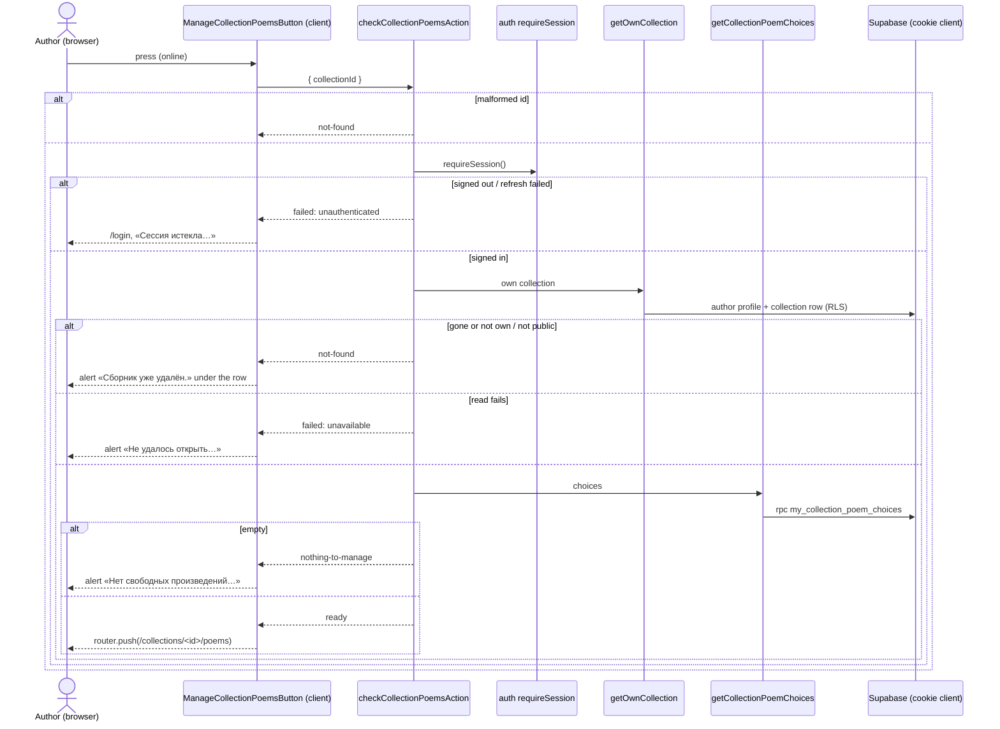
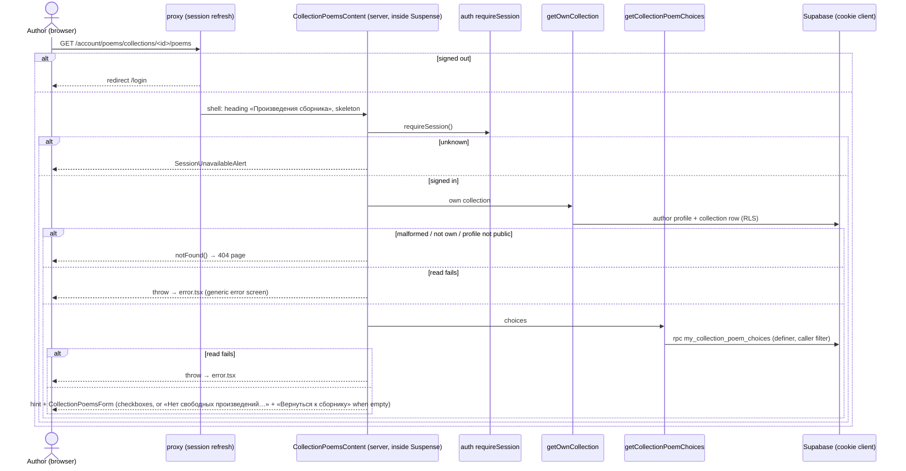
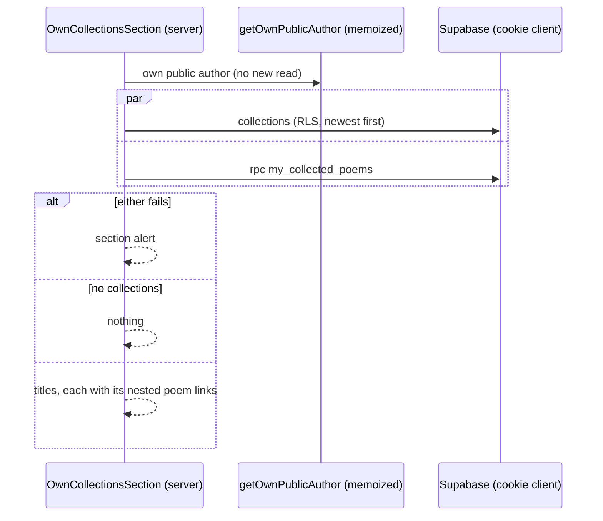

# Design

## Context

See proposal.md (Why). Current state the design builds on:

- `collection-management` (add-poem-collections) owns the collection pages, the section on
  `/account/poems` (a slot `MyPoemsPage` renders; the route file composes the two features), the
  edit form's leave guard (`EditCollectionForm/use-leave-guard.ts`, a copy of poem-management's),
  the one-time list notice («Сборник уже удалён.»), and the write-log helpers. Its reads are
  uncached and run under RLS with the cookie client (ADR 0011); writes call `refresh()` from
  `next/cache` on success.
- Poems are public: `poems` has an RLS policy for `anon, authenticated` and an explicit column
  grant `select (id, author_id, title, text, genre_id, illustration_path, created_at)`. Public pages
  read them from one `"use cache"` entry per author (`poemsTag`). Writes go only through
  `create_my_poem`, `update_my_poem`, `delete_my_poem` (ADR 0005), each setting explicit columns.
- `collections` is private: the owner reads their own rows through RLS; writes only through three
  definer functions.
- Writes that change existing rows count against `consume_write_allowance(scope)` (ADR 0007;
  scopes `profile_write`, `photo_upload`, `poem_edit`, `collection_edit`).
- `shared/` holds the connection status and notice, the leave-block store with `LEAVE_ANSWER`
  (`leave | stay | dismissed`), the session-expired store, `useOneTimeValue`, `Dialog`, `Button`,
  `ButtonLink`, `Alert`. There is no checkbox primitive in `shared/ui`.
- The collection edit form's guard calls `onBlocked()` with no argument: it only ever opens a
  dialog that says "save first", so it never needed the clicked link.

## Goals / Non-Goals

Goals: membership stored on the poem, invisible to everyone but the author; one save that applies
the whole selection or nothing, safe against two tabs; the new page built from the feature's own
patterns; `poem-management`, `poems`, and the public poem reads unchanged in code and behaviour.

Non-goals: a generic "entity picker", a shared checkbox primitive (one use), optimistic updates,
caching collection reads, moving the leave guard to `shared/`, paging the list.

## Decisions

### D1 — Everything in `collection-management` (NFR-3)

The page, its form, the check and save actions, and the new reads belong to the collection noun;
no new feature. `poem-management` and `poems` are not imported and not changed (the boundaries
test's expected `beforeunload` list is the only edit there, D7).

```
src/app/(authorized)/account/poems/collections/[collectionId]/poems/page.tsx   # thin: CollectionPoemsPage
src/app/@breadcrumbs/account/poems/collections/[collectionId]/poems/page.tsx   # slot page (D11)

src/features/collection-management/
├── actions/
│   ├── check-collection-poems.actions.ts      # checkCollectionPoemsAction (D4)
│   └── save-collection-poems.actions.ts       # saveCollectionPoemsAction (D6)
├── dal/
│   ├── collection-poems.ts                    # getCollectionPoemChoices, listCollectedPoems (D3)
│   ├── collection-poems-writes.ts             # saveOwnCollectionPoems (RPC) (D2, D6)
│   └── collection-poems-allowance.ts          # consumeCollectionPoemsSaveAllowance (`collection_poems_save`)
├── hooks/
│   └── use-leave-guard.ts                     # MOVED from EditCollectionForm/; onBlocked(href) (D7)
├── model/
│   ├── collection-poems-selection.ts          # isSelectionChanged, selectionDiff (D5)
│   ├── collection-poems.schema.ts             # check and save inputs (UUIDs, no duplicates, no overlap, caps)
│   ├── collection-management.constants.ts     # + COLLECTION_POEMS_SEGMENT, statuses, MAX_POEMS_PER_SAVE
│   ├── collection-management.types.ts         # + CollectionPoemChoice, CollectedPoem, results
│   ├── collection-management-messages.ts      # + the proposal's new copy
│   └── collection-paths.ts                    # + collectionPoemsPath(id), ownPoemPagePath(poemId) (D12)
└── components/
    ├── CollectionContent/                     # + reads the choices; renders CollectionPoemList and the button (D4)
    ├── CollectionActions/                     # named slots + the manage button and its error below the row (D4)
    ├── CollectionPoemList/                    # server: «Произведения» + title links (D4)
    ├── ManageCollectionPoemsButton/           # client: check, push, or the error under the row (D4)
    ├── OwnCollectionsSection/                 # + nested poem lists (D10)
    ├── CollectionPoemsPage/ CollectionPoemsContent/                    # the page and its reads (D5)
    ├── CollectionPoemsForm/                   # client: fieldset, save, notices (D5, D6)
    │   ├── use-collection-poems-form.ts       #   draft, outcomes, saved state
    │   └── use-collection-poems-leave-prompt.ts  # the dialog's opening, answer, and focus (D7)
    ├── CollectionPoemsLeaveDialog/            # client: save / leave / stay Dialog (D7)
    └── CollectionPoemsSkeleton/               # heading + list bars
```

The index adds `CollectionPoemsPage`, `COLLECTION_POEMS_SEGMENT`, `collectionPoemsPath`, and the
new trail label. Import direction is unchanged: `app → breadcrumbs → collection-management →
authors → auth → shared`.

### D2 — Database (NFR-1, FR-1, FR-6, FR-7, FR-8)

New migration `supabase/migrations/<ts>_collection_poems.sql`:

```sql
alter table public.collections add constraint collections_id_author_key unique (id, author_id);

alter table public.poems add column collection_id uuid;
alter table public.poems add constraint poems_collection_same_author
  foreign key (collection_id, author_id) references public.collections (id, author_id)
  on delete set null (collection_id);

create index poems_collection_created_idx on public.poems (collection_id, created_at desc, id)
  where collection_id is not null;
-- No grant: the existing grant names its columns, so the new one is unreadable and unwritable by anon
-- and authenticated (ADR 0012). Verified by pgTAP.
```

- **Same author by construction**: the composite foreign key makes "a poem only in its own
  author's collection" a database fact, not only the function's check. `on delete set null
  (collection_id)` (Postgres 15+, which Supabase runs) frees the poems when a collection goes and
  keeps `author_id`. Deleting a poem needs nothing.
- **Private column on a public table** (ADR 0012, new): RLS is per row, column grants per role, so
  neither can say "only the row's owner sees this column". The column therefore has no grant at all,
  and the owner reads it through definer functions that filter by `my_author_profile_id()`. ADR 0012
  explicitly amends ADR 0011 §1 (private reads go through the cookie client under RLS) and ADR 0005
  §1 (column grants decide which columns) for this one case: RLS can't help, because `poems` rows are
  public, so the function's own caller filter is the last line of defence, and pgTAP proves it for
  every function (another author's collection and poems return nothing) (Gate 1 C2). The
  alternative, a separate `collection_poems (poem_id primary key, collection_id)` table with
  owner-only RLS, would keep the poems table untouched, but the request asks for the id on the poem
  (proposal, Why), and the composite key above gives the same guarantees.
- `my_collection_poem_choices(collection_id uuid) returns table (id uuid, title text, selected
  boolean)`, `sql stable security definer`: the caller's own poems with `collection_id = $1` or
  `is null`, only when `$1` is the caller's own collection (else no rows), ordered `created_at desc,
  id`. `selected` is `collection_id is not null`.
- `my_collected_poems() returns table (collection_id uuid, id uuid, title text)`: the caller's own
  poems with a collection, ordered `created_at desc, id`.
- `save_my_collection_poems(collection_id uuid, added uuid[], removed uuid[]) returns jsonb`,
  `plpgsql security definer`:
  1. `auth.uid()` null → raise 42501. Arrays null, with duplicates, overlapping, both empty, or
     longer than 1000 each → raise 22023 (the action validates first; this is the direct-call
     guard).
  2. `profile := my_author_profile_id()`; null or not `is_public_author_profile` → `{ status:
     'not-found' }` (the action has already answered `not-public`; this is the race).
  3. Lock the collection row `for update` where `id = $1 and author_id = profile`; none →
     `{ status: 'not-found' }`.
  4. Lock every poem in `added ∪ removed` `for update` (ordered by id, so two saves never deadlock).
     After the lock, count `added` poems with `author_id = profile and collection_id is null` and
     `removed` poems with `author_id = profile and collection_id = $1`; either count short →
     `{ status: 'stale' }`, nothing written.
  5. `update poems set collection_id = $1 where id = any(added)`; `set collection_id = null where
     id = any(removed)`; return `{ status: 'saved' }`.
  Two concurrent saves wanting one free poem: the second waits on its row lock, then sees it taken
  and answers `stale` (FR-8, NFR-1).
- All three: `set search_path = ''`, execute revoked from `public, anon`, granted to
  `authenticated`.
- `write_rate_limits.scope`'s check and `consume_write_allowance` gain `('collection_poems_save',
  10, interval '1 minute')`.
- `create_my_poem`, `update_my_poem`, `delete_my_poem` are untouched: each names its columns, so a
  new poem starts free and an edit keeps the collection (poem-management NFR-1 scenarios).
- Down migration in the header (never auto-run): drop the three functions, the index, the foreign
  key, the column, the unique constraint; restore the scope check and `consume_write_allowance`;
  delete `collection_poems_save` rows.

### D3 — Reads (FR-2, FR-4, FR-11, NFR-5)

`dal/collection-poems.ts` (server-only, cookie client, uncached as ADR 0011):

- `getCollectionPoemChoices(collectionId)`: `rpc("my_collection_poem_choices")`, Zod-parsed to
  `CollectionPoemChoice[]` (`{ id, title, selected }`); error → `{ ok: false }`. Callers have
  already passed `getOwnCollection` (the 404 rules), so an empty array means "nothing to manage",
  never "not yours". Not wrapped in React `cache`: each request has one caller (the page derives
  the button's visibility itself; the trail doesn't need it), so ADR 0008's reason doesn't apply
  (Gate 1 P4).
- These two reads use definer functions, not RLS (D2, ADR 0012); the feature's other reads keep
  ADR 0011's cookie-client-under-RLS rule.
- `listCollectedPoems()`: `rpc("my_collected_poems")` → `CollectedPoem[]` (`{ collectionId, id,
  title }`); error → `{ ok: false }`.
- Log lines carry the operation and failure kind only (NFR-5), through the feature's write-log.

### D4 — The collection page (FR-2, FR-3, FR-9)

`CollectionContent`, after `getOwnCollection(id)` succeeds, awaits `getCollectionPoemChoices(id)`;
a failure throws (the route's `error.tsx`, add-poem-collections FR-6). From the choices it derives `poems =
choices.filter(selected)` and `canManage = choices.length > 0` (never stored). It renders
`CollectionPoemList` (server: `<h2>` «Произведения» and a `<ul>` of `Link`s to `ownPoemPagePath`,
nothing when empty) after the description, and passes `ManageCollectionPoemsButton` (only when
`canManage`) into `CollectionActions` between the edit link and the delete button.

`ManageCollectionPoemsButton` (client): a `Button` (`ghost` variant; `Button` has no other non-primary, non-danger variant) that is `aria-disabled` while
the connection status isn't `online` (as «Удалить сборник», add-poem-collections FR-14) or while the check is pending.
On press it clears its error and calls `checkCollectionPoemsAction({ collectionId })`:

| Result | Client |
| --- | --- |
| `ready` | `router.push(collectionPoemsPath(id))` |
| `not-found` | alert «Сборник уже удалён.» under the row (also when the own profile is no longer public: `getOwnCollection` answers `not-found`, as the page would) |
| `nothing-to-manage` | alert «Нет свободных произведений для добавления в сборник.» under the row |
| `failed: unavailable \| unknown` (or a rejected call) | alert «Не удалось открыть произведения сборника. Попробуйте позже.» |
| `failed: unauthenticated` | `markSessionExpired()`, `router.replace(SIGN_IN_PATH)`, `router.refresh()` |

The error shows below the whole row, but the button sits in the middle of it, so the row owns the
error: `CollectionActions` (already a client module) changes from `children` to named slots,
`editButton` and `deleteButton` (server-rendered, passed in as before), plus `manageCollectionId?:
string` (set only when `canManage`). It renders edit, `ManageCollectionPoemsButton`, delete in that
order, and below the row the `role="alert"` with the error the button reports through `onError`
(cleared on the next press). DOM order then matches visual order. No `refresh()`: on `not-found` a
refresh would replace the page with the 404 before the author reads the error.

`checkCollectionPoemsAction`, in order: malformed id → `not-found`; `requireSession` →
`unauthenticated`; `getOwnCollection(id)`: `not-found` → `not-found`, `unavailable` → `failed:
unavailable`; `getCollectionPoemChoices(id)`: failure → `failed: unavailable`, empty →
`nothing-to-manage`, else `ready`. A read only: nothing counted.

Why a check at all, rather than a plain link whose target renders the 404: the request asks for
the error on the press (proposal); a server round trip is the only way a stale page can know.

### D5 — The collection poems page (FR-4, FR-5)

`CollectionPoemsPage` (server): `<h1>` «Произведения сборника» in the shell, Suspense with
`CollectionPoemsSkeleton`. `CollectionPoemsContent`: `requireSession()` (unknown →
`SessionUnavailableAlert`); `getOwnCollection(id)` → `notFound()` / throw;
`getCollectionPoemChoices(id)` → throw on failure; else the hint with the title and
`CollectionPoemsForm` with `{ collectionId, choices }`. The form renders the nothing-to-manage
paragraph and `ButtonLink` «Вернуться к сборнику» itself when `choices` is empty, so it stays
mounted when a `stale` save's refresh empties the list and its stale alert stays above that text
(FR-8, spec-clarify 2026-11-07).

`model/collection-poems-selection.ts` (pure):

- `storedSelection(choices): ReadonlySet<string>` — ids with `selected`.
- `isSelectionChanged(stored, draft)` — set inequality.
- `selectionDiff(stored, draft): { added: string[]; removed: string[] }` — what the save sends.

`useCollectionPoemsForm({ collectionId, choices })` keeps `draft: ReadonlySet<string> | null` —
`null` means "follow what is stored" — plus `justSaved: boolean`, the failure, and the pending flag.
The checked set is `draft ?? stored`; `isChanged` is derived each render. Because `null` follows the
props, a `refresh()` that brings a new stored set needs no key and no effect: after `saved` or
`stale` the hook sets `draft` to `null`. That reset runs inside the same `startTransition` as the
action call (`startTransition(async () => { const result = await save(...); setDraft(null); … })`),
so React commits it together with the refreshed payload and never paints the old stored selection
next to the saved notice (Gate 1 P1; web-qa looks for the flash). This differs from the edit form's
remount-by-key on purpose: a remount would drop `justSaved`, which must survive the save. A poem that vanished from `choices` (deleted elsewhere, or taken by another collection's save)
simply has no checkbox; `selectionDiff` ignores ids not in `choices`. A kept hidden page whose
`draft` is not `null` therefore shows the refreshed list with the author's draft over it (FR-12,
spec-clarify 2026-11-07); a draft that has become stale fails the save with `stale`.

`CollectionPoemsForm` renders: `ConnectionNotice` (D8); the failure `Alert` or the saved notice
(`role="status"`, shown while `justSaved && !isChanged-since-save`); a `<fieldset>` with a
visually hidden `<legend>` «Произведения» and one native `<input type="checkbox">` with its
`<label>` per choice, styled with tokens in the feature's CSS module (no shared primitive: one
use, laziness ladder rung 3); then «Сохранить выбранное» when `isChanged || justSaved`
(disabled unless `isChanged`), and «Вернуться к сборнику» when `justSaved && !isChanged`. A change
after a save clears `justSaved`'s notice; the button and link come back when the draft returns to
stored (add-poems-to-collections FR-6).

### D6 — Saving (FR-6, FR-7, FR-8, FR-12)

`saveCollectionPoemsAction({ collectionId, added, removed })`, in order:

1. malformed collection id → `not-found`; other input invalid (non-UUID, duplicates, overlap, both
   empty, over `MAX_POEMS_PER_SAVE` = 1000 each) → `failed: unknown` (the form can't produce it);
2. `requireSession` → `failed: unauthenticated`;
3. `consumeCollectionPoemsSaveAllowance()` → `false` → `failed: too-many-saves`; error → classified;
4. `getOwnPublicAuthor()`: failure → classified, not public → `failed: not-public`;
5. `saveOwnCollectionPoems(...)`: `saved` → `refresh()`, `{ status: "saved" }`; `stale` →
   `refresh()`, `{ status: "stale" }`; `not-found` → `{ status: "not-found" }`; error → classified.

| Result | Client |
| --- | --- |
| `saved` | `draft = null`, `justSaved = true`, guard off; a pending leave continues (D7) |
| `stale` | `draft = null`, the stale alert, focus on it |
| `not-found` | `setListNotice({ kind: "already-deleted" })`, `router.replace(POEM_MANAGEMENT_PATH)` |
| `failed: unauthenticated` | `markSessionExpired()`, `router.replace(SIGN_IN_PATH)`, `router.refresh()` |
| `failed: too-many-saves \| not-public \| unavailable \| unknown` | alert above the list, focus, selection kept |
| call rejected while offline | the offline notice, selection kept |
| call rejected while online | the `unknown` alert, selection kept |

`refresh()` on `stale` too, so the reloaded list shows the poems as they are now (FR-8). No
automatic retry: every attempt counts against the limit.

### D7 — Leaving with unsaved changes (FR-10, auth)

**One guard, two pages.** `use-leave-guard.ts` moves from `EditCollectionForm/` to the feature's
`hooks/` (a move, its tests with it) and its `onBlocked` gains the clicked link's `href`
(`onBlocked: (href: string) => void`, where `href` is the link's `pathname + search + hash`, a
relative path `router.push` accepts — never the absolute `link.href`; Gate 1 P5); the edit form's
prompt ignores the argument. A third copy for
one changed callback signature would be the duplication the feature exists to keep at two. The
guard's link, `beforeunload`, and sign-out mechanics are unchanged.

The poems page uses it with `active = (isChanged || isPending) && !justSavedAndUnchanged`,
`isAllowed = (p) => p === collectionPoemsPath(id)`.

`use-collection-poems-leave-prompt.ts` holds the dialog's reason (`link` with its `href` | `sign-out`
with its pending answer) and its three buttons:

- **«Сохранить изменения»** (focused on open; disabled offline or slow, focus then on «Остаться»):
  runs the form's save. The dialog stays open while sending (`closable={false}`, buttons disabled,
  «Сохранение…»). On `saved`: link form → guard off, then `router.push(href)`; sign-out form →
  answer `leave` (the header signs out). Any other result: the dialog closes, answer `dismissed`
  (sign-out form), and the page shows the outcome as in D6.
- **«Уйти без сохранения» / «Выйти без сохранения»**: link form → guard off, `router.push(href)`;
  sign-out form → answer `leave`.
- **«Остаться»**, ×, Escape: closes; link form → focus back on the clicked link; sign-out form →
  answer `stay`.

The guard is turned off before `router.push`, so the push isn't blocked by its own listener (the
listener only catches DOM clicks, but `beforeunload` would still fire on a full navigation).

**Opened while a save is sending (spec-clarify, 2026-11-07).** The prompt opens in a "waiting"
state bound to the form's pending save: «Сохранение…», every button disabled, `closable={false}`.
It sends nothing itself; when the pending save resolves, it continues exactly as if «Сохранить
изменения» had started it (`saved` → push or answer `leave`; anything else → close, page outcome).

**Order after a save from the sign-out form (Gate 1 C1).** The guard's cleanup answers a pending
sign-out question `dismissed` as soon as `active` turns false, and drops any later answer. A
`saved` result makes the selection unchanged, which turns `active` false. So the prompt must
deliver `leave` before anything that can change `active`: on `saved` in the sign-out form it
resolves the pending answer synchronously, right in the transition callback and before
`setDraft(null)` / `setJustSaved(true)`, and only then closes the dialog. It does not wait for the
dialog's `close` event, unlike the edit form's prompt, whose answers never follow a state change of
their own. A test resets the draft before the `close` event fires and asserts exactly one sign-out.

**Why a separate prompt hook, not the edit form's (Gate 1 P3).** The edit form's prompt has one
answer button and no pending state; this one runs a save inside the dialog, holds the clicked
`href` to continue to, has three outcomes per form, and must answer before its own state changes
(above). Extending the edit form's hook would give it all of that unused. The two share the guard;
the focus-return detail (back to the opener) is three lines and is repeated.
`CollectionPoemsLeaveDialog` is the shared `Dialog` with the texts from the messages module.
The moved path is updated wherever the old one is pinned (Gate 1 P6): the expected
`beforeunload` lists in `poem-management/tests/boundaries.test.ts` and
`collection-management/tests/boundaries.test.ts`, `docs/architecture.md`'s guard note, and the
guard's test file, which moves from `tests/components/` to `tests/hooks/`.

### D8 — Offline and slow (FR-9)

`useConnectionStatus()` and `ConnectionNotice` as they are. On the poems page every checkbox and
«Сохранить выбранное» get native `disabled` while the status isn't `online` — "freeze all actions"
(user request) — links stay usable. The dialog's «Сохранить изменения» is disabled the same way.
«Произведения сборника» uses `aria-disabled` (D4). A rejected call while the latest status is
`offline` (kept in a ref) shows no alert.

### D9 — Freshness (FR-12)

Reads are uncached, so only the client router's copies can be stale. `saved` and `stale` call
`refresh()` in the action, which re-renders the current page and drops the router's other cached
pages, so the collection page, `/account/poems`, and every other collection's poems page render
anew on the next visit or Back/Forward. No poem tag is expired: membership appears on no cached
public page.

### D10 — `/account/poems` (FR-11)

`OwnCollectionsSection` reads `listOwnCollections(authorId)` and `listCollectedPoems()` in
parallel (`Promise.all`); either failing shows the existing section alert. It groups the poems by
`collectionId` (a `Map` built once per render) and renders, under each collection's title link, a
nested `<ul>` of poem title links (`ownPoemPagePath`) when the group is non-empty. `poem-management`
is untouched: the slot already renders whatever the section returns.

### D11 — Breadcrumbs (FR-14)

`matchOwnCollectionRoute` gains `[id, COLLECTION_POEMS_SEGMENT]` → `{ kind: "own-collection-poems",
id }`; its trail is the edit page's with «Произведения сборника» in place of «Редактирование» (title
from `getOwnCollectionTitle`; none → no trail). A slot page mirrors the route
(`app/tests/breadcrumbs-slot.test.ts`).

### D12 — The poem page path, repeated (NFR-3)

The collection page and the section link poems to `/account/poems/<poemId>`, which
`poem-management`'s `ownPoemPath` builds. `collection-management` may not import it (NFR-3), and
the path is a one-line template over `POEM_MANAGEMENT_PATH` (already in `shared/config`), so the
feature gets `ownPoemPagePath(poemId)` in `collection-paths.ts`, with a comment naming its twin.
`COLLECTION_POEMS_SEGMENT` is `"poems"`.

### D13 — Testing

- pgTAP (`collection_poems.test.sql`): `anon` and `authenticated` can't select or update
  `poems.collection_id`, and the old public columns still select; the composite key rejects a
  poem in another author's collection (as superuser); deleting a collection frees its poems and
  keeps `author_id`; `create_my_poem` stores a free poem, `update_my_poem` keeps the collection;
  `my_collection_poem_choices` returns own selected + free, nothing for another author's collection;
  `my_collected_poems` returns only own collected poems; save: adds and removes, `stale` on a poem in
  another collection, on another author's poem, on a removed poem not in this collection, and on a poem deleted meanwhile in `added` or `removed` (Gate 2) —
  with nothing written when one poem of several is bad; `not-found` for another author's
  collection, an unknown id, and a non-public profile; 22023 on duplicates, overlap, empty, and
  1001-element arrays while 1000 elements pass (pins `MAX_POEMS_PER_SAVE` on the database side; the
  schema test pins it on the app side, Gate 1 P7); deleting an author profile that has collected
  poems succeeds and removes both (the two cascade paths, Gate 1 P8); `anon` can't execute any
  function. `write_rate_limits.test.sql`:
  `collection_poems_save` 10 per minute.
- Vitest: selection helpers; input schema; DAL (parses, failures, NFR-5 log content); both actions'
  order (no RPC on invalid input; nothing counted before the limit step; `refresh()` only on
  `saved`/`stale`); `ManageCollectionPoemsButton` (each outcome, focus kept, `aria-disabled` offline
  and while pending); `CollectionContent` (list, button shown/hidden, choices failure throws);
  `CollectionPoemList`; `OwnCollectionsSection` (nested lists, title-only collection, either read
  failing); `CollectionPoemsContent` (404, empty state, throw); `useCollectionPoemsForm` and
  `CollectionPoemsForm` (change detection, saved state and its reset, each outcome, offline freeze);
  the moved guard (its existing tests plus the `href` argument); the leave prompt and dialog (three
  buttons, save-then-leave, failure closes, offline focus, sign-out answers); `matchRoute` for the
  new path; boundaries.
- web-qa: open from the collection page; add, remove, save, saved state; stale with a second tab;
  collection deleted in a second tab (both on the button and on save); limit; session expired;
  offline and slow freeze; the leave dialog's three buttons and «Выйти»; Back/Forward after a save;
  the section's nested lists; a recorded scenario for open → add → save → remove → save.

### Sequence diagrams

Pressing «Произведения сборника»:



Saving (from the button or the leave dialog):

```mermaid
sequenceDiagram
  actor A as Author (browser)
  participant F as CollectionPoemsForm (client)
  participant SA as saveCollectionPoemsAction
  participant AL as consume_write_allowance
  participant AP as authors getOwnPublicAuthor
  participant RPC as save_my_collection_poems
  A->>F: «Сохранить выбранное» (or the dialog's «Сохранить изменения»)
  F->>SA: { collectionId, added, removed }
  alt call rejected (network)
    SA--xF: rejected
    F-->>A: offline notice if the status is offline, else the `unknown` alert; selection kept
  else invalid input
    SA-->>F: not-found / failed: unknown
  else
    SA->>SA: requireSession()
    alt unauthenticated
      SA-->>F: failed: unauthenticated → /login
    else
      SA->>AL: collection_poems_save
      alt over the limit
        SA-->>F: failed: too-many-saves → alert
      else allowance call fails
        SA-->>F: failed: unavailable | unknown (classified) → alert
      else
        SA->>AP: own public author
        alt not public
          SA-->>F: failed: not-public → alert
        else profile read fails
          SA-->>F: failed: unavailable | unknown → alert
        else
          SA->>RPC: (collection, added, removed)
          RPC->>RPC: lock collection row, then poem rows (by id)
          alt database error
            RPC-->>SA: error
            SA-->>F: failed: unavailable | unknown (classified) → alert
          else collection gone / not own
            RPC-->>SA: not-found
            SA-->>F: not-found → /account/poems «Сборник уже удалён.»
          else a poem no longer free / not in this collection
            RPC-->>SA: stale (nothing written)
            SA->>SA: refresh()
            SA-->>F: stale → draft = null, stale alert
          else
            RPC-->>SA: saved (all rows updated)
            SA->>SA: refresh()
            SA-->>F: saved → draft = null, saved state
            opt a leave was pending
              F-->>A: guard off, router.push(href) or sign-out answer `leave`
            end
          end
        end
      end
    end
  end
```

Collection poems page load (Gate 1 C3), and the collection page's changed load in the same shape
(its last branch renders the list and the button instead of the form):



On the collection page (`CollectionContent`, D4) a failed choices read throws to `error.tsx` too,
so a page that rendered before this change now fails as a whole when the second read fails (add-poem-collections FR-6).

`/account/poems` section (inside `MyPoemsContent`'s Suspense, after the poems read, as before):



## Risks / Trade-offs

- [A column no client role can select is unusual on a public table] → recorded as ADR 0012; pgTAP
  proves both the hidden column and the unchanged public columns. A later `select *` from the
  client would fail loudly rather than leak.
- [The leave guard's `onBlocked` signature changes for the edit form too] → a move inside one
  feature, covered by the guard's existing tests and the edit form's; the poem guard is untouched.
- [`refresh()` on `stale` re-renders the page while the author reads the alert] → the alert is in
  the client form's state, which survives the refresh; web-qa checks it.
- [The check before opening costs one round trip] → requested behaviour; it is a read and is not
  counted against the save limit.
- [Choices read once per page view, uncached] → one indexed query over one author's poems.
- [`MAX_POEMS_PER_SAVE` = 1000 is a guess] → far above the poem create limit (100 per 30 days);
  one constant in the app and one in the function.
- [Saving from the leave dialog then navigating] → the guard is switched off first; web-qa checks
  the link and sign-out forms.
- [A poem's title edited elsewhere while this page is open] → the next read shows the new title;
  the saved selection is by id, unaffected.

## Migration Plan

1. Add the migration; `npx supabase db reset` locally; run pgTAP.
2. Deploy: `npx supabase db push` before the app ships (added to `docs/environment.md`'s deploy
   checklist). Existing poems start free.
3. Rollback: revert the app first, then the documented down migration (memberships are lost).
