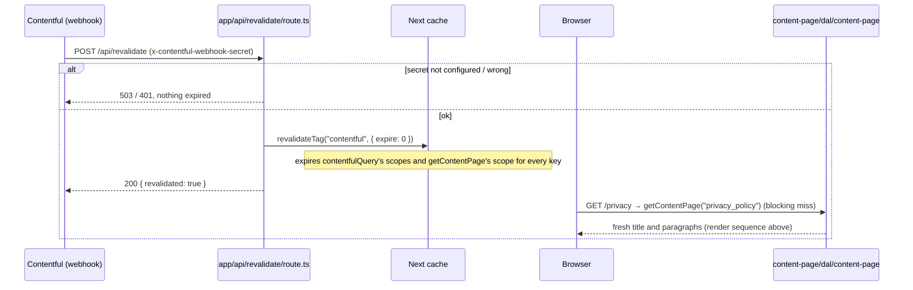

# Design

## Context

- The footer links «Политика конфиденциальности» to `/privacy` (`FOOTER_LINK_PATHS.privacy`, a
  literal today), and no page answers there (`site-footer` FR-4).
- `features/about` (archived change `add-about-page`) already renders one Contentful `greeting`
  entry as a page: `dal/about-page.ts` (`getAboutPage()`, a result-dependent `"use cache"`
  scope tagged `CONTENTFUL_CACHE_TAG`), `model/` (Zod schema, result types, the loading label),
  and four components: `AboutPage` (Suspense), `AboutContent` (async loader, throws on
  failure), `AboutArticle` (`<h1>` + paragraphs), `AboutPlaceholder` (skeleton). Every piece is
  specific to the entry key `about_page` only through `ABOUT_PAGE_KEY`, the log prefix, and the
  names.
- `add-about-page` design R7 accepted one copy of the Contentful failure mapping and log
  redaction (home and about) and named a third Contentful page as the trigger to stop copying.
  The privacy page is that third page. User decision (2026-10-21): one shared feature, not a
  copy.
- `shared/lib/contentful` provides `contentfulQuery` (its own 60 s `"use cache"` scope, tagged
  `CONTENTFUL_CACHE_TAG`) and `ContentfulError` (`config | network | auth | graphql | http`).
  `POST /api/revalidate` expires every scope carrying that tag.
- `features/breadcrumbs` uses a mirror `@breadcrumbs` slot (one slot page per real page,
  checked by `app/tests/breadcrumbs-slot.test.ts`) and a route table on named path constants.
- CI builds with no `CONTENTFUL_*` variables; the about page already proved (its task 4.2) that
  the result-dependent scope keeps such a build green.

## Goals / Non-Goals

**Goals**

- `/privacy` renders the `privacy_policy` entry's title and paragraphs, fully on the server, with
  every behaviour `/about` has (loading skeleton, error screen, webhook freshness, trail).
- One implementation serves both pages; `/about` behaves exactly as before apart from its log
  line and FR-7's numbered headings (its current text has none, so it looks the same).
- The CI build (no Contentful env) still passes.

**Non-Goals**

- Moving the home greeting onto the shared feature (it falls back instead of throwing).
- Extracting the failure mapping into `shared/lib/contentful` for home's sake: with home the only
  other user, that would rewrite home's DAL for one shared helper. Home keeps its copy (R2).
- A new content type, rich text, images, `metadata` titles.

## Decisions

### D1 — `features/about` becomes `features/content-page`, keyed by entry

```
src/features/content-page/
├── dal/content-page.ts                     # getContentPage(key): Promise<ContentPageResult>, server-only, owns the cache scope (D2)
├── model/content-page.constants.ts         # CONTENT_PAGE_KEYS = { about: "about_page", privacyPolicy: "privacy_policy" } as const
├── model/content-page.types.ts             # ContentPageKey, ContentPageFailureReason, ContentPageResult, ContentBlock (D5, FR-7)
├── model/content-blocks.ts                 # toContentBlocks(message): numbered headings + paragraphs (D5, FR-7; added by task 4.3)
├── model/content-page.schema.ts            # Zod for the greetingCollection response; ContentPageEntry
├── model/content-page-messages.ts          # CONTENT_PAGE_LOADING_LABEL ("Загрузка…")
├── components/ContentPage/                 # Suspense boundary + fallback (D3); props { entryKey }
├── components/ContentPageContent/          # async loader: awaits the DAL, throws on failure (D4)
├── components/ContentPageArticle/          # sync view: <h1> + headings and paragraphs (D5)
├── components/ContentPagePlaceholder/      # Suspense fallback (D3)
├── tests/
└── index.ts                                # exports ContentPage, CONTENT_PAGE_KEYS
```

- The files move with `git mv` from `features/about/` and are renamed (`AboutPage` →
  `ContentPage`, `getAboutPage` → `getContentPage`, …), so history follows them. Their bodies
  change only where the key, the log line, and the names do; markup, classes, and the cache
  logic stay byte-for-byte the about page's.
- `ContentPageKey = (typeof CONTENT_PAGE_KEYS)[keyof typeof CONTENT_PAGE_KEYS]`: the component and
  the DAL accept only a known key, so a route can't pass a misspelt string (NFR-5).
- Route files stay thin and keep their own `<main>` (every route in the app owns its `<main>`):

  ```tsx
  // app/(public)/privacy/page.tsx
  export default function PrivacyRoutePage() {
    return (
      <main className="mx-auto flex w-full max-w-4xl flex-1 flex-col items-start gap-8 px-6 py-16">
        <ContentPage entryKey={CONTENT_PAGE_KEYS.privacyPolicy} />
      </main>
    );
  }
  ```

  `app/(public)/about/page.tsx` changes only its import and its child
  (`<ContentPage entryKey={CONTENT_PAGE_KEYS.about} />`).

*Alternatives considered:*

- A copy, `features/privacy-policy`, mirroring about file for file. Rejected by the user: a third
  copy of the query, schema, failure mapping, skeleton, and four components, which `add-about-page`
  R7 already flagged.
- Keep `features/about` and export a second component from it. Rejected: the privacy page would
  live in a feature named after another page.
- Feature exports one wrapper per page (`AboutPage`, `PrivacyPolicyPage`) instead of a keyed
  component. Rejected: two more files that only pass a constant; the route file can pass it.

### D2 — Cache scope in the DAL, keyed by the entry, lifetime chosen by the result

```ts
export async function getContentPage(key: ContentPageKey): Promise<ContentPageResult> {
  "use cache";
  cacheTag(CONTENTFUL_CACHE_TAG);
  const result = await readContentPage(key);
  if (result.ok) cacheLife("minutes");
  else cacheLife("seconds");
  return result;
}
```

- The about page's D2 unchanged, plus the `key` argument. A `"use cache"` function's arguments
  are part of its cache key, so `about_page` and `privacy_policy` are two cache entries: one
  page's failure or freshness never affects the other (FR-6). `contentfulQuery`'s inner scope
  is keyed by its variables the same way.
- Tag: one shared `CONTENTFUL_CACHE_TAG`, so a publish of either entry expires both pages (and
  home). Accepted, as today: the next request of each page re-reads once.
- Success → `"minutes"`, failure → `"seconds"`: an env-less CI build or an outage stays a
  request-time hole inside D3's Suspense boundary, never frozen into the shell.
- `readContentPage(key)` returns failures as plain values and rethrows any non-Contentful error,
  as `docs/state-management.md` requires for cached functions.
- No route-level `"use cache"` (the throw path in D4 must not run during prerender).

### D3 — `ContentPage`: Suspense boundary inside the feature

`ContentPage({ entryKey })` renders
`<Suspense fallback={<ContentPagePlaceholder />}><ContentPageContent entryKey={entryKey} /></Suspense>`.
`ContentPagePlaceholder` is `AboutPlaceholder` renamed: `role="status"` with the visually hidden
«Загрузка…», then `aria-hidden` skeleton blocks (title bar `h-9`/`sm:h-10`, 60% wide, max
420 px; three paragraph groups of `h-4` lines). It doesn't vary by page: the skeleton stands for
"a title and some prose", whatever the length (R4).

### D4 — `ContentPageContent`: throw on failure, let `app/error.tsx` render

```ts
export async function ContentPageContent({ entryKey }: ContentPageContentProps) {
  const result = await getContentPage(entryKey);
  if (!result.ok) throw new Error(CONTENT_PAGE_UNAVAILABLE);
  return <ContentPageArticle entry={result.entry} />;
}
```

- The about page's D4 unchanged. `CONTENT_PAGE_UNAVAILABLE` is a fixed internal message (no key,
  reason, status, or entry text); the cause is in the DAL's log line.
- The `@breadcrumbs` slot has its own error boundary, so the trail stays above the error screen
  (FR-2, FR-4), as on `/about`.
- A failed page may answer HTTP 200 (the shell was already streamed); FR-2 asserts the screen.
- Tested by calling it as a function with a mocked DAL, as `AboutContent` is today.

### D5 — `ContentPageArticle`: headings and paragraphs from plain text

`AboutArticle` renamed: `<h1>` (`text-3xl font-bold tracking-tight sm:text-4xl`) and an
`<article>` (`max-w-prose`, `flex flex-col gap-6`, `text-prose-compact leading-relaxed
sm:text-lg`, `text-foreground`) with one `whitespace-pre-line` `<p>` per `splitParagraphs` item.
No Markdown or HTML parsing (NFR-3). Token utilities only (NFR-4).

FR-7 (added 2026-10-21, mid group 4): a pure function `toContentBlocks(message)` in
`model/content-blocks.ts` turns the message into a list of blocks, a discriminated union
`{ readonly kind: "section"; readonly text: string } | { readonly kind: "subsection"; … } |
{ readonly kind: "paragraph"; … }` (`ContentBlock` in `content-page.types.ts`). It calls `splitParagraphs`, tests each paragraph's first line against
two named regexes (`SECTION_HEADING_PATTERN` `^Раздел \d+\. `, `SUBSECTION_HEADING_PATTERN`
`^\d+\.\d+\. `, matched after trimming leading whitespace), and emits the heading block plus,
when lines remain, one paragraph block of the rest. `ContentPageArticle` maps blocks to
`<h2 className="text-lg font-bold sm:text-xl">` (one type step above the body),
`<h3 className="font-bold">` (body size), or the existing `<p>`; the article's `gap-6` spaces
them all. The rule lives in the feature's `model/`, not in `shared/lib`: home's greeting has no
use for it (architecture rule: no shared abstraction before a second consumer). It reads
numbering only, never markup, so NFR-3 holds, and it applies to `/about` too (FR-6), whose
current text has no matching line. The Claude Design mockup has no headings inside the text;
the two heading sizes are the closest scale steps to the article body, not mockup values.

### D6 — The DAL's log line names the key

`fail(key, reason, status?)` logs
`console.error("[contentful] content page failed", { key, reason })`, adding `status` only for
`auth`/`http`. The key is a public constant, not a secret, and it is what tells the two pages
apart in a log. This replaces `[contentful] about page failed` (`about-page` FR-2, modified).

### D7 — `PRIVACY_PATH` and the breadcrumb row

- `PRIVACY_PATH = "/privacy"` in `shared/config/constants.ts`, after `ABOUT_PATH`.
  `FOOTER_LINK_PATHS.privacy` becomes `PRIVACY_PATH` (shape unchanged; the footer's tests stay
  as they are). The footer's doc comment: `/about` and `/privacy` have pages, `/contact` not yet.
- `breadcrumbs`: `privacyPolicy: "Политика конфиденциальности"` in `BREADCRUMB_LABELS`, and
  `{ path: PRIVACY_PATH, label: BREADCRUMB_LABELS.privacyPolicy }` in `STATIC_ROUTES`.
- `app/@breadcrumbs/privacy/page.tsx` renders
  `<Breadcrumbs segments={Promise.resolve(["privacy"])} />`; `breadcrumbs-slot.test.ts` finds the
  pair automatically.
- The footer and breadcrumbs keep their own copy of the label (copy belongs to the feature that
  shows it, `docs/code-style.md`), as with «О проекте».

### D8 — Testing

The about tests move with their files and become parameterized where the key matters:

- `tests/model/content-page.schema.test.ts`: the about schema cases, renamed.
- `tests/dal/content-page.test.ts` (mocked `contentfulQuery`): for each key in
  `CONTENT_PAGE_KEYS`, the query receives that key; success; each `ContentfulError` kind →
  its reason, logged once as `[contentful] content page failed` with the key and status only for
  `auth`/`http`; `validation`; `not-found`; a non-Contentful error rethrows; `cacheTag` /
  `cacheLife` as in NFR-2.
- `tests/components/ContentPageContent.test.tsx`: passes `entryKey` through to the DAL; resolves
  to the article on success; rejects on failure with a message free of the key, reason, and
  entry text.
- `tests/components/ContentPageArticle.test.tsx`: FR-1's example (privacy title); NFR-3; FR-7's
  example (one `h2`, one `h3`, both bold, the paragraphs in order).
- `tests/model/content-blocks.test.ts` (added with FR-7): FR-7's example gives the six blocks in
  order; a heading line with leading spaces is trimmed; text with no numbered first line gives
  the same paragraphs as `splitParagraphs`.
- `tests/components/ContentPagePlaceholder.test.tsx`: the about placeholder test, renamed.
- `tests/dal/content-page.integration.test.ts`: the about integration test, run for every key in
  `CONTENT_PAGE_KEYS` against the real space, skipped without `CONTENTFUL_SPACE_ID` /
  `CONTENTFUL_ACCESS_TOKEN`. It catches a renamed or unpublished `privacy_policy` entry.
- `breadcrumbs` tests: `matchRoute(["privacy"])` + `buildTrail` → Главная › Политика
  конфиденциальности.
- Browser (Gate 3): FR-2 with a broken token on `/privacy`, FR-4, FR-5, FR-6 (both pages show
  their own titles), FR-7 (bold headings; heading order recorded, a skipped level is an editors' note per R4), NFR-1. FR-3 by `curl` to `/api/revalidate` against `npm run build &&
  npm start`, as the about page did.

### D9 — Documentation (NFR-7)

`docs/architecture.md`: replace the `features/about/` tree lines with `features/content-page/`
(one Contentful `greeting` entry per page, by key); route lines for `(public)/about/page.tsx`
(now `ContentPage` with `CONTENT_PAGE_KEYS.about`) and `(public)/privacy/page.tsx`; `privacy/` in
the `@breadcrumbs` list; `PRIVACY_PATH` on the `shared/config` line; `split-paragraphs.ts`'s
comment names the content pages. `docs/state-management.md`: the exception's example becomes
`features/content-page/dal/content-page.ts`, and it notes the scope is keyed by the entry key.

### Sequence diagrams

Render, success and failure (same for `/about` with `about_page`):

```mermaid
sequenceDiagram
    participant B as Browser
    participant Pg as app/(public)/privacy/page.tsx (RSC)
    participant CP as content-page/ContentPage (Suspense)
    participant CC as content-page/ContentPageContent
    participant D as content-page/dal/content-page
    participant C as shared/lib/contentful (contentfulQuery)
    participant CF as Contentful GraphQL API
    participant E as app/error.tsx

    B->>Pg: GET /privacy
    Pg->>CP: render (entryKey = CONTENT_PAGE_KEYS.privacyPolicy)
    CP->>CC: render inside Suspense (fallback ContentPagePlaceholder)
    CC->>D: getContentPage("privacy_policy")
    alt cache hit for this key (tag CONTENTFUL_CACHE_TAG not expired)
        D-->>CC: cached ContentPageResult
    else miss
        D->>C: contentfulQuery(ContentPage, { key: "privacy_policy" })
        C->>CF: POST GraphQL (token read inside the client)
        alt Contentful answers with data
            CF-->>C: { greetingCollection: { items } }
            C-->>D: data
            alt parse ok and an item exists
                D->>D: ok result with the first item
            else Zod parse fails
                D->>D: failure "validation"
            else items empty
                D->>D: failure "not-found"
            end
        else config / network / auth / graphql / http
            C-->>D: throws ContentfulError(kind)
            D->>D: failure kind
        else any other error
            C-->>D: throws
            D-->>CC: rethrown (not cached as a result)
            CC->>E: propagates to the error boundary
            E-->>B: same error screen as below
        end
        D->>D: cacheLife("minutes") if ok, "seconds" otherwise; on failure log one line { key, reason, status? }
        D-->>CC: ContentPageResult
    end
    alt build-time prerender and result is a failure
        Note over D,CC: "seconds" lifetime: a request-time hole; the throw never runs during prerender. The shell holds ContentPagePlaceholder.
    else ok
        CC-->>B: <h1/> + <article> headings and paragraphs (HTML, no client JS of its own)
    else failure (any reason), at request time
        CC->>E: throw Error(CONTENT_PAGE_UNAVAILABLE)
        E-->>B: «Что-то пошло не так» + «Повторить» (header, trail, footer stay)
    end
```

Publish → fresh pages (unchanged endpoint; both keys' scopes carry the tag):



## Risks / Trade-offs

- **R1 — Renaming a merged, Gate-3-verified feature.** The about page could regress in a change
  about another page. Mitigation: the move keeps markup, classes, and cache logic unchanged
  (D1); the about tests move with the code and stay green; FR-6 is checked in the browser
  (Gate 3) on `/about` as well as `/privacy`; the env-less build check covers both routes.
- **R2 — Home keeps its own copy of the failure mapping.** Two copies remain (home and
  content-page), down from the three a copy would have made. Accepted: home's behaviour differs
  (fallback, page-level scope), and `add-about-page` R7's trigger was a third copy.
- **R3 — One cache tag for every Contentful page.** A publish of any entry expires all of them.
  Accepted: three small reads, and the webhook isn't deployed yet.
- **R4 — Long policy text.** A legal text is often longer and structured (sections, lists).
  Numbered section and subsection lines become headings (FR-7, D5); lists, other heading styles,
  and real markup stay plain text, and need a rich-text change of their own. Two risks follow
  from reading numbering: an ordinary paragraph whose first line starts with `2.1. ` turns into a
  heading (accepted: the editors write the numbering, and the rule only checks a paragraph's
  first line), and a text that opens with a subsection before any `Раздел N.` puts an `h3`
  straight after the page `h1`, skipping a heading level (the current `privacy_policy` text
  starts with `Раздел 1.`). Accepted as a content risk: the code emits the `h3` regardless;
Gate 3 records the heading order and reports a skipped level as a note for the editors, not as a
failure. The skeleton is the about page's
  three-paragraph shape regardless of length.
- **R5 — The entry may not exist yet in a given Contentful environment.** Task 2.1 checks that
  `privacy_policy` exists and is published in the environment `.env.local` points at, before the
  DAL changes; if it doesn't, the task is blocked and the user is asked. The deployed
  environment is checked at deploy time (Migration Plan).
- **R6 — A failed page may answer HTTP 200** (D4), as `/about` does. Accepted.
- **R7 — `contentfulQuery`'s 60 s scope caches a failure.** After Contentful recovers, a page may
  show the error screen for up to a minute, as `/about` does. Accepted.
- **R8 — Log prefix change.** Anything searching logs for `[contentful] about page failed` stops
  matching. Only local runs read these logs today; accepted.

## Migration Plan

No data or config migration. The deployed webhook remains the existing deferred deploy item. The
editorial side must publish a `greeting` entry with key `privacy_policy` before `/privacy` is
deployed (until then it shows the error screen, R5).

## Scaffold map

Written after the files existed (scaffold, 2026-10-21). `features/about/` was moved with `git mv`
and renamed (identifiers and import paths only; the about key, log prefix, and thrown message
stay until tasks 2.2 and 2.3), so `/about` keeps working; the rest are new types, constants, and
stubs.

| File | Responsibility | Exports |
| --- | --- | --- |
| `src/shared/config/constants.ts` | add the path constant | `PRIVACY_PATH` |
| `src/features/content-page/model/content-page.constants.ts` | entry keys (new) | `CONTENT_PAGE_KEYS` |
| `src/features/content-page/model/content-page.types.ts` | key and result types (moved; `ContentPageKey` new) | `ContentPageKey`, `ContentPageFailureReason`, `ContentPageResult` |
| `src/features/content-page/model/content-page.schema.ts` | Zod for the collection response (moved) | `contentPageCollectionResponseSchema`, `ContentPageEntry` |
| `src/features/content-page/model/content-page-messages.ts` | loading label (moved) | `CONTENT_PAGE_LOADING_LABEL` |
| `src/features/content-page/dal/content-page.ts` | server-only read + cache scope (moved; `getContentPage()` takes no key until task 2.2) | `getContentPage` |
| `src/features/content-page/components/ContentPage/ContentPage.tsx` | Suspense wrapper (moved; no props until task 2.2) | `ContentPage` |
| `src/features/content-page/components/ContentPage/ContentPage.types.ts` | props (new, wired by task 2.2) | `ContentPageProps` |
| `src/features/content-page/components/ContentPageContent/ContentPageContent.tsx` | async loader, throws on failure (moved) | `ContentPageContent` |
| `src/features/content-page/components/ContentPageContent/ContentPageContent.types.ts` | props (new, wired by task 2.2) | `ContentPageContentProps` |
| `src/features/content-page/components/ContentPageArticle/ContentPageArticle.tsx` (+ `.types.ts`) | view (moved) | `ContentPageArticle`, `ContentPageArticleProps` |
| `src/features/content-page/components/ContentPagePlaceholder/ContentPagePlaceholder.tsx` | Suspense fallback (moved) | `ContentPagePlaceholder` |
| `src/features/content-page/index.ts` | public API (`CONTENT_PAGE_KEYS` added by task 2.2) | `ContentPage` |
| `src/features/content-page/tests/**` | the about tests, moved and renamed | — |
| `src/app/(public)/about/page.tsx` | route (import switched to `@/features/content-page`) | default `AboutRoutePage` |
| `src/app/(public)/privacy/page.tsx` | route (stub, returns `null`; task 3.1) | default `PrivacyRoutePage` |
| `src/app/@breadcrumbs/privacy/page.tsx` | breadcrumbs slot page (final code, D7) | default `PrivacyBreadcrumbs` |
| `knip.jsonc` | temporary ignores for the unwired exports; removed in tasks 1.1 and 2.2 | — |

Git sees `AboutPage.tsx` and `AboutContent.tsx` as delete + add (the renamed lines push these
small files under its similarity threshold), so `git log --follow` doesn't link them; the other
moved files keep their history.
