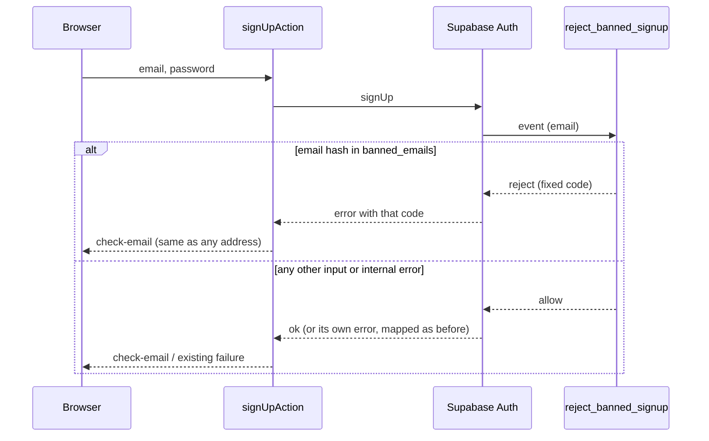
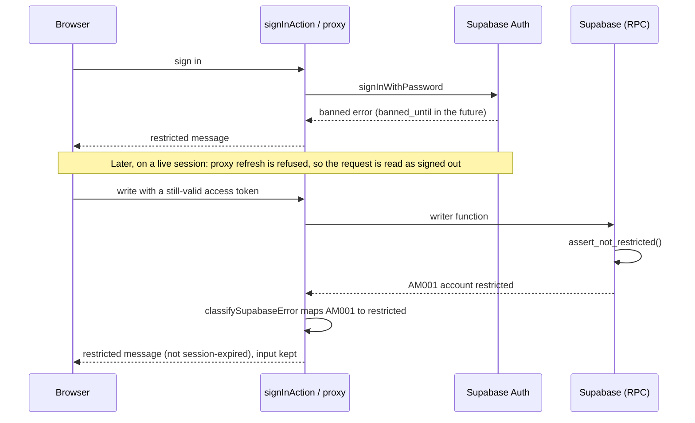
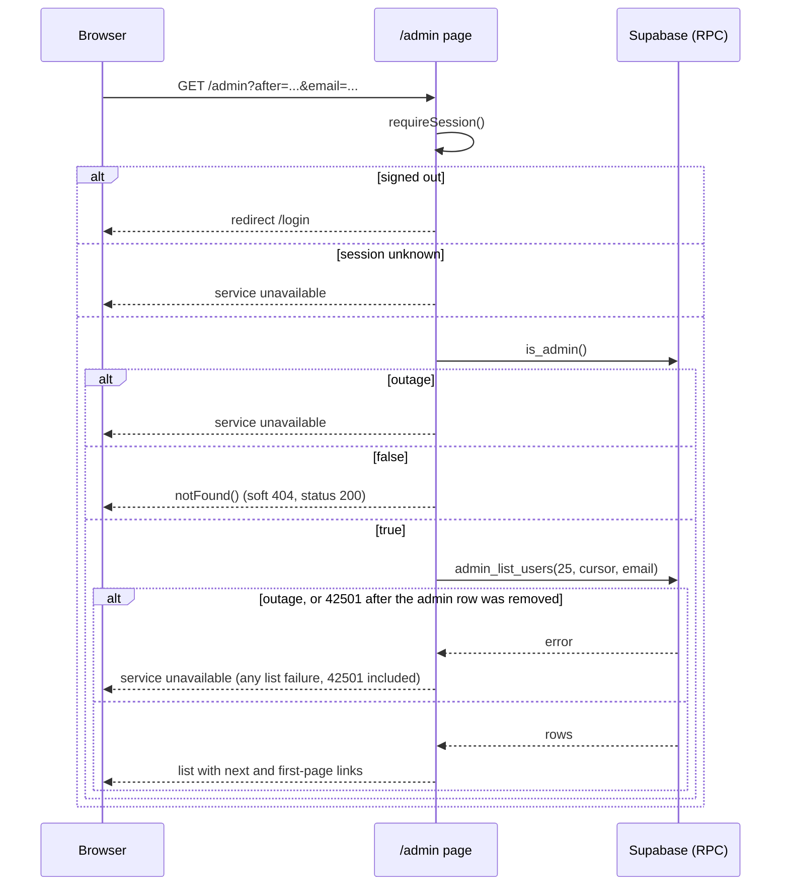

## Context

Auth is Supabase (`@supabase/ssr`); the app only ever holds the publishable key, and `docs/environment.md` forbids
a service-role key in `src/`. User content lives behind ADR 0005: RLS plus column grants, no client write grants,
and every write is a `security definer` function that takes the owner from `auth.uid()`.

There is **no single place** that every write passes through today. Observed in the migrations and DALs:

- `consume_write_allowance(scope)` is a separate RPC the app calls before some writes (ADR 0007), never from inside a
  write function. Creates are limited by counting creations instead (ADR 0009, 0010). Deletes have no limit
  (ADR 0010 D7).
- Poem and collection writes are `security definer` functions (`create_my_poem`, `update_my_poem`,
  `delete_my_poem`, `move_my_poem`, the collection writers, `save_my_collection_poems`, `move_my_collection`).
- Profile and photo writes are not functions: a direct `.update()` on `author_profiles` under RLS plus a column
  grant, and direct Storage uploads and deletes under owner policies on two buckets.

Today there is no role, no blocked account, and no ban. Supabase Auth's admin API (list users, ban, sign out a
user) needs the service-role key we do not use.

## Goals / Non-Goals

**Goals:**

- One admin role that cannot be granted from the app, enforced in the database, not only in the UI.
- Admin can delete any poem or collection, block/unblock an account, ban an account and its email, and revoke a
  user's sessions, from a closed `/admin` page and an admin-only control on public pages.
- A blocked or banned account can no longer **write** at once, whatever its access token still says. Its sessions
  end, and Supabase Auth refuses its sign-in and refresh. Reads of its own private pages may continue until its
  access token expires (D4).
- No service-role key anywhere in the app.

**Non-Goals:**

- Roles beyond admin/user, an admin management UI, or granting admin from the app (the owner adds a row by SQL).
- Reporting flows, appeals, notifications to the user, or email to the banned user.
- Reading the audit log in the app (the owner reads it in the Supabase dashboard).
- IP bans (the server shares one IP at Supabase, see `docs/environment.md`) and hiding instead of deleting.
- Accessibility of the admin UI: the owner is its only user and chose not to require it.

## Decisions

### D1. Admin is a table of user ids, not a JWT claim

`public.admins (user_id uuid primary key references auth.users on delete cascade)`: RLS on, no policies, no client
grants. `public.is_admin()` (`security definer`, `stable`, executable by `authenticated`) answers for the caller
only. It takes no argument, so it cannot be used to probe other users.

Alternative: `app_metadata.role` in the JWT. Rejected: setting it needs the Auth admin API (service-role key),
and a claim in an access token stays valid until it expires, so removing an admin would not take effect at once.

### D2. One guard, many functions

Each admin capability is its own `security definer` function (`set search_path = ''`) whose first statement is
`perform public.assert_admin()` (raises `42501` for a non-admin or signed-out caller). `anon` and `public` cannot
execute any of them. A direct PostgREST call by a non-admin fails inside the database, whatever the UI shows.

Functions: `admin_list_users`, `admin_delete_poem`, `admin_delete_collection`, `admin_block_user`,
`admin_unblock_user`, `admin_ban_user`, `admin_revoke_sessions`.

### D3. Block, ban, revoke are three different things

| Action | Account state | Sessions | Email | Reversible |
| --- | --- | --- | --- | --- |
| Revoke sessions | unchanged | all ended | unaffected | n/a, user signs in again |
| Block | restricted (`blocked`) | all ended | unaffected | yes (unblock) |
| Ban | restricted (`banned`) | all ended | added to ban list | not in the app; the owner removes the rows by SQL |

State lives in `public.account_restrictions (user_id pk references auth.users on delete cascade, kind 'blocked'|'banned', created_at, created_by)`
and `public.banned_emails (email_hash pk, created_at)`. A ban stores the SHA-256 digest (hex) of the trimmed, lower-cased email, not the
email: the hook looks it up by equality (a salted or keyed hash would need a secret in Vault and a table scan, and the
table is closed to every client role). `banned_emails` has no reference to an account, so a ban of an address survives the account's deletion; the
restriction row goes with the account (cascade).

Block and ban also set `auth.users.banned_until` so Supabase Auth refuses sign-in and token refresh by itself;
unblock clears it. The value is a **finite far-future time** (`now() + interval '100 years'`, a named constant in
the migration), not `infinity`: GoTrue reads the column into a Go `time.Time`, and `infinity` may fail to load and
turn a refusal into a 500, which the app would read as "service unavailable" instead of signed out (ADR 0006 D2).
Task 2.8 proves the chosen value on the local stack and on the hosted project; if `infinity` works it may replace
the constant.

The functions run as the migration role (`postgres`), not as the owner of `auth.users` (`supabase_auth_admin`).
Task 2.8 checks that role's `update` on `auth.users` and `delete` on `auth.sessions` on the hosted project, because
Supabase has been narrowing what `postgres` may do in `auth`. If a hosted check fails, the fallback is a
`security definer` function owned by a role that holds the grant; the design does not change otherwise.

### D4. Revoking sessions without the service-role key

The function deletes the user's rows from `auth.sessions`; their refresh tokens cascade (a token with a null
`session_id` would survive, which Auth no longer issues). The user's current access token stays valid until it
expires (Supabase default: 1 hour). Verified tokens are read locally by `getClaims()` when the project signs with
asymmetric keys, so the app keeps seeing that user as signed in until expiry.

What is closed at once is **writing** (D5). What is not: reads of the user's own private pages under RLS until
expiry. For a plain revoke (account not blocked) the leftover token also still writes, which is accepted: that user
is still allowed to act, and the next refresh fails. Shortening the JWT expiry in the dashboard narrows the window
and is an Open Question.

### D5. The restriction check lives in every writer and in the direct-write policies

There is no choke point to hook (Context), so the check is repeated where writes happen, from one helper:

- `public.is_restricted()` (no argument, caller only, `stable`, `security definer`, **executable by `authenticated`**,
  because the profile and Storage policies evaluate it as that role) and
  `public.assert_not_restricted()`, which raises a **dedicated SQLSTATE** `AM001` (message `account restricted`).
  `42501` is not used: existing writers already raise it for "not signed in", and `assert_admin()` uses it for
  "not an admin". Task 1.2 checks how PostgREST reports a custom SQLSTATE (HTTP status and `code`).
- The four write DALs drop the PostgREST message on purpose, so the code alone must carry the meaning: the shared
  `classifySupabaseError` (`src/shared/lib/supabase/classify-error.ts`) maps `AM001` once to a new `restricted`
  failure. Each feature then only adds its message and surface, never its own detection rule.
- Every `security definer` writer of user content calls `perform public.assert_not_restricted()` as its first
  statement (poem, collection, ordering writers, `ensure_my_author_profile`, and `consume_write_allowance`, which
  becomes `plpgsql` for this). `can_create_poem()` (a `stable` pre-check the create action calls before it uploads an
  illustration) calls it too, so a blocked user's create is refused before any upload (ADR 0009 D5). The profile and
  photo actions call `consume_write_allowance` before they touch the table or Storage, so the same call covers them.
- The direct-write paths gain the same test in their policies: `owners update their own profile` adds
  `and not public.is_restricted()` to `using` and `with check`; the owner `insert` and `delete` policies on the
  `author-photos` and `poem-illustrations` buckets add it too. These policies are the backstop against direct API
  calls; a refusal from Storage carries no "restricted" signal, so the app never tries to detect it: it relies on the
  guarded pre-check above, which refuses first.
- A pgTAP test lists every volatile `security definer` function (and `can_create_poem`) in `public` that `authenticated` can execute, and
  fails unless it calls `assert_not_restricted` or is on an explicit allowlist (the admin functions, which check
  admin instead, and the read-only helpers). A new writer that forgets the check fails the suite.

Alternative: one hook in `consume_write_allowance`. Rejected: not every writer calls it, and the profile and
storage writes cannot.

### D6. Banned email cannot sign up again: a Before User Created auth hook

`public.reject_banned_signup(event jsonb)` is registered as Supabase's Before User Created hook (Postgres function,
local `supabase/config.toml` and, at deploy, a manual dashboard step).

- It is `security definer`, `set search_path = ''`, so it reads `banned_emails` without any client or auth-role grant
  on the table. Execute is granted to `supabase_auth_admin` only, and revoked from `public`, `anon`, `authenticated`,
  so nobody can ask the database whether an address is banned.
- Its whole body is wrapped so any internal error or unrecognised input **allows** the sign-up. A broken hook can
  weaken a ban; it can never block every sign-up.
- A banned address is rejected with one fixed error code and message. `signUpAction` maps exactly that code to its
  existing `check-email` answer, so the form shows the same thing for every address; every other sign-up error keeps
  its existing mapping.

Alternative: check in the sign-up Server Action. Rejected: a direct call to Supabase Auth with the publishable key
would skip it.

### D7. Deleting someone else's content reuses the owner's delete logic

`delete_my_poem` and `delete_my_collection` derive the owner from `auth.uid()`. The admin versions must do the same
work, so each body moves into an internal function that takes the profile id (`delete_poem_of(profile, poem_id)`,
`delete_collection_of(profile, collection_id)`). The owner's function passes `my_author_profile_id()`; the admin
function passes the row's own `author_id` after `assert_admin()`. The owner functions' signatures and results do not
change.

What the bodies do today, and so what the admin delete does: `delete_poem_of` deletes the row, keeps the creation-log
row, and renumbers nothing (ADR 0014 D3). `delete_collection_of` takes the advisory lock of the **target** author's
profile (ADR 0014 D5, kept because `profile` becomes the argument), places the collection's poems first among that
author's free poems, and returns `{ status, author_id, title }`.

**The internal functions are not client-callable.** They take an owner as an argument, which ADR 0005 D1 forbids for
anything a client can call. They follow the `poem_create_status` pattern: `revoke execute ... from public, anon,
authenticated`, and no admin assert inside (the owner's own delete must still work). A pgTAP test proves
`authenticated` cannot execute them.

### D8. Admin controls on public pages: a dynamic island, composed in the route files

Public poem and collection pages are prerendered with dynamic holes (the cache is in the DAL, e.g. `cachedAuthorPoems`;
the pages read `params`). An admin-only control must not change what any other reader gets.

- `AdminDeleteControl` lives in `features/admin`. It is a Server Component that calls `getSessionState()` first (a local
  claims read) and calls the `may_moderate_author(author_profile_id)` RPC (admin, and not the profile's owner; one round trip, no import
  from `authors`) only for a signed-in reader, inside its own `<Suspense>`; it renders nothing for everyone else, an
  admin on their own work included.
- `poems` and `collections` stay session-free and never import `@/features/admin` (`poems/tests/boundaries.test.ts`
  pins this). `PoemPage` and `PublicCollectionPage` take an optional `moderation` render function (below), which the route files
  in `src/app/(public)/authors/[id]/...` fill with `<AdminDeleteControl .../>`.
- The route files only forward `params` promises; the poem or collection is read inside the page component's own
  Suspense boundary. So the slot is a **render function**: `PoemPage` and `PublicCollectionPage` take
  `moderation?: (target: { id; title; authorId }) => ReactNode`, and the content component (`PoemPageContent`,
  the collection's content) calls it next to the article once its own read has succeeded. The route file supplies
  `(t) => <AdminDeleteControl kind="poem" id={t.id} title={t.title} redirectHref={authorPagePath(t.authorId)} />`.
  Passing a function between two Server Components is allowed; no extra read happens and the route file never awaits
  `params` outside a Suspense boundary. `admin` imports nothing from `authors` or `collections`, and from `poems` only the
  illustrations bucket constant (D12); the control cannot appear on a soft 404.
- The delete is a Server Action in `features/admin` that re-checks admin in the database (D2), then expires the
  author's works cache tag and removes the illustration file.

### D9. The `/admin` page: dynamic, closed, 404 for non-admins, server-paged

`src/app/(authorized)/admin/page.tsx` is a one-line page that renders `AdminPage`; the gate lives in that feature
component, inside its own `<Suspense>`, as `docs/architecture.md` prescribes for every authorized page. `AdminPage`
reads the session (`requireSession`, so a signed-out request goes to `/login`), then `is_admin()`; a non-admin gets `notFound()`, a soft 404 (the not-found screen with status 200, as on the public pages), so the page
does not announce itself; `/admin` gets no `STATIC_ROUTES` row in the breadcrumbs, so its trail is `none`, the same as
an unknown URL; an unreadable
session or admin check shows the "service unavailable" state. Its data is never cached (ADR 0011).

The list is paged forward by a URL cursor (`?after=<created_at>_<id>`, optional `?email=` exact filter), rendered on
the server, 25 per page (a named constant), with a "Next" link and a "Back to the first page" link (a keyset cannot
find the previous cursor, and a `before` query is not worth it for a list one owner reads). The email filter sits in the GET URL, so the hosting platform's request logs and the browser history hold it; only the
admin's own searches reach it, and NFR-6 is scoped to the app's own logs. No page is copied into client state, so
`refresh()` after an action re-renders the current page with fresh data. It needs its own `@breadcrumbs` slot page
(`app/tests/breadcrumbs-slot.test.ts` checks).

### D13. The header link

The approved mockup (artboard 1) puts «Админка» in the session block, between «Личный кабинет» and «Выйти», not next
to «Наши авторы». That block is `auth`'s `HeaderAuthLinks`, and `auth` must not import `admin`, so `HeaderAuthLinks`
takes an optional `adminLink?: ReactNode` slot that it renders in its signed-in branch between those two controls
(nothing, and no gap, otherwise). The root layout (`src/app/layout.tsx`, which already composes `AuthorsNavLink` and
`HeaderAuthLinks`) fills it with `<AdminNavLink />`.

`AdminNavLink` (in `features/admin`) is a Server Component that reads `getSessionState()` first and calls `is_admin()`
only for a signed-in reader, then renders a `Link` to `/admin` (text «Админка», the same style as the other header
links), or `null`. It sits inside its own `<Suspense fallback={null}>`, so the prerendered shell is identical for
everyone and nothing shifts for non-admins. On a narrow screen the header wraps in three rows for an admin (logo; «Наши
авторы»; then «Личный кабинет», «Админка», «Выйти»); that layout is a CSS change in `HeaderAuthLinks`'s container,
applied only when the slot is filled. `/admin` itself stays closed by D9 whether or not the link exists; the link is a
convenience, not the gate. `admin` still imports only `auth` (session) and the poems bucket constant.

### D10. Self-protection and audit

`admin_block_user`, `admin_ban_user`, and `admin_revoke_sessions` refuse the caller's own id and any id in `admins`
(`target-is-admin`). Every successful admin function appends to `public.moderation_log (id, admin_id, action,
target_user_id, target_kind, target_id, created_at)` in the same transaction; `admin_id` and `target_user_id` are plain
uuids with no foreign key, so the history survives the deletion of any account. The table has no client grants
and no app read path. A deleted poem's text is not copied into the log.

### D11. An admin removes another author's illustration with the admin's own session

The Storage policies on `poem-illustrations` are owner-only (`owns_author_profile(folder)`), so the admin's cookie
client could not remove another author's file; Storage reports that as an empty success, not an error. The migration
adds `for select` and `for delete` policies on that bucket, `to authenticated`, using `public.is_admin()` (`anon` cannot
execute `is_admin()`, so a policy left on the default role would turn an anonymous read into an error). Rows in `storage.objects` are
never deleted from SQL, which would orphan the object. A local-stack test deletes another author's file as an admin and
as a non-admin.

### D12. Modules and their imports

```
src/features/admin/
  actions/   block, unblock, ban, revoke, delete-poem, delete-collection (Server Actions)
  dal/       admin-check.ts, user-list.ts, moderation-rpc.ts (block, ban, revoke), delete-rpc.ts, illustration-cleanup.ts
  model/     admin.types.ts, admin.schema.ts, admin-messages.ts, admin.constants.ts
  components/ AdminPage, AdminUserList, AdminUserRow, AdminDeleteControl, ...
  tests/
  index.ts   public API: AdminPage, AdminNavLink, AdminDeleteControl
```

`admin` imports `@/features/auth` (session accessors; copying the three-state session logic would duplicate domain
logic) and the illustrations bucket constant from `@/features/poems`, server side only and one way. The route files
pass it the target's title and redirect path (D8). Nothing imports
`admin` except `src/app/`. The admin check lives in `admin`'s own `dal/`, not in `auth`, so `auth` never depends on `admin`; nothing is exported for it until a consumer exists.
`docs/architecture.md` records these two edges the way it records `poem-management`'s.

### Flows

Block, with its error branches:

```mermaid
sequenceDiagram
  participant A as Admin browser
  participant S as Server Action (admin)
  participant DB as Supabase (RPC)
  participant AU as auth schema
  A->>S: Block user (id)
  S->>S: validate input; read session
  alt invalid input
    S-->>A: field errors (no RPC)
  else session ended
    S-->>A: session-expired message
  else
    S->>DB: admin_block_user(id)
    alt caller not admin (42501)
      DB-->>S: permission error
      S-->>A: permission message, data unchanged
    else target is admin / self
      DB-->>S: target-is-admin
      S-->>A: target-is-admin message
    else not found / already restricted
      DB-->>S: not-found / already-restricted
      S-->>A: matching message
    else ok
      DB->>AU: banned_until = far future; delete sessions of id
      DB->>DB: insert account_restrictions, moderation_log
      DB-->>S: blocked
      S-->>A: refresh(): row shows blocked
    end
  end
  Note over S,DB: outage at any call: unavailable message, nothing changes
```

Delete another user's poem from the public page:

```mermaid
sequenceDiagram
  participant A as Admin browser
  participant P as Public poem page (slot filled in the route file)
  participant S as Server Action (admin)
  participant DB as Supabase (RPC)
  participant ST as Storage
  A->>P: open poem page
  P->>P: getSessionState()
  alt not signed in / unknown
    P-->>A: no control
  else signed in
    P->>DB: may_moderate_author(author)
    DB-->>P: false / true / outage
    P-->>A: control only when true
  end
  A->>S: Confirm delete
  S->>S: read session
  alt session ended
    S-->>A: session-expired message
  else session unknown
    S-->>A: unavailable message, nothing changes
  else
  S->>DB: admin_delete_poem(poem_id)
  alt outage
    DB-->>S: unavailable
    S-->>A: unavailable message, nothing changes
  else not admin (42501)
    DB-->>S: error
    S-->>A: permission message
  else not-found
    DB-->>S: not-found
    S-->>A: already gone message
  else deleted
    DB-->>S: author_id, illustration_path
    S->>S: expire author works tag
    S->>ST: remove illustration (admin policy, D11)
    alt removal fails
      ST-->>S: error
      S->>S: log kind only; the delete still stands
    end
    S-->>A: redirect to the author page
  end
  end
```

Sign-up with the Before User Created hook:



Sign-in and refresh for a restricted account, and a refused write:



Loading `/admin`:



## Risks / Trade-offs

- [A new writer forgets the restriction check] → every writer calls it, the profile and storage policies carry it, and
  a pgTAP test over `pg_proc` fails on an unguarded `security definer` function.
- [Internal delete functions become an IDOR] → revoked from every client role, with a test (D7).
- [Access token outlives session deletion for up to an hour] → writes are refused regardless; reads of the user's own
  private pages are not (D4). Accepted; JWT expiry is an Open Question.
- [Writing to `auth.users` / `auth.sessions` couples us to Supabase's internal schema, and the `postgres` role's
  rights there may shrink] → confined to two functions, proven locally and on the hosted project in task 2.8, recorded
  in an ADR.
- [`banned_until` value breaks GoTrue] → finite far-future time, proven in task 2.8.
- [Hook misconfigured at deploy] → body wrapped to allow on error; deploy checklist step plus a manual check; the
  failure mode is "ban weaker than intended", never "blocks everyone".
- [Moving the delete bodies into shared internals touches working code] → owner signatures and results unchanged; the
  existing tests stay green unedited.
- [Admin acts on the wrong row] → a confirmation dialog naming the target for ban and for deleting content (the irreversible actions); block, unblock and revoke are reversible one-click actions; every action is in the audit log.

## Migration Plan

1. One migration (`<UTC>_admin_moderation.sql`) with the tables, helper and admin functions, the writer and policy
   changes, the internal delete functions, the storage policies, and the hook function. Header comment documents the
   down migration.
2. Deploy order: `supabase db push`, register the Before User Created hook in the dashboard, insert the owner's user id
   into `public.admins` by SQL, then ship the app (the app before the migration would call missing functions).
3. Rollback: revert the app first, then run the down migration. Existing accounts are untouched because no restriction
   row exists until an admin acts.

## Open Questions

- Should an unblocked user's content that was deleted while blocked be restorable? (Assumed no: deletes are permanent.)
- Should a ban also hide the banned author's public poems, or leave them visible until an admin deletes each one?
  (Assumed: a ban does not change visibility; the admin deletes content explicitly.)
- Shorten the JWT expiry in the dashboard to narrow the access-token window, or accept 1 hour?

## Scaffold map

Written by `opsx-scaffold` after the files existed (map approved 2026-11-13). Stub bodies only (`throw new Error("not implemented")`,
`return null`); the constants, types, schema shapes and the mockups' copy are complete. Not scaffolded, left to their groups:
the migration (1, 2), the `/admin` route file and its breadcrumb slot (5.1), the `adminLink` slot on `HeaderAuthLinks` (5.3a),
the `moderation` prop on `PoemPage` and `PublicCollectionPage` (6.2), the `restricted` member in `classify-error.ts` and the `auth`
changes (4), ESLint boundary entries (3.1), docs and tests. `knip.jsonc` ignores `src/features/admin/**` until task 7.5.
Gate 2b: no CONFIRMED finding. Fixed in the scaffold: `AdminPage` takes the raw search params (parsed inside), and
`may_moderate_author` has its own `ModerateCheckResult`. `AdminDeleteControl` also takes `authorId` (the control needs it for
`may_moderate_author`); the examples in D8 and tasks 3.1 and 6.2 still list four props. Copy not in the mockups is marked
"to confirm" in `admin-messages.ts`.

| File | Responsibility | Exports |
| --- | --- | --- |
| `src/features/admin/model/admin.constants.ts` | named values: page size, path, URL params, states, DB statuses | `ADMIN_USERS_PAGE_SIZE`, `ADMIN_PATH`, `ADMIN_LIST_PARAM`, `USER_STATE`, `RESTRICTION_KIND`, `MODERATION_DB_STATUS`, `DELETE_DB_STATUS` |
| `src/features/admin/model/admin.types.ts` | types between layers | `AdminUser`, `AdminFailure`, `AdminCheckResult`, `ModerateCheckResult`, `UserListResult`, `ModerationWriteResult`, `PoemDeleteWriteResult`, `CollectionDeleteWriteResult`, `SessionCheck`, `ModerationActionResult`, `DeleteActionResult` and the unions they use |
| `src/features/admin/model/admin.schema.ts` | action and list input shapes | `targetUserSchema`, `deleteTargetSchema`, `listQuerySchema` and their types |
| `src/features/admin/model/admin-messages.ts` | Russian copy from the mockups | `ADMIN_NAV_LABEL`, `ADMIN_LIST_COPY`, `USER_STATE_LABELS`, `ADMIN_ACTION_LABELS`, `MODERATION_RESULT_MESSAGES`, `MODERATION_FAILURE_MESSAGES`, `BAN_DIALOG_COPY`, `ADMIN_DELETE_COPY` |
| `src/features/admin/dal/admin-check.ts` | `is_admin()` and `may_moderate_author()` | `checkIsAdmin`, `checkMayModerateAuthor` |
| `src/features/admin/dal/user-list.ts` | `admin_list_users` | `listUsers` |
| `src/features/admin/dal/moderation-rpc.ts` | block, unblock, ban, revoke | `blockUser`, `unblockUser`, `banUser`, `revokeSessions` |
| `src/features/admin/dal/delete-rpc.ts` | delete another's poem or collection | `deletePoemAsAdmin`, `deleteCollectionAsAdmin` |
| `src/features/admin/dal/illustration-cleanup.ts` | best-effort illustration removal | `removeIllustration` |
| `src/features/admin/actions/action-client.ts`, `session-check.ts`, `expire-author-works-tag.ts` | shared log policy, session step, tag expiry (own copies) | `adminActionClient`, `checkSession`, `expireAuthorWorksTag` |
| `src/features/admin/actions/{block-user,unblock-user,ban-user,revoke-sessions}.actions.ts` | `"use server"` moderation | `blockUserAction`, `unblockUserAction`, `banUserAction`, `revokeSessionsAction` |
| `src/features/admin/actions/{delete-poem,delete-collection}.actions.ts` | `"use server"` content delete | `deletePoemAction`, `deleteCollectionAction` |
| `src/features/admin/components/AdminPage/` | `/admin` gate and list | `AdminPage`, `AdminPageProps` |
| `src/features/admin/components/AdminUserList/`, `AdminUserRow/`, `UserStateBadge/` | list, row, state pill | `AdminUserList`, `AdminUserRow`, `UserStateBadge` + props types |
| `src/features/admin/components/AdminNavLink/` | header link | `AdminNavLink` |
| `src/features/admin/components/AdminDeleteControl/` | admin delete button on public pages | `AdminDeleteControl`, `AdminDeleteControlProps` |
| `src/features/admin/index.ts` | public API | `AdminPage`, `AdminNavLink`, `AdminDeleteControl` |
