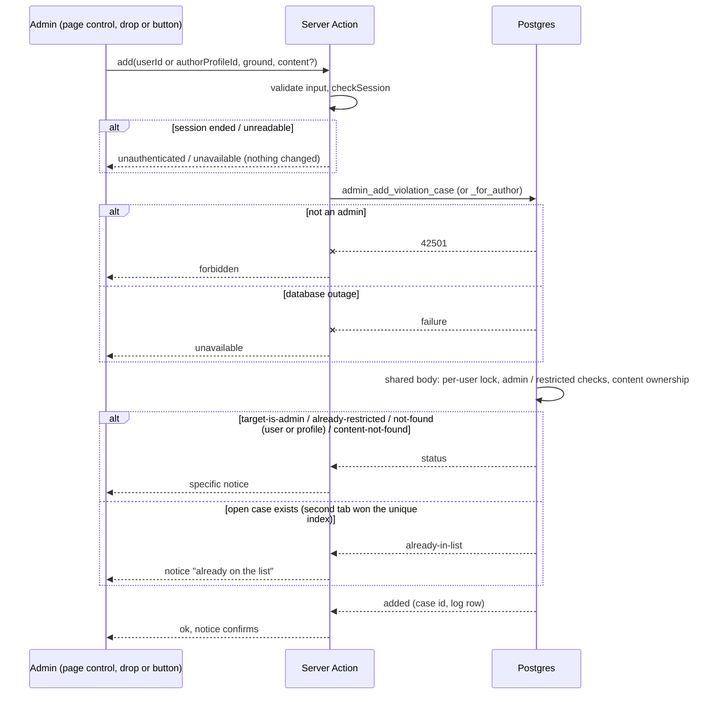
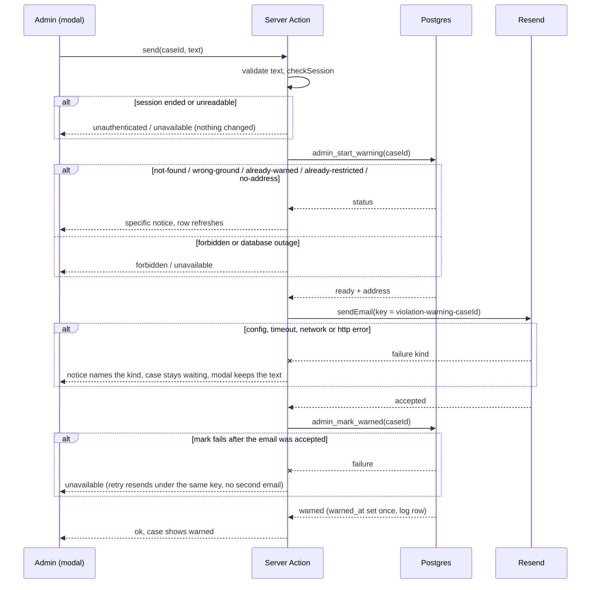
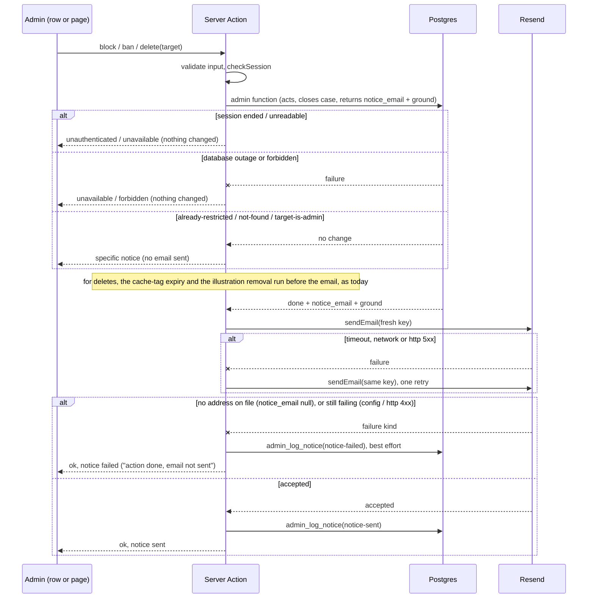

## Context

See `proposal.md` for the why. Observed in the code today:

- `admin-moderation` (archived 2026-11-17, ADR 0015): admin power is a set of `security definer` SQL functions that start with `assert_admin()`, executable by `authenticated` only; the app holds only the publishable key; the audit table is `moderation_log`; `admin_list_users` returns user emails to an admin.
- `features/admin` has `actions/` (Server Actions on `adminActionClient`, each running `checkSession()`, then one RPC, then mapping the answer in `model/action-results.ts`), `dal/` (RPC wrappers, Zod-parsed rows, `toAdminFailure`), and row components whose client side calls the action through `call-moderation.ts` (a missing answer reads as "unavailable").
- `shared/lib/telegram` is the precedent for server-only delivery to an outside service: lazy config, `fetch` with a timeout, failures as values, no secret in any log.
- `@dnd-kit/core` is already a dependency (work ordering). `shared/lib/network` has `use-connection`.
- The admin-moderation change listed "notifications to the user" and "email to the banned user" as non-goals. This change reverses that, on purpose.
- The About text is a Contentful entry; the repo holds no copy of it.

## Goals / Non-Goals

**Goals:**

- A recorded, reviewable step before a restriction: the violation case, with a ground, a warning, and a derived status.
- The user always hears about a restricting action, from the site, without the admin writing anything.
- No double email under retries, no lost action when the email fails.

**Non-Goals:**

- Automatic blocking at the deadline, any scheduler, or any key with more power than the publishable key (decided with the owner: the admin decides, the site reminds).
- Appeals, user-visible case pages, reporting by readers, comments and their reasons (the ground set is a closed list that comments will extend later), and admin-editable email templates (the fixed frame is code; only the admin's message is free text).
- Paging the review list, canned warning messages to pick from, a second warning per case, email to anyone but the affected user.
- Editing Contentful.

## Decisions

### D1. Email goes out through Resend's HTTP API from a server-only module

`src/shared/lib/email/` mirrors `shared/lib/telegram`: `config.ts` (reads `RESEND_API_KEY` and `EMAIL_FROM` lazily), `client.ts` (`sendEmail({ to, subject, text, idempotencyKey })` → `{ ok: true } | { ok: false, reason: "config" | "timeout" | "network" | "conflict" | "http", status? }`), constants, types, `index.ts`. It calls `POST https://api.resend.com/emails` with `fetch`, a bearer key, plain text only, a timeout, and the `Idempotency-Key` header.

Alternatives: the `resend` npm package (a dependency for one HTTP call; laziness ladder rung 3 says use the platform first); SMTP through `nodemailer` (a new dependency, worse deliverability without domain setup); Supabase Auth's mailer (it can only send its own templates). The key stays in the server environment, like the Telegram token; it is not a database key, so ADR 0015 decision 1 (no service-role key) still holds. A new ADR records the email boundary.

### D2. Case state lives in one table; status and deadline are derived

`public.violation_cases`: `id uuid`, `user_id uuid` (FK to `auth.users`, on delete cascade; the audit log keeps its own copy of ids without a foreign key), `ground text` (check: `harmful-content`, `malicious-activity`), `content_kind text null` and `content_id uuid null` (the poem or collection that prompted the case; both null or both set), `added_by uuid`, `created_at`, `warned_at timestamptz null`, `closed_at timestamptz null`, `closed_as text null` (check: `removed`, `blocked`, `banned`; null exactly when `closed_at` is null). A partial unique index on `user_id` where `closed_at is null` is the "one open case per user" rule, so the race of two tabs adding the same user is settled by the database, not by a read-then-write. RLS is on with no policy and no grant, like `admins`.

The status (`waiting`, `warned`, `deadline-passed`) and the deadline are computed in a pure model function from `warned_at` and the current time, with the period as a named constant (24 hours). Nothing stores them (the project rule on derived values), and nothing in the database enforces the deadline (D6).

Alternatives: a status column (drifts from `warned_at`); a separate warnings table with the message body (stores personal text the audit log is forbidden to hold, and the idempotency key does not need it, see D4).

### D3. Database functions: every one guarded, additive changes to the existing ones

New, all `security definer`, empty `search_path`, `assert_admin()` first, `authenticated` only (NFR-2):

- `admin_add_violation_case(target_user_id, ground, content_kind, content_id)` and `admin_add_violation_case_for_author(author_profile_id, ground, content_kind, content_id)`. The second resolves the profile's user and calls a shared body, `add_violation_case_of`, that takes the user as an argument and is revoked from every client role (the same split ADR 0015 made for `delete_poem_of`). The shared body is deliberately **not** named `admin_*`: the existing pgTAP inventory requires `assert_admin()` in every `admin_%` function, and this body is revoked from clients and guarded by its two callers. The public pages know a profile id, not an auth user id. The shared body takes the same per-user lock that block and ban take (`auth.users ... for update`), refuses an admin (`target-is-admin`) and a user who is already blocked or banned (`already-restricted`), and checks that the recorded poem or collection belongs to that user, so a browser cannot attach someone else's content to a case.
- `admin_list_violation_cases()`: open cases newest first, at most 100, with email, author name, the author's profile id, and the title of the recorded poem or collection (null once it is deleted, since the content id has no foreign key).
- `admin_set_case_ground(case_id, ground)` and `admin_remove_violation_case(case_id)`.
- `admin_start_warning(case_id)`: checks (`not-found` for a missing or closed case, `wrong-ground`, `already-warned`, `already-restricted` for a blocked or banned user, `no-address` for a user with no email) and returns the user's address. `admin_mark_warned(case_id)`: requires the case to be open (`not-found` otherwise, so a block in another tab between the two steps leaves no stray `warned_at`), sets `warned_at = now()` only if it is null, and says so otherwise.
- `admin_log_notice(target_user_id, notice_kind, outcome)`: writes the `notice-sent` or `notice-failed` log row. Its arguments are enumerated and hold no address or text. The kind of the action the email belonged to (`block`, `ban`, `delete-poem`, `delete-collection`) goes in the row's `target_kind`, with the user id as `target_id`, so a reader of the log sees which action a failed email was about without matching timestamps (decided with the owner while implementing group 1; the alternatives were to drop the kind or to add a column to `moderation_log`, and the log has no spare column). The case events use the action names `add-violation-case`, `set-case-ground`, `warn-violation-case` and `remove-violation-case`, with `target_kind` `case` and the case id as `target_id`.

Existing, changed additively: the block and ban wrappers read the open case's ground under the per-user lock they already take, then call `apply_restriction`, which keeps returning `void` (changing its return type would make `create or replace` fail and force a drop and re-grant) and which also closes the open case (`closed_as` `blocked` or `banned`) in the same transaction; and `block`, `ban`, `admin_delete_poem`, `admin_delete_collection` add `notice_email` (required key, null when the account has no address) and `ground` (the ground of the open case at that moment, or null) to the jsonb they already return; the two deletes also add `user_id` (the author's auth user id, since `author_id` in their answers is a profile id and `admin_log_notice` takes a user id). `admin_delete_poem` also adds `title` (`returning p.title` in `delete_poem_of`; the owner's delete ignores the extra key), because the poem's title for the email must come from the database and never from the browser; `admin_delete_collection` already returns it. Returning them from the function that acted means the address and ground are read in the same transaction as the change: no second round trip, and no race between reading the ground and the block closing the case. The address is read from `auth.users` inside the function, the way `admin_list_users` already does; the admin could read it from the list anyway. The old answers keep their keys, so the existing DAL schemas gain fields (`notice_email` nullable, not optional) and nothing breaks.

The two existing pgTAP files are changed, not left alone: `admin_foundation.test.sql`'s list of volatile writers that may skip `assert_not_restricted()` gains the new admin writers by name, and `admin_functions.test.sql`'s count of `admin_%` functions and its authenticated-only inventory are updated.

`admin_list_users` keeps its `email` argument in the database (dropping it is a signature change for no user gain); the DAL and page stop passing it, and a follow-up can drop it.

The add flow (both entry points: the public-page control, and the `/admin` drop or button) crosses browser, server and database:

Set-ground and remove follow the same shape with one function call each (`admin_set_case_ground`, `admin_remove_violation_case`): session check, the call, and `not-found` (the case is already closed or gone, from another tab) or `forbidden` or `unavailable` as the only non-success answers, each shown as its own notice. A case that is gone closes its row instead of refreshing it (D7).

### D4. The warning is two database steps around one email, with a stable key

The email is a fixed frame around the admin's message, built by a pure function in `model/` (a warning copy builder next to `action-notice-copy.ts`): a fixed subject with no user text, the admin's message, then a fixed block with the reason for the `harmful-content` ground and "one day from this email" (relative, because `warned_at` is set only after the email is accepted). The reason wording matches the About proposal (D8). The admin writes the message only; the frame is not editable.

A case can be warned once, so the case id is a natural idempotency key: it is stable across retries, across modal reopenings, and across tabs, with no extra request id to carry. Resend keeps a key for 24 hours (documented), so the key is a protection against a quick retry, not a permanent one: see the risks. If the email is accepted but the answer is lost, or `admin_mark_warned` fails, the admin's retry runs `admin_start_warning` again (still `ready`, because `warned_at` is null), sends under the same key (Resend returns the first result instead of sending again), and then marks. If the first attempt had already marked the case, the retry gets `already-warned`, which the UI shows as "this case was already warned" and refreshes the row, so it never mails twice. The message text is not stored anywhere: only the case's `warned_at` and a log row without the body.

The standard email (D5) crosses the same boundaries after the restricting action:

`sendEmail` gives a key conflict its own failure reason, `conflict`, only for Resend's `invalid_idempotent_request` (HTTP 409: the key was already used with a different body; a failed request is not stored, so an earlier request with that key was accepted), apart from a generic `http` failure. Any other 409, above all `concurrent_idempotent_requests` (a request with that key is still in progress and may yet fail) and a 409 whose body can't be read, is `http` with status 409 and an unknown outcome. The client reads only the `name` field of the 409 body, never the message, which can echo the address (decided with the owner in the group 3 review, DR-04: reading every 409 as "accepted" could mark a case `warned`, and log `notice-sent`, for an email that never left). The warning action reads `conflict` as "an email was already accepted for this case" and goes on to `admin_mark_warned`. After a send whose outcome is unknown (a timeout, a network error, an `http` status of 409 or of 500 or more, or a lost answer: any of these may have been delivered; a `config` failure and an `http` status below 500 other than 409 prove nothing was accepted, so they leave the field editable) the modal makes the message read-only, so a retry carries the same text. The lock lives in the open modal's state only: reopening gives an empty, editable field, and a different text then meets the key's conflict, which is read as accepted.

A failed send leaves `warned_at` null, so the case stays `waiting` and the modal stays open with the text in place. The notice names the failure kind (`config`, `timeout`, `network`, `http`) in the admin's terms, never a value.

Alternative: record an attempt row first and mark it after (a second table and a "sending" state for no benefit once the key is the case id).

### D5. The standard email is sent by the Server Action after the action committed, retried once, never decisive

`features/admin/actions/send-action-notice.ts` (server-only): given what the SQL function returned (`notice_email`, `ground`, and the action kind plus a poem or collection title for deletes), it builds the text with a pure function from `model/action-notice-copy.ts` (a fixed subject per kind with no user text, and a body with the reason from the ground or a general one; a poem or collection title appears in the body only, taken from the database answer, never from the browser, because titles may hold line breaks), sends it with a fresh idempotency key, retries once on `timeout`, `network` or an `http` status of 409 or of 500 or more (the same key, so a first send that did land is not repeated), and then calls `admin_log_notice`. A `conflict` on the retry means the first request was accepted, so it counts as `sent`. It returns `sent`, `failed`, or `skipped` (a no-op action sends nothing; a null address is `failed`, logged as `notice-failed` and shown to the admin as "no address on file"). The block and ban actions and the two delete actions call it explicitly, passing the notice kind; `runModeration` stays kind-agnostic and unblock and revoke never call it, so a later change to a SQL answer cannot start emailing on unblock. Each adds the outcome to its result; `failed` is a successful action result carrying `notice: "failed"`, so the page's data and the action's success never depend on the email. The log call is best-effort: if it fails, the failure is logged by kind only. The timeout is a smaller named `EMAIL_REQUEST_TIMEOUT_MS` than Telegram's, since the admin waits for up to two attempts.

The notice for a user who is being banned goes to the address read before the ban; a ban does not remove the account, so the address still exists. Titles are user-written, so the text is sent as plain text, never HTML.

### D6. The deadline is a reminder; nothing enforces it

Block and ban from a case row are always available. A ban always asks for confirmation, as in the `/admin` list. A block runs on one click, except that when a `harmful-content` case has no warning or its deadline has not passed, it first opens a confirmation that says so. The database does not check the deadline, because the same user can be blocked from the general `/admin` list anyway, and an enforced rule on one path only would be misleading. This matches the owner's decision that no scheduler runs and the admin decides.

Alternative: refuse a harmful-content block before the deadline in SQL. Rejected: bypassable from the other list, and it would make the admin's judgement (for example, an obvious threat) wait a day.

### D7. UI: server-rendered pages, small client islands

- `/admin/violations/page.tsx` is routing only; `AdminViolationsPage` in `features/admin` does the same gate as `AdminPageContent` (`requireSession`, `readAdminAccess`, `notFound()`), never cached, and renders the list on the server. A `@breadcrumbs/admin/violations` slot page wraps the trail in `AdminOnly` (the architecture doc says a new page needs its slot page, and a test checks it).
- A case row is a client component like `AdminUserRow`: it owns the warning modal (on `shared/ui`'s `Dialog`), the ground switch, the remove, and block and ban through the existing actions. Its calls go through a `callCaseAction` wrapper that turns a thrown or missing answer into the same "unavailable" result, and shows the offline notice from `shared/lib/network`'s `use-connection` when the browser is offline.
- `/admin`: `AdminUserFilter` and its query handling are deleted (knip would flag them anyway); a link «Список нарушителей» is added. Drag and drop uses `@dnd-kit/core`: each row is a draggable, the link is a droppable inside a `DndContext` island that wraps the link and the list. The row's plain button calls the same action, so dnd-kit's pointer-only default is not the only path.
- On the public pages the poem and collection page components already take a `renderModeration` slot that the route files fill with admin's `AdminDeleteControl`; the add control joins that same render function, so one check (`getSessionState()` plus `may_moderate_author`) serves both controls, and `checkMayModerateAuthor` is wrapped in React `cache()` like `readAdminAccess`. `AuthorPage` has only a `poems` slot today and gets a `renderModeration` function prop, like the poem and collection pages: the profile id and name are known only after the read, and `AuthorProfileView` shows its result under the heading. The targets of all three functions carry `authorName`, which the pages already read, because the ground dialog names the author and `admin` may not import `authors`. All of it sits inside its own `Suspense` with an empty fallback, and features stay decoupled: route files import only `@/features/admin`.
- A failed standard email after an admin delete has to survive the redirect to the author page: before `router.replace`, the delete control stores the outcome in a feature-local one-time notice store (`model/violation-notice-ui.store.ts`, the same shape as poem-management's `deleted-poem-notice-ui.store.ts`), and an admin-only notice island on the author page reads it once through `shared/lib/one-time-notice`'s `useOneTimeValue`. No new shared or global store.
- The messages for the new failure kinds go into `model/admin-messages.ts`, in Russian, next to the existing ones. Placeholder copy is marked "to confirm", as the existing placeholders are.
- **Decided with the owner while implementing group 4.**
  - Only an active user row has the drag handle and the «add to the review list» button (artboard 41's caption also names blocked rows, but FR-1 refuses a restricted user, so that button could only ever answer «already blocked»). A blocked or banned row keeps an empty slot of the handle's width, so the list stays aligned. The row component finds the area through a React context (`ViolationAddContext`) that only `ViolationDndArea` provides, so a row rendered anywhere else has no add controls; the one ground dialog, the pending flag and the result notice live in that area, not in each row.
  - A case row whose case is over (a block, a ban, or a notice that the case is gone or the user already restricted) keeps its message, loses its action buttons, and is not refreshed: a refresh would remove the row together with the only place the admin reads whether the standard email went out (FR-14), and the row leaves the list the next time the page loads. A ground switch, a warning, and the «already warned» and «ground changed» notices refresh the list at once.
  - The status is derived from a `renderedAt` instant the server passes to the rows, never from the browser's clock, so the server and the browser print the same status and a refresh recomputes it.

### D8. About page: a deliverable, not code

A task reads the live `/about` text (the dev server with the owner's Contentful credentials; the agent never reads `.env`), compares it with the two grounds, the one-day period, and the fact that emails are sent, and writes `docs/about-rules-proposal.md` with the findings and Russian wording for each gap. The owner pastes it into Contentful. The warning email's reason text and the proposal use the same wording, so the user sees the same rule in both places.

## Risks / Trade-offs

- **Resend keeps an idempotency key for 24 hours** → the key stops a quick retry from sending twice, not one a day later: if the email is accepted, marking fails, and the admin retries after more than 24 hours, a second email can go out. Marking is one database write right after acceptance, so the window is narrow; the ADR states the limit, and a retry within the window is safe.
- **A user can be blocked while a case is open and a warning is in flight** → `admin_add_violation_case` and `admin_start_warning` refuse a restricted user, `admin_mark_warned` requires an open case, and block and ban close the case; the remaining race leaves at worst one warning email to a user who was just blocked, with no `warned_at` written.
- **An email provider is a new outside dependency and a new secret** → one server-only module, lazy validation, failures as values, the secret never logged, no database key added; the deploy checklist gains the variables and the sender-domain step.
- **A deploy without the sender domain verified in Resend makes every send fail** → the admin sees "action done, email not sent" and the server logs the `http` status; the checklist names the step and the manual validation sends one real email.
- **The action's result and the email can disagree** (action done, email failed, or the log row failed) → the result carries the notice outcome separately; the log row is best-effort; the admin is told in both cases.
- **A resent standard notice is not offered** → one retry inside the action covers short outages; a longer outage leaves a `notice-failed` log row and the admin's message. A "resend notice" button is a follow-up if it happens in practice.
- **An early block of a harmful-content case is possible** (D6) → the row says so and asks; the audit log shows it.
- **The review list returns at most 100 cases with no paging** → cases are added by hand; a follow-up adds paging if the list ever reaches the cap, and the page says when the cap is hit.
- **Privacy**: addresses and a warning text pass through an outside processor → the proposal flags the privacy policy for the owner; the text of a warning is not stored by the app.
- **The privileged read of an address inside the block and delete functions widens what those functions return** → still admin-only, additive, and covered by the same permission tests as the rest.
- **Drag and drop over a link is easy to miss, and a mistaken drop adds the wrong user** → the add is cheap to undo (remove from the list), is logged, and the notice names the user.

## Migration Plan

1. One migration (`<timestamp>_violation_review.sql`, down migration in the header comment): the table and index, RLS with no policy, the new functions with grants, and `create or replace` of `apply_restriction`, the two admin delete functions and the block and ban wrappers with the additive keys. Push it before the app: an old app against the new database keeps working (the added keys are ignored).
2. Create the Resend account, verify the sender domain, and set `RESEND_API_KEY` and `EMAIL_FROM` in `.env.local` and on the host. Without them the app builds and runs, and every send shows "email not sent".
3. Ship the app. The owner pastes the About wording into Contentful.
4. Rollback: revert the app first, then run the down migration (cases are lost; the restriction and log tables are untouched).

## Open Questions

- ADR 0015 (admin power in guarded SQL functions) is still `Proposed`. The new ADR in task 6.1 builds on it, so the owner confirms 0015 first (or the new ADR amends ADR 0005 on its own). This changes no requirement.
- The exact Russian copy of the warning's reason text, the standard emails, and the new admin notices is a draft for the owner to confirm, as admin-moderation's placeholders were. It changes no requirement.

## Scaffold map

Written by `opsx-scaffold` after the files existed (map approved 2026-11-17). Stub bodies only (`throw new Error("not implemented")`, `return null`); the constants, types, Zod shapes and the one-time notice store are complete. Not scaffolded, left to their groups: the migration (1), the route file `app/(authorized)/admin/violations/page.tsx` and its breadcrumb slot page (4.3), the three new exports of `features/admin/index.ts` (`AdminViolationsPage`, `AddToViolationsControl`, `AdminActionNotice`, with the update of `tests/boundaries.test.ts`, in 4.3, 5.1 and 5.3), edits to existing files (`format-admin-date.ts`, `admin-messages.ts`, `AdminUserRow`, the block, ban and delete actions and DAL schemas, `AdminUserFilter`'s removal), docs and tests. `knip.jsonc` ignores only the new files until task 6.5.

| File | Responsibility | Exports |
| --- | --- | --- |
| `src/shared/lib/email/email.constants.ts` | env variable names, API URL, request timeout | `EMAIL_ENV`, `EMAIL_API_URL`, `EMAIL_REQUEST_TIMEOUT_MS` |
| `src/shared/lib/email/email.types.ts` | config, input and result types of one send | `EmailEnvName`, `EmailConfig`, `EmailConfigResult`, `SendEmailInput`, `EmailFailureReason`, `EmailSendResult` |
| `src/shared/lib/email/config.ts` | lazy read of the API key and sender | `readEmailConfig` |
| `src/shared/lib/email/client.ts` | one plain-text send with an idempotency key | `sendEmail` |
| `src/shared/lib/email/index.ts` | public API | `sendEmail`, `EmailFailureReason`, `EmailSendResult`, `SendEmailInput` |
| `src/features/admin/model/violation.constants.ts` | grounds, content kinds, case statuses, warning period, message and list limits, database statuses, notice kinds | `VIOLATION_GROUND`, `VIOLATION_CONTENT_KIND`, `CASE_STATUS`, `WARNING_PERIOD_HOURS`, `WARNING_PERIOD_MS`, `WARNING_MESSAGE_MAX_LENGTH`, `VIOLATION_LIST_LIMIT`, `VIOLATION_DB_STATUS`, `ACTION_NOTICE_KIND`, `NOTICE_LOG_OUTCOME` |
| `src/features/admin/model/violation.types.ts` | case, list, write results, action results, notice types | `ViolationCase`, `ViolationListResult`, `CaseWriteResult`, `StartWarningWriteResult`, `CaseFailureReason`, `AddCaseActionResult`, `SetCaseGroundActionResult`, `RemoveCaseActionResult`, `SendWarningActionResult`, `ActionNoticeContent`, `SendActionNoticeInput`, `NoticeEmailContent`, `ActionNoticeResult`, `FailedNoticeValue`, and the constant-derived unions |
| `src/features/admin/model/violation.schema.ts` | Server Action input shapes | `addViolationCaseSchema`, `addViolationCaseForAuthorSchema`, `setCaseGroundSchema`, `caseIdSchema`, `sendWarningSchema`, their input types |
| `src/features/admin/model/case-status.ts` | derived status and deadline | `deriveCaseStatus`, `deriveCaseDeadline` |
| `src/features/admin/model/action-notice-copy.ts` | the standard email's fixed frame | `buildActionNoticeEmail` |
| `src/features/admin/model/warning-copy.ts` | the warning email's fixed frame around the admin's message | `buildWarningEmail` |
| `src/features/admin/model/violation-action-results.ts` | database answer to action result | `toAddCaseActionResult`, `toSetCaseGroundActionResult`, `toRemoveCaseActionResult` |
| `src/features/admin/model/violation-notice-ui.store.ts` | one-time store for a failed notice after an admin delete | `useViolationNotice`, `ViolationNoticeState` |
| `src/features/admin/dal/violation-rpc.ts` | RPC wrappers of the violation functions | `addViolationCase`, `addViolationCaseForAuthor`, `listViolationCases`, `setCaseGround`, `removeViolationCase`, `startWarning`, `markWarned`, `logNotice` |
| `src/features/admin/actions/add-violation-case.actions.ts` | add a case from the list or from a public page | `addViolationCaseAction`, `addViolationCaseForAuthorAction` |
| `src/features/admin/actions/set-case-ground.actions.ts` | change a case's ground | `setCaseGroundAction` |
| `src/features/admin/actions/remove-violation-case.actions.ts` | remove a case | `removeViolationCaseAction` |
| `src/features/admin/actions/send-warning.actions.ts` | the two-step warning around one email | `sendWarningAction` |
| `src/features/admin/actions/send-action-notice.ts` | the standard email after a restricting action | `sendActionNotice` |
| `src/features/admin/hooks/call-case-action.ts` | a missing or thrown answer reads as unavailable; shared by the add hook, the row and the warning dialog | `callCaseAction` |
| `src/features/admin/hooks/use-add-violation-case.ts` (+ `.types.ts`) | the add call both entry points share; the target, ground and content go in per call (`add(request)`), since the `/admin` list adds a different user each time; it also returns the connection the controls read | `useAddViolationCase`, `AddViolationRequest`, `UseAddViolationCaseResult` |
| `src/features/admin/components/AdminViolationsPage/` | `/admin/violations` page shell with its own Suspense | `AdminViolationsPage` |
| `src/features/admin/components/AdminViolationsPageContent/` | the gate and the server-rendered list | `AdminViolationsPageContent` |
| `src/features/admin/components/ViolationCaseRow/` (+ `.types.ts`) | one open case and its actions | `ViolationCaseRow` |
| `src/features/admin/components/WarnDialog/` (+ `.types.ts`) | the warning dialog and its read-only lock | `WarnDialog` |
| `src/features/admin/components/EarlyBlockDialog/` (+ `.types.ts`) | block confirmation before the deadline; `EarlyBlockNote` lives in `model/early-block-note.ts` with its two functions, so `BanUserDialog` can show the same line | `EarlyBlockDialog` |
| `src/features/admin/components/GroundChoiceDialog/` (+ `.types.ts`) | the ground choice before adding | `GroundChoiceDialog` |
| `src/features/admin/components/ViolationDropLink/` (+ `.types.ts`) | the list link as a droppable | `ViolationDropLink` |
| `src/features/admin/components/ViolationDndArea/` (+ `.types.ts`) | the `DndContext` island on `/admin` | `ViolationDndArea` |
| `src/features/admin/components/AddToViolationsButton/` (+ `.types.ts`) | the add button, dialog and result on public pages | `AddToViolationsButton` |
| `src/features/admin/components/AddToViolationsControl/` (+ `.types.ts`, `Content`) | admin-only wrapper with its own Suspense | `AddToViolationsControl`, `AddToViolationsControlContent` |
| `src/features/admin/components/AdminActionNotice/` | one-time notice on the author page after an admin delete | `AdminActionNotice` |

Added by group 4 beyond this map: `model/case-notices.ts` (the result and failure lines of the add, case and moderation actions), `model/early-block-note.ts`, `model/warning-message-check.ts`, `model/dragged-user.ts`, `model/other-ground.ts`, `model/violation-content-href.ts`; in `components/`, `ViolationsConnectionNotice` (the offline notice above the list), `ViolationDndArea/violation-add-context.ts` and `violation-dnd-config.ts`, `ViolationCaseRow/use-case-row.ts`, `case-calls.ts` and `case-pill-classes.ts`, `WarnDialog/use-warn-form.ts` and `classify-warning.ts`, `AdminUserRow/use-user-row-drag.ts`; the route file `app/(authorized)/admin/violations/page.tsx` and its `@breadcrumbs` slot page.
