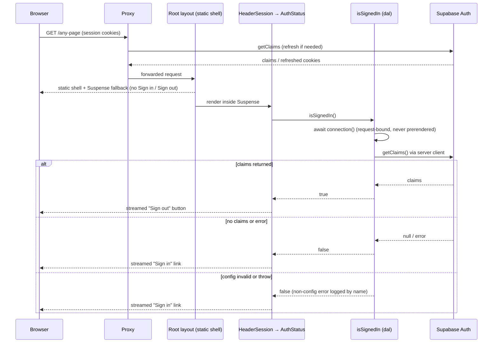
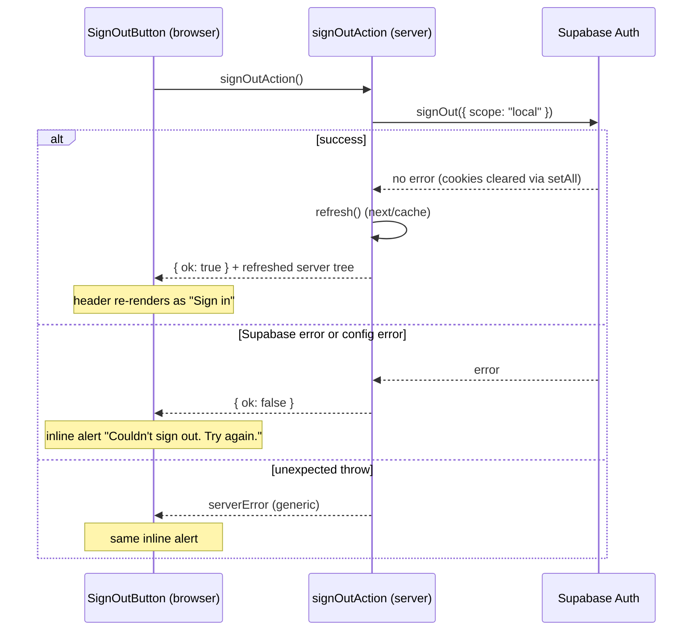

# Design

## Context

See `proposal.md` — Why. Current state, from the archived `add-supabase-auth` design (D5, D6):

- `src/app/layout.tsx` renders `<header>` inside `Providers` with the site link and the
  `AuthStatus` Client Component.
- `AuthStatus` (`features/auth/components/AuthStatus/`) reads the session after mount through
  `useQuery(sessionQueryOptions)` → `getSignedInEmail()` (`features/auth/api/`) →
  `getSupabaseBrowserClient().auth.getClaims()` (`shared/lib/supabase/browser.ts`), re-reads on
  every pathname change, and calls `signOutAction` (`features/auth/actions/auth.actions.ts`),
  then `router.refresh()`.
- `browser.ts` is the only user of `createBrowserClient`. The server client
  (`shared/lib/supabase/server.ts`, `createSupabaseServerClient`) already reads `cookies()` and
  tolerates the read-only cookie store of a Server Component; the proxy is the only refresher.
- Cache Components is on. `/`'s page body is a `"use cache"` scope (`cacheLife("minutes")`);
  the root layout reads no request data, so `/`, `/signup`, and `/_not-found` build as static
  (`○`). Next 16 requires a component that reads `cookies()` to sit inside `<Suspense>`;
  everything outside the boundary still prerenders into the static shell
  (Next docs: "Authentication with Cache Components", "Push dynamic access down").
- Server-only data access lives in a feature's `dal/` (ADR 0001), e.g.
  `features/auth/dal/confirm-sign-up.ts`.

## Goals / Non-Goals

**Goals:**
- Decide "signed in or not" on the server, per request, with no session code in the browser.
- Keep the page bodies and `/`'s cached content in the static shell; only the header's
  session part waits for the request.
- Remove every module whose only consumer was the browser read, leaving `knip` clean.

**Non-Goals:**
- Passing reader data (email, id) to the client, or a client-side user context.
- Restructuring `shared/lib/supabase` beyond deleting `browser.ts`.
- Changing `Providers`, the query client, the proxy, or the sign-in/sign-up/confirm flows.

## Decisions

### D1. One server-only session check in `features/auth/dal/`

`features/auth/dal/is-signed-in.ts` exports `isSignedIn(): Promise<boolean>`:
`import "server-only"`, then `await connection()` from `next/server` as its first statement,
outside any `try`, then `createSupabaseServerClient()` and `auth.getClaims()`.

`connection()` makes the check request-bound whatever the config. Without it, a build with no
Supabase env (CI sets none) throws `SupabaseConfigError` inside `createSupabaseServerClient`
before `cookies()` is reached; the check would resolve `false` during prerender and Next would
bake a static "Sign in" into the shell: CI would keep `○` and never notice a header moved out
of `<Suspense>`, and a deploy built without env would show "Sign in" to every reader (Gate 1
re-run, finding 1). With `connection()`, every build prerenders only the fallback.

It resolves
`true` only when claims come back without an error; no claims, an error result, a thrown
`SupabaseConfigError`, or any other throw resolve `false`. Only a thrown non-config error is
logged, by `name` only, like `confirmSignUp`. An `{ error }` result from `getClaims` (an expired
or bad token is routine) and a config error (the proxy already logs it) resolve `false`
silently, as `confirmSignUp` treats `verifyOtp`'s error result.

It returns a boolean, not claims: the header needs nothing else, and a narrower return keeps
reader data out of the render tree (proposal, Out of Scope).

*Alternatives:*
- *Check for the auth cookie's presence without `getClaims`.* Cheaper, but a stale or forged
  cookie would show "Sign out"; `getClaims` verifies the JWT.
- *Put the check in `shared/lib/supabase/session.ts`.* That module is the proxy's refresh; the
  header question is the auth feature's domain (ADR 0003's split), and ADR 0001 puts it in the
  feature's `dal/`.

### D2. `AuthStatus` becomes a synchronous presentational component; sign-out is a small Client Component

- `components/AuthStatus/AuthStatus.tsx` (no `"use client"`, not async), props
  `{ signedIn: boolean }`:
  `signedIn ? <SignOutButton /> : <Link href="/login" className="text-sm font-medium text-accent">Sign in</Link>`.
  It never calls the DAL itself, following `docs/state-management.md` ("the page awaits the DAL
  and passes plain values to synchronous presentational components"); the layout does the
  await (D3).
- `components/SignOutButton/SignOutButton.tsx` (`"use client"`): the existing ghost `Button`
  "Sign out", a `useTransition` around `signOutAction()`, and on a non-`ok` result or a thrown
  call the existing inline `<p role="alert" className="font-medium text-danger">` with
  `SIGN_OUT_FAILED_MESSAGE`. It keeps the current widget's other sign-out behaviour: the
  button is `disabled` while the transition is pending, and a new attempt clears the previous
  alert before calling the action. It keeps the current layout wrapper
  (`flex items-center gap-3 text-sm`) and has no query client, router, or session state.
- `index.ts` keeps exporting `AuthStatus` and adds `isSignedIn` (the index already exports the
  server-only `confirmSignUp`, and is imported only by Server Components); `SignOutButton` stays internal (imported by
  `AuthStatus` by relative path, as the feature's other components do, design D1 of
  `add-supabase-auth`).

*Alternative:* a `<form action={signOutAction}>` with no Client Component. Rejected: the
failure message needs client state, and FR-4 keeps it.

### D3. The layout awaits the check inside `<Suspense>`

Like `/login`'s `SignInFormWithError`, the layout file holds a small async wrapper that awaits
the DAL and passes a plain value down:

```tsx
async function HeaderSession() {
  return <AuthStatus signedIn={await isSignedIn()} />;
}

<Suspense fallback={<div aria-hidden="true" className="min-w-24" />}>
  <HeaderSession />
</Suspense>
```

The fallback is the same empty placeholder the widget renders today while pending, so the
header keeps its width and shows neither link (FR-3). The layout itself awaits nothing, so
`{children}` and the site link stay in the static shell. The header stays inside `Providers`
(no behaviour difference, smaller diff).

### D4. `signOutAction` refreshes from the server

On a successful `signOut({ scope: "local" })`, `signOutAction` calls `refresh()` from
`next/cache` before returning `{ ok: true }`. The client re-renders the server tree with the
cleared cookies, so `AuthStatus` resolves to "Sign in". On failure it returns `{ ok: false }`
without refreshing. `SignOutButton` drops `router.refresh()` and the query-cache writes.

Sign-in needs no change: `signInAction` already ends with `redirect("/")`, and a redirect from
a Server Action renders the target's server tree with the new cookies, so the header updates.
The confirm route redirects with a full navigation.

*Alternative:* keep `router.refresh()` in the client. Rejected: the server already knows the
moment the cookies change, and doing it there keeps the client component free of router logic.

### D5. Delete the browser read path, bottom-up

| Module | Only consumer |
| --- | --- |
| `shared/lib/supabase/browser.ts` (+ its test, its `index.ts` export) | `features/auth/api/auth.api.ts` |
| `features/auth/api/auth.api.ts`, `auth.queries.ts` (+ test) | the current `AuthStatus` |
| `useSessionRefreshOnNavigation` (inside `AuthStatus`) | the current `AuthStatus` |

`features/auth/api/` becomes empty and is deleted. `shared/lib/supabase/index.ts` keeps only
`SupabaseConfigError`. `signOutAction`, `SignOutResult`, and `SIGN_OUT_FAILED_MESSAGE` stay.

Traceability markers: the new header code carries `implements FR-1`…`FR-4 of
remove-browser-session-read` as it implements them. Existing `implements FR-7 of
add-supabase-auth` markers are removed from code this change rewrites (`AuthStatus`, the
layout comment) and kept on code it doesn't touch that still serves sign-out
(`signOutAction`, `SIGN_OUT_FAILED_MESSAGE`); `FR-8 of add-supabase-auth` markers stay. The
layout comment keeps no `NFR-2 of add-supabase-auth` marker, since that requirement is
replaced.

### D6. Specs: remove and re-add under new names

OpenSpec rejects a MODIFIED block that drops scenarios the main spec still has. So the `auth`
delta REMOVES "Auth status in the header (FR-7)", "Supabase configuration (FR-8)", and
"Rendering mode of `/` preserved (NFR-2)", and ADDS "Session-aware header (FR-7)", "Sign out
from the header (FR-7a)", "Supabase configuration validation (FR-8)", and "Rendering modes
with a session-aware header (NFR-2)". The FR/NFR numbers stay, so untouched
`implements FR-8 of add-supabase-auth` markers remain true. `feedback-tones` keeps FR-5 and
MODIFIES NFR-3 so the sign-out failure assertions can move into `SignOutButton`'s test.

### D7. A new decision record, not an edit to ADR 0003

A new `docs/decisions/0004-*.md` (via `record-decision`) records: the header reads the session
on the server inside a Suspense boundary; no browser Supabase client; routes under the root
layout are partially prerendered. It names ADR 0003's "Session freshness and the header"
bullet as superseded and:
- restates that the proxy refreshes the session on every matched request and is the only
  token refresher (still in force);
- names the 0003 consequences that no longer apply: a future feature reading "who is signed
  in" from the `["auth","session"]` query, the header relying on JS-readable cookies, the
  header syncing on navigation, and "the server render stays identical for every reader";
- notes that the browser no longer reads the session cookies, so making them HttpOnly
  becomes possible (a follow-up).

### Sequence: header session read (browser ↔ Next server ↔ Supabase Auth)



### Sequence: sign out (browser ↔ Server Action ↔ Supabase Auth)



## Risks / Trade-offs

- [Every page streams its header per request] → Only the header's session part waits; the
  shell and page bodies (including `/`'s cached body) stay prerendered. NFR-1's build check
  confirms the route table.
- [`getClaims` may make a network call per request when the project signs JWTs with a shared
  secret] → Accepted for now; the proxy already does the same call. Gate 3 notes the header's
  latency; moving the project to asymmetric JWT keys is a follow-up if it shows.
- [`refresh()` inside a `next-safe-action` action] → It doesn't throw (unlike `redirect`), so
  the action client's error handling is unaffected; the action test mocks `next/cache` and
  asserts it was called only on success.
- [The header can go stale on client-side navigation] → A shared layout isn't re-rendered on
  soft navigation, so a session that expires or is ended in another tab keeps showing
  "Sign out" until a full load, a `refresh()`, or a cookie-changing action or redirect.
  Accepted: clicking a stale "Sign out" is harmless (the action succeeds or fails cleanly and
  `refresh()` re-renders the header as "Sign in"), and sign-in/sign-out in this tab update it.
- [The Suspense wiring has no unit test] → `AuthStatus` is synchronous and unit-tested with a
  `signedIn` prop; `isSignedIn` is unit-tested, including its `connection()` call. Because
  `connection()` runs first whatever the config, moving `HeaderSession` out of `<Suspense>`
  fails every build, CI's env-less one included; Gate 3 covers the rendered header.
- [A tab opened before the deploy] → It still runs the old `AuthStatus` until reload; its
  "Sign out" still calls `signOutAction`, whose contract is unchanged.

## Migration Plan

Deploy as a normal release; nothing to migrate (no schema, no env change). Rollback is a
revert of the merge commit.
