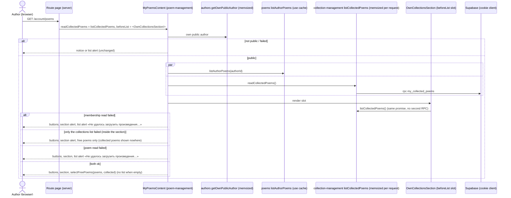
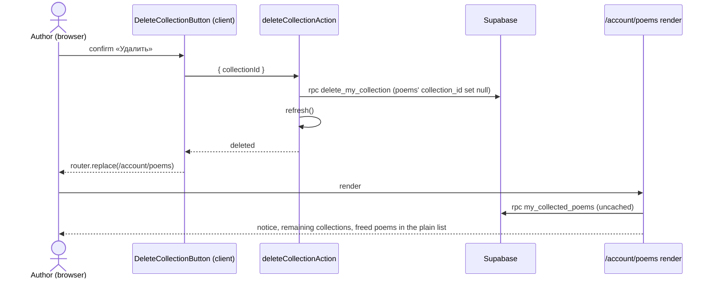

# Design

## Context

`/account/poems` is composed by its route file from two features that never import each other
(collection-management NFR-3): `poem-management`'s `MyPoemsPage` renders the heading, the button
row, and the plain poem list (from `poems`' cached public read `listAuthorPoems`), and takes
`collection-management`'s `OwnCollectionsSection` as its `beforeList` slot. The section reads the
author's collections and, through the definer function `my_collected_poems()` (ADR 0012), which
poems are in which collection — the `collection_id` column has no grant, so only that function can
tell a free poem from a collected one.

The plain list must now leave out every collected poem. `poem-management` can't read membership
itself (no grant, and it must not import `collection-management`), so the membership read has to
reach it from the route file.

Freshness is already in place: membership is read uncached (ADR 0011), and the delete and the
collection poems save both call `refresh()`, so the next render of `/account/poems` reads the
current membership. The public poem list does not change on either write.

## Goals / Non-Goals

**Goals**

- The plain list shows free poems only, in the existing order and look (FR-1).
- A failed membership read never produces a guessed list (FR-2, user decision 2026-11-10).
- The section and the plain list always agree, so every poem appears exactly once (NFR-2).
- No new import between the two features (NFR-1).

**Non-Goals**

- No database change: `my_collected_poems()` already returns every collected poem id.
- No change to public pages, the collection pages, or the collection poems page.
- No new copy, heading, or empty-state text.

## Decisions

### D1 — The route passes the membership read as a function prop (NFR-1, FR-1)

`MyPoemsPage` gains a required prop `readCollectedPoems: () => Promise<CollectedPoemsRead>`, passed
down to `MyPoemsContent`. `CollectedPoemsRead` is `poem-management`'s own minimal type,
`{ ok: true; poems: readonly { readonly id: string }[] } | { ok: false }` — structurally satisfied by
`collection-management`'s `CollectedPoemsResult`, so neither feature imports the other's types. The
route file passes `collection-management`'s exported `listCollectedPoems`.

A function, not a promise or a pre-computed set: the route file is a synchronous Server Component
outside any Suspense boundary, and starting a cookie-bound read there would make the static shell
dynamic (Cache Components). `MyPoemsContent` calls the function inside the existing Suspense
boundary, after the session and public-profile checks, exactly where it reads the poem list today.

Required, not optional: the requirement is "free poems only", and a missing prop silently showing
every poem is the bug this change removes. The type system makes the route pass it.

Alternatives rejected:

- **A new definer function `my_free_poems()` read by `poem-management`**: a migration and a deploy
  step for data one existing function already returns, and it would teach `poem-management` about
  collections at the database level.
- **Move the plain list into `collection-management`'s slot**: the list, its alert, and its order
  belong to `poem-management` (FR-2, FR-11); moving them duplicates its rendering and failure rules.

### D2 — One memoized membership read per request (NFR-2)

`listCollectedPoems` in `collection-management/dal/collection-poems.ts` is wrapped in React's
`cache` (as `getOwnCollection` and the authors DAL already are), so the section's call (via
`listOwnCollectionsWithPoems`) and the plain list's call share one promise and one result in a
request. Without it the two calls could see different membership if a save lands between them, and
a poem could show in both places or in neither. It stays uncached across requests (ADR 0011); this
extends the per-request rule (ADR 0008, ADR 0011 §3) from a page and its trail to a page and its
slot: ADR 0011 §3 gets a one-line amendment note and `docs/state-management.md` a line (Gate 1 P2).

`listCollectedPoems` is exported from `collection-management/index.ts`.

### D3 — Filtering and failure (FR-1, FR-2)

`MyPoemsContent` reads both in parallel: `Promise.all([listAuthorPoems(authorId),
readCollectedPoems()])`. Either failing shows the existing list alert
(`POEM_MANAGEMENT_COPY.ownPoemsUnavailable`) in the list's place; the button row and the section
slot render as today. Otherwise a pure helper `selectFreePoems(poems, collected)` in
`poem-management/model/free-poems.ts` builds a `Set` of collected ids and keeps the poems not in it,
preserving `listAuthorPoems`' newest-first order. An empty result renders no list, as no poems does
today.

When only the collections list (`listOwnCollections`) fails, the section shows its alert while the
plain list still shows free poems only, so collected poems are shown nowhere. Accepted: the
section's alert tells the author why, and falling back to every poem would be the guessed list
FR-2 rules out (Gate 1 P1).

A collected id with no matching poem (a public list a few seconds stale) is ignored; a poem in the
list with no membership row is free. No other reconciliation is needed: both reads are the
author's own.

### D4 — Freshness (FR-3, FR-4)

Nothing new. The delete and save actions already call `refresh()`; `/account/poems`' next render
re-reads membership uncached, so freed poems appear in the plain list and added ones leave it,
on the next screen and on Back/Forward (collection-management FR-15, add-poems-to-collections
FR-12). web-qa checks both paths.

### D5 — Testing

- `free-poems.test.ts` (unit): free only, order kept, unknown collected ids ignored, all collected
  → empty.
- `MyPoemsContent.test.tsx` (component): free poems only; every poem collected → no list; poem read
  fails → alert; membership read fails → alert and no poem link; button row and slot present in
  every case; `readCollectedPoems` not called on the not-public or session-unknown branch.
- `collection-poems.test.ts`: `listCollectedPoems` called twice in one request reaches the RPC once.
- Boundary tests of both features unchanged in substance (no cross-import).
- web-qa: delete a collection and see its poems in the plain list (plus Back/Forward); save a
  collection's poems and see the plain list follow.

### Sequence diagrams

Rendering `/account/poems`:

Deleting a collection, then the page (FR-3):

## Risks / Trade-offs

- [A required prop on `MyPoemsPage`] → one caller (the route file); the type forces it, tests pass a
  stub.
- [A membership failure now hides the plain list too] → requested (user decision 2026-11-10); the
  section shows its own alert at the same time, so the author sees why.
- [The public poem list is cached for hours while membership is live] → poems don't change on a
  delete or a save; a create or edit already expires the poem tag (poem-management FR-12).
- [One more read on the page's critical path] → it was already made for the section; with D2 it is
  shared, not doubled.

## Migration Plan

None: no schema change and no deploy step. Rollback is reverting the app.
