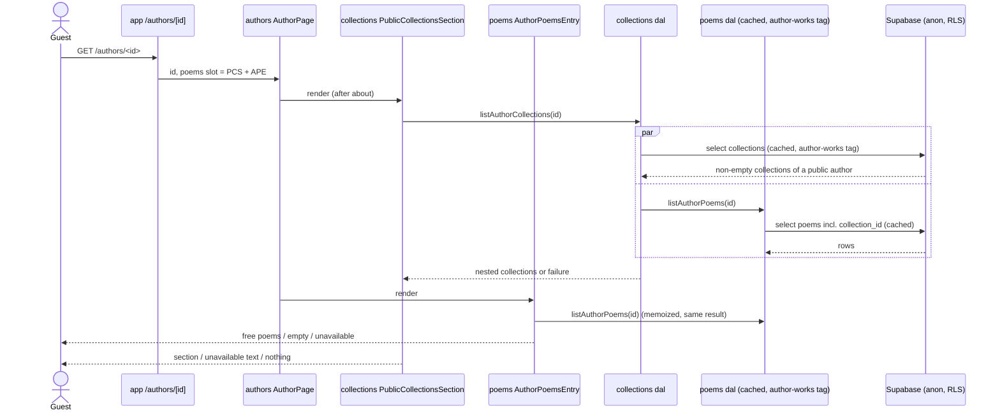
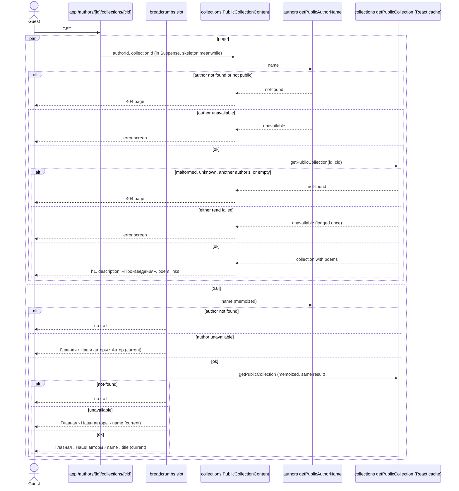
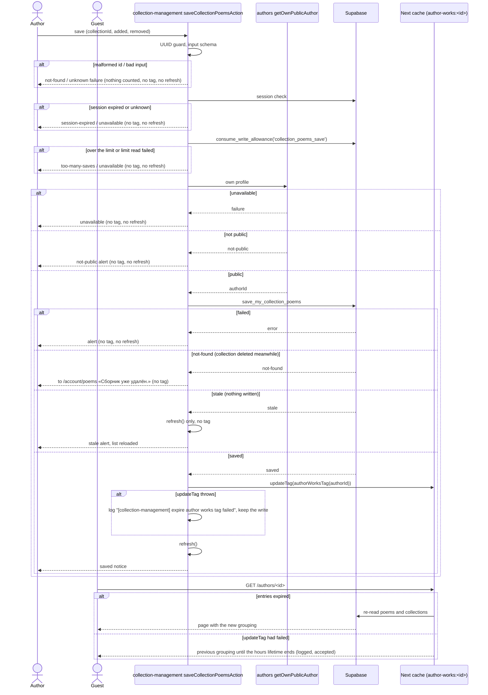
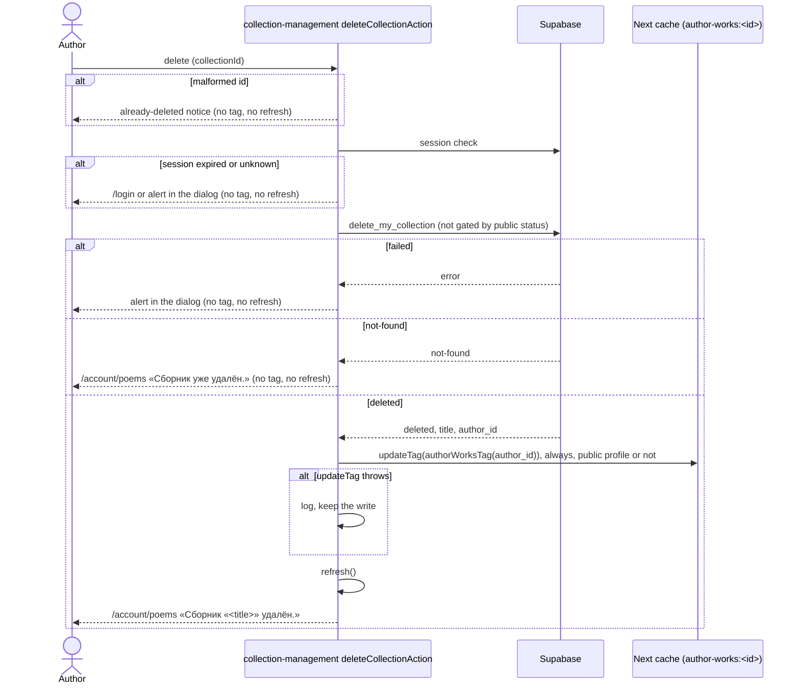

# Design

## Context

Collections live in `collection-management`, private by design: `collections` has an owner-only RLS
policy and no `anon` grant (ADR 0011), and `poems.collection_id` has no grant at all, so membership
is read only through the owner's `security definer` functions (ADR 0012). The public author page
`/authors/<id>` composes `authors`' `AuthorPage` with `poems`' `AuthorPoemsEntry` (one flat list,
newest first) through a slot prop. `poems` is the only reader of the `poems` table (author-poems
NFR-3) and caches one entry per author under `poemsTag(authorId)`, which `poem-management`'s three
writes expire with `updateTag`. `collection-management` imports neither `poems` nor
`poem-management` (collection-management NFR-3) and keeps its pages fresh with `refresh()` only.

The user decided (2026-11-10) that collections, their descriptions, their poems, and membership are
public; only managing them is private. Guests see only non-empty collections. The author page
mirrors `/account/poems`: collections with their poems first, then the free poems. A collection gets
its own public page. The poem page is unchanged.

## Goals / Non-Goals

**Goals**

- Guests see an author's non-empty collections on the author page and on a public collection page,
  with the same order and grouping as the author's own `/account/poems`.
- One source of truth for membership on the public side: the poem row, read by `poems`.
- Every write that changes what the public pages show expires their cache at once.
- No new import between `collection-management` and `poems` / `poem-management`, no cycle.

**Non-Goals**

- Ordering by drag-and-drop (the next change).
- Switching the author's own pages to the public reads. `/account/poems` keeps its uncached owner
  reads and `my_collected_poems()`; now that membership is public they could share the public entry,
  but that is a refactor with no visible change, left for later (recorded in `docs/deferred.md` at
  the end of the last group).
- A collection line on the public poem page (user decision, 2026-11-10).
- Changing any write, limit, or who may write.

## Decisions

### D1 — A new public feature `collections` (NFR-3)

The public side of collections is a new feature, `src/features/collections/`, the way `poems` is the
public side of `poem-management`: server-only, session-free, cookie-less reads, no `"use client"`.

```
app (author route, collection route, trail slot)
 ├─► authors      (AuthorPage, getPublicAuthorName)
 ├─► poems        (AuthorPoemsEntry, listAuthorPoems, authorPoemPath)
 ├─► collections  (PublicCollectionsSection, PublicCollectionPage)
 │     ├─► poems    (listAuthorPoems, authorPoemPath)
 │     └─► authors  (getPublicAuthorName)
 └─► breadcrumbs ─► collections (getPublicCollection, PUBLIC_COLLECTIONS_SEGMENT)

shared/config/cache-tags.ts  ◄── poems, poem-management, collection-management, collections
```

- `collections` imports `poems` and `authors` through their indexes; `poems` and `authors` never
  import `collections` (no cycle).
- `collections` never imports `collection-management`, and `collection-management` never imports
  `collections`: the public side and the management side share only the database and the cache tag.
  Each keeps its own copy of the small pieces both need (the description's paragraph rendering
  uses `shared/lib/split-paragraphs`, already shared; the poem link look is repeated, as in
  `CollectionPoemList`). This follows the project's rule: a mirroring feature repeats logic in its
  own module, and only domain-free code goes to `shared/`.
- `authors` stays untouched: the author route passes both sections into `AuthorPage`'s existing
  `poems` slot as one fragment.

Alternatives: putting the public reads in `collection-management` (rejected: that feature is
signed-in and cookie-bound, and public code would sit next to private reads); putting them in
`poems` (rejected: `poems` would grow a second domain and need the collections table).

### D2 — Database (NFR-1, FR-1)

A new migration `<timestamp>_public_collections.sql`:

```sql
-- Anyone reads a public author's collection that holds at least one poem (user decision, 2026-11-10).
create policy "anyone reads public authors' non-empty collections" on public.collections
  for select to anon, authenticated
  using (
    public.is_public_author_profile(author_id)
    and exists (select 1 from public.poems p where p.collection_id = collections.id)
  );

grant select (id, author_id, title, description, created_at) on public.collections to anon;
-- authenticated already holds this grant (20261104180000_collections.sql).

grant select (collection_id) on public.poems to anon, authenticated;
```

- The owner policy stays, so an author still reads their own empty collections and their
  collections while their profile isn't public; Postgres ORs the two policies.
- The `exists` subquery runs under the caller's own RLS on `poems` (public authors' poems only) and
  needs the new `collection_id` grant; `poems`' policy doesn't read `collections`, so there is no
  policy recursion. pgTAP proves an empty collection, a non-public author's collection, and a
  collection whose only poem was deleted are invisible to `anon`.
- Writes are unchanged: no insert, update, or delete grant on either table; the five write functions
  and their limits stay as they are. `my_collection_poem_choices`, `my_collected_poems`, and
  `save_my_collection_poems` stay too: the owner's pages still use them.
- The owner's reads in `collection-management/dal/own-collections.ts` already filter by the own
  author id (`.eq("author_id", authorId)`), so the wider policy can't add another author's
  collections to `/account/poems`; a test pins this (task 1.4).
- `delete_my_collection(uuid)` is recreated (`create or replace`, same signature, same rules) to also
  return the deleted row's `author_id`: `{"status": "deleted", "title": "<title>", "author_id":
  "<uuid>"}`, as `delete_my_poem` already does. The delete action needs it to expire the author's
  public tag whatever the profile's status (D4; Gate 1 C1). `not-found` is unchanged.
- Down migration (documented, never auto-run): drop the policy, revoke the two grants, and re-run
  `delete_my_collection` from `20261104180000_collections.sql` (the extra key is harmless to an older
  app, so the order of app and database rollback doesn't matter).

**ADR 0013** records this: collections and membership are public data; it supersedes ADR 0012
(the column now has a grant, and its definer functions remain only as the owner's convenience) and
amends ADR 0011 (collections are no longer private data; the owner's pages keep reading them
uncached, which ADR 0011 still describes).

### D3 — The poems read carries membership (FR-1, FR-3, NFR-2)

- `POEM_COLUMNS` gains `collection_id`; `poemRowSchema` gains `collection_id:
  lowercaseUuidSchema.nullable()`; `Poem` gains `readonly collectionId: string | null`; `toPoem`
  maps it. Every consumer of `Poem` keeps working (the field is additive).
- `poems` stays the only reader of the `poems` table (author-poems NFR-3): `collections` gets
  membership from `listAuthorPoems`, never from its own query.
- `AuthorPoemsEntry` lists `poems.filter((poem) => poem.collectionId === null)` through a named
  function `uncollectedPoems(poems)` in `poems/model/uncollected-poems.ts`: the feature's own copy of
  the rule, named apart from `poem-management`'s `selectFreePoems(poems, collected)` so a later grep
  can't confuse the two (Gate 1 P5).

| Poems read | Poems | Free poems | «Произведения» section |
| --- | --- | --- | --- |
| ok | none | — | heading + «У автора пока ещё нет публикаций.» |
| ok | some | some | heading + free poem links |
| ok | some | none | not rendered (`null`) |
| unavailable | — | — | heading + «Произведения сейчас недоступны.» |

### D4 — One public tag per author, in `shared/config` (NFR-2, NFR-3, FR-7)

The poems entry now holds membership, which collection writes change, so `collection-management`
must expire it; but it may not import `poems`. The tag builder therefore moves to
`src/shared/config/cache-tags.ts`:

```ts
/** The one cache tag of an author's public works — their poems and collections: `author-works:<authorId>`. */
export function authorWorksTag(authorId: string): string
```

- It replaces `poems`' `poemsTag` (removed from `poems`' index and model). The `poems` read and the
  `collections` read both tag their entries with it; `poem-management`'s `expirePoemsTag` becomes
  `expireAuthorWorksTag` with the new import.
- `collection-management` gets its own copy, `actions/expire-author-works-tag.ts` (logged under
  `[collection-management]`, never failing the write), called right before the existing `refresh()`
  after every write that changes what the public pages can show. `refresh()` keeps the owner's
  private pages fresh; `updateTag` makes the next public request wait for fresh data
  (`docs/state-management.md`). Both are allowed in a Server Action; the implementing group
  confirms with context7 that Next 16 permits calling both in one action.
- Which writes expire, and where the author id comes from (Gate 1 C1, user decision 2026-11-10:
  "удаление сбрасывает кэш всегда"):

  | Action | Outcome | Expires `authorWorksTag`? | Author id from |
  | --- | --- | --- | --- |
  | update | `updated` | yes | `getOwnPublicAuthor()`, already read before the write (step 4, public-gated) |
  | save collection poems | `saved` | yes | `getOwnPublicAuthor()`, already read before the write (step 4, public-gated) |
  | save collection poems | `stale` | no: nothing was written (the `refresh()` stays) | — |
  | delete | `deleted` | **always**, whatever the profile's status now | `author_id` returned by `delete_my_collection` (D2) |
  | create | `created` | no: a new collection is empty, so no public page can show it (FR-1) | — |
  | any | refused, `not-found`, failed | no, and no `refresh()` (unchanged) | — |

  Update and save are refused before the write for a non-public profile, so their expiry needs no
  extra read and adds no failure point. Delete isn't gated by public status, and cached public
  entries can outlive a non-public spell (the profile's own writes expire only the authors tags),
  so it expires unconditionally with the id the database returns, as `deletePoemAction` does.
- The tag string changes from `poems:<id>` to `author-works:<id>`. Entries cached under the old tag
  just age out (hours); a deploy rebuilds the cache anyway.
- One tag for both entries is deliberate: every write that changes either entry expires both, so the
  two can't drift apart for longer than one request, and a poem edit costs one extra collections
  read. Rate: every write that expires it is already limited (ADR 0007, 0009, 0010), except deletes,
  as for poems today.

### D5 — The `collections` reads (FR-1, FR-2, FR-5, NFR-2, NFR-9)

`collections/dal/public-collections.ts`, `import "server-only"`:

- `cachedPublicCollections(authorId)` — `"use cache"`, `cacheTag(authorWorksTag(authorId))`,
  public client, `select("id, title, description, created_at")` from `collections` where
  `author_id = authorId`, `order created_at desc, id asc`; Zod-parsed; `cacheLife("hours")` on
  success, `"seconds"` on failure; failures returned as `{ ok: false, reason: "unavailable" }` and
  logged `[collections] read public collections failed: <kind>` with no id or title. RLS returns
  only non-empty collections of a public author, so an unknown or non-public author reads as an
  empty list.
- `listPublicCollections = cache(async (authorId) => …)` — validates the UUID (junk → empty list, no
  cache scope), lowercases it like `listAuthorPoems`, and calls the cached function.
- `listAuthorCollections = cache(async (authorId): Promise<AuthorCollectionsResult>)` — runs
  `listPublicCollections` and `poems`' `listAuthorPoems` in parallel and nests them with the pure
  `model/nest-public-collections.ts`: each collection gets the poems whose `collectionId` matches,
  in the poems list's order (newest first); a collection left with no poems is dropped. Either read
  failing gives `{ ok: false, reason: "poems-unavailable" | "collections-unavailable" }` (poems
  checked first, since without them nothing can be shown).
- `getPublicCollection = cache(async (authorId, collectionId))` — a non-lowercase-UUID id is
  `not-found` with no read; otherwise finds the collection in `listAuthorCollections`; missing →
  `not-found`; a failed read → `unavailable`. Memoized so the page and its trail share one result
  (ADR 0008).

Dropping empty collections in the app as well as in RLS covers the two entries' timing: a poem
deleted since the collections entry was cached can leave a listed collection with no poems.

### D6 — The author page's collections section (FR-2, FR-4, NFR-6)

`collections/components/PublicCollectionsSection/PublicCollectionsSection.tsx`, an async Server
Component taking `authorId: Promise<string>` like `AuthorPoemsEntry`:

| `listAuthorCollections` | Result |
| --- | --- |
| `poems-unavailable` | `null` (the «Произведения» section shows its own unavailable text) |
| `collections-unavailable`, and some poem has a `collectionId` | `<section lang="ru">` with h2 «Сборники произведений» and «Сборники сейчас недоступны.» in the muted text style |
| `collections-unavailable`, no poem in a collection | `null` |
| ok, no collection | `null` |
| ok, collections | h2 «Сборники произведений», then `<ul>` with one `<li>` per collection: the title as a link to `/authors/<id>/collections/<collectionId>`, then a nested `<ul>` of its poems' title links to `/authors/<id>/poems/<poemId>` |

The markup and classes repeat `collection-management`'s `OwnCollectionItem` (title `text-lg`,
nested list with `border-l border-border pl-4`, poem links `text-base`). "Some poem has a
`collectionId`" needs the poems list, so the nested result carries it on the
`collections-unavailable` branch (`hasCollectedPoems: boolean`).

The author route becomes:

```tsx
<AuthorPage
  id={id}
  poems={
    <>
      <PublicCollectionsSection authorId={id} />
      <AuthorPoemsEntry authorId={id} />
    </>
  }
/>
```

Both are async inside `AuthorPage`'s existing slot position (after the about section); each awaits
its own reads, and `listAuthorPoems` is memoized, so the page still reads the poems entry once.

### D7 — The public collection page (FR-5, FR-8, NFR-4, NFR-5)

- Route: `src/app/(public)/authors/[id]/collections/[collectionId]/page.tsx`, the same `<main>`
  shell as the poem route, rendering `PublicCollectionPage({ authorId, collectionId })` with
  promises from `params`.
- `PublicCollectionPage`: `<Suspense fallback={<PublicCollectionSkeleton />}>` around
  `PublicCollectionContent`.
- `PublicCollectionContent`: `getPublicAuthorName(id)` first (not-found → `notFound()`,
  unavailable → throw to the error screen, as `PoemPageContent`); then
  `getPublicCollection(id, collectionId)` (not-found → `notFound()`, unavailable → throw).
  Renders `<article lang="ru">`: h1 the title; the description as paragraphs via
  `shared/lib/split-paragraphs` with `whitespace-pre-line` (as `CollectionContent`); h2
  «Произведения»; the poem title links through `poems`' `PoemTitleList` with `authorPoemPath` (the
  same 18 px look as the account collection page's list; `collections` may import `poems`). A collection on this page always has poems (D5), so the
  heading is always shown.
- `PublicCollectionSkeleton`: heading bar, two paragraph bars, and three link bars, built like
  `PoemPageSkeleton` (`bg-surface animate-pulse` blocks, off under reduced motion, a screen-reader-only
  «Загрузка…» status); no shared skeleton primitive exists (`docs/design-system.md` §4).
- Paths: `collections/model/public-collection-paths.ts` — `PUBLIC_COLLECTIONS_SEGMENT =
  "collections"` and `publicCollectionPath(authorId, collectionId)`, built on `authors`'
  `authorPagePath`. Poem links use `poems`' `authorPoemPath`, newly exported from its index.
- `/authors/<id>/collections` has no page and renders the 404 page.

### D8 — Breadcrumbs (FR-6)

- `match-route.ts`: `[id, "collections", collectionId]` under `/authors/` → `{ kind:
  "author-collection", authorId, collectionId }`; anything longer or shorter → no match.
- `build-trail.ts`: Главная › Наши авторы › `<author name>` (link to `/authors/<id>`) › `<collection
  title>` (current). Rules mirror the poem trail (breadcrumbs FR-4): unknown author → no trail;
  author unavailable → «Автор»; collection not found → no trail; collection unavailable → the trail
  ends at the author item as current.
- Slot page `src/app/@breadcrumbs/authors/[id]/collections/[collectionId]/page.tsx`, segments
  `["authors", id, "collections", collectionId]`. `app/tests/breadcrumbs-slot.test.ts` checks it
  exists.

### D9 — Freshness (FR-7)

| Write | Expires | Public effect |
| --- | --- | --- |
| Poem create / edit / delete (`poem-management`) | `authorWorksTag` | poems entry and collections entry re-read |
| Collection create | nothing | none: the new collection is empty, so hidden (FR-1) |
| Collection edit (`updated`) | `authorWorksTag` | new title and description |
| Collection delete (`deleted`) | `authorWorksTag`, always | collection gone, its poems listed as free |
| Collection poems save (`saved`) | `authorWorksTag` | poems move between a collection and the free list; an empty collection appears or disappears |
| Collection poems save (`stale`) | nothing | none: nothing was written |

A guest whose browser already shows a page sees the change after a reload, as for poems today
(edit-poem FR-14).

### D10 — Testing

- **pgTAP**: `collections.test.sql` (anon reads a public author's non-empty collection; not an
  empty one, not a non-public author's, not a collection whose last poem was deleted; anon writes
  still fail; the owner still reads own empty and own while not public); `collection_poems.test.sql`
  (anon and another author now select `collection_id`; direct updates still fail; the save
  function's rules unchanged).
- **Unit**: `nest-public-collections`, `uncollected-poems` (poems), the paths, the trail match and build,
  `authorWorksTag`.
- **DAL**: `public-collections.test.ts` with the fake public client (`poems/tests/dal/
  fake-public-client.ts`'s pattern, repeated in `collections/tests/dal/`): parse, order, failure as
  value, UUID guard, both-read nesting, `getPublicCollection` cases; `author-poems.test.ts` maps
  `collection_id`.
- **Components**: `PublicCollectionsSection` (every row of D6), `AuthorPoemsEntry` (every row of
  D3), `PublicCollectionContent` (404, throw, render), the skeleton.
- **Actions**: each `collection-management` action test asserts D4's table: `updateTag(authorWorksTag(id))`
  after `updated`, `saved`, and `deleted`; not after `created`, `stale`, a refusal, `not-found`, or a
  failure; a delete by an owner whose profile is no longer public still expires the tag with the id
  the database returned (Gate 1 C1); a throwing `updateTag` is logged and the write still reports
  success. `deleteOwnCollection`'s DAL test parses `author_id`. poem-management's tests switch to the
  new tag.
- **pgTAP** also: `delete_my_collection` returns `author_id` on `deleted` and still `not-found` for
  another author's or a missing collection.
- **Boundaries**: `collections/tests/boundaries.test.ts` (no `"use client"`, no `auth`,
  `collection-management`, `poem-management`, cookie client); `collection-management`'s still bans
  `poems` / `poem-management`; `poems`' bans `collections`.
- **Gate 3**: guest on the author page and the collection page; the author saves a collection's
  poems, edits and deletes a collection, and the guest's next load follows; 404 for an empty
  collection.

### Sequence diagrams

Guest opens the author page:



Guest opens a collection page (page and trail share one read):



The author saves a collection's poems (steps as in `save-collection-poems.actions.ts`; the profile
is read before the write), and a guest loads the author page:



The author deletes a collection (the update action follows the save shape above: profile read
before the write, `updated` expires, everything else doesn't):



Create has no public effect (the new collection is empty) and is unchanged.

### Deferred note (Gate 1 P5)

The rules "a free poem is one in no collection" and "newest first" now live in four places, by the
project's repeat-per-feature rule: `poem-management/model/free-poems.ts`,
`collection-management/model/collection-poems-nesting.ts`, `poems/model/uncollected-poems.ts`, and
`collections/model/nest-public-collections.ts`. The next change (drag-and-drop ordering) must change
all four in step; the last group records this, with the owner-pages refactor from the Non-Goals, in
`docs/deferred.md`.

## Risks / Trade-offs

- **Privacy reversal.** Anything an author put in a collection description before this change
  becomes public once the collection holds a poem. Collections exist only in development so far
  (the migrations are not deployed: `PROGRESS.md` item 6), so no real author is affected; the ADR
  records the reversal.
- **Two cache entries under one tag** can briefly disagree if one read fails (seconds lifetime)
  while the other succeeds; D5's nesting drops what doesn't match, so the worst case is a
  poem in a collection shown nowhere for a few seconds, never a wrong grouping.
- **Wider read of `collections`** for `authenticated`: the owner's DAL must keep filtering by own
  author id (D2, pinned by a test).
- **Tag rename** touches `poem-management`'s three actions and their tests; mechanical.
- **One tag, more re-reads**: a poem edit re-reads the collections entry too. Negligible at this
  scale.

## Migration Plan

1. Apply `<timestamp>_public_collections.sql` (`npx supabase db push`; added to
   `docs/environment.md`'s deploy checklist next to the collection migrations it follows).
2. Deploy the app. Before the migration, the public collections read returns no rows and
   `collection_id` can't be selected, so the app must not ship before the migration: the deploy
   checklist orders them.
3. Rollback: revert the app, then run the documented down migration.

## Scaffold map

Written from the files on disk after the scaffold (`feature/public-collections-scaffold`, approved
2026-11-10). The migration, the route, and the breadcrumb slot are not scaffolded: groups 1 and 6
add them. knip ignores the new files until task 7.5.

| File | Responsibility | Exports |
| --- | --- | --- |
| `src/shared/config/cache-tags.ts` | the one per-author public tag (D4) | `authorWorksTag` |
| `src/features/collections/index.ts` | the feature's public API (D1) | `PublicCollectionPage`, `PublicCollectionsSection`, `getPublicCollection`, `PUBLIC_COLLECTIONS_SEGMENT`, `publicCollectionPath`, type `PublicCollectionResult` |
| `src/features/collections/model/public-collections.types.ts` | the types between DAL, model, and components (D5) | `PublicCollectionPoem`, `PublicCollectionEntry`, `PublicCollection`, `PublicCollectionsResult`, `AuthorCollectionsResult`, `PublicCollectionResult` |
| `src/features/collections/model/public-collection-row.schema.ts` | the row shape (Zod schema in 4.1) | `PublicCollectionRow` |
| `src/features/collections/model/nest-public-collections.ts` | nesting and the empty-collection drop; whether any poem is in a collection (D5, D6) | `nestPublicCollections`, `hasCollectedPoems` |
| `src/features/collections/model/public-collection-paths.ts` | the segment and the page path (D7) | `PUBLIC_COLLECTIONS_SEGMENT`, `publicCollectionPath` |
| `src/features/collections/model/public-collections-messages.ts` | the copy (NFR-8) | `PUBLIC_COLLECTIONS_COPY` |
| `src/features/collections/dal/public-collections.ts` | the cached read, the nested read, the one-collection read (D5) | `listPublicCollections`, `listAuthorCollections`, `getPublicCollection` |
| `src/features/collections/components/PublicCollectionsSection/` | the author page's section (D6) | `PublicCollectionsSection`, `PublicCollectionsSectionProps` |
| `src/features/collections/components/PublicCollectionPage/` | the page's Suspense boundary (D7) | `PublicCollectionPage`, `PublicCollectionPageProps` |
| `src/features/collections/components/PublicCollectionContent/` | the page's content and its 404 / error branches (D7) | `PublicCollectionContent`, `PublicCollectionContentProps` |
| `src/features/collections/components/PublicCollectionSkeleton/` | the page's loading state (D7) | `PublicCollectionSkeleton` |
| `src/features/poems/model/uncollected-poems.ts` | the author page's free poems (D3) | `uncollectedPoems` |
| `src/features/collection-management/actions/expire-author-works-tag.ts` | the feature's own tag expiry, logged, never failing the write (D4) | `expireAuthorWorksTag` |
