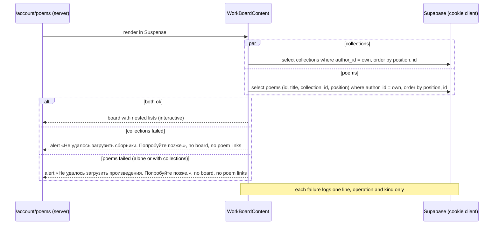

## Context

`/account/poems` today is two server-rendered lists from two features: `collection-management`'s
`OwnCollectionsSection` (collections with nested poems, passed to `MyPoemsPage` as `beforeList`) and
`poem-management`'s free poems list. Both read "newest first"; the database has no order column.
Public pages read the same data under one per-author cache tag (`authorWorksTag`, `public-collections`
D4, ADR 0013). `poem-management` and `collection-management` never import each other; the route
composes them (`docs/architecture.md`). Writes go through security definer functions that take the owner
from `auth.uid()` (ADR 0005, 0012); per-account limits use `consume_write_allowance` scopes (ADR 0007).

The new need: one drag surface where a poem can cross from a collection to another and to the free list.
That cannot live inside either existing feature, and it cannot be two surfaces, because one drag must
span both lists.

## Goals / Non-Goals

**Goals**

- A stored order for collections, for each collection's poems, and for the free poems; every drop saved
  at once; readers see the author's order.
- Keyboard and touch support; the moves are atomic and safe against another tab.
- Features stay independent; no code is extracted into `shared/` for the sake of this change.

**Non-Goals**

- A button-only alternative to dragging, undo, multi-select drag, sort menus, nesting collections,
  dragging on public pages, dragging on the checkbox page (`proposal.md` Out of scope).
- Switching the owner's pages to the cached public reads (still open in `docs/deferred.md`; revisit
  separately).

## Decisions

### D1. Order is an integer `position` on the row, per container

`collections.position integer not null` (container: the author) and `poems.position integer not null`
(container: the author's free poems when `collection_id is null`, otherwise that collection). Lists read
`order by position, id`. Alternatives rejected: a separate ordering table (a join on every public read for
no gain); an array column on `collections` holding poem ids (a second source of truth beside
`poems.collection_id`, and it breaks the one-membership constraint); fractional/lexorank keys (no problem
that dense integers don't solve at 1000 poems per list, and harder to read).

- **New item first (FR-1):** `position = coalesce(min(position) over its container, 0) - 1`, set by the
  insert trigger of D2 under the per-author advisory lock. Negative positions are fine; they are never shown.
- **Deletes** leave gaps; gaps keep the order, so no renumbering (FR-1).
- **A move renumbers** the container(s) it touches to `0..n-1` in one statement
  (`row_number() over (order by …)`), so positions never drift apart and gaps are healed on the first move.
- **Backfill:** `row_number() over (partition by author_id [, collection_id] order by created_at desc, id) - 1`.
- **Indexes:** `poems (author_id, collection_id, position, id)` replaces `poems_collection_created_idx`;
  `collections (author_id, position, id)` replaces `collections_author_created_idx`.

### D2. Two definer functions write order; membership changes only with them or the existing save

`move_my_poem(poem_id uuid, from_collection_id uuid, to_collection_id uuid, to_index integer) → jsonb`
and `move_my_collection(collection_id uuid, to_index integer) → jsonb`. Same shape as
`save_my_collection_poems`: `security definer`, `search_path = ''`, owner from `auth.uid()` and
`my_author_profile_id()`, a public-profile check, and the per-author advisory lock
(`pg_advisory_xact_lock(hashtextextended(<profile>::text, 0))`, the one the creates already take) as the first statement of `move_my_poem`, `move_my_collection`, `save_my_collection_poems`, `delete_my_collection`, and the new insert triggers: one serialization point per author, so a poem joining the free list needs no row-lock reasoning and no two writes of one author deadlock. The advisory lock is the guarantee against deadlock; inside, the collections a function names are locked by id and then the moved poem, and the other poems of a renumbered list are locked by the update itself (the writers that skip the advisory lock each touch one row), arguments written `<function>.<name>`.

- `from_collection_id` is the browser's belief about where the poem was (null = free). A mismatch answers
  `{"status":"stale"}` with nothing written (FR-11); an id that is not the caller's or does not exist
  answers `{"status":"not-found"}`, the same for both (FR-11, as `save_my_collection_poems`); a profile that is
  no longer public also answers `not-found` (the action then refreshes and shows the «list changed» text).
- `to_index` is clamped into `0..count` of the target list after removing the poem (NFR-1).
- Success answers `{"status":"moved","author_id":"<uuid>"}`: the app needs the author to expire the
  public tag, as `delete_my_collection` does (ADR 0013 §4).
- **Rows always get a position from the database**, not from each function: a `before insert` trigger on
  `poems` and on `collections` sets `position` to "first in its container" when the insert gave none, under
  the per-author advisory lock above. So `create_my_poem`, `create_my_collection`, the seed, and every
  fixture that inserts rows directly get a position with no change (FR-1), and the columns can be `not null`.
- `save_my_collection_poems` (add-poems-to-collections) places added poems first in the collection and
  removed ones first among the free poems (FR-10). **`delete_my_collection` places the poems it frees first
  among the free poems, in their collection order, before the delete** (FR-1; without it their old positions
  would collide with the free list's and interleave by id). `my_collected_poems` orders by position.
  `my_collection_poem_choices` keeps `created_at desc` (the checklist stays newest first, user decision).

- No client role gets an update grant. `position` gets a select grant for `anon` and `authenticated`
  on both tables, exactly where `collection_id` has one (ADR 0013 §2).
- Limit: a new `write_rate_limits` scope `order_move`, 30 per minute, checked by the app through
  `consume_write_allowance` after the session check and before the move (ADR 0007's shape, as
  `collection_edit` and `collection_poems_save`). The named constant lives in the feature's constants module
  and in the migration; keep the two in step.

### D3. One new feature, `work-ordering`, owns the board

`src/features/work-ordering/` holds the board (a client component), its server reads, the two actions,
and their DAL. It repeats what it needs from its siblings in its own module instead of importing them
(project rule: a mirroring feature repeats logic, `shared/` only for domain-free pieces): its own reads of
the owner's collections and poems, its own nesting function, its own write-limit helper and write log.
It may import `@/features/auth` (the session check) and `@/features/authors` (the own public profile) and `shared/`, as its siblings do — security-relevant code is not copied. It imports neither `poem-management` nor `collection-management`, and neither imports it nor each other (NFR-3).

How the page is assembled: `MyPoemsPage` gets one new slot, `board`, which replaces both `beforeList`
(the collections section) and its own free poems list. The route passes `<WorkBoard />`. The slot replaces
both (no fallback list: YAGNI), so the old pieces become dead and are deleted in this change (`OwnCollectionsSection`,
`OwnCollectionItem`, `nestCollectedPoems`, the `readCollectedPoems` prop, `selectFreePoems`, the free
list component, and the pieces knip then reports) along with their tests. The states `MyPoemsPage` owns —
heading, buttons, notices, not-public, unavailable, offline, skeleton — stay. `my_collected_poems()` is
kept in the database only if something still reads it; otherwise a later migration drops it (the task
list decides after the deletion; an unused function is recorded in `docs/deferred.md`, not dropped here).

### D4. The board: server reads, one client island, `useOptimistic`

- `WorkBoardContent` (Server Component, in a Suspense boundary like the existing sections) reads the
  author's collections and poems in parallel with the cookie client and an explicit author filter
  (ADR 0013 §5), orders by `position, id`, nests them, and passes plain props to the client island.
  **Failure matrix** (the board needs both reads; one read is not enough to arrange anything): both ok →
  the board; the collections read fails → the alert «Не удалось загрузить сборники. Попробуйте позже.» in the
  board's place; the poems read fails (alone or together) → «Не удалось загрузить произведения. Попробуйте
  позже.»; in either failure no poem link and nothing draggable is shown, and the buttons stay (poem-management
  FR-2). This drops the old "free list still shown when only the collections fail" state on purpose: without
  the collections the author cannot place anything, and a half board that cannot be dragged would mislead.
- `SortableWorkBoard` (`"use client"`) renders the lists and the drag-and-drop context. Its arrangement is
  `useOptimistic(arrangementFromProps)`: a drop calls `startTransition(async () => { applyDrop(…); await
  movePoemAction(…) })`. While the transition runs, the optimistic arrangement shows the dropped place; when it
  ends, React drops the optimistic state and shows the props again — which, after a successful or stale
  move, the action has already refreshed (D6), and after a failure are the unchanged server data, so **the
  item returns by itself** (FR-6) with no timer, no store, no manual rollback. The board's arrangement is
  local component state; nothing is copied into Zustand (project rule). `isPending` disables every handle
  until the answer (stricter than FR-6 needs; one move in flight at a time keeps the "last drop wins" story
  trivial).
- **The arrangement during a drag (2026-11-11 revision, `@dnd-kit`).** A poem visibly entering another list
  while it is dragged needs a third state, the *in-drag arrangement*: `useState`, set on drag start from the
  current arrangement, updated in `onDragOver` through `arrangeDrop`, **discarded** on cancel (Escape, a drop
  on nothing) and **handed to the optimistic transition** on a real drop. It is never written through the
  `useOptimistic` setter outside a transition, and never sent anywhere before the drop. Spike 5.1 confirms
  this shape (or the user is asked again).
- The island is split by concern, each part next to the component (`docs/code-style.md`): `useBoardDrag` (the
  library glue: sensors, the `coordinateGetter`, the in-drag arrangement, the live region, focus repair) and
  `useMoveSubmit` (the transition, the action call, the result for the alert, the unauthenticated redirect);
  `SortableWorkBoard.tsx` composes them and renders the nested lists.
- The action call is wrapped in `try/catch`, like `use-collection-poems-form` and `DeleteCollectionButton`: a
  thrown call (network drop) becomes the "failed" result and the alert, never the page's error screen. State
  set after the `await` is set inside its own `startTransition` (`docs/state-management.md`). The result of
  every answer is held in `useState` next to the transition and read by an `Alert` with `role="alert"` and a
  ref focused in an effect — the pattern the existing forms use. Results are explicit unions, never `null`
  for success.


### D5. Library: `@dnd-kit/core` + `@dnd-kit/sortable`, pinned exactly (revised 2026-11-11)

**Revision.** This decision first chose `@hello-pangea/dnd`. The group 5 spike (real browser, project's Next,
React 19, Compiler and Strict Mode) passed nested droppables by type, in-list and collection keyboard moves,
focus return, Russian announcements and handle-only touch, but failed Risk R1: for lists stacked at full
width none of the four arrow keys moves a poem into the neighbouring list, and an empty collection cannot be
reached by keyboard. It also needs `disableInteractiveElementBlocking` on every `Draggable` for a `<button>`
handle to lift at all, and its live region is fixed to `aria-live="assertive"` (FR-7 and NFR-4 say polite).
The user took the R1 fallback below on 2026-11-11 (spike results: `PROGRESS.md`, `docs/deferred.md`
entry "drag-and-drop-ordering · 5.1"). The original reasoning stays below as the record of what was weighed.

Chosen now: `@dnd-kit/core` with `@dnd-kit/sortable` (the stable legacy packages; not `@dnd-kit/react`,
pre-1.0). Why: its `KeyboardSensor` takes a `coordinateGetter`, so the keyboard mapping is ours (spec FR-7:
Up/Down step through the places of the board in reading order, crossing list boundaries, empty collections
included), the activator is any element (a `<button>` works with `listeners`/`attributes`), and its
`accessibility` option takes our instructions text (D8). Costs: the multi-container arrangement, the
places model and the announcement wording are our code and our tests, kept pure in the feature's model
(D8); the keyboard getter is thin glue in the island's hook (D8); touch needs the `TouchSensor` with a
press delay and `touch-action` on the handle only, to keep FR-7's "a scroll never starts a drag":
the drag starts after a hold of a named constant (about 200 ms, with a small named movement tolerance)
on the handle, `touch-action: manipulation` on the handle only, so a quick swipe that starts on the
handle still scrolls the page (user decision, 2026-11-11, spec-clarify); nothing else on the board starts
a touch drag. The spike (task 5.1) picks and records the two values.

Original reasoning (superseded). The laziness ladder (accessibility is exempt from the ladder, so a hand-rolled or HTML5-native drag is
out: HTML5 drag has no touch and no keyboard). Candidates: `@hello-pangea/dnd` (keyboard, screen reader
announcements with overridable text, touch, nested droppables by `type`, one `onDragEnd` giving source and
destination lists and indexes); `@dnd-kit/core` + `sortable` (flexible, but multi-container keyboard
and announcements are code we would write and test); `@dnd-kit/react` (pre-1.0). Chosen: the first, because
the three accessibility requirements (FR-7, NFR-4) are the library's job, not ours, and a poem moving
between stacked lists plus reordering collections is its core use. Costs: it is a smaller-surface library in
maintenance mode; its cross-list keyboard movement is by the arrow keys that point to the neighbouring
list, which for **stacked** vertical lists must be verified (Risk R1). The user installs it (`permissions.deny`
blocks agents' package installs); `npm run deps:outdated` and `knip` must stay green; the version goes in
an exact pin (`package.json` convention, as the project's other dependencies).

The board is loaded with `next/dynamic` inside the island's parent only if the bundle check (NFR-8) shows
it leaks into other routes; otherwise a plain import in a client module used only by this route is enough.

### D6. Freshness: the action expires the per-author tag

`movePoemAction`/`moveCollectionAction` (`"use server"`): validate → session → limit → RPC. On `moved`:
`updateTag(authorWorksTag(author_id))` through the feature's own never-throwing `expireAuthorWorksTag` copy
(the tag lives in `shared/config`, `public-collections` D4), then `refresh()` — ADR 0011 §4 as amended by
ADR 0013 §5 still holds: the router's kept copies of `/account/poems` and of the collection pages must be
dropped. On `stale`, `not-found`, or a not-public profile: nothing is written, nothing public is expired, and
`refresh()` still runs, as `saveCollectionPoemsAction` does, so the board shows the stored lists (FR-11). On a
rate-limited or failed move nothing is expired and nothing is refreshed (the data did not change). A
refused move never expires a tag (FR-8). Validation of arguments (lowercase UUIDs, `to_index` an integer; any
integer passes the schema and the database clamps it — below 0 to the start, beyond the list to the end — so the rule lives in one place) with a
Zod schema in the feature's model at the action boundary, as the sibling actions do.


### D7. Reading order everywhere (FR-9)

Every list read gains `order by position, id`: `poems`' `listAuthorPoems` (public author page and public
collection page), `collections`' public collections read, `collection-management`'s `listOwnCollections`,
`listCollectedPoems`/`my_collected_poems` and the collection page's poems read; the new board reads. The four
model copies named in `docs/deferred.md` (`free-poems.ts`, `collection-poems-nesting.ts`,
`uncollected-poems.ts`, `nest-public-collections.ts`) all keep "the order given", so none changes except its
comment and tests; the dead ones are deleted with D3. `docs/deferred.md`'s "four copies" entry is closed with
this change; the "owner's pages still read their own collections uncached" entry stays open (Non-Goals) and gains the board's read.

### D8. Keyboard cross-list movement and announcements

Four pure functions in the feature's model carry the rules, so they are tested without a browser: the
board's **places** in reading order (each collection's poem slots, an empty collection having one, then the
free poems' slots, an empty free list having one), the **next place** for an ArrowUp/ArrowDown from the current one (a collection steps
among the collections only), the **arrangement** after a drop, and the **announcement** for an event
(`screenReaderAnnouncementFor(event, before, after)` in `model/screen-reader-announcements.ts`: picked up, moved, dropped,
cancelled; «помещено в …» only when a poem's list changes, the «— позиция n из total» phrase otherwise and
for every collection, n and total taken from the target list; the strings come from the messages module).
A **place** is `{ container, index }` in model types (container: a collection id or the free poems), with
no `@dnd-kit` types in the model. In the island each list container is registered as a droppable whose
id/`data` encodes `{ kind: "list", container }`, each item as `{ kind: "poem" | "collection", id }`; the
island's hook alone translates between a place and `over.id` and rectangles, so the two id schemes cannot
drift. The `KeyboardSensor`'s
`coordinateGetter` (a thin function in the island) moves the lifted item's coordinates to the rectangle of
the next place; `onDragOver` and `onDragEnd` read the destination from the places, not from geometry
guesses, so keyboard and pointer end in the same arrangement function. ArrowLeft/ArrowRight are ignored.

Texts: the handle instructions go in the `accessibility.screenReaderInstructions` option, with the Russian
copy of the proposal in the feature's messages module. Announcements: the island owns one visually hidden
`aria-live="polite"` region and writes into it the string `screenReaderAnnouncementFor` returns (it holds no wording
rule itself); the library's own `accessibility.announcements` return nothing, so its assertive region stays
silent and nothing is read twice (spike checks this, task 5.1). Focus after a drop or a cancel: the library
restores it to the activator; the island verifies it and sets it on the moved item's handle explicitly if it
does not (FR-7), also after React re-orders the list. The repair runs only after a cancel or a stored
drop; after a refused or failed move the alert keeps focus (FR-6), after a stale move FR-11's alert does,
and handles use the native `disabled` attribute while a move is sending.

## Sequence — a drop

```mermaid
sequenceDiagram
  participant A as Author (browser)
  participant B as SortableWorkBoard
  participant S as movePoemAction (server)
  participant D as Supabase (move_my_poem)
  participant C as Next cache / router
  A->>B: drop poem P on list L at index i
  B->>B: optimistic arrangement (useOptimistic)
  B->>S: move(P, from, to, i) inside try/catch
  alt the call throws (network drop, server error)
    S--xB: thrown
    B->>B: caught: result "failed" (set in its own startTransition)
  else answered
    S->>S: validate args
    alt invalid arguments
      S-->>B: { ok:false, reason:"failed" }
    else no session
      S-->>B: { ok:false, reason:"unauthenticated" } (the island redirects to /login with the session-expired message, as the sibling forms do)
    else session ok
      S->>D: consume_write_allowance(order_move)
      alt over the limit
        S-->>B: { ok:false, reason:"rate-limited" }
      else limit check fails (fails closed, ADR 0007)
        S-->>B: { ok:false, reason:"failed" }
      else allowed
        S->>D: rpc move_my_poem(P, from, to, i)
        alt moved
          D-->>S: { status:"moved", author_id }
          S->>C: updateTag(authorWorksTag(author_id)) (own never-throwing copy)
          S->>C: refresh()
          S-->>B: { ok:true } + fresh tree
        else stale or not-found (a non-public profile answers not-found)
          D-->>S: { status } (nothing written)
          S->>C: refresh()
          S-->>B: { ok:false, reason:"stale" } + fresh tree
        else database error
          D-->>S: error (logged: operation and kind only)
          S-->>B: { ok:false, reason:"failed" }
        end
      end
    end
  end
  B->>B: transition ends: optimistic state replaced by props
  Note over B,A: ok:true — props already fresh, item stays. stale — props fresh, item shows where the server has it; the stale alert is shown and focused (FR-11). failed / rate-limited — props unchanged, item is back; alert shown and focused
```

## Sequence — reading the board



## Risks / Trade-offs

- **R1 — keyboard between stacked lists. Happened; the fallback is taken (2026-11-11).** The spike of
  `@hello-pangea/dnd` proved that no arrow key reaches a neighbouring list from stacked lists (D5). The
  remaining risk moved to the fallback: `@dnd-kit/core`'s keyboard getter must carry a poem across list
  boundaries, into an empty collection, and back to the handle with focus. Mitigation: group 5 is
  redone as a spike of `@dnd-kit` on a throwaway page in the scratchpad that proves the FR-7 scenarios
  (task 5.1); a second failure is a stop with the user again.
- **R2 — nested droppables.** Collections are sortable items and also contain sortable poem lists. In
  `@dnd-kit` containers and items are told apart by the `data` each registers (kind `collection`,
  `poem`, or a list); the spike checks nesting, including dragging a collection that holds poems and
  dropping a poem onto an empty collection, and that a collection never lands inside another.
- **R3 — two writes of a rate-limited path.** A fast author can reach 30 drops a minute; the board shows
  the limit message and the item returns. Accepted.
- **R4 — React Compiler and Strict Mode.** The sensors and refs of the library must survive the
  Compiler's memoization and Strict Mode's double effects; the island is the only client module that
  touches the library and the spike runs under the project's config (Compiler on, Strict Mode on).
- **R8 — more of our own code in the accessibility path.** The places model, the keyboard getter and the
  announcements are ours, so a wrong phrase or a missed place is our bug. Mitigation: the four model
  functions are pure and unit tested exhaustively (every move kind, empty lists, the board's ends), and
  Gate 3 repeats the keyboard scenarios in a real browser.
- **R5 — the migration touches existing functions and tables.** It changes `save_my_collection_poems`,
  `delete_my_collection`, `my_collected_poems`, and the insert path (two triggers), each keeping its
  signature, so the rollout order is database first, then app, and the down migration restores them
  (documented, never auto-run). `supabase/seed.sql` and the pgTAP fixtures that insert rows directly need no
  change because the trigger fills `position`; the migration group still runs `supabase db reset` and the
  whole pgTAP suite to prove it.
- **R6 — a poem moved out of the author's only collection hides that collection publicly at once**
  (public-collections FR-1), and a poem moved into an empty one shows it. This is the existing rule, and it
  is what the author asked for; the scenarios pin it.
- **R7 — deleting dead code is part of the change** (D3); knip must stay green per group PR, so the
  deletions land in the group that stops using each piece.

## Migration Plan

1. One migration, in this order: the two columns (nullable) → backfill → `not null`; the two insert triggers
   (they fill `position` for any insert that gives none); the indexes; the select grants; the scope
   `order_move` and `consume_write_allowance`; the changed functions (`create or replace`, same signatures:
   `save_my_collection_poems`, `delete_my_collection`, `my_collected_poems`); the two new functions and their
   grants (`authenticated` only).
2. Deploy: `supabase db push` before the app. An old app still works against the new database (the reads
   it uses still return rows; they only miss the order).
3. Down migration documented in the migration's header: restore the three functions from their previous
   files, drop the two new functions, the triggers, the indexes, the columns, and the scope row.
4. `docs/environment.md`'s deploy checklist gains this migration.

## Open Questions

None blocking; the three defaults in `proposal.md` are confirmed in `spec-clarify`. The mockups were
approved on 2026-11-11; the free poems' drop area follows FR-4 (shown while a poem is dragged, even with
no free poem; never while a collection is dragged).

## Scaffold map

Stub files at their final paths, written after the file map was approved (2026-11-11). Every body is
`throw new Error("not implemented")` or `return null`; the only declarative content is constants, types, Zod
shapes, and the copy strings. `knip.jsonc` ignores `src/features/work-ordering/**` until the route wires the
board (group 7). The scaffold review (Gate 2b) added the lowercase-UUID guard (`areMoveIdsValid`), the
safe-action shape of the two actions, and the `not-found` answer for a non-public profile (D2); an expired session
is the result reason `unauthenticated`, redirected by the island, as the sibling forms do.

| File | Responsibility | Exports |
| --- | --- | --- |
| `src/features/work-ordering/index.ts` | public API, read only by the `/account/poems` route file | `WorkBoard` |
| `src/features/work-ordering/model/work-ordering.constants.ts` | the move limit and its scope, the database statuses, the failure reasons, the lowercase-UUID pattern | `MOVE_LIMIT_PER_MINUTE`, `MOVE_LIMIT_SCOPE`, `MOVE_DB_STATUS`, `LOWERCASE_UUID`, `MOVE_FAILURE_REASON` |
| `src/features/work-ordering/model/work-ordering.types.ts` | board, drop, read, write, and result types | `ServiceFailure`, `BoardPoem`, `BoardCollection`, `Arrangement`, `PoemContainer`, `Drop`, `OwnBoardResult`, `MoveWriteResult`, `MoveResult`, `WriteAllowance` |
| `src/features/work-ordering/model/work-ordering-messages.ts` | the Russian copy of the proposal's UI table | `WORK_BOARD_COPY`, `MOVE_FAILURE_MESSAGES`, `collectionHandleLabel`, `poemHandleLabel`, `SCREEN_READER_ANNOUNCEMENTS` |
| `src/features/work-ordering/model/move.schema.ts` | the two actions' input schemas and the ids guard | `movePoemInputSchema`, `moveCollectionInputSchema`, `MovePoemInput`, `MoveCollectionInput`, `areMoveIdsValid` |
| `src/features/work-ordering/model/arrange-drop.ts` | the arrangement after one drop | `arrangeDrop` |
| `src/features/work-ordering/model/board-places.ts` | added by the 2026-11-11 revision (D8): the board's places in reading order and the next place for an ArrowUp/ArrowDown; pure | `boardPlaces`, `nextKeyboardPlace` |
| `src/features/work-ordering/model/screen-reader-announcements.ts` | added by the 2026-11-11 revision (D8): the screen reader string for a pick-up, move, drop, or cancel; pure | `screenReaderAnnouncementFor` |
| `src/features/work-ordering/model/board-drag.ts` | the arrangement rules of a drag; pure: where a pointer pass, a keyboard step and a drop leave the board | `arrangeOverByPointer`, `stepArrangementByKeyboard`, `dropBetween`, `enteredContainer` |
| `src/features/work-ordering/model/board-lookup.ts` | where a poem is on the board; pure | `findPoem` |
| `src/features/work-ordering/model/keyboard-drag-step.ts` | the arrow-key rules of a lifted item: which keys are the board's, and the step one key press takes; pure | `resolveKeyboardDrag`, `KeyboardDragOutcome`, `HeldItem` |
| `src/features/work-ordering/model/board-drag-session.ts` | the life of one drag as pure steps: each answers with the next state and the effects to apply (announce, store, give focus back) | `beginDrag`, `moveDrag`, `dragOver`, `cancelDrag`, `endDrag` |
| `src/features/work-ordering/model/board-drag-session.types.ts` | the drag session's types | `DragState`, `DragTransition`, `DragActivator`, `DragEndInput`, `ScreenReaderAnnouncementRequest` |
| `src/features/work-ordering/components/SortableWorkBoard/use-board-drag.ts` | added by the 2026-11-11 revision (D4, D8), split by responsibility after the PR #215 review: the `@dnd-kit` glue only reads the library's event, asks the drag session and applies its answer | `useBoardDrag` |
| `src/features/work-ordering/components/SortableWorkBoard/use-board-sensors.ts` | the mouse, touch and keyboard sensors | `useBoardSensors` |
| `src/features/work-ordering/components/SortableWorkBoard/use-screen-reader-announcement.ts` | the board's live region text | `useScreenReaderAnnouncement` |
| `src/features/work-ordering/components/SortableWorkBoard/use-handle-focus-repair.ts` | focus back on the moved item's handle once it exists and is enabled (the library's `restoreFocus` is off) | `useHandleFocusRepair` |
| `src/features/work-ordering/components/SortableWorkBoard/use-board-connection.ts` | the connection status and whether a move may be sent | `useBoardConnection` |
| `src/features/work-ordering/components/SortableWorkBoard/board-dnd-config.ts` | the fixed `DndContext` settings: id, silent library announcements, collision rule | `BOARD_ID`, `BOARD_ACCESSIBILITY`, `boardCollisionDetection` |
| `src/features/work-ordering/components/SortableWorkBoard/board-drag-ids.ts` | the one place that translates the library's ids, data and events into model terms | `draggedItemOf`, `overTargetOf`, `activatorOf`, `listDroppableId` |
| `src/features/work-ordering/components/SortableWorkBoard/use-move-submit.ts` | added by the 2026-11-11 revision (D4): the transition, the action call, the result | `useMoveSubmit` |
| `src/features/work-ordering/model/board-nesting.ts` | the feature's own nesting of poems under collections | `nestBoard`, `BoardCollectionRow`, `BoardPoemRow` |
| `src/features/work-ordering/dal/own-board.ts` | the two ordered reads of the author's board | `listOwnBoard` |
| `src/features/work-ordering/dal/move-writes.ts` | the two move function calls | `moveOwnPoem`, `moveOwnCollection` |
| `src/features/work-ordering/dal/write-allowance.ts` | the shared write-limit call (own copy) | `WriteLimit`, `consumeWriteAllowance` |
| `src/features/work-ordering/dal/move-allowance.ts` | the `order_move` limit, 30 per minute | `consumeMoveAllowance` |
| `src/features/work-ordering/dal/write-log.ts` | failure logging without titles or ids (own copy) | `logFailure`, `toServiceFailure`, `withStatus` |
| `src/features/work-ordering/actions/action-client.ts` | the log-and-mask client of both actions | `workOrderingActionClient` |
| `src/features/work-ordering/actions/session-check.ts` | the session step over `auth`'s public API | `SessionCheck`, `checkSession` |
| `src/features/work-ordering/actions/expire-author-works-tag.ts` | never-throwing expiry of the public tag | `expireAuthorWorksTag` |
| `src/features/work-ordering/actions/run-move.ts` | added in group 4: the steps both actions share (ids guard, session, limit, move, then the tag and the refresh), so the two actions stay one-line bodies | `runMove` |
| `src/features/work-ordering/actions/move-poem.actions.ts` | the poem move action | `movePoemAction` |
| `src/features/work-ordering/actions/move-collection.actions.ts` | the collection move action | `moveCollectionAction` |
| `src/features/work-ordering/components/WorkBoard/WorkBoard.tsx` | the board's entry: content in Suspense with the skeleton | `WorkBoard` |
| `src/features/work-ordering/components/WorkBoardContent/WorkBoardContent.tsx` | the reads, the failure matrix, and the board | `WorkBoardContent` |
| `src/features/work-ordering/components/SortableWorkBoard/SortableWorkBoard.tsx` | the interactive board (client) | `SortableWorkBoard` |
| `src/features/work-ordering/components/SortableWorkBoard/SortableWorkBoard.types.ts` | the board's props: the stored collections and free poems | `SortableWorkBoardProps` |
| `src/features/work-ordering/components/WorkBoardSkeleton/WorkBoardSkeleton.tsx` | the loading state | `WorkBoardSkeleton` |
