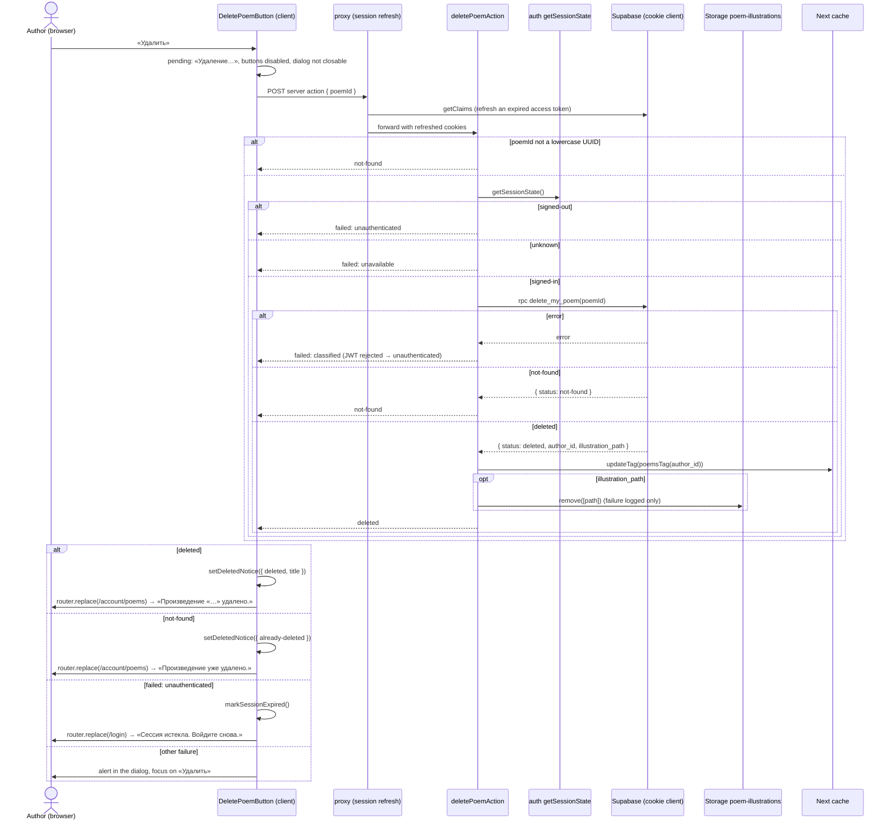
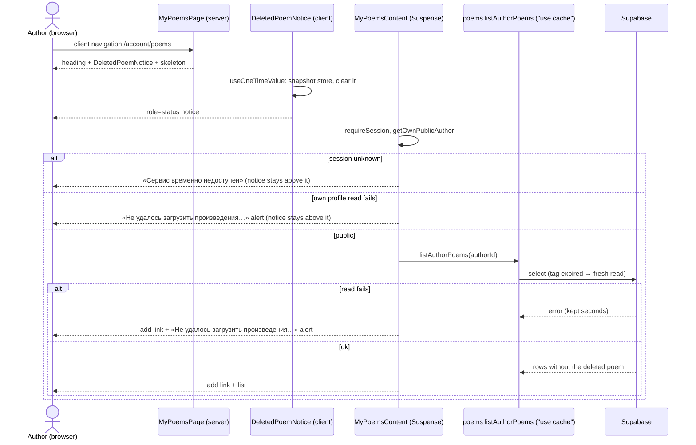

# Design

## Context

See proposal.md (Why). Current state the design builds on:

- `poems` follows ADR 0005: RLS plus select-only column grants, no insert/update/delete grant or
  policy; the only write is `create_my_poem()`, a `security definer` function that resolves the
  caller with `auth.uid()` and `my_author_profile_id()` (`20261028160000_poems.sql`).
- The `poem-illustrations` bucket already lets an owner select and delete objects in their own
  folder (`owns_author_profile(folder)`); the create flow's best-effort cleanup uses it.
- `poem-management` has one write path today: `createPoemAction` → `poem-writes.ts`
  (`checkCanCreatePoem`, `createOwnPoem`), with logging helpers that keep poem content and ids out
  of logs (NFR-10). Failures are values (`{ status: "failed", failure }`), never `null`.
- One cached read per author, tag `poemsTag(authorId)`, serves the public author page, the public
  poem page, `/account/poems`, and `/account/poems/<id>` (author-poems NFR-4). The create action
  expires it with `updateTag` and the client then navigates; Next drops its client router cache
  for that tag in the same response.
- `OwnPoemContent` (server) renders `CreatedPoemNotice` + `PoemArticle`; `MyPoemsPage` renders the
  heading in the static shell and `MyPoemsContent` in a Suspense boundary.
- `CreatedPoemNotice` holds the one-time-notice logic: snapshot the store on the first render,
  clear it in an effect, and dismiss it when an `Activity`-hidden page (Back/Forward) runs the
  cleanup, with a timer guard for Strict Mode's re-run.
- `shared/ui/Dialog` is a native `<dialog>` with a corner close button and backdrop close; it can't
  be held open. `shared/ui/Button` has `primary` and `ghost` variants, no danger.
- `/login` renders `SignInPanel` (server); `@/features/auth`'s index is server-only, so a client
  component in another feature can't import from it.
- Every server action request passes the proxy, which refreshes the session (auth FR-6) before the
  action runs.

## Goals / Non-Goals

Goals: an owner-only delete that a direct API call can't widen; one cache expiry per delete; the
one-time-notice behaviour written once and used by three notices; no new import between features.

Non-goals: a toast system, a generic "confirm" component beyond what this dialog needs, a
`returnTo` on `/login`, soft delete.

## Decisions

### D1 — Module layout (NFR-3)

```
src/features/poem-management/
├── actions/
│   ├── delete-poem.actions.ts           # new: deletePoemAction ("use server")
│   └── expire-poems-tag.ts              # new, server-only: expirePoemsTag (moved out of create-poem.actions.ts)
├── dal/
│   ├── poem-writes.ts                   # unchanged behaviour; logging and cleanup helpers move out
│   ├── poem-delete.ts                   # new: deleteOwnPoem(poemId) (D3)
│   ├── illustration-cleanup.ts          # new: removeIllustrationBestEffort (moved), used by create and delete
│   └── write-log.ts                     # new: describeError, logFailure, toServiceFailure, withStatus (moved)
├── model/
│   ├── poem-management.constants.ts     # + DELETE_POEM_STATUS
│   ├── poem-management.types.ts         # + DeletePoemResult, DeleteOwnPoemResult, DeletedPoemNotice
│   ├── poem-management-messages.ts      # + the delete copy
│   ├── delete-poem.schema.ts            # new: Zod input { poemId } (lowercase-hex UUID)
│   └── deleted-poem-notice-ui.store.ts  # new: Zustand, the outcome + title until shown (D5)
└── components/
    ├── DeletePoemButton/                # new, "use client": button + Dialog + action + navigation (D4)
    ├── DeletedPoemNotice/               # new, "use client": one-time notice on /account/poems (D5)
    ├── OwnPoemContent/                  # renders DeletePoemButton below PoemArticle
    ├── MyPoemsPage/                     # renders DeletedPoemNotice between heading and Suspense
    └── CreatedPoemNotice/               # same behaviour, now on useOneTimeValue (D5)

src/features/auth/components/
├── SessionExpiredNotice/                # new, "use client": one-time notice on /login (D6)
└── SignInPanel/                         # renders SessionExpiredNotice above the Suspense

src/shared/
├── ui/Dialog/                           # + `closable` prop (D7)
├── ui/Button/                           # + `danger` variant (D7)
└── lib/one-time-notice/
    ├── use-one-time-value.ts            # new: the snapshot / clear / Activity-dismiss hook (D5)
    └── session-expired-notice.store.ts  # new: Zustand flag, written by poem-management, read by auth (D6)
```

Import direction is unchanged: `app → poem-management → poems → authors → auth → shared`;
`auth` imports only `shared` for the notice; no feature imports `poem-management`.
`poem-management/index.ts` exports nothing new: the button and notice render inside its own
pages.

Why `write-log.ts`, `illustration-cleanup.ts`, and `expire-poems-tag.ts`: the delete path needs the
exact same "class name or PostgREST code, never a message" logging (NFR-10), the same best-effort
file removal, and the same "log, don't fail" tag expiry as the create path; copying them would let
the two drift (Gate 1 P3). `expirePoemsTag` leaves `create-poem.actions.ts` because a
`"use server"` module may export only actions.

### D2 — The delete operation in the database (NFR-1, FR-3, FR-4)

New migration `supabase/migrations/<ts>_delete_my_poem.sql`, ADR 0005's pattern: still no delete
grant or policy on `poems`; one `security definer` function.

```sql
create function public.delete_my_poem(poem_id uuid)
returns jsonb
language plpgsql volatile security definer set search_path = ''
as $$
declare
  caller uuid := (select auth.uid());
  deleted_author uuid;
  deleted_path text;
begin
  if caller is null then
    raise exception 'not signed in' using errcode = '42501';
  end if;

  delete from public.poems p
  where p.id = delete_my_poem.poem_id
    and p.author_id = public.my_author_profile_id()
  returning p.author_id, p.illustration_path into deleted_author, deleted_path;

  if deleted_author is null then
    return jsonb_build_object('status', 'not-found');
  end if;
  return jsonb_build_object('status', 'deleted', 'author_id', deleted_author,
                            'illustration_path', deleted_path);
end;
$$;
revoke execute on function public.delete_my_poem(uuid) from public, anon;
grant execute on function public.delete_my_poem(uuid) to authenticated;
```

- **Owner from the session only** (clarify decision 1): the function takes no author argument;
  `my_author_profile_id()` resolves it. Another author's poem and an unknown id both match no row
  and answer `not-found` (FR-4: indistinguishable).
- **Not gated by public status**: an owner whose profile lost its last name can still delete their
  own poems through the API. The UI never offers it then (the poem page is a 404), and removing
  one's own content widens nothing.
- **Returns `author_id`** so the action expires the right tag without a second profile read, and
  **`illustration_path`** so it can remove the file after the row.
- Down migration (header comment, never auto-run): drop `delete_my_poem`, the trigger, and
  `poem_creations`, then restore `poem_create_status`'s count over `poems`.

**The create limit counts creations, not live rows (FR-9; Gate 1 C1, user decision 2026-10-29).**
Before this change `poem_create_status` counts the author's rows in `poems` with
`created_at` in the window. With deletes, a create → delete loop keeps that count near zero, so
the 100-per-30-days cap stops bounding creates, uploads, and `poems:<authorId>` expiries — and the
loop runs straight against the database API, past any app check. The same migration therefore:

- adds `public.poem_creations (author_id uuid not null references public.author_profiles (id) on
  delete cascade, created_at timestamptz not null default now())` with an index on
  `(author_id, created_at)`, RLS on, no policies, and every grant revoked from `anon` and
  `authenticated` (ADR 0007's counter-table pattern: only definer functions touch it);
- adds an `after insert on public.poems` trigger (`security definer`, `set search_path = ''`) that
  inserts one `poem_creations` row for the new poem's author, with the poem's `created_at`, and
  deletes that author's rows older than the longest window, so the table stays bounded (at most
  100 rows per author per window). `create_my_poem` is unchanged: every stored poem passes the
  trigger, including the seed's direct inserts;
- backfills `poem_creations` from the existing `poems` rows inside the window;
- replaces `poem_create_status` (same signature, same windows list) to count `poem_creations`
  instead of `poems`.
- moves the windows list into `poem_create_limits()` (internal, no client grant), so the status
  check, the trigger's pruning, and the backfill read one list instead of repeating `30 days`
  (group 1, 2026-10-29).

A delete removes the `poems` row and nothing from `poem_creations`, so a deleted poem keeps its
place in the window until it ages out. Deletes need no limit of their own: an author can only
delete poems they created, so deletes and their tag expiries are bounded by creates (100 per 30
days plus the poems they already had). The advisory lock in `create_my_poem` still serializes one
author's creates, and the trigger runs inside that transaction, so two concurrent creates can't
both pass as the last allowed one.

A new ADR 0010 records "row-creating limits count creations, not live rows", amending ADR 0009
(its Decisions on what is counted); ADR 0009's status line gains "Amended by 0010".

Rejected: a separate delete limit through `consume_write_allowance('poem_delete')` (Gate 1's
option a). It bounds tag expiries but leaves the create cap bypassable by the same loop, so it
would need this change anyway; with this change it adds nothing.

Rejected: an RLS `delete` policy plus a `delete` grant, called with `.from("poems").delete()`. It
works, but breaks ADR 0005's "no write grant on reader-owned tables", and the app would need a
second query to learn the illustration path (the column grant is select-only, `returning` would
need it). One function keeps the rule in one place and makes the pgTAP surface explicit.

### D3 — Delete DAL and action (FR-3 – FR-8, NFR-5)

`dal/poem-delete.ts` (server-only, cookie client as the signed-in owner):

```ts
type DeleteOwnPoemResult =
  | { ok: true; status: "deleted"; authorId: string; illustrationPath: string | null }
  | { ok: true; status: "not-found" }
  | { ok: false; failure: ServiceFailure };            // "unauthenticated" | "unavailable" | "unknown"
deleteOwnPoem(poemId: string): Promise<DeleteOwnPoemResult>   // RPC + Zod parse of the jsonb
```

The file removal is `illustration-cleanup.ts`'s `removeIllustrationBestEffort(path)`, the one the
create path already uses (D1).

`deletePoemAction` (next-safe-action, input `deletePoemInputSchema = { poemId: string }`), in order:

1. `poemId` not a lowercase-hex UUID → `{ status: "not-found" }`, nothing else runs (the same guard
   as the read DAL; junk never reaches the database).
2. Session via `getSessionState()`: `signed-out` → `failed: "unauthenticated"`; `unknown` →
   `failed: "unavailable"`. The proxy has already refreshed an expired access token by now
   (FR-7), so `signed-out` means the refresh token is gone too (FR-6).
3. `deleteOwnPoem(poemId)`: a failure is returned as is (`classifySupabaseError` maps a rejected
   JWT to `unauthenticated`, so a session that ends between steps 2 and 3 is FR-6 as well).
   `not-found` → returned, no cache touched (FR-4, FR-8).
4. `deleted` → `expirePoemsTag(authorId)` (`updateTag(poemsTag(authorId))`, shared with the
   create action): an expiry failure is logged and the delete still succeeds (the row is gone; an
   error would invite a pointless retry).
5. `illustrationPath !== null` → `removeIllustrationBestEffort(path)`; its failure is logged
   (`[poem-management] remove illustration failed: <kind>`) and does not change the result
   (clarify decision 2).
6. Return `{ status: "deleted" }`.

```ts
type DeletePoemResult =
  | { status: "deleted" }
  | { status: "not-found" }
  | { status: "failed"; failure: ServiceFailure };
```

The client already has the title, so the action returns no poem data. Logs follow NFR-10 via
`write-log.ts`: operation + kind only; never the id, the path, or the title.

Why the row before the file (clarify decision 2): a row pointing at a missing file would render a
broken image on public pages; a file with no row is invisible and only costs storage.

Why the tag before the file: the page the author lands on must be fresh even if Storage is slow;
both run before the action responds, so order only matters for failures.

### D4 — Button, dialog, and navigation (FR-1 – FR-6, NFR-4)

`DeletePoemButton` (client) gets `poemId` and `title` from `OwnPoemContent`, which already holds
the poem; it renders below `PoemArticle`.

- `Button variant="danger"` «Удалить произведение» opens the `Dialog` (`showModal()`).
- Dialog content, DOM order: the body text, the alert slot, then «Отмена» (`autoFocus`, so the
  native dialog focuses it on open) and `Button variant="danger"` «Удалить».
- Confirm runs the action in `useTransition`; while pending: «Удаление…», both buttons
  `disabled`, `Dialog closable={false}`. A ref guard ignores a second click that lands before the
  re-render disables the button (FR-3 double click).
- Outcome:

  | Result | Client |
  | --- | --- |
  | `deleted` | `setDeletedNotice({ kind: "deleted", title })`, `router.replace(POEM_MANAGEMENT_PATH)` |
  | `not-found` | `setDeletedNotice({ kind: "already-deleted" })`, `router.replace(POEM_MANAGEMENT_PATH)` |
  | `failed: unauthenticated` | `markSessionExpired()`, `router.replace(SIGN_IN_PATH)`, then `router.refresh()` so the root layout's header drops its signed-in links (Gate 1 P4; `signOutAction`'s reason, ADR 0004) |
  | `failed: unavailable \| unknown`, `serverError`, `validationErrors` | alert in the dialog, focus back on «Удалить» |

- `router.replace`, not `push`, so Back from `/account/poems` doesn't return to a 404 (FR-3 "Back
  after a delete"); the same for `/login`, whose Back would show the poem page of a signed-out
  reader.
- The alert is cleared when the next confirm starts (FR-5) and when the dialog closes.
- Cancel paths are the `Dialog`'s own (corner button, Escape, backdrop) plus «Отмена» calling
  `close()`; the native dialog returns focus to the opener (FR-2).
- As built (group 4): opening focuses «Отмена» and every close focuses the opener explicitly, rather
  than relying on `autoFocus` and the browser's focus return, so both hold in any browser and in
  tests. Each navigating outcome closes the dialog before `router.replace`: the page left behind may
  stay mounted but hidden (`Activity`), and an open modal there would block the next page. The
  transition is still pending then, so the button first commits `closable` back to `true` with
  `flushSync` and only then calls `close()`, which keeps the close from racing `Dialog`'s re-open
  guard (D7, group 3 Gate 4 CR-01).

**The deleted page re-renders before the navigation (Gate 1 P2).** An action that calls
`updateTag` answers with the current route re-rendered, and the current route is the deleted
poem's page, so `OwnPoemContent` calls `notFound()` and the dialog unmounts before
`router.replace` runs; a 404 could flash. The client therefore writes the notice store and starts
`router.replace` from the action's result, which it receives together with that re-render.
web-qa checks this path (task 5.5); the fallback below is adopted only if a 404 is visible to a
person there — on a screenshot or by eye at normal speed. A frame seen only in a DOM trace or a
performance profile does not count (clarify, 2026-10-29). The fallback, recorded here so it isn't
decided ad hoc: before calling the action, `DeletePoemButton` writes
`{ kind: "deleted", title }` to the deleted-notice store; the action ends with
`redirect(POEM_MANAGEMENT_PATH)` on `deleted` only. `not-found` calls no `updateTag`, so it
re-renders nothing and keeps the normal path: the client overwrites the store with
`{ kind: "already-deleted" }` and calls `router.replace`. On a failure the client clears the
store. FR-4's separate text stays in both variants.

Why not `redirect()` inside the action by default: the client must set the notice store before navigating,
and the session-expired path writes a different store; returning a status keeps both explicit and
testable, as in the create flow (add-poem-creation D7).

### D5 — One-time notices (FR-3, FR-4, NFR-2)

`shared/lib/one-time-notice/use-one-time-value.ts`:

```ts
/** Reads `read()` once on the first render, then clears it; null after the page is left (Activity) */
function useOneTimeValue<T>(read: () => T | null, clear: () => void): T | null
```

It is `CreatedPoemNotice`'s current logic, moved — snapshot in `useState`'s initializer, clear in
an effect, the timer-guarded dismissal on `Activity` hide — with one change (Gate 1 P1): the effect
also reads the store each time it runs and, when it finds a value, replaces the snapshot and
un-dismisses. A route Next keeps hidden in `Activity` and reveals again re-runs the effect but not
the initializer, so without this a `router.replace` back to an already-visited `/account/poems`
(list → poem → delete, the main path) or `/login` would show the old, dismissed state and wipe the
new value. That state update runs in a `queueMicrotask` callback, not in the effect body
(group 3, user decision 2026-10-30): `react-hooks/set-state-in-effect` rejects the direct call, the
effect already runs after the paint so the delay is invisible, and the alternative, a reasoned
`eslint-disable`, would be the project's first. `CreatedPoemNotice` is unaffected: its store is only set for a never-visited poem page. Three consumers now —
`CreatedPoemNotice`, `DeletedPoemNotice`, `SessionExpiredNotice` — across two features, which
meets architecture.md's "second consumer" rule. `CreatedPoemNotice` keeps its behaviour and tests.

`deleted-poem-notice-ui.store.ts` (Zustand, poem-management):

```ts
type DeletedPoemNotice = { kind: "deleted"; title: string } | { kind: "already-deleted" };
// state: { notice: DeletedPoemNotice | null; setDeletedNotice; clearDeletedNotice }
```

It holds the title only between the click and the notice's first render, then is cleared (NFR-2
modified). `DeletedPoemNotice` renders a success `Alert` with `role="status"`: «Произведение
«<title>» удалено.» or «Произведение уже удалено.». It sits in `MyPoemsPage` between the heading
and the Suspense boundary, so it shows at once, above the skeleton and then above the add link.

Why a store and not `?deleted=…`: the same reason as the create flow (state-management.md) — a
query flag repeats on reload and leaks the title into links and history.

### D6 — Session-expired notice on `/login` (FR-6)

`shared/lib/one-time-notice/session-expired-notice.store.ts`: Zustand
`{ expired: boolean; markSessionExpired(); clearSessionExpired() }` — a flag, no data.
`poem-management`'s `DeletePoemButton` writes it; `auth`'s `SessionExpiredNotice` reads it with
`useOneTimeValue` and renders a neutral `Alert` (`role="status"`, D7) «Сессия истекла. Войдите снова.» above
the form. `SignInPanel` renders it outside its Suspense, so it is in the static shell's tree but
renders nothing on the server (the store is empty there); after a client-side `router.replace` it
mounts on the client with the flag set. A hard load starts empty, which is FR-6's "plain visit".

Why in `shared/`: the writer (`poem-management`) and the reader (`auth`) are different features,
and `auth`'s index is server-only (a client import fails the build), so the store can't live in
`auth/model` without a second, client entry point that architecture.md forbids. The flag is
feature-agnostic: any future write that finds the session expired can set it. state-management.md
gets one line for this exception to "stores live in `features/<name>/model`", and its "hold ids
and flags, never server data" line gains the deleted notice's title as the second documented
exception, held only until the notice's first render (Gate 1 P6).

Rejected: `/login?error=session-expired` through the existing `getLoginErrorMessage`. It is less
code, but the alert would repeat on reload and stay in shared links, against clarify decision 7's
"once"; and it would show as a form error (`role="alert"`) rather than a notice.

The text reuses the profile editor's existing «Сессия истекла. Войдите снова.»; auth gets its own
copy constant with the same string (no cross-feature import for one string).

### D7 — `Dialog` and `Button` changes (FR-2, FR-3, NFR-6)

- `Dialog` gains `closable?: boolean` (default `true`, so the contact dialog is unchanged). When
  `false`: the corner button is `disabled`, a backdrop click doesn't close, and the `cancel` event
  (Escape) is `preventDefault`-ed. The caller still closes it with `ref.current.close()`.
  Chromium's close-watcher rules can make a second Escape without user activation uncancelable
  (Gate 1 P7). `Dialog` therefore also re-opens itself with `showModal()` in its `close` handler
  whenever it closes while `closable` is `false` (clarify, 2026-10-29), so to the author it never
  closes while a request runs and FR-3 holds as written; the request is never cancelled, and
  `onClose` is not passed on for that close. The re-open waits one task and reads the latest
  committed `closable` (group 3 Gate 4 CR-01, user decision 2026-10-30): a caller that sets
  `closable` back to `true` and closes in the same tick keeps its close, and `onClose` runs then. web-qa presses Escape twice while pending (task 5.5).
- `Button` gains `variant="danger"`: a solid `danger` fill with `on-danger` text, hover mixes 15%
  black into the fill, disabled at 50% like the other variants (artboard 22). `globals.css` gains
  the `--on-danger` token (`#ffffff` light, `#0a0a0a` dark; 4.8:1 and 7.6:1 against `--danger`,
  WCAG AA) and its `--color-on-danger` theme mapping.
- `Alert` gains `tone="neutral"`: the same box with a `muted` left border and `role="status"`,
  for the `/login` session-expired notice (artboard 24). The deleted notices on `/account/poems`
  stay `tone="success"` (artboard 23).
- The dialog's buttons sit right-aligned in a wrapping row with an 8 px gap («Отмена» `ghost`,
  then «Удалить» `danger`); the failure `Alert` sits between the body text and the buttons; the
  opener sits directly under the poem's `article` in the page's 32 px flow (artboard 22).

### D8 — Freshness (FR-8)

One `updateTag(poemsTag(authorId))` covers every page: all four read the one cached list per
author, and the poem pages find the poem in it, so a deleted poem becomes `not-found` → 404 on
both poem pages, and the `own-poem` breadcrumb renders no trail. No new tag, no `revalidatePath`.

### D9 — Testing

- pgTAP for the limit: each stored poem adds one `poem_creations` row; 100 creations in the window
  then 10 deletes → `create_my_poem` and `can_create_poem` answer `over-limit`; a creation older
  than 30 days stops counting and is pruned on the next insert; no client role can read or write
  `poem_creations`; the backfill counts existing poems; the existing limit tests stay green.
- pgTAP (`supabase/tests/poems.test.sql`): no role can `delete from poems` directly; anon can't
  execute `delete_my_poem`; the owner gets `deleted` with `author_id` and `illustration_path`, and
  the row is gone; another author gets `not-found` and the row stays; an unknown id gets
  `not-found`; a Storage delete in another author's folder removes nothing.
- Vitest: `delete-poem.schema` (UUID guard); `deleteOwnPoem` (status parse, error classification,
  NFR-10 log content); the action (order: input → session → RPC; no tag expiry on `not-found` or
  failure; tag before file; a file failure still returns `deleted`); `DeletePoemButton` (focus on
  «Отмена», cancel paths send nothing, pending state, double click, each outcome's store write and
  `router.replace` target, alert and focus on failure); `DeletedPoemNotice` and
  `SessionExpiredNotice` (once, role, copy); `useOneTimeValue` (snapshot, Strict Mode, Activity
  hide); `Dialog` `closable={false}`; `Button` danger; the existing `CreatedPoemNotice` tests
  unchanged.
- web-qa (Gate 3): delete with and without an illustration, cancel paths, failure (database
  stopped), already deleted in a second tab, expired session (cookies cleared before confirming),
  freshness on the public pages; the list → poem → delete path (the notice must show on the
  revealed `/account/poems`, P1); no 404 flash before the navigation (P2); the header right after
  the session-expired redirect (P4); Escape twice while pending (P7); a recorded scenario for the
  happy path.

### Sequence diagrams

Delete (confirm pressed):



Landing on `/account/poems` after a delete:



The notice lives outside the Suspense boundary, so a failing list read (an alert inside the
boundary) leaves it shown. Only a thrown render error replaces the whole page with `error.tsx` and
loses the notice; `MyPoemsContent` shows its failures as alerts and doesn't throw, so that takes an
unexpected bug — accepted (Gate 1 P5).

## Risks / Trade-offs

- [Hard delete, no undo] → the confirmation dialog with the title, focus on «Отмена»; soft delete
  stays out of scope.
- [Orphan illustration when Storage removal fails] → logged; the file is invisible (nothing links
  to it) and sits in the owner's folder; a cleanup job can sweep files with no row later.
- [The deleted poem's title sits in client memory] → only between the click and the notice's first
  render, in the author's own tab, cleared after; never sent anywhere.
- [Another browser's router cache shows the poem until reload] → same accepted limit as creating
  (FR-8); clicking it then gives the 404.
- [`/login` notice depends on a client-side navigation] → a hard load or a new tab shows no notice;
  the author still lands on the sign-in page, which is the essential part.
- [A shared Zustand store breaks the "stores in features" convention] → one documented exception
  in state-management.md, holding only a boolean.
- [Moving `CreatedPoemNotice`'s logic into a hook] → its tests stay unchanged and must stay green
  in the same group.
- [A deleted poem still holds its place in the create limit for up to 30 days] → intended (FR-9);
  an author who deletes a batch of test poems can't immediately post 100 new ones. The cap is
  generous enough that a real author doesn't meet it.
- [`poem_creations` is a second record of creation times] → it holds no content, only author and
  time, is pruned past the window, and is reachable only by definer functions and the trigger.
- [Owner with a non-public profile can delete via the API] → accepted: own content only; recorded
  in pgTAP so a later change can't widen it by accident.

## Migration Plan

1. Add the migration; `npx supabase db reset` locally; run pgTAP.
2. Deploy: `npx supabase db push` before the app ships (the action calls a function that must
   exist); add it to `docs/environment.md`'s deploy checklist.
3. Rollback: revert the app first (the button calls the function), then the documented down
   migration.

## Scaffold map

Written by `opsx-scaffold` after the files existed (map approved 2026-10-29). Stub bodies only; the
helper moves (task 2.1), the migration (group 1), the `Dialog` / `Button` / `Alert` and token
changes (group 3), UI copy, and the wiring into `OwnPoemContent`, `MyPoemsPage`, and `SignInPanel`
(group 4) are not scaffolded. Temporary `knip.jsonc` ignore entries and `@public` tags carry the
task that removes each.

| File | Responsibility | Exports |
| --- | --- | --- |
| `src/shared/lib/one-time-notice/use-one-time-value.ts` | the one-time-notice hook (D5) | `useOneTimeValue` |
| `src/shared/lib/one-time-notice/session-expired-notice.store.ts` | Zustand flag: a write found the session expired (D6) | `useSessionExpiredNotice`, `SessionExpiredNoticeState` |
| `src/features/poem-management/model/delete-poem.schema.ts` | the action's input shape, type only (D3) | `deletePoemInputSchema`, `DeletePoemInput` |
| `src/features/poem-management/model/poem-management.constants.ts` (added) | the delete action's outcomes | `DELETE_POEM_STATUS` |
| `src/features/poem-management/model/poem-management.types.ts` (added) | action and DAL results, the notice value (D3, D5) | `DeletePoemResult`, `DeleteOwnPoemResult`, `DeletedPoemNotice` |
| `src/features/poem-management/model/deleted-poem-notice-ui.store.ts` | Zustand: the outcome and title until shown (D5) | `useDeletedPoemNotice`, `DeletedPoemNoticeState` |
| `src/features/poem-management/dal/poem-delete.ts` | `delete_my_poem` RPC as the owner (D2, D3) | `deleteOwnPoem` |
| `src/features/poem-management/actions/delete-poem.actions.ts` | `"use server"` delete (D3) | `deletePoemAction` |
| `src/features/poem-management/components/DeletePoemButton/` | client button, dialog, action call, navigation (D4) | `DeletePoemButton`, `DeletePoemButtonProps` |
| `src/features/poem-management/components/DeletedPoemNotice/` | client one-time notice on `/account/poems` (D5) | `DeletedPoemNotice` |
| `src/features/auth/components/SessionExpiredNotice/` | client one-time notice on `/login` (D6) | `SessionExpiredNotice` |

The type `DeletedPoemNotice` and the component of the same name never meet in one module: the
component reads the value from the store (Gate 2b note).
