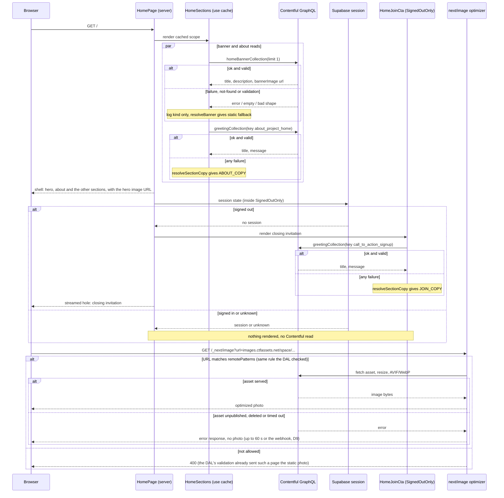

## Context

See proposal.md, Why. The home feature already has `dal/home-greeting.ts` (a GraphQL read of the `greeting` type by the fixed key `home_greeting`, Zod validation, failures as values), `HomeHero` (a static photo through `next/image` with `fill`, a `--hero-scrim` layer, left-aligned text), constant copy in `model/home-messages.ts`, and `HomeSections`, a `"use cache"` scope (`minutes`, tagged `contentful`) that holds hero, featured, about, authors and latest. `HomeJoinCta` sits outside that scope because it depends on the session (`SignedOutOnly`). The Contentful client (`shared/lib/contentful`) is server-only, attaches the `contentful` tag and a 60 s lifetime, and maps failures to typed errors. `next.config.ts` allows remote images only from Supabase, built by `buildSupabaseImagePatterns`.

## Goals / Non-Goals

**Goals**
- Hero, about and closing copy come from Contentful, each with today's static copy as a fallback.
- The hero photo comes from the Banner image asset.
- Text is centred and the overlay is 10%.

**Non-Goals**
- No CMS control of the button labels, the button targets, the section headings of the other sections or the featured/authors/latest sections.
- No Contentful preview mode, no localisation, no multiple banners or scheduling.
- No code change to the revalidation route: it already expires the `contentful` tag. The webhook's triggers gain Asset publish and unpublish (a docs and Contentful setting only, D9).

## Decisions

**D1. A banner DAL beside the greeting DAL, in the same feature.** `dal/home-banner.ts` queries `homeBannerCollection(limit: 1, order: sys_publishedAt_DESC)` (the most recently published entry wins, so an editor's second entry is predictable) and returns `{ ok: true, banner } | { ok: false, reason }`. The banner has its own `HomeBannerResult` type whose reasons reuse `ContentfulErrorKind` plus `"validation"` and `"not-found"`, so the greeting types stay untouched. Alternative: one generic "Contentful entry" reader for both types. Rejected: two readers of a few lines each do not justify an abstraction (YAGNI); the log prefix and the schema differ.

**D2. The greeting DAL takes a key.** `getHomeGreeting()` becomes `getGreetingByKey(key)` with the two keys as named constants (`ABOUT_GREETING_KEY = "about_project_home"`, `JOIN_GREETING_KEY = "call_to_action_signup"`) and the parameter typed as the union of those two constants, like `content-page`'s `ContentPageKey`, so no free string reaches the query. The query and schema are unchanged; the failure log line now carries the key as well as the reason (and the status for `auth` and `http`), so an about failure and a closing failure can be told apart, as in `content-page/dal`. `home_greeting` is no longer referenced, and its constant is deleted. `resolveGreeting` stops being the hero's static-fallback source; each section resolves its own fallback (D5).

**D3. The banner schema is strict, all or nothing.** Title and description are non-blank after trimming, as for the greeting. The image URL must be allowed by the same rule `next.config.ts` uses for remote images: the DAL builds the patterns with `buildContentfulImagePatterns(spaceId)` (D4) from the runtime `CONTENTFUL_SPACE_ID` and accepts the URL only when its protocol, host and path prefix (`/<space id>/`) match one of them. Any other shape (missing image, another host or space, blank text) is a `validation` failure and the whole hero falls back. An unset `CONTENTFUL_SPACE_ID` never reaches this check: the Contentful client requires it (`config.ts`), so no request is sent and the result is a `config` failure; the DAL takes the space id from the client's parsed configuration, not from its own `process.env` read. For that, `shared/lib/contentful` gains one small public export, `getContentfulSpaceId()`, since the home feature may import only through its index. Alternative: check only the host. Rejected: the architecture review (F1) showed it accepts URLs the optimizer then refuses, which leaves a hero without a photo and with white text on a white page. The check is exact as long as build and runtime share `CONTENTFUL_SPACE_ID`, which `docs/environment.md` states for the Supabase URL already and now for this variable too. Alternative: show the CMS text over the static photo when only the image is bad. Rejected: a half-CMS hero is harder to reason about and to test, and the editor sees the fallback at once.

**D4. Remote image pattern from the space id.** A new `shared/config/contentful-image-patterns.ts` mirrors `buildSupabaseImagePatterns`: it returns one pattern `https://images.ctfassets.net/<space id>/**` from `CONTENTFUL_SPACE_ID`, an empty list when it is unset (a CI build). `next.config.ts` concatenates it with the Supabase patterns. The pathname carries the space id, so another space's images are refused. The space id is not a secret (it is part of every public asset URL) but stays read from the env at build time, like the Supabase URL. `qualities` stays `[IMAGE_QUALITY]`; the hero's `sizes` stays `100vw`.

**D5. Fallback per section, decided in the component's resolver, not in the DAL.** A pure `resolveBanner(result)` returns `{ title, text, imageSrc }` from the CMS or from `siteConfig.name`, `siteConfig.description` and `HERO_IMAGE_PATH`. For about and closing, a pure `resolveSectionCopy(result, fallback)` returns the CMS title and message or the constants in `ABOUT_COPY` / `JOIN_COPY` (their `heading` and `text`). The constants remain, now documented as the fallback. This keeps D5 testable without Contentful, like `resolveGreeting` today.

**D6. Where each read happens relative to the caches.** The banner and about reads run inside `HomeSections`, next to the existing parallel reads, so they join its cache scope and its `contentful` tag. The closing invitation is outside that scope: `HomeJoinCta` becomes an async Server Component that reads `getGreetingByKey(JOIN_GREETING_KEY)` and is rendered only inside `SignedOutOnly`, so the read never runs for a signed-in reader and nothing session-dependent enters the shared cache (home-sections NFR-1). The Contentful client's own cached read (a `"use cache"` function keyed by query and variables, 60 s, tag `contentful`) makes this read cheap and lets the publish webhook expire it. `/` is already partially prerendered because of the header session (ADR 0004); the closing read sits inside a part that is already dynamic, so it cannot change that. Alternative: read the closing copy in `HomeSections` and pass it down as props through the session boundary. Rejected: it would force `HomePage` to thread a prop through `SignedOutOnly`, and the section is the only consumer. A task verifies that `npm run build` still lists `/` as partially prerendered (`◐`), not fully dynamic; if it does not, this decision is reopened.

**D9. Asset edits reach the page through the webhook, by setting only.** The revalidation route already expires the `contentful` tag on any accepted notification. The webhook's triggers today are Entry publish and unpublish; an editor who replaces the photo by publishing the Asset alone would otherwise wait for the 60 s safety net. The docs' webhook setup gains Asset publish and unpublish; no code changes. If the photo's URL stays the same but the asset is unpublished or deleted while a cached page still points at it, the optimizer answers an error for that photo until the page revalidates; this is accepted for the 60 s window (Risks).

**D7. Centred layout and overlay are CSS only.** `HomeHero.module.css` gets `text-align: center` on the title and message, and the content wrappers centre their boxes (`mx-auto`, `items-center`, `justify-center` for the buttons). The overlay is the existing `.scrim` layer with `--hero-scrim` set to `rgb(0 0 0 / 0.1)` in both themes (the token is currently `rgb(10 10 10 / 0.6)` light and `rgb(0 0 0 / 0.65)` dark). Changing the token keeps one source of truth; the contrast test already reads the token's alpha from `globals.css`, so it follows the new value. A separate overlay element is not added (KISS).

**D8. The static photo stays.** `public/home-hero.jpg` and `HERO_IMAGE_PATH` remain as the fallback image. Without it a failed read would leave a white-on-white hero. The fallback photo is served through `next/image` exactly as today, so the same `Image` element handles both sources.

## Flows

The server reads Contentful (server↔external service) and the browser loads the photo (browser↔server). Hero and about share one cached scope; the closing invitation is read inside the signed-out boundary.

## Risks / Trade-offs

- **Contrast with a 10% overlay** → Today's 60% scrim lets white text pass over the lightest allowed photo (the contrast test's `#efeff0` floor). At 10% the floor will not pass for light photos. Mitigation: the test is updated to compute the ratio from the new alpha and the floor is lowered to the lightest photo that still gives 4.5:1 for body text; the number, and the editorial rule «the Banner image must be at least this dark in the text area», is written in `docs/design-system.md` and in `docs/environment.md`'s Contentful notes. If the shipped fallback photo fails the new floor, the task replaces or darkens it. The owner chose 10%, so the overlay value is not changed here; the photo is the lever (Open Question).
- **Wrong Field IDs** → Contentful derives IDs from the names, and the owner has not confirmed them. A wrong ID makes GraphQL answer with an error, which becomes a `graphql` failure and the static fallback, so the page never breaks, but the CMS content would not show. Mitigation: task 1.1 queries the real space once through a throwaway runtime check (never reading `.env`) and fixes the constants before any other code is written.
- **Image URL refused by the optimizer breaks the hero** → D3 validates the URL against the same patterns the build allows, so a mismatch inside one deployment gives the static hero, not a broken one; a test feeds the builder's output and URLs on another host, another space and a missing space id through the same check. A build and a runtime with different `CONTENTFUL_SPACE_ID` values can still disagree; the docs say the two must match.
- **Photo asset unpublished while a page is cached** → for up to 60 s (or until the webhook, D9) the hero image URL is dead and the text sits on the page background. Accepted: an editor swaps a photo, not removes it; D9 shortens the window.
- **A large Contentful photo slows the first paint** → the image goes through `next/image` with `sizes="100vw"`, `quality` and `preload`, so it is resized and AVIF/WebP-encoded; the editor guidance in the docs asks for a photo of about 2000 px wide.
- **The closing read is outside the page's cache scope** → covered by the client's cached read; the build check in D6.
- **Editors depend on publish order** → until the three entries are published the page shows the static copy; the deploy checklist lists them.

## Migration Plan

1. In Contentful, publish one Home banner entry and the Greeting entries `about_project_home` and `call_to_action_signup` (before or after the deploy; the page is correct either way).
2. Deploy the app. `CONTENTFUL_SPACE_ID` must be set at build time on the host, with the same value as at runtime (it is already set for the client); a runtime without it makes the banner read a `config` failure, so the hero shows the static photo, and a build without it allows no remote Contentful image, so the check in D3 must use the same value at runtime. In Contentful → Settings → Webhooks add Asset publish and unpublish to the existing triggers (D9).
3. Rollback: revert the change. No data moved. The old `home_greeting` entry can stay in Contentful unused.

## Open Questions

- Which photo the owner will upload and whether the lightest-photo floor needs to be re-confirmed after the contrast test is updated (deferrable: it changes a number in a test and in the docs, not the specs). Owner: project owner, due: 2026-11-30 (the same item as the third Open Question in `proposal.md`).
