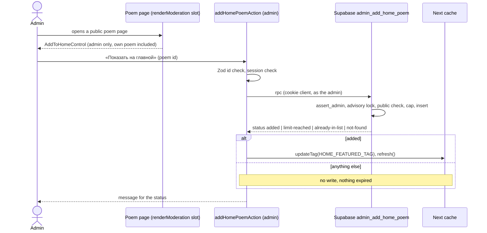
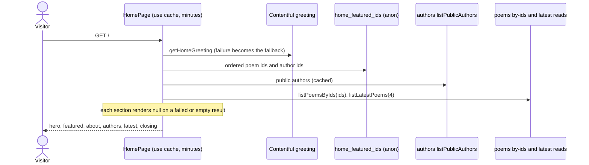
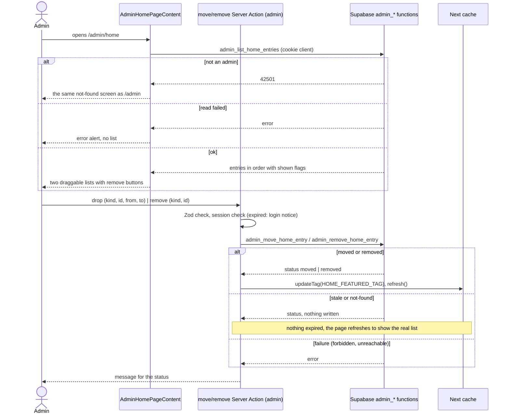

# Design

## Context

See `proposal.md` for the why. Observed state:

- `/` is a cached page (`"use cache"`, `cacheLife("minutes")`, tagged `CONTENTFUL_CACHE_TAG`) that renders `HomeGreeting` only. `features/home` holds the Contentful greeting read, its fallback and the home metadata.
- Public Supabase reads follow `docs/state-management.md`: the cookie-less anon client inside a feature-owned `"use cache"` scope, a result-dependent `cacheLife` (`hours` or `minutes` on success, `seconds` on failure), failures as values, one `authorWorksTag(authorId)` per author's works. `authors` exports `listPublicAuthors` (every public author with name, photo and `about`); `poems` has no read across authors except `listPublicPoemRefs` (ids only, for the sitemap).
- A public author is one with first and last name set (`is_public_author_profile`); the `poems` and `author_profiles` RLS policies expose only those rows to `anon`. A ban or block restricts the account and leaves the content public.
- Admin power is guarded SQL (`assert_admin()` first, `security definer`, empty `search_path`, ADR 0015); closed tables have RLS on and no client grant. The violations list is the precedent: a table, `admin_*` functions, an action client, a control that the route files pass into the public pages through `renderModeration`, and a closed page with an `AdminOnly` breadcrumb slot.
- `may_moderate_author` excludes an admin's own content, so the moderation controls hide there. The new control must not use it.
- `home-greeting` FR-10 bans the names `PoemSearch`, `PoemList`, `PoemCard`, `usePoemsUiStore`, `poemsListQueryOptions` anywhere in `src/` and `docs/`; a substring match counts.

## Goals / Non-Goals

**Goals:**
- Six home sections that each fail alone and keep the page cached and session-free.
- An admin curation path that reuses the violations-list pattern, with every write guarded in the database.
- Deleting a chosen poem or profile frees its slot without a trigger or a job.

**Non-Goals:**
- A page listing every poem, and the two «Все …» links (owner decision, 2026-11-21).
- Loading the hero image from Contentful (a constant now, swapped by a follow-up).
- Search or paging for the admin's choice: the admin picks from the poem or author page.
- Dragging an entry from the poem list to the author list or back: each list is ordered on its own.

## Decisions

### D1. Two small tables with foreign keys, not one polymorphic table

`home_featured_poems (poem_id uuid primary key references poems(id) on delete cascade, position smallint not null check (position between 1 and 4), unique (position) deferrable initially deferred, created_at)` and `home_featured_authors (author_id uuid primary key references author_profiles(id) on delete cascade, position smallint not null check (position between 1 and 4), unique (position) deferrable initially deferred, created_at)`. Primary key gives uniqueness of an entry; `unique(position)` plus the 1 to 4 check gives the cap of 4 in the database (FR-10); the foreign keys give FR-11's removal on deletion for free (an author's deleted poem, a deleted profile, an admin's `admin_delete_poem`).
Alternative: one table with `kind` and `item_id`. Rejected: no foreign key is possible on a polymorphic id, so a trigger or a cleanup job would be needed to meet FR-11, and the cap would need a partial index per kind anyway.
Both tables are closed like `violation_cases`: RLS on, no client grant. Public reads of the list go through one `security invoker`-free read function, see D3.

### D2. Guarded functions, one lock per list

All names start with `admin_` so `admin_functions.test.sql` checks `assert_admin()` is first: `admin_add_home_poem(poem_id)`, `admin_add_home_author(author_profile_id)`, `admin_move_home_entry(kind, id, from_position, to_position)`, `admin_remove_home_entry(kind, id)`, `admin_list_home_entries()`. Each takes a transaction advisory lock named for its list before reading the count, so two simultaneous adds cannot both pass the cap (the `unique(position)` is the second safety net). Add refuses an unknown or non-public target with `not-found` (a poem is public when its author is, checked with `is_public_author_profile`), a full list with `limit-reached`, an existing entry with `already-in-list`; none of these writes anything. A cascade delete leaves a gap in the positions and renumbers nothing, so add first compacts the list to 1..n under the lock and then inserts at n+1 (the count is the cap check, so a gap never blocks an add); remove compacts the rest; move puts the entry at `to_position` (clamped into the list) and renumbers the list to 1..n in one statement, the way ADR 0014's `move_my_poem` does. The `unique (position)` constraint is deferrable and initially deferred, so a shift inside one statement is checked at commit, not row by row. Answers are jsonb with a `status`, like the violation functions, and the TypeScript side parses them with Zod. The statuses: add `added | limit-reached | already-in-list | not-found`; move `moved | stale | not-found` (`stale`: the entry is no longer at `from_position`, because another admin or a cascade delete changed the list, nothing written; `not-found`: the entry is gone, nothing written; the page refreshes on both); remove `removed | not-found` (a repeat or a cascaded entry changes nothing). Only `added`, `moved` and `removed` expire the tag.
`admin_list_home_entries()` is declared `stable` (a read, so `admin_foundation.test.sql`'s `unguarded_writers` view does not list it) and is the only read of the closed tables for the admin page; it returns, per entry, its kind, id, position, a `shown` flag (the poem or author resolves as public), the poem's title or the author's name and, for a poem, its author's name (read inside the definer function, so an author who is no longer public still has a name for the admin). The page needs the id and kind for the move and remove actions. A non-public author's entry stays listed with `shown = false` (spec FR-11).
Alternative: client-side writes with an RLS `is_admin()` policy. Rejected: ADR 0015 puts admin power in functions, never in broad policies.

### D3. The public read resolves ids through existing public reads, not a join

The anon role cannot read a closed table, and giving it a grant to expose positions would open the table for every client. So a small `security definer` function `home_featured_ids()` returns only the two ordered id lists (no `admin_` prefix, declared `stable` so the `unguarded_writers` check does not match it, executable by `anon` and `authenticated`; it filters with `is_public_author_profile`, so it returns only chosen entries whose author is public, as FR-10 of `home-curation` requires). `features/home` calls it through the public client, then turns ids into cards:
- authors: intersect with `listPublicAuthors()` (already cached, already public-only, already carries name, photo and `about`); an id not found is skipped.
- poems: a new `poems` read, `listPoemsByIds(ids)`, one `in(...)` query through the public client in its own `"use cache"` scope, RLS keeping only public authors' poems; author names come from the same `listPublicAuthors()` result.
- latest: a new `poems` read, `listLatestPoems(limit)`, `order created_at desc, id desc limit 4` through the public client, joined to names the same way.
Alternative: one SQL join in a definer function returning ready cards. Rejected: it would duplicate author-name and photo-URL mapping that `authors` already owns, and it would put `authors` rules into `home`'s SQL.

### D4. Where the code lives and who imports whom

`home` gains `dal/` (`home-featured.ts`: the ids function; `home-sections.ts`: composes the three reads), `model/` (card types, Zod row schemas, constants such as `FEATURED_LIMIT = 4`, `LATEST_LIMIT = 4`, `AUTHOR_DESCRIPTION_MAX_LENGTH = 120` (its own constant, not the SEO `DESCRIPTION_MAX_LENGTH` of 160; the design may change it later in one place), copy), `components/` (`HomeHero`, `HomeFeaturedWorks`, `HomeAbout`, `HomeAuthors`, `HomeLatestWorks`, `HomeJoinCta`, with `WorkCard` and `AuthorCard` as parts of their own sections: `WorkCard` only serves the featured section, since the latest list shows no cover, and `AuthorCard` only the authors section). `home` imports only the public APIs of `poems` (`listPoemsByIds`, `listLatestPoems`, `authorPoemPath`, the illustration URL helper) and `authors` (`listPublicAuthors`, `authorPagePath`). `admin` gains `pages/AdminHomePage`, an `AddToHomeControl` (poem and author variants), `actions/` and `dal/home-rpc.ts`; `admin` does not import `home`, and `home`, `poems`, `authors` never import `admin`. The two route files pass `AddToHomeControl` through the existing `renderModeration` prop; because it is a separate control from `AdminDeleteControl` and `AddToViolationsControl`, it is rendered for an admin on their own content too. The new route `app/(authorized)/admin/home/page.tsx` and its `@breadcrumbs/admin/home` slot copy the violations route files, and `STATIC_ROUTES` in `breadcrumbs` gets the row.
Names avoid FR-10's banned substrings: the card is `WorkCard`, never `PoemCard`, and the list component `LatestWorks`, never `PoemList`.

### D5. Page composition and caching

`HomePage` keeps `"use cache"`, `cacheLife("minutes")` and `CONTENTFUL_CACHE_TAG`, and adds one named tag `HOME_FEATURED_TAG` (in `shared/config/cache-tags.ts`: the admin writes it, `home` reads it, so it is feature-agnostic like `authorWorksTag`). Each data section is its own async Server Component reading its own DAL result and rendering `null` on `unavailable` or empty (FR-7), inside the cached page scope, so there is no Suspense per section and the whole page prerenders; one failing read cannot break the others because each section handles its own result value, never a throw.
Lifetimes: the ids read and the by-ids read use `hours` on success and `seconds` on failure, with `home_featured_ids` tagged `HOME_FEATURED_TAG` and the by-ids poems read tagged only with `authorWorksTag(authorId)` of each author in its result (the ids are its cache key, so a new choice is a new entry and `poems` carries none of `home`'s tags), so an admin's change, or an author deleting a chosen poem, expires them at once. The latest read uses `minutes` on success and `seconds` on failure and is tagged with `authorWorksTag` of the authors it lists (a deletion expires it); a brand new poem by an author not yet in the list shows within the minute (FR-12). `minutes` on success departs from ADR 0005 §3 (`hours` for a hit) on purpose, because a new poem must reach the home page within the minute (FR-12), as ADR 0018 recorded its own departure; task 7.1 records it in `docs/state-management.md` so a cleanup does not align it to `hours`. A spike in group 1 confirms that a tag set after the read inside a nested `"use cache"` scope reaches the page scope and expires it (the page's own comment says it tags itself *without* relying on nested propagation, so this is unverified, not assumed); if it does not, the page awaits `home_featured_ids` and the latest read itself to collect the `authorWorksTag` values, and `home_featured_ids` and `listPublicAuthors` are wrapped in React's `cache` (ADR 0008) so the sections and the page share one result per request.
Alternative: make the sections dynamic with Suspense per section. Rejected: it would drop the page out of the cache and makes every visit hit Supabase (NFR-1).

### D6. The admin's control and the page

`AddToHomeControl` mirrors `AddToViolationsControl`: its own `Suspense` with an empty fallback, an admin check through the existing per-request `readAdminAccess` answer (so a guest causes no extra call), a Server Action that validates the id with Zod, checks the session, calls the add function, and on `added` calls `updateTag(HOME_FEATURED_TAG)` then `refresh()`; on `limit-reached` or `already-in-list` it expires nothing (FR-13). The poem variant sends a poem id, the author variant a profile id. The page `/admin/home` copies `AdminViolationsPage`: a Suspense wrapper, an admin gate, the two lists, each one a drag-and-drop list (one `DndContext` per list, so no entry crosses between the lists) whose drop calls the move action with the entry's `from_position` and the new place, and a remove button that calls the remove action; each success expires the tag. The drag setup repeats the sensor configuration of the work board (`@dnd-kit/core` and `@dnd-kit/sortable` are already dependencies): a mouse sensor with a distance threshold, a touch sensor with a hold delay, and a keyboard sensor, so reordering works without a mouse. The admin feature keeps its own copy in its own files, like `violation-dnd-config.ts`, instead of importing `work-ordering` (a mirroring feature repeats its sibling's logic; nothing domain-free enough for `shared/` is being extracted). The list shows the new order at once while the move runs and returns to the stored order on `stale`, `not-found` or a failure (the page refreshes), and the drag is disabled while offline, like the board. Entries with `shown = false` carry a «не показывается на главной» note.
The hero image is a file in `public/` named by one constant; the image component gets `priority` and `sizes`.

### D7. Copy and the about text

The about text, the section headings and the closing invitation are constants in `home/model/` copy (assumed in the proposal's open questions); a Contentful source can replace them later without touching the components, since they take props.

## Sequences

**An admin chooses a poem** (crosses the browser, a Server Action, Supabase and the cache):

**A visitor opens `/`** (a cached page whose sections read independently):

**An admin moves or removes an entry on `/admin/home`**, and the page's own read:

## Risks / Trade-offs

- [A poem stays in the home caches until the minute ends if it is removed some way that expires no tag] → every delete path (owner, admin) already expires `authorWorksTag`, and the nested tag makes that reach `/`; the by-ids read also depends on RLS, so a non-public poem is dropped at the next read.
- [A table of ids is a second place that names a poem] → foreign keys with `on delete cascade`, and `admin_list_home_entries` shows what no longer resolves.
- [`listPublicAuthors` is unpaged, about 1000 authors (ADR 0018 follow-up)] → the home page reuses its cached result and adds no new unpaged read.
- [The home page now makes more reads at build time] → each read returns failures as values and uses a short failure lifetime, so an env-less CI build prerenders the page with the failed sections left out.
- [A UI of six sections needs design] → the Claude Design brief is written after the review gates and test plan, and no UI group is scaffolded until the approved link arrives (`docs/claude-design.md`).

## Migration Plan

1. Push the migration (two tables, five admin functions, `home_featured_ids`, their grants and revokes) with `supabase db push` before the app ships. An old app against the new database keeps working: nothing reads the tables.
2. Ship the app. With both tables empty the page shows the hero, about, latest and closing sections; the featured and authors sections stay absent until the admin chooses.
3. Rollback: revert the app, then run the down migration documented in the migration's header (drop the functions, then the two tables). No data outside them changes.
4. Add the migration to the Deploy checklist in `docs/environment.md`.

## Scaffold map

Paths are under `src/`. Every function body is `throw new Error("not implemented")` (or a `null` return for a component); nothing is wired. The route files, the migration, the tests, the tokens and the docs are tasks, not scaffold. `admin/index.ts` is deliberately unchanged: `admin/tests/boundaries.test.ts` pins its exports, so tasks 4.3 and 5.1 add the two new ones. The home section components take an already-awaited `result` and stay synchronous, because the page awaits the DAL and passes plain values (`docs/state-management.md`); this is what D5's "each section reads its own result" means in code.

| File | Responsibility | Exports |
| --- | --- | --- |
| shared/config/cache-tags.ts (edited) | cache tag of the admin's home choice | `HOME_FEATURED_TAG` |
| shared/config/account-paths.ts (edited) | the admin's home-choice page path | `ADMIN_HOME_PATH` |
| features/poems/model/poem-summary.types.ts | a public poem as the home page needs it, and the read's result | `PoemSummary`, `PoemSummariesResult` |
| features/poems/dal/poems-by-ids.ts | public poems by id, in the requested order | `listPoemsByIds` |
| features/poems/dal/latest-poems.ts | the newest public poems | `listLatestPoems` |
| features/poems/index.ts (edited) | public API | the three above |
| features/home/model/home.constants.ts | limits 4 / 4 / 120 and the hero image path | `FEATURED_LIMIT`, `LATEST_LIMIT`, `AUTHOR_DESCRIPTION_MAX_LENGTH`, `HERO_IMAGE_PATH` |
| features/home/model/home-section.types.ts | section cards, the chosen ids, section results | `FeaturedWork`, `FeaturedAuthor`, `LatestWork`, `HomeFeaturedIds`, `HomeFeaturedIdsResult`, `SectionResult` |
| features/home/model/to-author-description.ts | «О себе» to the card's short description | `toAuthorDescription` |
| features/home/model/order-by-ids.ts | the admin's order, unresolved ids dropped | `orderByIds` |
| features/home/dal/home-featured.ts | the chosen ids from `home_featured_ids` | `getHomeFeaturedIds` |
| features/home/dal/home-sections.ts | the data of the three sections | `getFeaturedWorks`, `getFeaturedAuthors`, `getLatestWorks` |
| features/home/components/HomeHero/ | the hero (replaces `HomeGreeting`) | `HomeHero`, `HomeHeroProps` |
| features/home/components/HomeFeaturedWorks/, WorkCard/ | the featured section and its card | `HomeFeaturedWorks`, `WorkCard` |
| features/home/components/HomeAuthors/, AuthorCard/ | the authors section and its card | `HomeAuthors`, `AuthorCard` |
| features/home/components/HomeLatestWorks/ | the latest section | `HomeLatestWorks` |
| features/home/components/HomeAbout/, HomeJoinCta/ | the about section and the closing invitation | `HomeAbout`, `HomeJoinCta` |
| features/home/index.ts (edited) | public API | the DAL and component exports above |
| features/admin/model/home-entry.constants.ts | cap of 4 and the operation names | `HOME_ENTRY_LIMIT`, `HOME_ENTRY_OPERATION` |
| features/admin/model/home-entry.types.ts | entry, inputs, statuses, write and action results | `HomeEntry`, `HomeEntryKind`, the inputs, `HomeAddStatus`, `HomeMoveStatus`, `HomeRemoveStatus`, `HomeWriteResult`, `HomeFailureReason`, `HomeActionResult`, `HomeEntriesResult` |
| features/admin/model/home-entry.schema.ts | the four actions' input schemas | `addHomePoemSchema`, `addHomeAuthorSchema`, `moveHomeEntrySchema`, `removeHomeEntrySchema` |
| features/admin/dal/home-rpc.ts | the five SQL functions as values | `addHomePoem`, `addHomeAuthor`, `moveHomeEntry`, `removeHomeEntry`, `listHomeEntries` |
| features/admin/actions/{add-home-poem,add-home-author,move-home-entry,remove-home-entry}.actions.ts | the four admin Server Actions on `adminActionClient` | one action each |
| features/admin/components/AddToHomeControl/ | «Показать на главной» and its admin check | `AddToHomeControl`, `AddToHomeControlContent` |
| features/admin/components/HomeEntryList/ | one draggable list of chosen entries | `HomeEntryList` |
| features/admin/pages/AdminHomePage/, AdminHomePageContent/ | `/admin/home` with its gate | `AdminHomePage`, `AdminHomePageContent` |
| knip.jsonc (edited) | temporary ignores for the unwired stubs, each with its reason | none |
