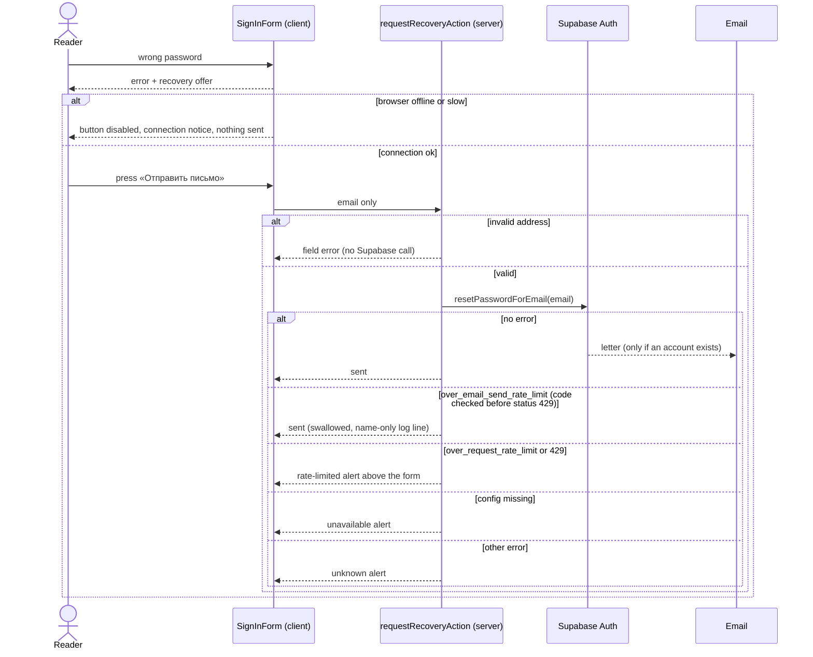
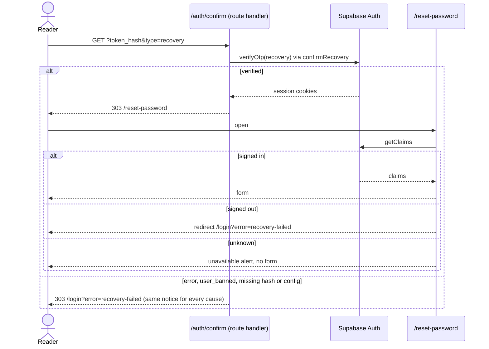
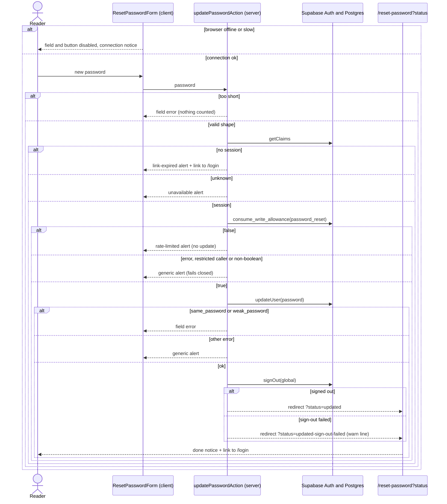

## Context

`features/auth` already owns sign-in, sign-up, the email confirmation route `/auth/confirm` (`confirmSignUp`, a `dal/` function, never an action) and the Google flow. Sign-in answers a wrong password and an unknown address with the same text (admin-moderation FR-16), and sign-up hides whether an address exists (FR-4, FR-17). Supabase Auth does the mail and the tokens: `resetPasswordForEmail` sends the letter, `verifyOtp({ token_hash, type: "recovery" })` turns the link into a session, `updateUser({ password })` sets the password. Reader writes are limited by `consume_write_allowance(scope)` in Postgres (ADR 0007), which resolves the caller from `auth.uid()`, so it only works for a signed-in caller.

The reader who forgot the password is signed out, so two steps differ: asking for the letter (nobody is known) and setting the password (the recovery session makes the account known).

## Goals / Non-Goals

**Goals:**

- A reader with a wrong password can get back in through a letter, a link and one form, with a notice on every outcome.
- No step tells a stranger whether an address has an account, or how it was registered.
- The new-password step is limited to 5 attempts per minute per account; the letter is limited by Supabase.
- Offline, nothing can be sent.
- A reader who registered with Google is pointed to the Google button by a hint every visitor sees.

**Non-Goals:**

- A standalone «forgot password» page, a change-password screen for signed-in readers, new password-strength rules, a per-IP limit in the app (ADR 0007 point 5), a «confirm password» field.
- A notice that depends on the address (for example «this address is tied to a Google account»): it would need a database function over `auth.users` that anyone could call, and it would tell a stranger that an address has an account and how it signs in (owner, 2026-11-25).

## Decisions

### D1. One route for both letters, one DAL function per letter, the table in `model/`

The recovery email links to the existing `/auth/confirm` with `type=recovery`; the template already works that way for the sign-up letter. The route reads `type` and calls `confirmSignUp` (type `email`) or the new `confirmRecovery` (type `recovery`). Both stay in `dal/`, so neither becomes a public endpoint. The two functions repeat about fifteen lines and each keeps its own literal-`type` schema: the outcomes differ and a shared function would hide that.

The decision table (type and outcome to the redirect target) is a pure function `getConfirmTarget(type, outcome)` in `auth/model/`, as `getGoogleCallbackTarget` is for `/auth/callback` (ADR 0019 Decision 2), so the route stays parse, call, redirect. Targets: `email` verified `/`, `email` failed `/login?error=confirm-failed`, `recovery` verified `/reset-password`, `recovery` failed `/login?error=recovery-failed`, any other type `/login?error=confirm-failed`. The target is a fixed path, never a parameter, so there is no open redirect (auth FR-5). The feature's index exports `confirmRecovery`, `getConfirmTarget` and `RECOVERY_FAILED_ERROR`.

Alternative: a new route `/auth/recovery`. Rejected: one more handler, a second copy of the no-store header and the cookie-writing path, and a template that no longer matches the sign-up one.

### D2. The recovery offer is a second submit button of the sign-in form, with one owner of the form's state

`SignInForm` keeps the email in controlled state (`useState`), so a form action finishing never resets it, and keeps the sign-in `useActionState` as today. The offer is a child `RecoveryOffer`, rendered inside the same `<form>`, with its own `useActionState` for `requestRecoveryAction` and a button `formAction`. It is shown when the last sign-in result is the wrong-credentials failure, or when `/login` was opened with `error=recovery-failed` and no sign-in has been submitted yet. The first sign-in submit ends the URL's effect: from then on only the last sign-in result decides, so after any other failure the recovery-failed alert and the offer are gone. The parent passes it a `key` that changes on every sign-in submit, so a stale `sent` notice or failure never outlives the next sign-in attempt.

The recovery submit wrapper reads only the `email` entry of the `FormData`; the password entry never reaches the action (FR-2). The form shows one alert slot above it: the recovery failure when there is one, otherwise the sign-in failure. The `sent` notice replaces the offer's text under that alert, and the button stays, so another letter can be asked for.

Alternative: a link to a `/forgot-password` page with the address in the query. Rejected: a new page, a new breadcrumb row, a new sitemap exclusion, and an address in the URL, which ends up in logs and history.

### D3. The answer to a letter request never depends on the address

`requestRecoveryAction` validates the address with the sign-in email schema, calls `resetPasswordForEmail(email)` (the link comes from the template), and answers `sent` for every outcome except these:

- invalid address shape: a field error, before any Supabase call;
- `over_request_rate_limit`, or HTTP 429 on an error that carries no code: `rate-limited` (the IP-wide limit applies to any address, so it reveals nothing);
- missing config: `unavailable`; any other failure: `unknown`.

`over_email_send_rate_limit` is answered as `sent`, and **when an error carries a code, the code alone decides**: that code also arrives with HTTP 429, so a status check first would turn it into `rate-limited` and show the known-address answer, and an unlisted code with 429 is `unknown`, so a renamed per-address code cannot do the same. The status decides only for an error with no code. Supabase refuses a second letter within a minute only for an address that has an account, and the hourly letter cap is hit only by addresses that send mail, so «too many attempts» for those would let anyone probe addresses. The mapping is kept whatever the recording in task 1.1 shows: the local stack's pause is 1 second, the hosted default is 60 seconds, so a local recording alone cannot prove the answers equal. The action logs a name-only line for the operator when it swallows the code (`[auth] recovery letter refused: email send limit`), never the address.

Timing: Supabase may answer a known address slower than an unknown one, because only the first sends mail. Task 1.1 measures it. The design does not pad the response (YAGNI, and sign-in has the same channel today); the accepted risk is recorded in the ADR of task 6.2.

Task 1.1 records the answers on the local stack, with the pause set to the hosted value for the recording, for: a known address twice, an unknown address twice, a blocked address, an unconfirmed address, and a Google-only account.

Alternative: show «too many attempts» for the per-address refusal. Rejected for the probing reason above.

### D4. `/reset-password` shows the form to a signed-in session and the done notice to anyone

A successful `verifyOtp` writes a normal session. The page (a Server Component in `app/(public)/reset-password/`) renders the feature's `ResetPasswordPage` inside its own `<Suspense>` and reads the search parameter `status`:

- `status` is `updated` or `updated-sign-out-failed` (the named constants of D5): the done notice with the link to `/login`, no session read, because after the reset there is no session (D5);
- otherwise the session decides: `getSessionState()` signed out redirects to `/login?error=recovery-failed`, `unknown` shows the «service unavailable» alert, signed in shows the form.

The page is never cached (it reads the session or the search parameter on every request). A signed-in reader who opens the page by hand sees the form; that is allowed, because they hold a session and `updateUser` itself decides (the project's `secure_password_change` setting is left as is). No `amr` check: YAGNI until a change-password screen exists. Anyone can open `/reset-password?status=updated` and read the done text; it holds nothing private.

The page sits in `(public)`, not `(authorized)` (`docs/architecture.md`: a page needing a signed-in reader goes in `(authorized)`), on purpose: it needs its own head (title, `noindex, follow`, canonical, as `/login` and `/signup` have), the done notice needs no session, and a signed-out request is redirected to `/login` with a notice, where the `(authorized)` gate's redirect carries none.

### D5. `updatePasswordAction`: schema, session, allowance, update, end sessions, redirect

Order, each step before the next:

1. Validate the password against the sign-up password schema (minimum length), returning field errors.
2. Read the session (`getSessionState`); a signed-out or unknown result returns `link-expired` or `unavailable`, with nothing counted.
3. `consume_write_allowance("password_reset")` through the feature's own `dal/password-reset-allowance.ts`, a copy of `collection-management`'s one-scope helper. Over the limit returns `rate-limited` and writes nothing; a failed check fails closed.
4. `updateUser({ password })`. `same_password` becomes a field error, `weak_password` the sign-up field error, anything else goes through `classifyAuthError`.
5. On success, `signOut({ scope: "global" })`, then `redirect` (outside every `try`) to `/reset-password?status=updated`; if the sign-out failed, to `/reset-password?status=updated-sign-out-failed` and one name-only warning line. No `refresh()` and no in-place state swap: a cookie change in a Server Action re-renders the current page, and with the session gone the D4 gate would redirect a reader who has just succeeded to the «link expired» notice. A redirect target that needs no session avoids the race.

`global`, not `local`: a reset usually means someone else may know the old password, so every other device must sign in again. When the global sign-out fails, the password is changed but the old sessions may live on, and the reader's own session too; the notice says that honestly instead of promising a sign-in.

The action returns only failures (field errors, `link-expired`, `rate-limited`, `unavailable`, `unknown`); success never returns, as in `signInAction`. It logs the action name and failure kind only (auth NFR-1); the form keeps no password after a failed submit.

### D6. The `password_reset` scope: 5 per 1 minute, a new migration

One migration adds `('password_reset', 5, interval '1 minute')` to the limits list of `consume_write_allowance` and to `write_rate_limits_scope_check`, copying the function body from `20261113170000_admin_moderation.sql` and the constraint from the latest migration that changed it. ADR 0007 gets a «Scope added by `password-recovery`» paragraph that states what the limit is: it bounds the attempts made through this app. A holder of the session (its cookies are readable by script) can call Supabase Auth's own endpoint directly and skip it, so it is a guard on the app's path and defence in depth, not a security boundary; Supabase's own limits and the single-use link bound the rest. Fixed window, one row per user and scope.

### D7. Offline and slow: the same guard as the Google button

On the sign-in form a pending sign-in or recovery request disables both submit buttons, so two requests never run at once from one form. Both new surfaces read `useConnection()`. When `isOnline` is false (offline or slow), the recovery button and the new-password field and submit are disabled and `ConnectionNotice` shows above them, as on the Google button (google-sign-in D6). Each surface has its own `ConnectionNotice` with the component's default texts directly above its button or form; the Google button's notice on `/login` is not touched, so an offline `/login` with the offer shows two. While a request is pending a second click or Enter sends nothing (the buttons are disabled and the second submit is ignored). A failure notice is an `Alert tone="danger"` above the form.

### D8. Blocked and banned accounts

The letter request answers `sent` for every address, so a block is not revealed. A blocked or banned account that follows a link fails `verifyOtp` (`user_banned`), which reads as an invalid link: the `recovery-failed` notice, the same as an expired link. `assert_not_restricted()` in `consume_write_allowance` is the second guard for a session that exists anyway.

### D9. Letters and configuration

The recovery email template (`[auth.email.template.recovery]` in `supabase/config.toml`, a file under `supabase/templates/`, and the hosted dashboard) links to `{{ .SiteURL }}/auth/confirm?token_hash={{ .TokenHash }}&type=recovery`. No Redirect URL entry is needed: the `token_hash` flow never uses one. `docs/environment.md` and its Deploy checklist get an item for the hosted template, the hosted `max_frequency` between letters (the local stack uses 1 second, the hosted default is 60) and the letter cap. The link lives 1 hour (owner, 2026-11-25): Supabase's `otp_expiry`, 3600 s, which `supabase/config.toml` already holds locally and the hosted dashboard must hold too (Deploy checklist). The sent notice says «1 час»; the expired-link notice says only «expired», because an opened-too-late link and a used link look the same to Supabase.

### D10. The Google hint is static text, not an answer

The sign-in and sign-up forms always show one line directly under the Google button telling a reader who registered with Google to use that button (texts in the spec). It depends on nothing the visitor typed, so it reveals nothing about any address, and it needs no database function. Sign-in and sign-up answers stay identical for every address. A Google-only account that asks for a recovery letter is allowed to: setting a password through the link adds a password sign-in beside Google (task 1.1 records what Supabase does).

### D11. Placement of the pieces

| Piece | Where |
| --- | --- |
| `requestRecoveryAction`, `updatePasswordAction` | `auth/actions/auth.actions.ts` (the existing «use server» module, exports only actions) |
| `confirmRecovery` | `auth/dal/confirm-recovery.ts`, exported from the index for the route |
| `getConfirmTarget`, recovery schemas, failure kinds, messages, form states, `RECOVERY_FAILED_ERROR`, the `status` parameter name and values | `auth/model/` |
| `ResetPasswordPage`, `ResetPasswordForm`, `PasswordResetDone`, `RecoveryOffer`, the Google hint | `auth/components/` |
| `RESET_PASSWORD_PATH` | `shared/config/account-paths.ts` (breadcrumbs needs it without importing `auth`) |
| Breadcrumb row and `@breadcrumbs/reset-password` | `breadcrumbs` model table, `app/@breadcrumbs/reset-password/page.tsx` |

## Sequences

Request the letter (browser to server to Supabase):

Follow the link (browser to route handler to Supabase):

Set the new password (browser to server to Supabase, then back to the page):

## Risks / Trade-offs

- [The recovery session is a full session; a reader who opens the link and leaves stays signed in] → They proved the address by opening the letter, which is what Supabase's flow assumes; the link is single use and expires.
- [A mail scanner that opens the link first uses the single-use token, and the reader lands on `recovery-failed`] → The notice carries the offer, so a new letter is one press away; sign-up links already share this.
- [A letter «sent» that never arrives when the project's hourly cap or the sender fails] → The reader can only retry; the operator sees the name-only log line; the Deploy checklist asks for a custom sender and a raised cap before launch.
- [Response time may tell a known address from an unknown one] → Measured in task 1.1, accepted and recorded in the ADR; sign-in has the same channel.
- [Global sign-out ends the author's session on every device] → Intended; the done notice says to sign in again, and a failed sign-out has its own honest notice.
- [The `password_reset` limit can be skipped by calling Supabase's endpoint with the session] → It is a guard on the app's path only, recorded in ADR 0007; Supabase's limits and the single-use link bound the rest.
- [Supabase changes the code it returns for a refused second letter] → The mapping falls back to `unknown`, which reveals nothing; the recording in task 1.1 is the check to repeat after an upgrade.
- [A Google-only account gets a password through the recovery link] → Allowed (D10); task 1.1 records the behaviour and the owner can veto it.
- [`consume_write_allowance` is replaced again] → The migration copies the latest body; `assert_not_restricted()` stays first.
- [The one-scope allowance helper is copied into `auth`, the fifth copy] → Allowed by the project's rule (repeat feature logic); moving the domain-free wrapper into `shared/lib/supabase` is a separate refactor proposal.

## Migration Plan

1. Push the migration with `supabase db push` before the app ships; the old app never calls the new scope, so the order is safe either way, but the new action fails closed without it.
2. Set the hosted recovery email template and check the letter cap and the pause between letters (Deploy checklist).
3. Rollback: revert the app; the extra scope in the function and the constraint is harmless.

## Open Questions

- The assumptions in the proposal's Open Questions: what «unique» and «complexity» mean, global versus local sign-out, the wording of the sign-out-failed notice, and whether to keep the `password_reset` limit given that it bounds only the app's path. Owner, due 2026-11-27.
