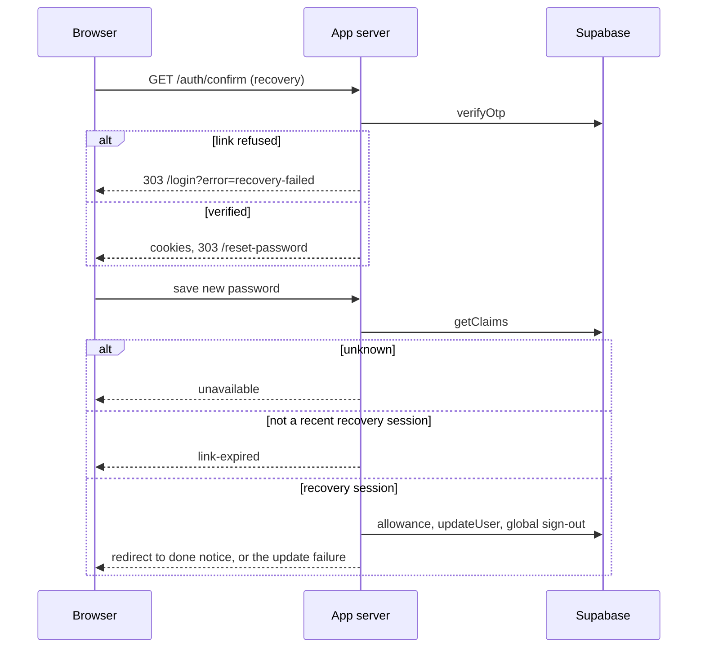
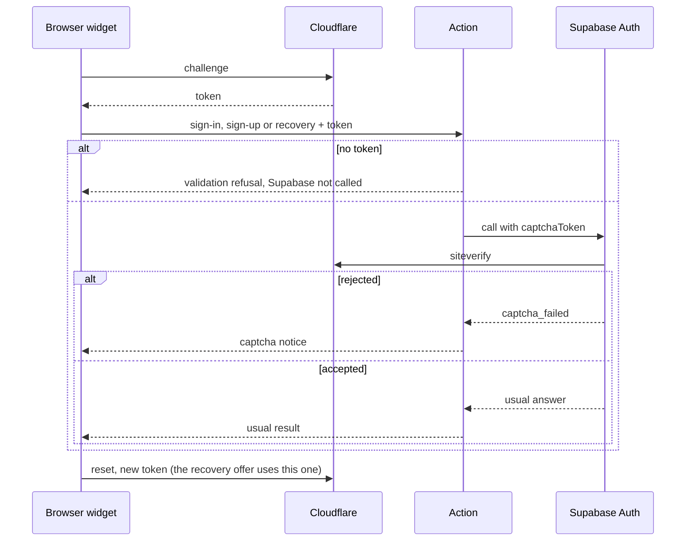
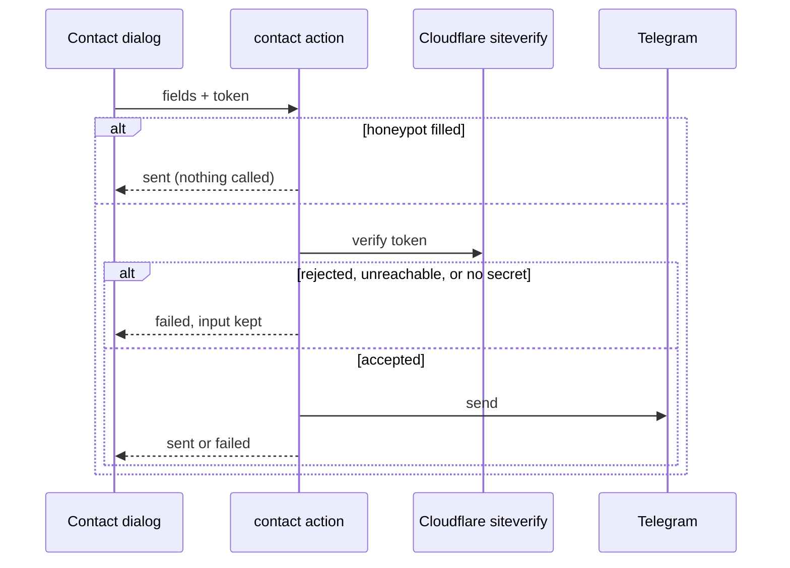
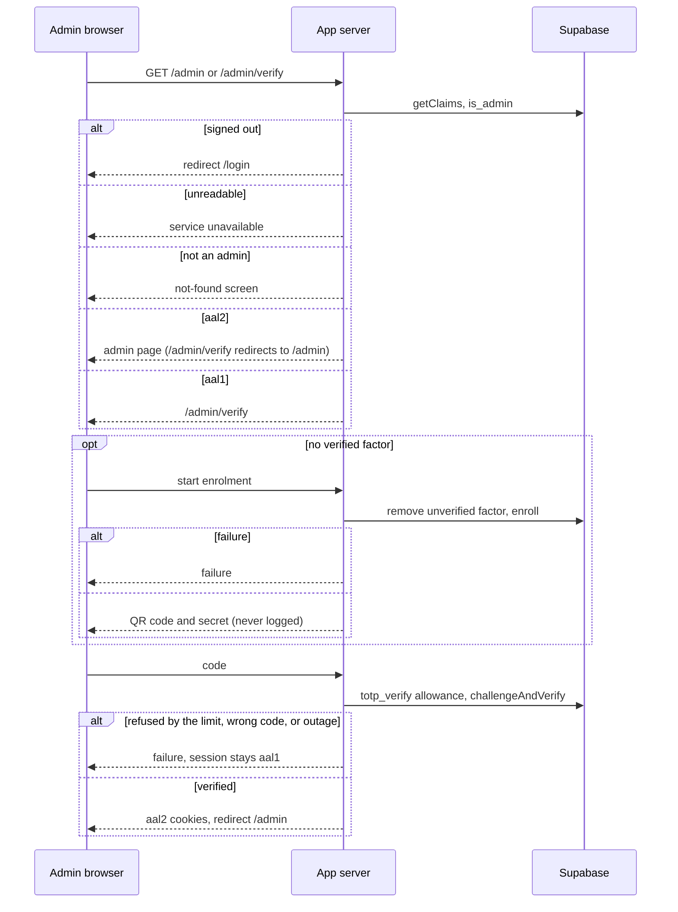
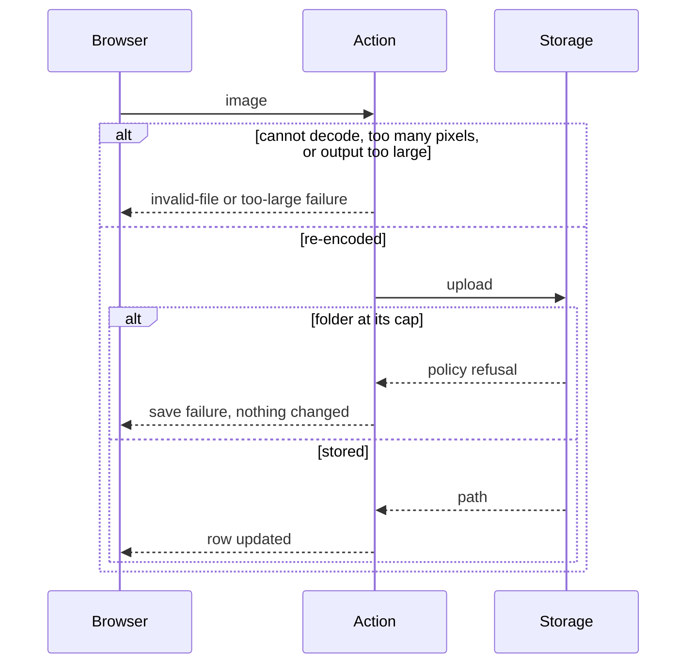
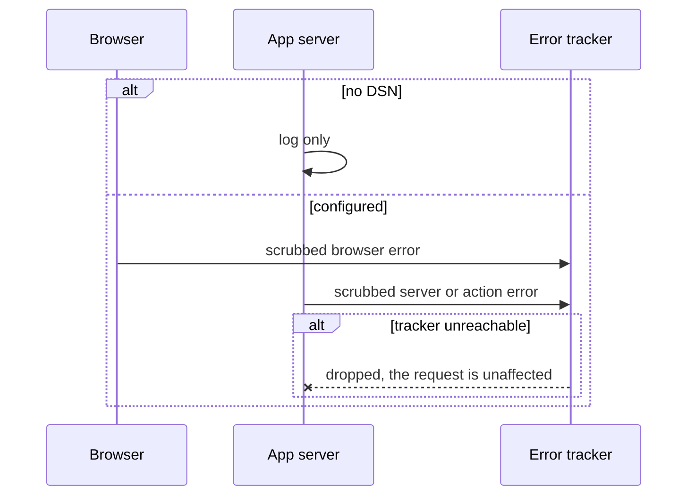

# Design

## Context

See `proposal.md`, Why. Facts the design rests on:

- Both `createServerClient` calls (`shared/lib/supabase/server.ts`, `session.ts`) use the library defaults, `httpOnly: false` included. No browser Supabase client exists.
- Every sign-in, sign-up and recovery request reaches Supabase Auth from a Server Action, so Auth's per-IP limits see one IP (ADR 0003).
- `updatePasswordAction` and `ResetPasswordContent` accept any signed-in session.
- `assert_admin()` calls `is_admin()`; two Storage policies for admins and `may_moderate_author()` call `is_admin()` directly.
- `uploadIllustration` and `replacePhoto` store the file's bytes unchanged.
- Verified in the Supabase sources and docs (context7): `@supabase/ssr` spreads `cookieOptions` over its defaults for every auth cookie write, chunks and removals included; `POST /verify` issues a session with `amr` `otp` for every type; `PUT /user` answers `insufficient_aal` for a password change at `aal1` when a factor is verified; captcha guards `/signup`, `/recover`, `/otp`, `/resend` and the `password` grant, not the `refresh_token` or `pkce` grants and not `/verify`.

## Goals / Non-Goals

**Goals:** close each finding with the smallest mechanism; every check that matters is enforced below the app (Supabase Auth or Postgres) where it can be; everything the app adds fails closed.

**Non-Goals:** the post-deploy list; a general permissions model; a captcha or logging abstraction over more than one provider.

## Decisions

### D1. One source of cookie options

A function in `shared/lib/supabase/` returns `{ httpOnly: true, sameSite: "lax", secure: NODE_ENV === "production" }`; both server clients pass it as `cookieOptions`. Alternative, editing options inside `setAll`, rejected: two copies that can drift.

### D2. CSP built in the proxy

The proxy sets `Content-Security-Policy` together with `SECURITY_HEADERS`; the value is built per request, not part of that static map: `object-src 'none'; base-uri 'none'; frame-ancestors 'none'; form-action 'self' <Supabase origin> https://accounts.google.com`. The origin comes from `getSupabaseConfig().url`; on an invalid config the policy omits it and keeps the rest, since the proxy never throws. No `script-src`, `frame-src` or `connect-src`, so Turnstile and Sentry need no allowance yet. `form-action` is checked by hand with JavaScript on and off, because Chrome applies it to the redirects after a form post. Alternative, `headers()` in `next.config.ts`, rejected: a second place for security headers.

### D3. What counts as a recovery session

`readClaimsState` stays the one reading of a session (ADR 0006): the signed-in variant of `ClaimsState` gains `aal` and `amr`, parsed there, so no feature reads the claims a second time and an outage keeps one meaning (`unknown`). A missing or malformed `amr` or `aal` never changes the state: the session stays signed in, `amr` parses as empty (not a recovery session) and `aal` as `aal1` (no second factor). A pure function in `auth/model/` reads that `amr`: true when an entry with method `otp` or `recovery` has a timestamp no older than `RECOVERY_SESSION_WINDOW_SECONDS` (900). A server-only DAL function feeds it from `getSessionState()` and answers `recovery | not-recovery | unknown`; it is read by `ResetPasswordContent` and `updatePasswordAction`. The action's order becomes: schema, session, recovery check, allowance, update, sign-out. `not-recovery` answers the existing `link-expired` failure (the page redirects to `/login?error=recovery-failed`); `unknown` fails closed as `unavailable`.

Alternatives: an app-set marker cookie at `/auth/confirm` (a new signing secret, rejected); a table of recovery session ids written by a function (any session could call it, rejected). The residual: an email-confirmation session also carries `otp` (accepted, proposal Decisions).



This check bounds the app's path only. `secure_password_change = true` makes Supabase ask for reauthentication for sessions older than 24 hours; "require current password" closes the rest and skips recovery sessions: it is turned on in the hosted project whenever the dashboard offers it, and in `config.toml` only if the CLI supports it.

### D4. Password policy

`secure_password_change = true` in `config.toml` and hosted. Leaked-password protection is a hosted setting. Only if the plan lacks it: `MIN_PASSWORD_LENGTH` 8 → 12 in `auth.constants.ts` (which the schema and the messages read), `minimum_password_length` in `config.toml` and hosted. Sign-in's schema never enforces a minimum, so no existing password is locked out. No character-class rules.

### D5. Turnstile: one widget, two verifiers

- Server-side: `shared/lib/turnstile/` (every module `import "server-only"`), shaped like `shared/lib/telegram/`: lazy config validation of `TURNSTILE_SECRET_KEY`, a `siteverify` call answering `{ ok: true } | { ok: false, reason }`, never throwing, never logging the token or secret. Used by `contact.actions.ts` only.
- Client: one widget component in `shared/ui/` reading `NEXT_PUBLIC_TURNSTILE_SITE_KEY`, loading Cloudflare's script, writing the token into the form and exposing a reset. It mounts only when its form is in use: `Dialog` always renders its children and the footer puts `ContactDialog` on every page, so the contact widget mounts when the dialog opens, never before.
- A token is single-use and short-lived, so the widget resets after every submission, successful or not. The submit control and the recovery offer are disabled until a token exists; the recovery request takes its own fresh token.
- Auth forms pass the token as `options.captchaToken` to `signInWithPassword`, `signUp` and `resetPasswordForEmail`; the app does not verify it itself (a token can be verified once). The auth action schemas require a non-empty token, so a tokenless call is refused before Supabase. The contact schema leaves the token optional: the action checks it after the honeypot, so a bot that fills the hidden field still gets «sent».
- New failure kind `captcha` for Auth's `captcha_failed`. The recovery request shows it too: Auth checks the captcha before it looks up any address, so this extends the non-`sent` answers of ADR 0021 without revealing one.
- Contact order: honeypot, then `siteverify`, then Telegram. A missing secret or an unreachable verifier refuses the send.
- Local: Cloudflare's published test keys; the test secret is written in `config.toml` `[auth.captcha]`, which configures the local stack only.





Alternative, an app-level per-IP limiter, rejected: needs a trusted client IP and storage the publishable key cannot protect; the Firewall rule does it at the edge.

### D6. Admin second factor inside `features/admin`

- `AdminAccess` gains `needs-second-factor`: `is_admin()` true and the session's `aal` (from `ClaimsState`, D3, passed in by the caller through auth's public API) is not `aal2`. An `unknown` session stays `unavailable`, never `needs-second-factor`. `docs/architecture.md`'s list of what admin takes from auth is updated if it grows. Every admin page redirects that answer to `/admin/verify`. The header link still shows (it leads there); delete and add-to-home controls do not.
- `/admin/verify` is gated like the other admin pages. With no verified factor it offers enrolment, otherwise code entry. Enrolment starts by an action, never on render, and first removes an unfinished (unverified) factor. The QR code and the secret reach the admin's browser only and are never logged. `challengeAndVerify` writes the `aal2` cookies through the server client, then redirects to `/admin`.
- Migration: `assert_admin()` also requires `(auth.jwt() ->> 'aal') = 'aal2'`; the two admin Storage policies on `poem-illustrations` and `may_moderate_author()` require it too, otherwise an `aal1` admin session could still delete files and would be offered controls that fail. `is_admin()` is unchanged.
- Admin actions at `aal1` get `42501`, already shown as `forbidden`.
- Code attempts through the app are limited per account by a new `consume_write_allowance` scope `totp_verify` (5 per minute) before `challengeAndVerify`, failing closed. It bounds the app's path only: a holder of an `aal1` token can call Supabase's verify endpoint directly, and Supabase's own limit there is per IP. That residual goes into ADR 0025, with whether the hosted plan offers the MFA Verification Attempt hook.
- Scenarios compute codes with `node:crypto`; no new dependency.



Alternative, MFA in `features/auth`, rejected: only the admin is offered it.

### D7. Re-encode on the server with `sharp`

A server-only module in `shared/lib/image-file/` takes the file and its sniffed type and returns `{ ok: true, body } | { ok: false, reason }`: apply EXIF orientation, encode PNG as PNG and JPEG as JPEG, keep no metadata, cap input at 50 million pixels, a named constant (decompression bombs). `replacePhoto` and `uploadIllustration` upload its output. A file `sharp` cannot decode answers the existing invalid-file failure; an output above the bucket's size limit answers the existing too-large failure; nothing is stored in either case. Alternative, stripping EXIF segments by hand, rejected: it keeps polyglot tails.

### D8. Cap objects in the insert policies

A `security definer` helper answers whether the caller's folder has room, and both insert policies add it. It answers false unless `owns_author_profile(folder)` holds, so as an RPC it tells nothing about another author (ADR 0005). Author photos: at most 5 (current, incoming, and room for failed cleanups). Illustrations: at most the author's poem count plus 20 (an insert is allowed while the folder holds fewer than that), so it grows with real use and bounds unreferenced files. It is a function because a policy on `storage.objects` cannot query that table itself without recursion; the task verifies that its owner reads past RLS.

Concurrency: direct uploads go to the Supabase host, so the Vercel Firewall never sees them. The task first checks whether Storage evaluates the insert policy in the same transaction that writes the object row. If it does, the helper takes the per-author `pg_advisory_xact_lock` of ADR 0009 and 0014 (the helper is then `volatile` and joins the function allowlist of ADR 0015). If it does not, no lock can make the cap strict: the task measures the overshoot of a parallel burst, and the owner accepts it or not before the group ends.

This reverses ADR 0009 Decision 6 (and 0010's closing line) that uploads are not counted, so group 6 writes ADR `0026` amending both, and recording the concurrency result. Alternative, a scheduled cleanup, rejected: needs a scheduler and a privileged key. Alternative, a server-only upload path (ADR 0009's suggestion), rejected: needs a secret key.



### D9. Observability

- `shared/lib/security-log/`: one server-only function that writes one JSON line `{ "kind": "security", "event", "source" }` with `console.warn`; events are a closed union: `sign-in-failed`, `captcha-refused`, `rate-limited`, `admin-refused`. No free-text field, so no input can reach it.
- Sentry (owner's choice): `src/instrumentation.ts`, `src/instrumentation-client.ts`, DSN from `NEXT_PUBLIC_SENTRY_DSN`; unset means off. Errors only: tracing and Session Replay stay off.
- Server Actions never reach Next's `onRequestError`: `createActionClient`'s `handleServerError` swallows the throw. A server-only reporter in `shared/lib/error-reporting/` (a no-op without a DSN) is called from there. Render errors caught by `app/error.tsx` are reported from it, and a `global-error.tsx` does the same for the root layout.
- Scrubbing: `sendDefaultPii: false`, and a `beforeSend` that removes cookies, headers, user, request bodies, query strings (breadcrumb URLs included; `/auth/confirm` carries a token hash) and every exception message, which can carry reader data; the error's name and stack stay. "Prevent storing IP addresses" is switched on in the Sentry project (Deploy checklist), since the app cannot strip what the service adds on receipt.



### D10. Hosted check script

`scripts/check-hosted-config.mjs` with a pure comparison module beside it. Reads `SUPABASE_ACCESS_TOKEN`, `SUPABASE_PROJECT_REF` and the expected site address from the shell. Runs `supabase migration list --linked`, reads `GET /v1/projects/{ref}/config/auth`, and exits non-zero listing each mismatch. The password choice is a named constant in the script, so it checks leaked-password protection or the length of 12, whichever applies. Redirect URLs and migrations are compared for equality. Anything unreadable or unparseable is a failure, never a pass.

Two guards: it fails when the CLI's linked project differs from `SUPABASE_PROJECT_REF`, so migrations and settings are read from one project; and it fails when the hosted project holds any `example.test` account (one read-only count through the Management API), so a seeded admin, whose password and TOTP secret are public, cannot pass the gate. The comparison module and its tests live under `scripts/`, and `vitest.config.mts` includes `scripts/tests/**` so CI runs them.

```mermaid
sequenceDiagram
    participant D as Developer script
    participant C as Supabase CLI
    participant M as Management API
    D->>D: token, ref, linked ref match
    alt missing or different
        D-->>D: fail
    else
        D->>C: migration list --linked
        D->>M: auth config, account count
        alt error, unreadable, or mismatch
            D-->>D: list names, exit non-zero
        else all match
            D-->>D: exit zero
        end
    end
``` The response holds SMTP and captcha secrets, so only the checked field names and expected values are printed. Field names are confirmed in the Management API reference before coding.

## Risks / Trade-offs

- [Captcha breaks JavaScript-free password sign-in] → accepted (proposal, Decisions); Google sign-in keeps working.
- [Cloudflare outage blocks sign-in, sign-up and contact] → fail closed; the owner can turn Auth captcha off in the dashboard.
- [Turnstile test keys need network access in local scenarios] → accepted; unit tests mock the widget and verifier.
- [A single-use token reused after a failed submit] → reset after every submission, covered by tests.
- [Admin locked out by a lost device] → dashboard path in `docs/environment.md`.
- [Recorded admin scenarios fail at `aal1`] → seeded local factor and a helper that enters the code.
- [A signed-in, non-recovery user redirected to `/login`] → the task checks what that page shows a signed-in reader.
- [Object cap may leak under parallel direct uploads] → D8: strict with a lock if Storage allows it; otherwise measured and put to the owner. The Firewall does not cover Storage.
- [Direct Storage API uploads skip re-encoding: an author can store unprocessed bytes and point their own photo or illustration at them] → only their own file is exposed; FR-10 covers the app's path; signed upload URLs are out of scope.
- [Re-encoding costs CPU and memory in the action] → one image per call, input capped at 5 MiB and by pixels.
- [Seed guard passes on an empty hosted database, which would get an admin with a public password and TOTP secret] → the rule "never seed a hosted project" stays, and the check script (D10) fails on any `example.test` account.
- [The widget sends visitors' data to Cloudflare] → it mounts only on the auth pages and the open contact dialog; the privacy policy update names Cloudflare.

## Migration Plan

Nothing is deployed, so there is no compatibility window. At the first deploy, in order: `supabase db push` (all migrations); hosted Auth settings (hook, URLs, captcha, TOTP, password settings); app variables; deploy; insert the owner into `public.admins`; the owner enrols; Firewall rules; raise Auth rate limits only after the captcha works; run the check script. Rollback of a migration: revert the app, then the down migration in its header. Turning a hosted setting off is the rollback for captcha.

## Scaffold map

| File | Responsibility | Exports |
| --- | --- | --- |
| `src/shared/lib/supabase/cookie-options.ts` | auth cookie options (D1) | `getSessionCookieOptions` |
| `src/features/auth/model/recovery-session.ts` | recent recovery session predicate (D3) | `isRecentRecoverySession` |
| `src/features/auth/dal/recovery-check.ts` | the session's recovery answer (D3) | `checkRecoverySession`, `RecoveryCheckResult` |
| `src/shared/lib/turnstile/{index,config,client,turnstile.types}.ts` | server-side captcha verification (D5) | `verifyTurnstileToken`, `readTurnstileConfig`, result types |
| `src/shared/ui/TurnstileField/` | the captcha widget (D5) | `TurnstileField`, `TurnstileFieldProps`, `TurnstileFieldHandle` |
| `src/features/admin/model/totp.types.ts` | second factor result types (D6) | `TotpFactorResult`, `TotpEnrolmentResult`, `TotpVerifyResult`, `TotpVerifyAllowance` |
| `src/features/admin/dal/totp.ts` | factor read, enrolment, code check (D6) | `readTotpFactor`, `startTotpEnrolment`, `verifyTotpCode` |
| `src/features/admin/dal/totp-verify-allowance.ts` | the `totp_verify` limit (D6) | `consumeTotpVerifyAllowance` |
| `src/features/admin/pages/AdminVerifyPage/` | `/admin/verify` page and its gate (D6) | `AdminVerifyPage`, `AdminVerifyPageContent` |
| `src/features/admin/components/TotpEnrolment/` | enrolment screen (D6) | `TotpEnrolment` |
| `src/features/admin/components/TotpCodeForm/` | code form (D6) | `TotpCodeForm`, `TotpCodeFormProps` |
| `src/shared/lib/image-file/reencode-image.ts` | server re-encode (D7) | `reencodeImage` |
| `src/shared/lib/security-log/` | security event lines (D9) | `logSecurityEvent`, `SecurityEvent`, `SecurityEventSource` |
| `src/shared/lib/error-reporting/` | server error reporter (D9) | `reportServerError` |

Also added: `AmrEntry` in `shared/lib/supabase/claims.ts` and `ReencodeResult` in `shared/lib/image-file/image-file.types.ts`. Written with their tasks, not stubbed: the `/admin/verify` route and breadcrumb files and the Server Actions, the instrumentation files, `global-error.tsx`, the scrubbing function, the hosted check script and the migrations.
