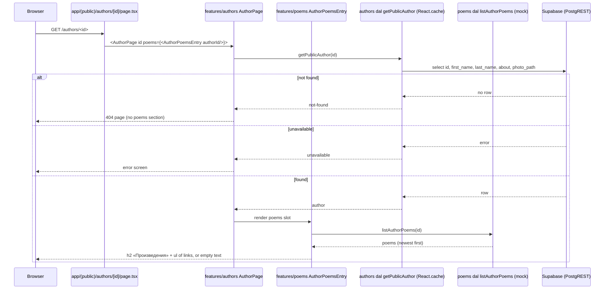
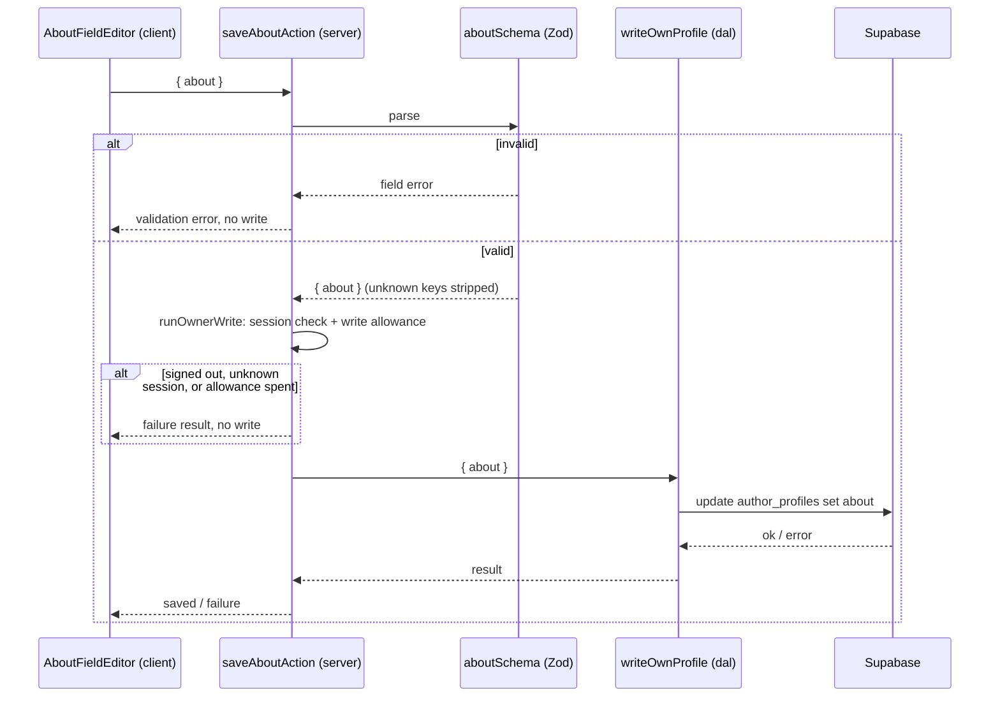
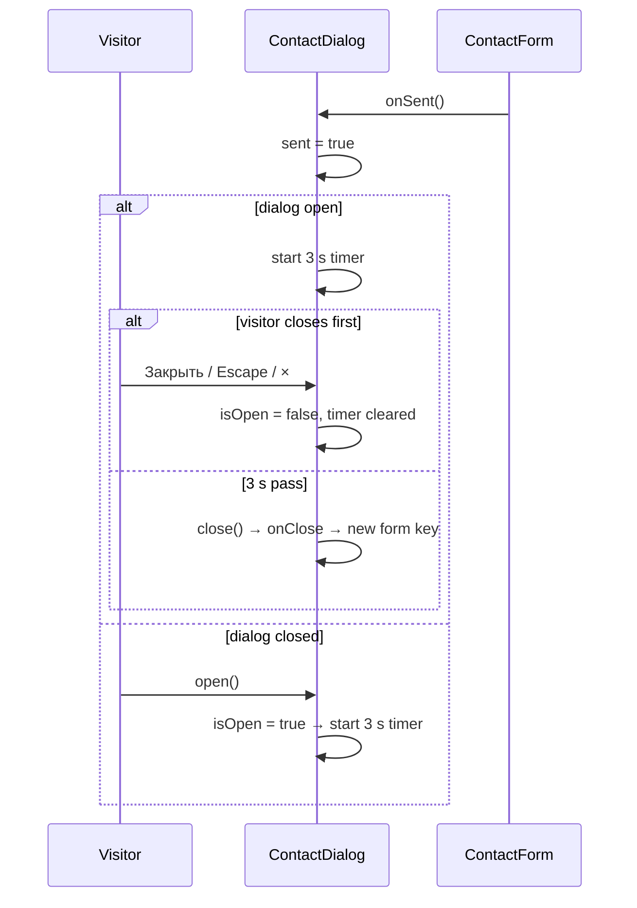

# Design

## Context

Three shipped features get small behaviour changes (proposal, Why):

- `contact` (`add-contact-form`): `ContactDialog` owns a native `<dialog>` through the shared
  `Dialog` primitive and swaps the form for a thank-you view on success (`ContactForm` calls
  `onSent`, the dialog sets `sent`). Closing after success remounts the form empty through a new
  `key` (`handleClosed`).
- `authors` (`add-author-profiles`): about is stored as Markdown plus `about_align`
  (`left | center | right`, `not null default 'left'`). The alignment flows through
  `author-profile.schema.ts` (`align`, `about_align`), `saveAboutAction`, `writeOwnProfile`,
  the delete patch (`about_align: "left"`), `OWNER_PROFILE_COLUMNS` (also the public columns),
  `profile-queries.ts`' row mapping, `AuthorProfile.aboutAlign`, and the UI: `AlignControl` in
  `AboutToolbarRow` and `AboutPreview`, `AuthorAbout`'s `ALIGN_CLASSES` and `.inlineLists`.
- `poems` (`add-author-poems`): the route file composes `AuthorPoemsEntry` (a link to
  `/authors/<id>/poems` or the empty text) into `AuthorPage`'s `poems` slot. The list page
  `/authors/<id>/poems` renders `AuthorPoemsPage` → `AuthorPoemsPageContent` →
  `AuthorPoemList` (h1 «Произведения» + `ul` of links). `breadcrumbs` matches an
  `author-poems` route and puts a «Произведения» link in the poem page's trail.

There is no `supabase/seed.sql` yet, although `supabase/config.toml` already lists it under
`[db.seed]`. Local authors were created by hand; all are test data.

## Goals / Non-Goals

**Goals**

- Auto-close the contact dialog 3 s after the thank-you view shows (FR-1).
- Remove alignment end to end: UI, validation, action, DAL, types, and the column (FR-2..FR-4).
- Move the poem list onto the author page and delete the list route (FR-5, FR-6), keeping the
  poem page and its URL.
- Shorten the poem page's trail (FR-7).
- Reproducible local test data (FR-8).

**Non-Goals**

- No change to the poem page's content, the mock poem set, or how many poems an author gets.
- No pagination or other change to the poem list's look (proposal: "looks the same").
- No redirect from the old list URL (user decision, 2026-10-27).
- No hosted-project data work: the hosted Supabase project has not been deployed yet.
- No change to how the contact message is sent or validated.

## Decisions

### D1 — Auto-close lives in `ContactDialog` (FR-1)

`ContactDialog` already owns `sent` and the dialog ref, and closing after success already goes
through `handleClosed`. It gains one piece of state, `isOpen`, set in `open()` and cleared in
`handleClosed` (the `Dialog`'s `onClose`, fired by every close path: «Закрыть», Escape, the
header close button, and `dialog.close()`).

```ts
useEffect(() => {
  if (!sent || !isOpen) return;
  // The ref, not `close`: a ref needs no dependency entry (react-hooks/exhaustive-deps, lint fails on warnings).
  const timer = setTimeout(() => dialogRef.current?.close(), SENT_AUTO_CLOSE_MS);
  return () => clearTimeout(timer);
}, [sent, isOpen]);
```

`handleClosed` clears `isOpen` as its first statement, before its existing `if (!sent) return;`.
Otherwise a close before the success would leave `isOpen` true, and a success arriving while
the dialog is closed would start the timer at once instead of on the next open.

- `SENT_AUTO_CLOSE_MS = 3000` in `contact.constants.ts` (named constant, no magic value).
- The timer calls the same `close()` the «Закрыть» button calls, so focus return (the native
  dialog restores focus to the opener) and the empty form on the next open are the existing
  FR-8 behaviour, not new code.
- Any earlier close flips `isOpen` to false; the effect's cleanup clears the timer, so a
  reopen inside the 3 s never gets closed by a stale timer.
- A success that arrives while the dialog is closed sets `sent` with `isOpen` false: no timer.
  The next `open()` sets `isOpen`, and the effect starts the 3 s then (FR-1, last sentence).
- `ContactForm` is unchanged. The timer belongs to the dialog (it closes the dialog), not to
  the form's view.

Alternative rejected: a timer in `ContactForm`'s sent view calling `onClose`. It would run
while the dialog is closed (the form stays mounted), closing nothing and then missing the
"start on next open" case.

### D2 — Alignment removed end to end (FR-2, FR-3, FR-4)

Removed, not hidden: a control nobody can reach and a column nobody reads are dead code that
knip and future readers would trip over (YAGNI; user decision to drop the column, 2026-10-27).

| Layer | Change |
| --- | --- |
| Database | New migration `supabase/migrations/<timestamp>_drop_about_align.sql`: `alter table public.author_profiles drop column about_align;`. Postgres drops the column's privileges with it, so the existing column grants need no edit. A documented down migration in the header comment re-adds the column with its old default and check. |
| pgTAP | `supabase/tests/author_profiles.test.sql`: drop `about_align` from the `returning` list and remove the `about_align = 'justify'` integrity case; add `hasnt_column('public', 'author_profiles', 'about_align')`. |
| Model | `AboutAlign` type, `alignSchema`, the `align` / `about_align` schema fields, `ALIGN_LABELS`, and `VALIDATION_MESSAGES.invalidAlign` are deleted. `OWNER_PROFILE_COLUMNS` (also `PUBLIC_AUTHOR_COLUMNS`) loses `about_align`. `profileRowSchema` (the DAL's row check), `AuthorProfile`, the public author type, and the row type lose the field. |
| DAL | `profile-queries.ts` stops mapping `aboutAlign`; the about delete patch becomes `{ about: null }`. |
| Action | `saveAboutAction`'s input is `{ about }`; it writes `{ about }`. |
| Editor | `AboutContent` collapses to the Markdown string: `AboutFieldEditor`'s draft, saved value, and `save` use `string`; `savedAlign` goes from its props and from `AuthorProfileEditor`. `AlignControl` is deleted. `AboutToolbarRow` only wrapped `MarkdownToolbar` and `AlignControl`, so it is deleted and `AboutEditForm` renders `MarkdownToolbar` directly. `AboutPreview` renders only `AuthorAbout`. |
| Public view | `AuthorAbout` takes `markdown` only; `ALIGN_CLASSES` and the `.inlineLists` class go. Lists follow the approved mockup: `.about ul` and `.about ol` get `padding-left: 0` and `list-style-position: inside` (markers at the left edge, no indent; user decision, 2026-10-27), so the former `.inlineLists` look becomes the only one. |

The Server Action's schema is the trust boundary: with `align` gone from it, a forged request
that still sends `align` is parsed by Zod's default object behaviour, which strips unknown
keys, so nothing reaches the database (and the column no longer exists anyway).

### D3 — Poem list on the author page, list route deleted (FR-5, FR-6)

The route file keeps composing the poems block into `AuthorPage`'s existing `poems` slot, so
`features/authors` still imports nothing from `features/poems` (NFR-2).

- `AuthorPoemsEntry` (same export name, so `src/app/(public)/authors/[id]/page.tsx` is
  unchanged) becomes: read `listAuthorPoems(id)`, render `AuthorPoemList`.
- `AuthorPoemList` keeps its markup and classes, with one change: the heading is an `h2`
  (the page's `h1` is the author's name, NFR-4). The heading size steps down from the page
  heading scale to the approved mockup's section heading (artboard 12): 24/32 px, weight 600,
  letter-spacing -0.01em (`text-2xl font-semibold tracking-[-0.01em]`). Heading to list is
  16 px (the section's `gap-4`, down from the list page's `gap-8`); titles stay 18/28 px, 12 px
  apart, `foreground`, `accent` on hover. Its `section lang` stays.
- The section is the last child of `AuthorProfileView`'s `article`, after about or after the
  photo: exactly where the entry link sits today, so FR-5's placement needs no layout change.
- Deleted: `src/app/(public)/authors/[id]/poems/page.tsx`,
  `src/app/@breadcrumbs/authors/[id]/poems/page.tsx`, `AuthorPoemsPage`,
  `AuthorPoemsPageContent` (and their types and tests), `AUTHOR_POEMS_LINK_LABEL`.
- `authorPoemsPath` is deleted: `authorPoemPath` builds
  `${authorPagePath(authorId)}/${POEMS_SEGMENT}/${poemId}` directly. `authorPoemsPath` and
  `POEMS_PAGE_TITLE` leave the public API (the breadcrumbs stop using them; `POEMS_PAGE_TITLE`
  stays as the section heading inside the feature) — knip enforces this.
- The 404 for `/authors/<id>/poems` comes from Next itself: the `poems` folder keeps only its
  `[poemId]` child, so no page matches the URL. With no `page.tsx` matched and no catch-all,
  Next answers HTTP 404 with `app/not-found.tsx`; the `@breadcrumbs` slot falls back to
  `default.tsx` (no trail), as for every other unknown URL (breadcrumbs FR-6). Verified, not
  assumed: task 5.2 checks the status on a production build.

The author page's existing loading state already covers the list: the list renders inside
`AuthorPage`'s Suspense boundary after the author read resolves, and `listAuthorPoems` reads
in-code mocks with no I/O.

### D4 — Breadcrumbs lose the list route (FR-7)

- `matchAuthorRoute`: `[id, "poems"]` no longer matches (returns `none`, so no trail, FR-6);
  `[id, "poems", poemId]` still matches `author-poem`. The `RouteMatch` union loses
  `author-poems`, so `BreadcrumbsLoader`'s `readForMatch` loses its `case "author-poems"` too
  (the union change makes the old case a type error).
- `buildTrail`'s `author-poem` case drops the `{ label: POEMS_PAGE_TITLE, href:
  authorPoemsPath(...) }` item. Every other rule (not-found hides the trail, unavailable shows
  «Автор», shared memoized reads) is untouched.
- The breadcrumbs feature then needs only `POEMS_SEGMENT`, `getAuthorPoem`, and
  `AuthorPoemResult` from `@/features/poems`.

### D5 — Test data seed (FR-8)

`supabase/seed.sql`, loaded by `npx supabase db reset` after the migrations (already wired in
`config.toml`). It runs as the database owner, so RLS and column grants don't apply.

- For each test reader: one `auth.users` row (fixed UUID, `email_confirmed_at = now()`,
  `encrypted_password = crypt('<placeholder>', gen_salt('bf'))`, the `aud`/`role`
  `authenticated`, empty-string token columns as GoTrue expects) and its `auth.identities` row
  (provider `email`), so the reader can sign in through the app. Then one
  `public.author_profiles` row with a fixed id.
- Profile ids are fixed UUIDs chosen so `mockPoemCount(id)` is 0, 1, 2, 3, and 4 for `author1` …
  `author5` in that order. A seed test (task 1.1) recomputes the counts from the ids with the real
  `mockPoemCount`, so a wrong id fails a test instead of a manual check.
- One more reader has a profile row with no names: not public, absent from `/authors`.
- Emails `author1@example.test` … `author5@example.test`, `draft-author@example.test`
  (reserved `.test` domain); one shared placeholder password, documented in the file header as
  local-only. No photos (the bucket starts empty after the reset).
- Fictional Russian names and short Markdown about texts with a heading and a list, so FR-3's
  left alignment is visible on real data.

`db reset` wipes the whole local database, including the QA user `qa-breadcrumbs@example.test`
noted in `PROGRESS.md`; that note is updated (task 5.1). It does not delete files already in the
local Storage volume; they become unreferenced and harmless.

### D6 — Testing

- Unit (Vitest + Testing Library): `ContactDialog` timer with fake timers (FR-1); the about
  editor has no alignment buttons (FR-2); `AuthorAbout` renders no alignment class (FR-3);
  schema/action/DAL write only `about` (FR-4); `AuthorPoemsEntry` renders the h2 section, the
  ordered links, or the empty text (FR-5); `matchRoute` / `buildTrail` (FR-6 trail side, FR-7);
  the slot-mirror test keeps passing with both files deleted (breadcrumbs NFR-5).
- Database (pgTAP via `npx supabase test db`): the column is gone (FR-4).
- Build: route list minus `/authors/[id]/poems` (NFR-3); the HTTP 404 (FR-6) on
  `npm run build && npm run start`.
- Browser (Gate 3, recorded scenarios): the auto-close and its cancel path, the author page list,
  the 404, the trail.

### Sequence diagrams

Author page with its poem list (FR-5, NFR-2): the only boundary crossing is the existing author
read; the poem list adds none.



Saving about without alignment (FR-4). The session check (ADR 0006) and the write allowance
(ADR 0007) run inside `runOwnerWrite` before the write, unchanged by this change, each with its
own failure result; they are drawn as one step here.



Contact dialog auto-close (FR-1), client only:



## Risks / Trade-offs

- **Auto-dismissed message and assistive tech.** A screen-reader user hears the `role="status"`
  thank-you and then loses the dialog after 3 s. The message is short and already announced,
  and closing returns focus to the opener, so nothing is lost; the duration is the user's
  decision (2026-10-27).
- **Schema change ordering on deploy.** Code that no longer selects `about_align` works with or
  without the column; code from before this change fails once the column is gone. The hosted
  project is not deployed, so the first deploy pushes both together; the deploy checklist's
  `npx supabase db push` already runs before the app ships.
- **Soft vs hard 404.** FR-6 expects HTTP 404. If Next answers a soft 404 (200) for a folder with
  only a dynamic child, task 5.2 fails and the fix (a `poems/page.tsx` that calls `notFound()`
  outside any Suspense boundary) is a design revision, not a silent workaround.
- **Seeding `auth.users` by SQL** depends on GoTrue's table shape. The seed follows Supabase's
  documented local-seed pattern; a CLI upgrade that changes the shape surfaces as a failed
  `db reset`, never in production (the seed never runs on `db push`).
- **Old links.** Bookmarks of `/authors/<id>/poems` now 404 (user decision). No external links
  exist yet.

## Migration Plan

1. Land the migration and code together; locally run `npx supabase db reset` (drops old test
   data, applies the migration, loads the seed).
2. Hosted project: nothing yet. At first deploy the existing checklist step
   (`npx supabase db push`) applies the new migration with the others; the seed is not pushed.
3. Rollback: the documented down migration re-adds `about_align text not null default 'left'`
   with its check and grants; revert the code.
