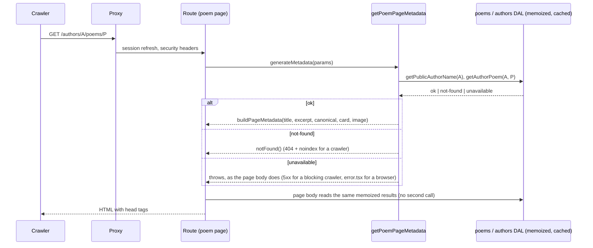
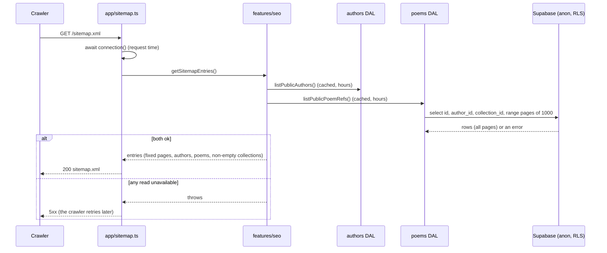

## Context

The root layout exports one static `metadata` (`siteConfig.name`, `siteConfig.description`), and every page inherits it, so all pages share one title and description. There is no `metadataBase`, `robots.ts`, `sitemap.ts`, Open Graph or Twitter data (`grep` finds `metadata` only in `src/app/layout.tsx`). `public/` does not exist; the proxy's matcher skips any path with a dot, so `/robots.txt`, `/sitemap.xml` and `/og-default.png` bypass the session refresh and the redirect.

Facts that shape the design:

- Cache Components is on. `generateMetadata` follows the rules of components: reading `params` is runtime data, uncached external data is an error unless the page is otherwise dynamic, and a metadata function may not be wrapped in `<Suspense>` (Next docs, generate-metadata, "With Cache Components").
- The public poem, author and collection pages await `params` only inside a Suspense boundary and call `notFound()` there. A `notFound()` inside a streamed boundary is a soft 404: the screen is the not-found UI, the status is 200 (`PoemPage` comment, and the open follow-up in `PROGRESS.md` about collection pages in a production build).
- The public reads are already memoized per request (`getPublicAuthor`, `getPublicAuthorName`, `getAuthorPoem`, `getPublicCollection`; ADR 0008) over one `"use cache"` entry per author, so metadata can share them at no cost.
- Contentful's content-page read is cached per entry key (`content-page.ts`).
- Supabase caps a response at `max_rows = 1000` (`supabase/config.toml`; the hosted setting defaults the same).
- Hosting is Vercel (ADR 0017): `VERCEL_PROJECT_PRODUCTION_URL` is a system variable there; preview deployments are `noindex` by Vercel itself.
- Navigation to `/account/**` signed-out is redirected by the proxy before rendering; `/admin/**` shows the soft 404 to non-admins.

## Goals / Non-Goals

**Goals:**

- The requirements of `page-metadata` and `crawler-discovery`.
- Metadata that costs no extra read and cannot break a page that works.
- One place that knows how a title, a description, a canonical, a card and a `noindex` are written, so a new page copies a one-line call, not a block of tags.
- Private pages inherit nothing that looks like a card.

**Non-Goals:**

- JSON-LD, generated per-poem images, `lastmod`, favicon set and manifest, RSS, search-engine verification tags, sitemap sharding (listed in the proposal as follow-ups).
- Changing what a page shows, its routes, or its data model. No migration.
- A real 404 status for browsers (a person opening a removed poem still sees the soft 404 screen; only crawlers are served the status, D4).
- Per-page titles inside `/account/**`: one group title only.

## Decisions

### D1. Pure builders in `shared/lib/seo`; one metadata function per feature

`src/shared/lib/seo/` holds feature-agnostic, server-only code:

- `site-url.ts`: `getSiteUrl()`: `SITE_URL`, then `https://` + `VERCEL_PROJECT_PRODUCTION_URL`, then `http://localhost:3000`; an invalid value is logged once per server process, behind a module-level flag, and skipped (FR-11); the tests reset the flag between cases.
- `plain-text-excerpt.ts`: `toPlainTextExcerpt(markdown, limit)` (NFR-4).
- `page-metadata.ts`: `buildPageMetadata({ title, description, path, type, image })` returns a complete `Metadata` (title, description, `alternates.canonical`, `openGraph`, `twitter`); `buildNoIndexMetadata({ title, follow, canonicalPath? })` returns only `title`, `robots` and, when `canonicalPath` is given (login and sign-up), `alternates.canonical`; `FALLBACK_METADATA` (the site title and description).
- constants: `DEFAULT_SHARE_IMAGE_PATH = "/og-default.png"`, `DESCRIPTION_MAX_LENGTH = 160`, `OG_LOCALE = "ru_RU"`, the `/auth` and `/api` path constants, named once here (`ACCOUNT_PATH` and `ADMIN_PATH` come from `shared/config`). The robots rules have one consumer, so `buildRobots` lives in `features/seo/model/robots-rules.ts` (D5, D6), not here.

Each feature that owns a public page adds an optional `metadata/` folder (a new role, like `pages/`): `features/poems/metadata/poem-page-metadata.ts` (`getPoemPageMetadata(authorId, poemId)`), `features/authors/metadata/…` (`getAuthorPageMetadata(id)`, `AUTHORS_PAGE_METADATA`), `features/collections/metadata/…`, `features/content-page/metadata/…` (`getContentPageMetadata(key)`). Each reads through the page's own memoized read, then calls the builder. They are exported through the feature's `index.ts`, and route files only forward: `export function generateMetadata({ params }) { return getPoemPageMetadata(…) }`.

Why not one central `seo` module that knows poems, authors and collections: it would import three features' internals or all three public APIs for text rules only the owner knows (the poem's first lines, the author's name). Why not inline tags in each route file: it breaks "app/ is routing only" and repeats the title, card and canonical code in a dozen files. `shared/lib` is allowed here from its first use because the builders are used by four features at once (`docs/architecture.md`, "Don't create a `shared/` abstraction until a second feature actually needs it").

### D2. The root layout holds only the base and the title template; every public page sets its own full metadata

Next merges metadata shallowly: a child's `openGraph` replaces its parent's whole `openGraph`, and a field set on a parent is inherited by every child, the signed-in pages included. So the root layout keeps only `metadataBase: new URL(getSiteUrl())` (from a `generateMetadata()` that reads no runtime data, so it stays prerenderable and `getSiteUrl()` runs at use, not at import, D10) and `title: { default: siteConfig.name, template: "%s | Поэтический Хаб" }`. The root `description` moves out. Every public page calls `buildPageMetadata` itself (a static `metadata` export for the fixed pages, `generateMetadata` for the dynamic ones), including the home page (`title: { absolute: … }`). A test lists the page files under `app/(public)/` and fails for one that exports neither (the pattern of `breadcrumbs-slot.test.ts`), so a new public page cannot ship without metadata.

Alternative: defaults in the `(public)` layout and only overrides in pages. Rejected: the canonical and `og:url` differ per page and have no sensible default, and a layout default for a page that forgot to override would publish a wrong canonical.

The `(authorized)` layout exports `metadata = buildNoIndexMetadata({ title: "Личный кабинет", follow: false })` (FR-6); the two admin pages export their own title through the same call. They inherit nothing but `metadataBase` and the title template, so no `description`, `og:` or `twitter:` tag appears.

### D3. Metadata shares the page's reads and never throws except for `notFound`

`getPoemPageMetadata` calls `getPublicAuthorName`, then `getAuthorPoem`: the same memoized calls the page body makes, so one request reads once (NFR-1). Results map as:

| Read result | Metadata | Status effect |
| --- | --- | --- |
| `ok` | full metadata (FR-1 to FR-5) | none |
| `not-found` | `notFound()` (D4) | 404 for a crawler |
| `not-found` of a content page's entry (`/about`, `/privacy`) | `notFound()` too, so a crawler gets 404; the page body's own handling (an error screen today) is not changed by this change | 404 for a crawler |
| `unavailable` | the metadata throws the same error the page body throws | a crawler that gets blocking metadata gets a 5xx and retries; a browser gets `error.tsx` as today |
| an unexpected exception in the metadata's own code (the excerpt, the builder) | `FALLBACK_METADATA` | none; the page is unaffected |

`notFound()` is called outside any `try`, since it works by throwing. A failed read is not caught to a fallback, because the page body shares the same memoized result and throws to `error.tsx` anyway, so no working page is left to protect; a generic title on a 200 error screen would be a soft error page a crawler could index, and the sitemap makes the opposite choice for the same reason (D5). Only a bug in the metadata code itself falls back, so it can never replace a working page with an error. The spike (1.2) confirms that a thrown error from `generateMetadata` reaches `error.tsx` for a browser; if it does not, the `unavailable` row falls back to `FALLBACK_METADATA`, the risk is recorded as accepted, and FR-1 and FR-10 are amended to say so before group 4.

The canonical path and `og:url` are built from the ids of the read result (lowercase), never from the raw `params`, since `/authors/<UPPERCASE-UUID>` also renders (FR-3). The content pages' read (`getContentPage`) is wrapped in React's `cache`, as ADR 0008 asks of a read that two callers share, so the page and its metadata make one Contentful call on a cold cache.

Under Cache Components, `generateMetadata` reads `params` (runtime data). These pages already read `params` inside a Suspense boundary and so already have a request-time hole; Next then streams the metadata with the rest and raises no error. The spike (group 1) confirms this on the real pages before the rest is built; if a page is judged "otherwise fully prerenderable" the fix is the documented dynamic marker, not caching the metadata.

### D4. A real 404 for crawlers comes from `notFound()` in the metadata step

For a client in Next's `htmlLimitedBots` list the metadata is resolved before the response starts (blocking), so `notFound()` in `generateMetadata` can still set status 404 and add `noindex`; for a browser it streams and the page's own soft 404 stays. This gives FR-10 without changing the page bodies.

"Crawler" and "member of `htmlLimitedBots`" are not the same set. Next's docs say Googlebot executes JavaScript, so it gets streamed metadata and the default list leaves it out (the list names Google's ad and renderer bots, Bingbot, Twitterbot, Slackbot and others). For Googlebot the status would stay 200 and its tags would sit in `<body>`. The fix is the one D9 already provides: add Googlebot (and YandexBot, if the spike finds it missing) to `htmlLimitedBots`. The cost is that metadata blocks the first byte for those bots, which is small here because the reads are cached and memoized. Verified in the spike with a production build (`next build && next start`) for: a removed poem, an unknown author id, an empty collection, each with and without Googlebot in the list.

If the status still stays 200 with the bot in the list, FR-10 is amended to "`noindex` and the not-found screen" (Next adds `noindex` to a not-found response), and the 404 status is recorded as a follow-up. The rest of the change does not depend on it.

### D5. The sitemap is composed in a small `features/seo` feature, from public APIs

`src/features/seo/` has `model/` (pure `buildSitemapEntries(authors, poemRefs)`: the fixed pages, then each author, each poem whose author is in the authors list, and each distinct non-null `collectionId` per author; paths from the owner features' path functions; plus `robots-rules.ts`, D6) and `dal/sitemap-entries.ts` (`getSitemapEntries()`, which calls `listPublicAuthors()` from `authors` and a new `listPublicPoemRefs()` from `poems`, then the pure function). `features/seo` imports the public APIs of `authors` (the list and `authorPagePath`), `poems` (the refs and `authorPoemPath`) and `collections` (`publicCollectionPath` only, so the collection URL is never rebuilt by hand); `breadcrumbs` already composes the same three features' public APIs the same way. `listPublicAuthors` is exported from the authors index by this change. Dropping poem refs of authors absent from the authors list keeps the two lists consistent when their cache lifetimes differ. `app/sitemap.ts` forwards.

`listPublicPoemRefs()` in `poems/dal/` reads `id, author_id, collection_id` from `poems` through the public client, in pages of 1000 ordered by `id` (`.range()`), until a page returns no rows (not until a short page, so a lower hosted cap cannot truncate the list silently); any page error fails the whole read (`unavailable`), so no partial list is cached as complete. It owns a `"use cache"` scope with `cacheLife("hours")` on success and `"seconds"` on failure, and no tag. This departs from ADR 0005's "per-entity tags" on purpose and the new ADR (task 6.2) says so: the list spans every author, so it has no single entity to tag, and one tag per author would run into Next's per-entry tag limit. Staleness is bounded by hours (NFR-5); the page itself answers at once. An alternative, one site-wide tag that every `updateTag(authorWorksTag)` call also expires, would need edits in `poem-management`, `collection-management` and `admin` for a list a crawler reads a few times a day, so it is left out. A poem's collection is public by construction (membership is the poem row's `collection_id`, and the collection's author is the poem's author), so the collection URLs come from the poem refs and no collections read is needed; an empty collection has no poem and so never appears (FR-9).

`sitemap()` calls `await connection()` first, so it is never prerendered at build time: an env-less CI build must not fail, and an `unavailable` result throws, giving the crawler a 5xx to retry instead of a partial 200. Alternative considered: prerender at build and revalidate; rejected because the build would bake in a failure or an empty list, and CI has no database.

### D6. `robots.txt` is static, built from constants

`app/robots.ts` returns `features/seo`'s `buildRobots(getSiteUrl())`: `userAgent: "*"`, `allow: "/"`, `disallow: ["/account", "/auth", "/api"]`, `sitemap: <url>/sitemap.xml`. It is prerendered at build with the build's `SITE_URL`, so the variable must be set in the Vercel build environment (checklist). Disallowing `/account` complements `noindex` (D2): both are kept because a disallowed URL is never fetched, and `noindex` covers a URL a crawler reaches through a stray link. `/admin` is not listed: `robots.txt` is public, so the line would announce the admin page's address, and the page already answers a non-admin with the not-found screen, which Next marks `noindex`.

### D7. Description text from Markdown by a small pure function, not the renderer

`toPlainTextExcerpt` removes the Markdown the editors can produce (emphasis markers, `>` quote and epigraph markers, `#` heading markers, list markers, the `* * *` separator line, the em-space indent), collapses whitespace, and cuts at a word boundary at `DESCRIPTION_MAX_LENGTH` with `…`. `react-markdown` is installed but only as a renderer of React elements; running it for a meta string would pull a parse and a render per request. The input set is small and fixed (`markdown-format.ts`, the `poem` and `about` variants), so the function stays a few lines and is covered by table tests (laziness ladder, rung 6, after rung 4 was checked).

### D8. The share image is explicit, never a file convention

Every `buildPageMetadata` call sets `openGraph.images` and `twitter.images` itself: the poem's `illustrationUrl`, the author's `photoUrl`, else `DEFAULT_SHARE_IMAGE_PATH` (resolved against `metadataBase`). The file conventions (`opengraph-image.png`) are not used, because how a segment-level `openGraph` object interacts with a convention file in a parent segment is not something the docs settle, and an explicit image per page is testable. The default image is `public/og-default.png`, supplied by the owner (Open Question). The two Supabase URLs are already absolute.

### D9. Crawler access is checked, not assumed

Next ships a default `htmlLimitedBots` pattern (the bots that get blocking metadata). Whether it covers Googlebot, Telegram, VK, WhatsApp and Yandex previews is checked in the spike by requesting a poem page from the production build with each user agent and reading the initial HTML. Setting `htmlLimitedBots` **replaces** the default list (Next docs), so the value in `next.config.ts` is the full current default pattern, copied from Next's `html-bots.ts` source for the installed version (read through the link in the docs, not from `node_modules`), plus the missing crawlers, with a comment naming each addition and the Next version it was copied from. No bot name is added on a guess, and the nine-user-agent check is repeated against the final build to catch a default bot lost in the copy.

### D10. `SITE_URL` is a server-side setting, read lazily

Metadata, `robots.ts` and the sitemap run on the server, so no `NEXT_PUBLIC_` prefix. `getSiteUrl()` is called at use, not at import, so a missing value never fails a build or a test; the localhost fallback keeps local development and CI working with no setup. Documented in `docs/environment.md` with a deploy-checklist line (set `SITE_URL` in the Vercel Production build and runtime environment; Preview inherits the production address for canonicals, which is acceptable: previews are `noindex` on Vercel).

## Sequence: a crawler requests a poem page

## Sequence: a crawler requests the sitemap

## Risks / Trade-offs

- [Metadata that awaits `params` raises a Cache Components build error on a page judged fully prerenderable] → the pages already have request-time holes; the spike confirms it on the real pages first, and the dynamic marker is the documented fix.
- [`notFound()` in `generateMetadata` does not yield a 404 status for crawlers in this Next version] → verified first in the spike; FR-10 is amended to `noindex` plus the not-found screen if it does not, and nothing else depends on it.
- [A bug in the metadata code turns a working page into an error page] → an unexpected exception in the excerpt or the builder maps to `FALLBACK_METADATA`; a unit test throws from the builder and asserts the fallback. A failed read is deliberately not caught (D3).
- [Googlebot gets streamed metadata and a soft 404 under the default bot list] → D4: add it to `htmlLimitedBots` (with the full default list, D9), then re-verify.
- [One sitemap cache entry grows with the catalogue; a platform limit on a cache item (about 2 MB on Vercel's data cache, unverified for `"use cache"`) could be reached near 15 000 poems, before the 50 000-URL limit] → the `generateSitemaps` follow-up is keyed to entry size as well as URL count.
- [The sitemap lists a deleted or banned author's URLs for hours] → accepted (NFR-5); the pages answer 404 at once (D4), and a stale URL in a sitemap is something crawlers handle.
- [`listPublicPoemRefs` loads every public poem id into one cache entry] → three short strings per poem; fine to tens of thousands of poems; sharding with `generateSitemaps` is the recorded follow-up before the 50 000-URL limit.
- [A hosted Supabase `max_rows` below 1000] → the loop stops only when a page returns zero rows, not when it returns fewer than 1000, so a lower cap costs extra requests but never truncates.
- [The default image is missing at deploy] → the owner supplies it before deploy (Open Question); the unit test only asserts the URL, so a task verifies the file exists in the repo.
- [Moving the root `description` out leaves error and not-found pages without one] → they are not indexed and not shared; accepted.
- [Preview deployments publish a production canonical] → previews are `noindex` on Vercel; accepted.

## Migration Plan

1. Merge with `SITE_URL` unset: the code falls back and works.
2. Before the deploy: `public/og-default.png` (supplied by the owner on 2026-11-20, committed with this change) is in the repository; set `SITE_URL` in the Vercel Production environment only if the final address differs from Vercel's production URL; then deploy.
3. After the deploy: open the production `/robots.txt` and `/sitemap.xml`, check one poem page's `<head>`, run the preview check (Telegram, VK, WhatsApp) with a real link, and submit the sitemap in Google Search Console and Yandex Webmaster (owner, manual).
4. Rollback: revert the merge; no data or schema is touched.

## Open Questions

- The production address (custom domain or `*.vercel.app`): known only after the first deploy; owner, due 2026-12-04 (see the proposal). It sets `SITE_URL` only if it differs from Vercel's production URL, which the code already uses as the fallback.
